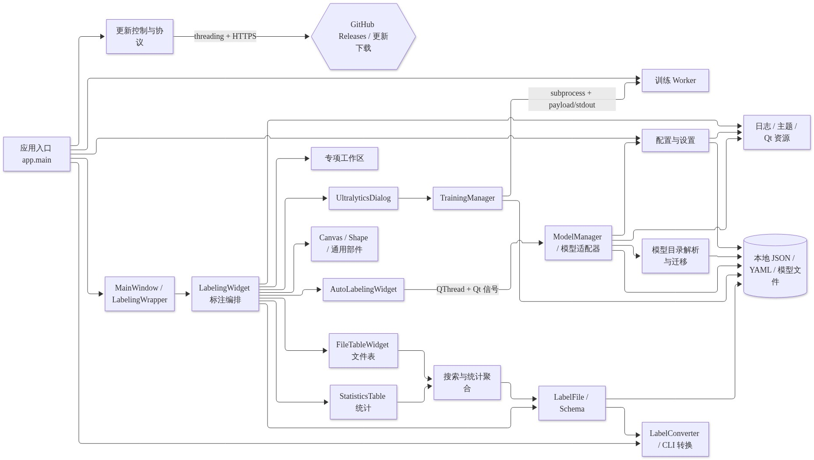
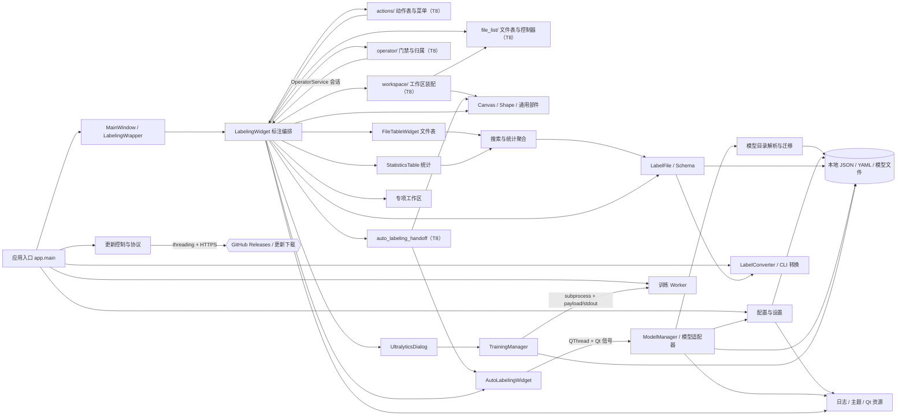
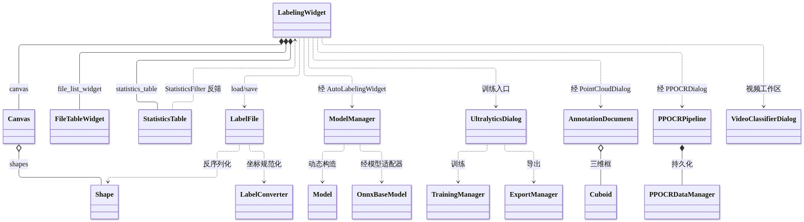
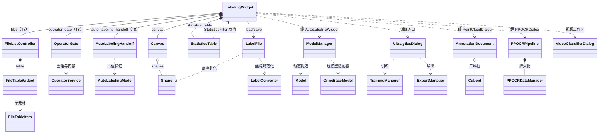
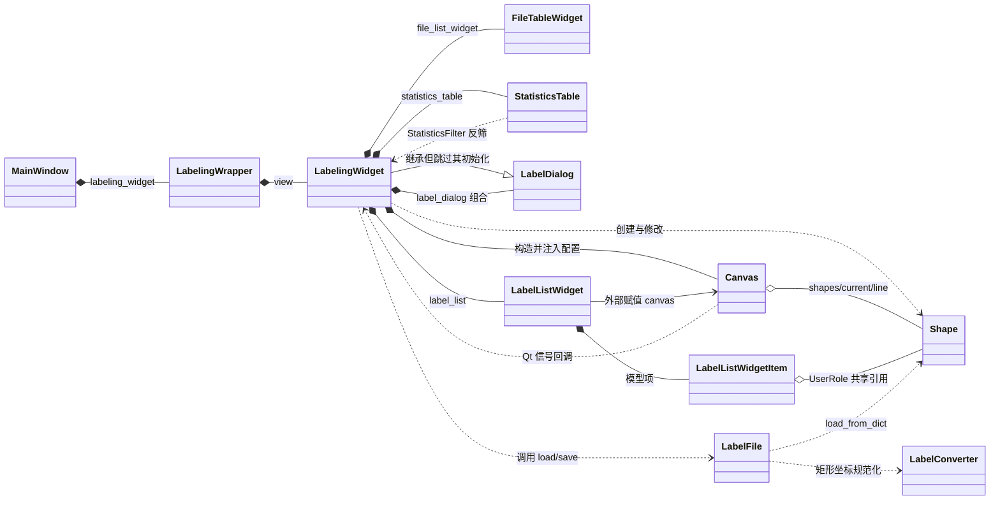
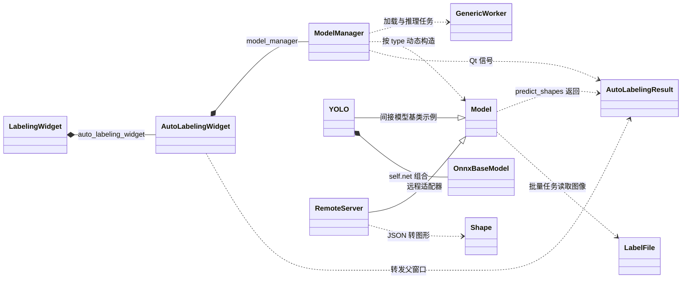
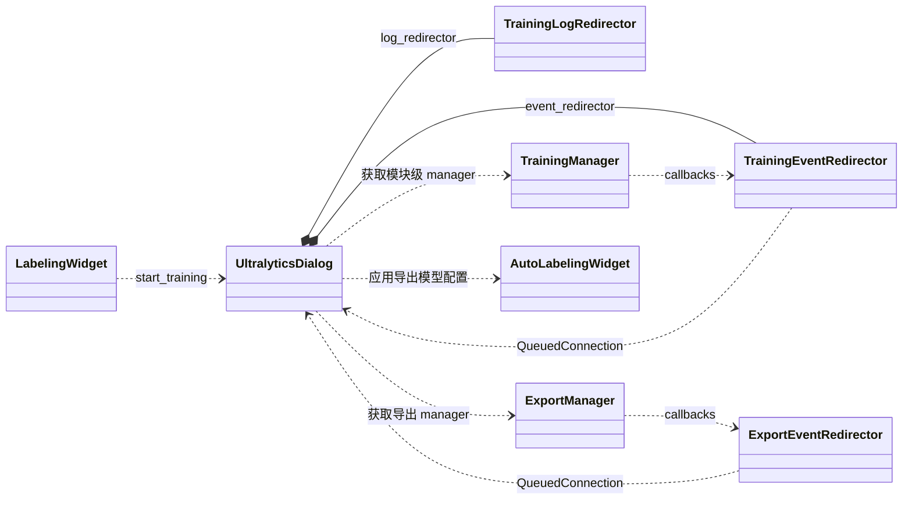
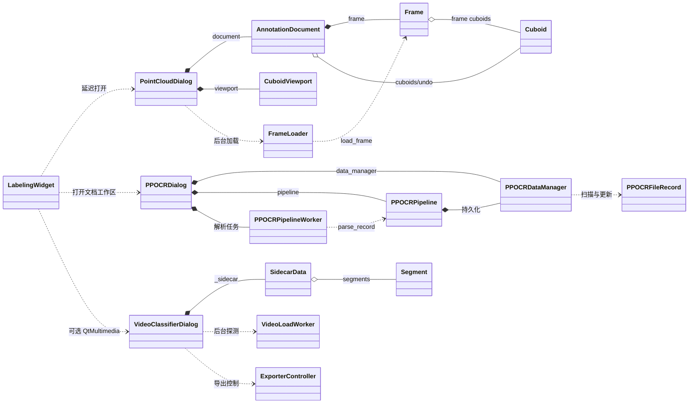

# X-AnyLabeling 代码结构说明（理解与维护）

> 最近核对日期：2026-11-20（Asia/Shanghai）
> 对应版本：4.3.2+fork.28（fork.19 的 T8 拆分未升版；fork.20 为 SAM 编码器 CPU 串行化与编码输出复制；fork.21 为无边框模块多屏最小化/最大化还原修复；fork.22 为文件表多选批量动作与图片标签并入“图像属性”页；fork.23 为标签管理器并入“类别”页；fork.24 为 T3/P1 数据集存储层接入文件表与单图读写；fork.25 为 T3/P2 搜索、统计与类别页接入 DB；fork.26 为 T3/P3a 导入项目与回收站；fork.27 修复普通目录未自动建库/二次打开仍扫 JSON；fork.28 修复 DB 连接未在退出时关闭与旧 sidecar 清理）
> 分析方式：以当前代码为准进行静态阅读、搜索与 AST 统计；fork.21 在真实 Windows 双屏（主屏 100% + 副屏 200%）上用原生消息探测与真实 `MainWindow` 复核窗口行为；fork.22/fork.23 用真实 `MainWindow` 离屏夹具做定向 pytest 与基线导出树对比；fork.24 用 P0 导入器生成 DB 后做离屏 `MainWindow` 打开/保存冒烟，并切回 JSON 目录验证兼容；fork.25 在同一离屏夹具上验证 DB 搜索、统计、类别读取/改名；fork.26 验证导入建库、回收站移动/恢复；fork.27 验证普通目录自动建库与二次打开走库；fork.28 验证 `rel_path`/`file_name`、旧 sidecar 清理、关闭后 WAL/SHM 消失；T3/P0 用 Qt-free 存储层单测验证 schema/导入/往返；其余结论沿用 T8 阶段“基线工作树 vs 重构后”的 pytest 对比与离屏冒烟；各测试包的具体结果见 §16。
> 运行时行为、动态注册、条件导入和实际导入顺序结论可能不完整。上游 4.3.2 的分析内容保留作对照，fork.1/fork.2/fork.4/fork.19(T8)/fork.20(SAM 编码锁)/fork.21(无边框多屏)/fork.22(文件表多选与图像属性页)/fork.23(标签管理器并入类别页)/fork.24(T3/P1 数据集接入)/fork.25(T3/P2 搜索/统计/类别页)/fork.26(T3/P3a 导入/回收站)/fork.27(目录自动建库修复)/fork.28(DB 关闭/sidecar 清理) 已改变的结构以本文当前版本说明为准。
> 行号锚点：T8 把 `label_widget.py` 从 9507 行降到 1776 行、`LabelingWidget.__init__` 从 2816 行降到 239 行，几乎所有历史行号都已失效；本报告中 `label_widget.py` 的行号均为 T8 第二阶段之后的当前值，定位时优先使用类名和方法名（实现多数已移入 §5.11 的模块）。
> 规模口径：本报告的行数一律按 `str.splitlines()` 统计（与 `Get-Content | Measure-Object -Line` 的口径不同，后者会少算），早期章节里的 8949/8768 等数字属于旧口径，已在 §1.1 与 §8 更新。

## 1. 范围与基线

| 项目 | 结论 |
|---|---|
| 项目根目录 | `E:\dev-GitHub\X-AnyLabeling-main` |
| Git 基线 | 分析起点为 `main` / `c7c5518`（fork.3 治理提交）；后续 fork.4–fork.28 的结构变化见 §5/§16，T8 重构（fork.19 内、不升版）见 §5.11，fork.20 的 SAM 编码锁见 §5.3，fork.21 的无边框多屏修复见 §5.7，fork.22 的文件表多选与“图像属性”页见 §4.3/§5.11，fork.23 的标签管理器并入“类别”页见 §4.3/§5.11，fork.24–fork.28 的 T3 数据集接入见 §5.12，实际提交哈希以 Git 记录为准 |
| 版本 | 4.3.2+fork.28，见 [app_info.py](../../anylabeling/app_info.py) |
| 语言 | Python，`requires-python >=3.11`，见 [pyproject.toml](../../pyproject.toml) |
| 主要框架 | PyQt6；ONNX/ONNX Runtime 为可选推理依赖 |
| 构建后端 | setuptools；PyInstaller 用于桌面可执行文件 |
| 主入口 | `xanylabeling = anylabeling.app:main`；亦支持 `python -m anylabeling.app` |
| 包构建 | `python -m build --no-isolation`，见 [build_and_publish_pypi.sh](../../scripts/build_and_publish_pypi.sh) |
| 最近核对日期 | 2026-11-21（T8 两阶段拆分 + fork.20 SAM 编码锁 + fork.21 无边框多屏修复 + fork.22 文件表多选与图像属性页 + fork.23 标签管理器并入类别页 + fork.24 T3/P1 数据集接入 + fork.25 T3/P2 搜索/统计/类别页 + fork.26 T3/P3a 导入/回收站 + fork.27 目录自动建库修复 + fork.28 DB 关闭/sidecar 清理） |

### 1.1 规模与统计口径

当前枚举 `anylabeling` 下有 482 个 Python 文件，`tests` 下有 144 个 Python 文件。AST 与依赖统计仍排除：

- [resources.py](../../anylabeling/resources/resources.py)：生成代码，只分析加载关系；
- `anylabeling/services/auto_labeling/visualgd/model/ops/build` 下 8 个生成 Python 文件；
- `__pycache__` 缓存。

因此当前统计集合为 **474 个 Python 文件、698 个唯一类名**。T3 新增 `anylabeling/services/dataset/` 7 个应用文件 + `widgets/trash_dialog.py` 1 个应用文件，与 `tests/test_dataset_db/` 6 个测试文件（存储层、编解码、导入器、schema 同步、往返与 P1/P2 适配器用例）；P1/P2/P3a 修改 `file_session.py`/`annotation_editor.py`/`file_list/controller.py`/`label_widget.py`/`right_sidebar.py`/`file_search.py`/`label_manager.py`/`actions/`/`repository.py`；未重跑全项目 AST 排名，文件数分母以当前枚举为准。相比 fork.3，新增应用文件来自操作员身份服务包、登录/注册对话框与会话控件、fork.7 的无边框窗口包（`anylabeling/widgets/frameless/` 8 个模块 + `anylabeling/widgets/__init__.py`），以及 T8 从 `label_widget.py` 拆出的 29 个模块（第一阶段：`labeling/actions/` 3、`labeling/file_list/` 4、`labeling/operator/` 2、`auto_labeling_handoff.py`、`constants.py`、`widgets/workspace.py`、`widgets/splitters.py`、`utils/label_text.py`；第二阶段：`annotation_editor`、`file_session`、`object_editor`、`canvas_navigation`、`status`、`appearance`、`label_filters`、`shape_commands`、`draw_modes`、`special_workspaces`、`label_loop`、`relations`、`right_sidebar`、`actions/toolbar`、`widgets/attributes_panel`）；新增测试文件为身份库、归属字段、门禁逻辑、无边框窗口测试与 T3 数据集存储/适配测试。

### 1.2 纳入范围

- 入口、配置、主窗口、标注、画布、标签持久化和格式转换；
- 自动标注、模型下载/加载/推理、自动训练及导出；
- 点云、PPOCR、VQA、聊天、图像分类、视频分类；
- 设置、更新、公共组件、资源加载、构建和发布脚本；
- 测试源码用于静态判断测试引用和维护风险，不据此声称测试通过。

### 1.3 排除或限制深度

- `assets`、`docs`、`examples` 不作为代码结构事实来源，只在需要时定点查阅；
- 第三方依赖源码不分析，只记录本项目对其接口的使用；
- 模型算法、OpenGL/相机投影、PPOCR 富文本编辑器只覆盖公共接口，不逐行展开；
- 测试数据、模型权重、构建产物和生成代码不展开；
- 结构结论不依赖运行时验证；本轮 pytest 临时目录回归受权限阻塞，性能、模型精度、UI 实机表现和全量测试通过率不在范围内。

## 2. 分析计划与执行

| 批次 | 内容 | 执行结果 |
|---|---|---|
| 第 1 批 | 总览、入口、配置、模块级数据流与依赖图 | 已完成 |
| 第 2 批 | 标注主链路、持久化与相关核心类 | 已完成 |
| 第 3 批 | 自动标注、自动训练与相关核心类 | 已完成 |
| 第 4 批 | 专项子系统、支撑设施与外围脚本 | 已完成 |
| 第 5 批 | 解耦、维护指引、问题风险与覆盖声明 | 已完成 |

拟覆盖内容均已覆盖；本报告额外统一了生成文件排除口径，并增加 18 个核心类的总览图。未将计划中的静态分析扩大为运行或调试。

## 3. 入口与配置

### 3.1 应用入口

[app.py](../../anylabeling/app.py) 的 `main()` 是 GUI、格式转换和训练 worker 的共同入口。它先设置线程相关环境变量并解析参数，再通过 `set_work_directory()` 确定工作目录。`help/checks/version/config/convert/train-worker/training-worker` 在 `special` 表中分发并直接返回；GUI 相关模块随后才导入，见 [app.py:261-310](../../anylabeling/app.py#L261-L310)。

GUI 组合链为：

```text
main() → MainWindow → LabelingWrapper → LabelingWidget
```

对应 [app.py:427-449](../../anylabeling/app.py#L427-L449)、[mainwindow.py:35-82](../../anylabeling/views/mainwindow.py#L35-L82)、[label_wrapper.py:8-37](../../anylabeling/views/labeling/label_wrapper.py#L8-L37)。`MainWindow` 负责窗口外壳、状态栏、关闭事件、窗口几何状态，以及把标注工具栏安装到 `ToolsDock`（`QDockWidget`）承载的 `ToolBarScrollArea` 中，实现左侧垂直滚动、顶部水平滚动的可停靠工具栏。工具栏位置和可见性显式保存为 `window/toolbar_area`、`window/toolbar_visible`；旧 `window/state` 在启动和关闭时移除，避免 Qt 恢复浮动工具栏导致 Windows 几何异常，见 [mainwindow.py:84-141](../../anylabeling/views/mainwindow.py#L84-L141)、[mainwindow.py:216-234](../../anylabeling/views/mainwindow.py#L216-L234)。

**维护重点：**把 GUI 或训练依赖移到入口顶层，可能破坏轻量 CLI 的懒加载；隐藏训练命令被子进程实际调用，不能当作死代码删除。修改窗口持久化时，不得重新写回 `window/state` 或绕过显式工具栏键。

### 3.2 配置加载与保存

[get_config()](../../anylabeling/config.py#L198-L230) 的覆盖顺序为：

1. 从包内 [xanylabeling_config.yaml](../../anylabeling/configs/xanylabeling_config.yaml) 读取默认值；
2. 读取用户 YAML 文件或 YAML 字符串，规范化旧键后覆盖默认值；
3. 用 CLI 参数再次覆盖。

默认工作目录为用户主目录，可由 `--work-dir` 改写。用户配置保存到该目录下的 `.xanylabelingrc`，旧 `.anylabelingrc` 在新文件不存在时复制迁移，见 [config.py:131-159](../../anylabeling/config.py#L131-L159)。这些是代码定义的运行时路径，未检查用户机器上的实际文件。

`update_dict()` 对默认配置中不存在的键只记录警告并跳过，见 [config.py:43-53](../../anylabeling/config.py#L43-L53)。界面设置由 [SettingsController](../../anylabeling/views/labeling/settings/controller.py) 修改配置并延迟保存。`QSettings("anylabeling", "anylabeling")` 另用于窗口和界面状态，与 YAML 是两套持久化通道。

**维护重点：**新增配置键通常要同时核对默认 YAML、校验/旧键规范化、设置 schema 和运行时应用逻辑，否则可能出现设置无法持久化或文件值被跳过。

## 4. 模块划分表

划分依据为目录、职责分层及入口调用链。“可插拔”仅指功能边界独立，不表示存在通用插件框架。

| 模块名 | 职责 | 主要目录/文件 | 对外接口 | 依赖模块 | 类型 | 分析深度 | 维护提示 |
|---|---|---|---|---|---|---|---|
| 应用入口 | CLI 分发、GUI 初始化、更新启动 | [app.py](../../anylabeling/app.py)、[app_info.py](../../anylabeling/app_info.py) | `main()` | 配置、主窗口、转换、训练、更新 | 入口 | 深入 | 修改命令参数须同步训练 worker 的命令构造，不能只改帮助文本 |
| 配置与设置 | 默认/用户/CLI 配置合并及保存 | [config.py](../../anylabeling/config.py)、[controller.py](../../anylabeling/views/labeling/settings/controller.py) | `get_config()`、`save_config()`、`SettingsController` | 默认 YAML、日志 | 支撑 | 深入 | 新增键需同步默认 schema 与设置 schema；未知键不会自动加入配置 |
| 主窗口与标注编排 | 文件、图形、菜单、右侧 tab、工具栏及自动标注状态协调 | [mainwindow.py](../../anylabeling/views/mainwindow.py)、[label_widget.py](../../anylabeling/views/labeling/label_widget.py) | `MainWindow`、`LabelingWidget` | 见 §5.11 的 26 个实现模块（外加 3 个包 `__init__.py`） | 核心 | 深入（T8 两阶段后复核） | `label_widget.py` 只剩 1776 行窗口外壳/事件/缩略图/UI 密度与约 150 个一行委托；改构造参数、信号连接或 `__init__` 装配顺序仍会多点联动，具体职责先查 §5.11 |
| T8 视图控制器群 | 标注数据、文件生命周期、对象编辑、缩放导航、属性面板、门禁、自动标注交接、工具栏策略、外观/状态、过滤、绘制模式、关系、引导循环、专项窗口 | [annotation_editor.py](../../anylabeling/views/labeling/annotation_editor.py)、[file_session.py](../../anylabeling/views/labeling/file_session.py)、[object_editor.py](../../anylabeling/views/labeling/object_editor.py)、[canvas_navigation.py](../../anylabeling/views/labeling/canvas_navigation.py)、[widgets/attributes_panel.py](../../anylabeling/views/labeling/widgets/attributes_panel.py) 等 | 见 §5.11 类名与宿主契约 | Qt、`widgets/`、`utils/`、`services/` | 支撑（视图控制器） | T8 新增 | 均为“宿主回调型”无状态控制器：通过 `host` 属性表读写 `LabelingWidget`，本身不持有窗口状态；改宿主属性时须同步对应模块 docstring 的契约表 |
| 动作表与菜单装配 | 创建全部 `QAction`、菜单结构、菜单专用动作、工具条元组 | [actions/builder.py](../../anylabeling/views/labeling/actions/builder.py)、[actions/menus.py](../../anylabeling/views/labeling/actions/menus.py) | `build_actions(host)`、`build_menus(host)` | Qt、`utils.new_action`、`get_icon/get_theme` | 视图装配 | 新增（T8） | 新增动作只在 builder 中定义；新增内容修改类动作必须同步 `OperatorGate.OPERATOR_REQUIRED_ACTIONS`；菜单从 `host.actions` 取动作，不要再引用 `__init__` 局部变量 |
| 工作区装配 | 画布视图、指令栏/面板按钮、操作员条、中央布局、右侧栏、拆分器、会话状态恢复 | [widgets/workspace.py](../../anylabeling/views/labeling/widgets/workspace.py)、[widgets/splitters.py](../../anylabeling/views/labeling/widgets/splitters.py) | `build_canvas_view()`、`build_instruction_bar()`、`build_operator_bar()`、`build_workspace()`、`restore_session_state()` | Qt、`widgets/` 面板、`settings`、`file_list.constants` | 视图装配 | 新增（T8） | 构建函数只装配并设置宿主属性，不持有状态；顺序（画布 → 动作 → 指令栏 → 操作员条 → 工作区 → 会话）不能随意调整 |
| 无边框窗口 chrome | 启动形态二选一、自绘标题栏与窗口按钮、菜单嵌入/显隐、全屏、Windows 原生命中测试 | [widgets/frameless/](../../anylabeling/widgets/frameless) | `FramelessWindow`、`FrameMenuBar`、`TitleBar`、`FramelessTheme` | Qt、`get_theme()`、QSettings（宿主） | 支撑 | 新增 | 模块不依赖业务代码，可整包复制；Windows 原生行为需实机回归；启动后不能切换形态 |
| 文件列表、搜索与统计 | 六列文件表（含标签列）、多选与批量划分/移除/复制、布尔/`split` 查询、类别×划分统计及点击反筛 | [file_list/](../../anylabeling/views/labeling/file_list)（`table.py`、`controller.py`、`constants.py`）、[file_search.py](../../anylabeling/views/labeling/utils/file_search.py)、[dataset_statistics.py](../../anylabeling/views/labeling/utils/dataset_statistics.py)、[statistics_table.py](../../anylabeling/views/labeling/widgets/statistics_table.py) | `FileTableWidget`、`FileListController`、`parse_search_query()`、`filter_image_files()`、`StatisticsTable` | 标注 JSON、文件元数据、配置 | 核心 | fork.22 复核 | 查询语法、统计计数和点击反筛必须共用同一 split/无对象语义；`FileListController` 是行/列/排序/缩略图/多选批量动作的唯一实现，`LabelingWidget` 只有薄委托；改文件表映射时同时检查排序与当前文件索引；只有普通单击和键盘导航会打开图片，扩展选择手势必须由控件自身状态判断 |
| 模型存储目录 | 解析自定义/默认模型目录、迁移及旧目录扫描 | [model_storage.py](../../anylabeling/services/auto_labeling/model_storage.py)、[model.py](../../anylabeling/services/auto_labeling/model.py)、[model_manager.py](../../anylabeling/services/auto_labeling/model_manager.py) | `resolve_model_directory()`、`migrate_model_directory()` | 用户配置、文件系统、模型下载 | 支撑 | 本批补充 | 配置目录优先，默认/旧目录用于兼容扫描；迁移遇同名跳过，失败保留旧文件，修改时不能把它当成全量原子迁移 |
| 画布与通用部件 | 图形编辑、缩放、列表及交互组件 | [canvas.py](../../anylabeling/views/labeling/widgets/canvas.py)、[shape.py](../../anylabeling/views/labeling/shape.py) | `Canvas`、`Shape` | Qt、标注编排 | 核心 | 深入 | `Shape` 同时连接画布、标签列表和文件读写，坐标/字段变更须检查三处一致性 |
| 标签持久化与转换 | XLABEL JSON 读写及多格式转换 | [label_file.py](../../anylabeling/views/labeling/label_file.py)、[label_converter.py](../../anylabeling/views/labeling/label_converter.py)、[converter.py](../../anylabeling/views/common/converter.py) | `LabelFile.load/save()`、`LabelConverter`、`handle_convert_command()` | Shape、schema、本地文件 | 核心 | 深入 | 保存会规范化矩形并合并 `other_data`；改字段时需检查加载兼容和转换器 |
| 数据集数据库存储层（T3/P0–P3a） | SQLite 建库/事务/备份、XLABEL↔DB 编解码、Repository CRUD、XLABEL 目录导入；P1 文件表/单图读写；P2 搜索/统计/类别页；P3a 导入项目/回收站 | [services/dataset/](../../anylabeling/services/dataset)（`connection.py`、`codec.py`、`repository.py`、`importer.py`、`schema.py`）、[trash_dialog.py](../../anylabeling/views/labeling/widgets/trash_dialog.py) | `DatasetDatabase`、`DatasetRepository`、`ImageAnnotation`、`import_xlabel_folder()`；`DatabaseLabelFile`/`FileSession`/`RightSidebarTabs`/`LabelManagerPanel`/`TrashDialog` 适配 | sqlite3、PIL、`schema.py`、`FileSession`、`AnnotationEditor`、`file_search`、`dataset_statistics` | 支撑（存储） | 新增（T3/P0）；P1/P2/P3a 接入 | Qt-free 存储包；P1 由 `FileSession._open_dataset_for_folder/_load_database_folder/_prepare_database_file` 与 `AnnotationEditor._save_database_labels` 调用；P2 用 `statistics_rows()`/`category_counts()`/`rewrite_categories()` 与 `matches_query_label_data()`；P3a 用 `import_xlabel_folder()` 与 `.trash/<image_id>/`。schema 常量须与 `docs/dev/db_design_assets/schema.sql` 保持结构一致（`test_schema.py` 守护）；`save_annotation` 按 uuid upsert、缺失对象软删、回收站用 `deleted_at`。同步/导出/训练尚未接入 DB |
| 操作员身份与标注归属 | 本地账号库、会话状态、未登录门禁与浏览模式、归属盖章判据、JSON 归属字段 | [identity/](../../anylabeling/services/identity)、[operator/gate.py](../../anylabeling/views/labeling/operator/gate.py)、[operator_dialog.py](../../anylabeling/views/labeling/widgets/operator_dialog.py)、[operator_bar.py](../../anylabeling/views/labeling/widgets/operator_bar.py)、[label_file.py](../../anylabeling/views/labeling/label_file.py)、[batch.py](../../anylabeling/views/labeling/utils/batch.py) | `OperatorStore`、`OperatorService`、`OperatorSession`、`OperatorGate`、`get_operator_service()`、`content_signature()`、`stamp_attribution()` | 配置工作目录、`MainWindow`、`LabelingWidget`、自动标注批量写盘、Qt | 支撑 | T8 复核 | 账号库在系统应用数据目录（与 work_dir 无关），旧路径仅作迁移来源；新增修改类动作必须登记到 `OPERATOR_REQUIRED_ACTIONS`；归属只在内容签名变化时盖章，账号不是安全边界；`OperatorGate.baseline/suppress` 是唯一归属基线状态，不要另建字段 |
| 自动标注 | 模型配置、下载/加载、推理和结果回传（服务侧）；结果合并、占位清理与“完成对象”兜底（视图侧交接） | [model_manager.py](../../anylabeling/services/auto_labeling/model_manager.py)、[auto_labeling.py](../../anylabeling/views/labeling/widgets/auto_labeling/auto_labeling.py)、[auto_labeling_handoff.py](../../anylabeling/views/labeling/auto_labeling_handoff.py) | `ModelManager`、`AutoLabelingWidget`、`AutoLabelingHandoff` | 配置、模型适配器、标注 UI、画布/标签列表 | 核心 | T8 复核 | 模型 `type`、模型清单、动态类映射和适配器构造参数必须同步；合并规则（replace/追加、关系、flags/tags、占位清理）集中在 `AutoLabelingHandoff`，`LabelingWidget` 只保留同名委托 |
| 自动训练 | 训练配置、进程启动、事件回传与导出 | [ultralytics_dialog.py](../../anylabeling/views/training/ultralytics_dialog.py)、[trainer.py](../../anylabeling/services/auto_training/ultralytics/trainer.py) | `UltralyticsDialog`、`TrainingManager` | 标注 UI、训练 worker、Ultralytics | 核心 | 深入 | payload、stdout 事件协议和隐藏 CLI 命令是跨进程契约，需成套修改 |
| 专项工作区 | 点云、PPOCR、VQA、图像/视频分类、聊天 | `views/labeling/{pointcloud,ppocr,vqa,classifier,video_classifier,chatbot}` | `LabelingWidget.open_*()` | 主标注窗口、各自服务与工具 | 可插拔 | 主链路深入、算法选读 | 视频分类依赖可选 QtMultimedia；点云采用延迟导入，不能移除异常和空值分支 |
| 更新服务 | 版本检查、下载和安装协调 | [update_controller.py](../../anylabeling/views/labeling/utils/update_controller.py)、[protocol.py](../../anylabeling/services/updates/protocol.py) | `UpdateController.check()` | 网络、主窗口、本地安装目录 | 支撑 | 主链路分析 | 控制器在窗口创建后附加；关闭流程依赖 `closing/prepare_for_close()` 防止迟到回调 |
| 公共资源与工具 | 日志、主题、Qt 工具、翻译资源 | [logger.py](../../anylabeling/views/labeling/logger.py)、[resources.py](../../anylabeling/resources/resources.py) | 工具函数、Qt 资源 | PyQt6 等第三方库 | 支撑 | 选读 | 资源 import 被入口用于翻译加载，不能仅因无直接调用而删除 |
| 构建、测试与脚本 | 打包、发布及回归测试 | [pyproject.toml](../../pyproject.toml)、[conftest.py](../../tests/conftest.py)、`packaging`、`scripts`、`tests` | 构建命令、pytest 配置 | 全部运行时模块 | 外围 | 抽样 | pytest 一次性文件按进程写入 `temporary/runs`，可复用缓存写入 `temporary/cache/pytest`；发布脚本会同时构建并上传，不是纯本地构建命令 |

## 5. 模块级数据流

### 5.1 启动与配置

CLI/默认 YAML/用户 YAML → `get_config()` → `MainWindow` → `LabelingWidget`；界面设置再经 `SettingsController` 写回用户 YAML。窗口尺寸等另写入 `QSettings`。翻译和模型 YAML 通过包资源读取，因此打包配置属于运行链路的一部分。

### 5.2 图像标注与持久化

图像或同名 JSON → [LabelingWidget.load_file()](../../anylabeling/views/labeling/label_widget.py#L4548-L4799) → `LabelFile` 读取 JSON/图像字节 → `Shape`、Canvas 和标签列表。

保存时，[save_labels()](../../anylabeling/views/labeling/label_widget.py#L3758-L3811) 将列表中的 `Shape` 转为字典；[LabelFile.save()](../../anylabeling/views/labeling/label_file.py#L166-L230) 生成 XLABEL JSON，先写同目录临时文件，再用 `os.replace()` 替换目标文件。此链路使用本地文件，不涉及数据库。fork.4 起该链路在写盘前调用 `_prepare_attribution()`（T8 后实现在 [OperatorGate.prepare_attribution()](../../anylabeling/views/labeling/operator/gate.py)），内容签名变化且已登录时才写入 `author`/`modified_at`；签名基线保存在 `OperatorGate.baseline`。

独立 CLI 转换链为：`app convert` → `handle_convert_command()` → `LabelConverter` → 本地格式文件，不创建 GUI。

### 5.2A fork 文件表、统计与模型目录

文件表由 [FileTableWidget](../../anylabeling/views/labeling/file_list/table.py)（`QTableWidget`）展示文件、对象、导入时间、推理、划分和标签等列，行/列/排序/缩略图/多选批量动作规则集中在 [FileListController](../../anylabeling/views/labeling/file_list/controller.py)，`LabelingWidget` 只保留 `fn_to_index` 与少量薄委托；右侧对象/类别/图像属性/描述/统计使用 `QTabWidget`，与文件表通过纵向 `QSplitter` 调整比例，布局装配见 [workspace.build_workspace()](../../anylabeling/views/labeling/widgets/workspace.py)。

fork.23 起，**“类别”页就是标签管理器**（[LabelManagerPanel](../../anylabeling/views/labeling/widgets/label_manager.py)）：表格按当前文件列表扫描出的类别列出 `Category`（可编辑）/`Delete`/`Visible`/`Lock`/`Color`，底部 `From`/`To`/`Go` 是唯一的写盘边界；原 `LabelModifyDialog` 模态窗口已删除，`工具 → 标签管理器` 与 `Alt+L` 只负责切页。`unique_label_list` 不再显示，仅作为“类别 → 颜色/锁定”的会话登记表保留。浏览模式下整张表只读（`OperatorGate.apply()` 调 `set_editing_enabled()`）。

fork.22 起，**图片级元数据只有一处编辑入口**：右侧 `flags` 页标题为“图像属性”，页内自上而下是图片标签编辑器（`ImageTagsWidget`）与图片标志列表（`flag_widget`）；原先画布下方的图片标签条已移除，画布区域不再被它占用。`right_sidebar.ALWAYS_VISIBLE_TABS = ("flags",)` 使该页不可隐藏，`show_image_tags` 动作（`Ctrl+Shift+T`/标题栏按钮）改为“切到该页并聚焦标签控件”。文件表的 `标签` 列是不切页也能看到标签的出口，`FileListController.set_row_tags()` 负责“编辑后尚未保存”时的即时更新。

搜索链为：搜索文本 → `parse_search_query()` → `filter_image_files()` → 标注 JSON/文件元数据 → 过滤后的文件表。`,` 为 AND、`|` 为 OR、`!` 为取反，`split::` 和 `shape::` 与旧条件共用解析链，见 [file_search.py](../../anylabeling/views/labeling/utils/file_search.py)。

统计链为：当前图片集合 → `collect_entries()` 读取标注 → `build_class_split_table()` → `StatisticsTable.set_entries()`；点击单元格产生 `StatisticsFilter`，再由 `LabelingWidget` 转成搜索文本反筛。类别单元格按“包含该类别的图片数”计数，总计行按文件数计数，两者不能混加，见 [dataset_statistics.py](../../anylabeling/views/labeling/utils/dataset_statistics.py)、[statistics_table.py](../../anylabeling/views/labeling/widgets/statistics_table.py)。

模型下载链增加了目录解析：`model_directory` 配置优先，否则使用默认目录；旧数据迁移失败时保留旧位置。`ModelManager` 扫描已下载文件时先查配置目录，再兼容默认和旧目录。迁移函数逐项移动、同名跳过并收集错误，见 [model.py:170-186](../../anylabeling/services/auto_labeling/model.py#L170-L186)、[model_storage.py](../../anylabeling/services/auto_labeling/model_storage.py)。

### 5.3 自动标注

`AutoLabelingWidget` 创建 `ModelManager`，并将推理结果信号转给父级 `new_shapes_from_auto_labeling()`，见 [auto_labeling.py:118-145](../../anylabeling/views/labeling/widgets/auto_labeling/auto_labeling.py#L118-L145)。

模型列表来自 [models.yaml](../../anylabeling/configs/models.yaml) 和用户自定义模型配置；`ModelManager` 按 `type` 延迟导入适配器。加载和推理均可放入 **QThread**，结果通过 Qt 信号返回标注状态，见 [model_manager.py:1122-1207](../../anylabeling/services/auto_labeling/model_manager.py#L1122-L1207)。

模型权重通过 HTTPS 下载，远程服务通过 HTTP 请求，均构成网络边界；已存在的 `.onnx/.pth/.pt` 缓存还可经 **multiprocessing.spawn 子进程**校验。

**SAM 内存与编码串行化（fork.20）：**SAM ViT 编码器的全局注意力需要一次性分配约 1 GiB，单次编码峰值约 5 GB；`segment_anything` 属于 `_ON_NEXT_FILES_CHANGED_MODELS`，后台预加载与交互编码并发时峰值约 10.5 GB。[encoder_lock.py](../../anylabeling/services/auto_labeling/encoder_lock.py) 的 `cpu_encoder_lock(providers)` 在 CPU-only 环境返回进程级共享锁，`sam_onnx.py`/`sam_hq.py`/`grounding_sam.py`/`sam_med2d.py`/`__base__/sam.py` 的 `run_encoder` 已接入，峰值降为单次编码水平；GPU/加速 provider 不加锁以保留预加载并行。新增 SAM 适配器时应沿用该锁，否则并发预加载仍可能 OOM。

**另一个已修复的累积问题：**ORT `InferenceSession.run()` 返回的 numpy 数组是会话 arena 的视图（`owndata=False`）；`image_embedding_cache` 缓存视图会让整个约 4 GB 的 arena 在 session 关闭后仍不释放（表现为每张图 +4 GB、切图不回收）。`sam_onnx.py`/`sam_hq.py` 的 `run_encoder` 现在先复制输出（`np.array(..., copy=True)`）再释放 session；新增会缓存编码输出的适配器时必须复制，不能缓存 ORT 视图。

### 5.4 自动训练与导出

标注 UI → `UltralyticsDialog` → `TrainingManager` → 临时 JSON payload → **subprocess.Popen 子进程** → 训练 worker。

父进程用 Python 线程读取子进程 stdout，将带前缀的 JSON 事件转为 UI 回调。导出 ONNX 后可生成自定义模型 YAML并回到自动标注，形成：

```text
标注数据 → 数据集 → 训练权重 → ONNX → 自动标注自定义模型
```

### 5.5 专项工作区与更新

- 点云：BIN/PLY/PCD → `FrameLoader(QThread)` → `Frame/AnnotationDocument` → `.label`、`.cuboids.json` 或数据集压缩包；
- PPOCR：图像/PDF → `PPOCRPipelineWorker` → 官方异步 API或自建远程服务 → JSON、预览页和块裁剪图；
- VQA/图像分类：写回主窗口 `other_data` 或 flags，由主 `LabelFile` 链路保存；
- 视频分类：视频 → `SidecarData` → 同名 sidecar JSON；导出经 ffmpeg 子进程；
- 更新：检查和下载使用 Python 线程及 HTTPS，安装 helper 是独立进程。

### 5.6 操作员身份与标注归属（fork.4）

```text
注册/登录 → OperatorStore(SQLite) → OperatorSession → OperatorGate 门禁
                                              ↓
标注内容/tags 变化 → content_signature 比对 → stamp_attribution → XLABEL JSON
```

- 账号库固定在系统应用数据目录（Windows `%APPDATA%\X-AnyLabeling\operators\operators.db`，Linux/macOS 对应 XDG/Application Support），与 `--work-dir` 无关；旧路径 `<work_dir>/xanylabeling_data/operators/operators.db` 只作为首次复制迁移来源。库中只存账号，不存标注内容；口令用标准库 PBKDF2-HMAC-SHA256 加每用户 salt。首个注册账号成为管理员，账号只禁用不删除，`none` 为保留名（大小写不敏感禁止注册）。
- 会话为进程级单例，只存在于内存，关闭软件即失效；`get_operator_service()` 是唯一访问点，`reset_operator_service()` 供测试替换。
- 未登录为“浏览模式”：`OPERATOR_REQUIRED_ACTIONS` 中的动作、图片 tags 控件和批量自动标注入口被禁用；浏览、训练、评估、导出、切换 split、导入外部标注不受影响。T8 后这些策略由 [OperatorGate](../../anylabeling/views/labeling/operator/gate.py) 统一执行，`LabelingWidget._apply_operator_gate()` 等只是薄委托。
- 写入保护与盖章：`save_labels()`/`save_attributes()` 先用 `content_signature()` 比对内容签名，只有标注内容、flags、tags、description 或 relations 变化才写 `author`/`modified_at`；勾选 `checked`、切换 `split` 不更新归属。内容确实变化但无操作员时可拒绝写盘，不会伪造作者；签名基线与 `suppress` 标志是 `OperatorGate.baseline`/`OperatorGate.suppress`。
- 旧文件与导入数据统一按 `author="none"` 读取（[label_file.py](../../anylabeling/views/labeling/label_file.py) 的 `ensure_attribution`），不反推文件修改时间；自动标注批量写盘（[batch.py](../../anylabeling/views/labeling/utils/batch.py)）按发起批量运行的操作员盖章。
- 界面表现：`MainWindow` 把 `OperatorBar` 放在菜单栏右上角 corner widget、把 `AttributionLabel` 放在状态栏永久控件，二者都不占画布高度；独立嵌入且无菜单栏时回退到画布上方。未登录时工具置灰，这是刻意的可见状态，不是缺陷。
- 契约同步：`docs/开始.md` §10、[讨论稿 §12A](数据库设计-讨论稿.md)、[设计书 §3.4](工业机器视觉数据平台-设计书-v1.6.md) 记录同一契约；账号库为应用级、项目库为数据级，不共享存储、不做外键。项目数据库的操作者列尚未落地，见 T6。
- 已知边界：点云、PPOCR、VQA、图像分类、视频分类等专项工作区不在本批门禁和归属范围内；自动标注面板按钮本身未置灰，依赖写入保护兜底；归属只记最后修改人，不保留历史（历史/单一权威仍留给 T3 的数据库与 revision 审计）。

### 5.7 窗口 chrome 与启动形态（fork.7）

```text
启动 → _resolve_frameless(config / XANYLABELING_NATIVE_FRAME)
      ├─ true  → setMenuWidget(TitleBar(菜单栏 + 宿主按钮 + 窗口控制))
      └─ false → setMenuBar(QMenuBar) + 原生标题栏
菜单构建 → LabelingWidget.menu() → MainWindow.menuBar() → FrameMenuBar
```

- `MainWindow` 继承 [FramelessWindow](../../anylabeling/widgets/frameless/window.py)，启动时按 `frameless` 配置（默认 `true`）或环境变量 `XANYLABELING_NATIVE_FRAME` 决定形态；**运行中不切换**，切换需重启。
- 无边框模式用 `setMenuWidget()` 把自绘标题栏放在菜单栏区域，标题栏内嵌真实 `QMenuBar`；因此 `LabelingWidget.menu()`、子菜单、`Alt` 激活与快捷键都不用重写。工具条、状态栏、dock 仍由 `QMainWindow` 管理。
- 菜单显隐：`FrameMenuBar` 通过 `QAction.setVisible(False)` 隐藏顶层菜单入口，`menu_visibility_changed` 由 `MainWindow` 持久化到 `frameless/menu_visibility`；隐藏后快捷键仍有效。菜单溢出交给 Qt 内建的 menubar extension 按钮，不自绘折叠逻辑。
- 全屏：`F11` 动作加入“视图”菜单；首版全屏保留标题栏，退出恢复进入前的最大化/普通状态。
- 窗口状态：`window/size`、`window/position` 恢复时用 `window_state.clamp_geometry()` 做多屏可见性校正；新增 `window/maximized` 持久化。
- 主题：`MainWindow.apply_theme(get_theme())` 生成标题栏/菜单栏 QSS，浅色模式不再依赖系统调色板；窗口激活/失活由 `FramelessWindow.event()` 切换标题颜色。
- 状态栏：`DocumentStatusBar` 左侧常驻 `[x,y|绝对路径]`；临时消息写入独立标签，应用层过滤器拦截 `QStatusTipEvent`，因此状态提示不会隐藏文档信息。
- Windows 原生能力（fork.21 更新）：`nativeEvent()` 只处理 `WM_NCCALCSIZE`（收回客户区）与 `WM_NCHITTEST`（缩放/命中）；其他平台用 `QWindow.startSystemResize()` 兜底。
  - `WM_NCHITTEST`：`lParam` 是物理屏幕坐标，先用 `ScreenToClient()` 转成本窗口客户区物理坐标，再与 `GetClientRect()` 的物理尺寸、`round(resize_margin * dpr)` 比较后返回 `HT*`；**不得**把全局物理坐标除以 `devicePixelRatio`——混合 DPI 副屏的逻辑原点不等于物理原点除以缩放，会把窗口中心误判成边框（fork.20 及以前的实现正是如此，fork.21 修复）。
  - **不再覆写 `WM_GETMINMAXINFO`**：实测 Qt/Windows 对 `WS_THICKFRAME` + `WM_NCCALCSIZE=0` 的无边框窗口已能最大化到工作区（主屏 1920×1032、200% 副屏 1536×912）；自写 `ptMaxSize`/`ptMaxPosition` 会让 200% 副屏上的窗口最大化到主屏，并污染还原 geometry。回归用例 `test_getminmaxinfo_is_not_overridden` 守门。

### 5.8 工具栏、导入入口与状态提示（fork.13，fork.17 更新）

```text
工具栏：ToolBar(QToolBar) → ToolBarScrollArea(QScrollArea) → QDockWidget(ToolsDock) → 左/顶停靠
       左侧：Vertical + 垂直滚动条按需；顶部：Horizontal + 水平滚动条按需
导入：文件列表右键 / 搜索框“+” → 单文件导入（追加）或文件夹导入（重建列表）
状态：画布 mouse_position_changed → [x,y|路径]；形状尺寸/长度提示不再带坐标
```

- 工具栏默认停靠左侧；`window/toolbar_area_scheme` 做一次性迁移，之后用户选择优先。
- `MainWindow._install_toolbar()` 创建无标题栏、不可浮动/关闭的 `ToolsDock`，把 `ToolsToolBar` 放进 `ToolBarScrollArea`；`_apply_toolbar_area()` 负责切换 `Vertical/Horizontal` 方向与滚动条策略，`dock_toolbar()` 只切换停靠区，不再把工具栏直接 `addToolBar()`。
- `ToolBarScrollArea.sizeHint()/minimumSizeHint()` 按工具栏自然宽度（左侧）或高度（顶部）加滚动条宽度申请停靠尺寸，避免顶部按整条工具栏超宽尺寸布局；`wheelEvent()` 把滚轮转给当前方向滚动条。
- 按钮短标签由 `LabelingWidget._short_tool_label()` 生成并写入 `QAction.iconText`；`ToolBar` QSS 使用 `min-width/min-height` 让按钮随文字自适应；按钮再按内容 `setFixedSize`，不再依赖 QToolBar extension 折叠。
- 工具栏不插入 `None` 分隔符：`populate_mode_actions()` 只添加真实动作，避免竖向工具栏把分隔符渲染成深色空块。
- `refresh_toolbar_geometry()` 在 `populate_mode_actions()`、`apply_toolbar_preferences()` 与方向切换后调用 `adjustSize()` 并刷新滚动区尺寸。
- 设置窗口新增“工具栏”页（`SETTINGS_PRIMARY_ORDER` 中的 `Toolbar`）：显示/隐藏标签、全选、逐项显隐；写入 `toolbar/show_labels`、`toolbar/hidden_actions`，`populate_mode_actions()` 按索引过滤。
- 导入入口复用 `import_files_dialog()`（追加）与 `open_folder_dialog()`（重建），右键菜单允许空列表使用。
- 状态栏消息标签位于文档标签之前，临时提示不会把文档信息推到右侧或隐藏。

### 5.9 浏览模式与登录守卫（fork.18）

```text
登录态：OperatorSession.is_logged_in
        ├─ True  标注模式：tools 可用、画布可编辑、chip 显示操作员名
        └─ False 浏览模式：13 个模式工具可点（点击弹登录）
                          16 个内容修改动作禁用
                          Canvas.set_read_only(True)：可缩放/平移/选中，不可改
                          画布左上角 browse_mode_badge + 标题栏琥珀色 chip
写保护：保存时 _prepare_attribution() → _ensure_operator() 仍会要求登录
```

- 动作集合拆分：`OPERATOR_MODE_ACTIONS`（`create_*`、`edit_mode`、`edit_brush_mode`）在浏览模式下保持可用，点击后由入口守卫弹出登录；`OPERATOR_REQUIRED_ACTIONS`（编辑标签、删除、复制/粘贴、撤销、关系、分组、管理器、批量运行）在浏览模式下禁用。
- 入口守卫：`LabelingWidget._ensure_operator_for_edit()` 被 `toggle_draw_mode()`（创建类唯一入口，含数字快捷键、画笔、魔棒与自动标注交接）、`toggle_brush_mode()`、`_enter_edit_mode_from_toolbar()` 调用；取消登录时回退状态并在状态栏提示，不再静默失败。
- 画布只读：`Canvas.set_read_only()` 置位后在 `bounded_move_shapes()`、`bounded_move_vertex()`、`move_cuboid_face_by()`、`_update_rotation_handle_drag()`、`add_point_to_edge()` 与 `mouseDoubleClickEvent()` 早退；缩放、平移、选中不受影响。
- 状态提示：`OperatorBar` 未登录用 `warning_text` 色加粗显示；`LabelingWidget.browse_mode_badge`（视口左上角浮层，点击登录）在登录后隐藏，位置由 `_position_browse_mode_badge()` 跟随视口尺寸。
- 主题禁用态：`DARK/LIGHT` 的 `text_disabled`（`#6e6e73` / `#a1a1a6`）用于 palette Disabled 组、`QMenu::item:disabled` 与 `QToolButton:disabled`；`warning_text`（`#FF9F0A` / `#8A5300`）用于浏览模式 chip 与画布浮层文字（浅色下琥珀色对比度不足，故分主题取值）；`utils.qt.with_disabled_variant()` 为图标生成 32% 不透明度的 Disabled 位图，`new_action()` 统一套用。
- 画布右键菜单：`actions.canvas_menu`（13 个动作 + 2 个分隔符；加上预置的筛选×2 与检查状态，菜单共 16 项可点条目）取代原 29 项 `actions.menu`；工具模式项只保留在工具栏与“编辑”菜单。

### 5.10 自动标注占位对象与工具栏固定按钮（fork.19）

```text
自动标注结果（追加模式）
  → 清理旧 AUTOLABEL_OBJECT 占位：对象列表行 + canvas.shapes 同时删除
  → load_shapes(新结果, replace=False)
完成对象：finish_auto_labeling_object()
  → _auto_labeling_list_item(shape)：缺行时按需补建，补不出则跳过
```

- 根因：旧实现只删占位对象的列表行、不删画布形状，第二次结果后留下“有形状无行”的孤儿，`finish_auto_labeling_object()` 对 `None` 调用 `setText` 崩溃（fork.19 修复）。
- `_auto_labeling_list_item(shape)` 是“完成对象”两个循环的唯一取行入口：先查 `find_item_by_shape()`，缺失时 `add_label(..., update_last_label=False, refresh_filters=False)` 补建；仍取不到则跳过，保证历史孤儿与中断会话不会再次崩溃。
- `clear_auto_labeling_marks()` 改为判空后删行（`remove_item(None)` 抛的是 `TypeError`，原 `except ValueError` 捕获不到）。
- 工具栏固定按钮：`_utility_toolbar_entries` 保存 `(key, title, action)`；`toolbar_entries()` 追加 `settings`/`shortcuts`；`populate_mode_actions()` 先按 `id()` 跳过 `actions.tool` 里的这两个 `QWidgetAction`，再按 key 决定是否插入，隐藏状态沿用 `toolbar/hidden_actions`。
- 维护提示：`Canvas.end_move(copy=True)` 仍直接向 `canvas.shapes` 追加形状、由调用方负责补建对象行；新增直接改 `canvas.shapes` 的路径时必须同步对象列表，否则会重现 fork.19 的孤儿问题。
- T8 起以上合并/清理/补行逻辑集中在 [AutoLabelingHandoff](../../anylabeling/views/labeling/auto_labeling_handoff.py)（`new_shapes_from_auto_labeling`/`clear_auto_labeling_marks`/`finish_auto_labeling_object`/`_auto_labeling_list_item`），`LabelingWidget` 的同名方法只是委托，排查时先看该模块。

### 5.11 label_widget.py 拆分（T8，两阶段，fork.19 内不升版）

```text
label_widget.py（9507 行 → 1776 行；LabelingWidget 9118 → 1697 行）
├─ 窗口外壳/事件/缩略图/UI 密度 + 约 150 个一行委托            1697 行
├─ actions/builder.py        build_actions(host)：全部 QAction   1660 行
├─ file_session.py           FileSession：打开/导航/保存/删除/导入  789 行
├─ widgets/workspace.py      窗口装配（画布/布局/会话恢复）        790 行
├─ widgets/label_manager.py   LabelManagerPanel：“类别”页标签管理器  641 行
├─ file_list/{table,controller,constants}.py                   1110 行
├─ object_editor.py          ObjectEditor：选择/改名/锁定/显隐      576 行
├─ widgets/attributes_panel.py AttributesPanel：属性控件与保存      554 行
├─ annotation_editor.py      AnnotationEditor：新建/加载/保存/颜色   354 行
├─ canvas_navigation.py      CanvasNavigation：缩放/导航器         421 行
├─ auto_labeling_handoff.py  AutoLabelingHandoff                 428 行
├─ shape_commands.py         ShapeCommands：剪贴板/分组/显隐        321 行
├─ status.py / appearance.py 状态栏/标题/脏标记；主题/语言/提示     291 + 260 行
├─ actions/toolbar.py        ToolbarPolicy                       256 行
├─ operator/gate.py          OperatorGate                        243 行
├─ label_filters.py / draw_modes.py / special_workspaces.py /
│  label_loop.py / relations.py / right_sidebar.py / actions/menus.py
└─ constants.py / utils/label_text.py / widgets/splitters.py      共享常量与工具
```

| 拆分项（类 / 函数） | 宿主契约（`LabelingWidget` 必须提供） | 判断依据 |
|---|---|---|
| `actions.builder.build_actions` / `actions.menus.build_menus` | `tr`、`_config`、动作目标方法、`menu()`/`toolbar()`、`canvas`、`label_list`、`update_file_menu()` | 动作定义与菜单只在建窗时执行，无运行期状态 |
| `widgets.workspace.build_*` / `restore_session_state` | 宿主全部控件属性与回调 | 纯装配，无状态、无业务判断 |
| `FileListController` | `_config`、`output_dir`、`filename`、`load_file()`、`status()`、`_annotation_checked_text()` 等（见模块 docstring） | 文件表规则可单独构造测试；`LabelingWidget` 保留 `fn_to_index` 与委托 |
| `LabelManagerPanel` | `file_list_widget`、`output_dir`、`filename`、`label_info`、`unique_label_list`、`label_dialog`、`_get_rgb_by_label()`、`apply_label_visibility()`、`load_file()`、`_refresh_statistics_if_visible()`（见模块 docstring） | “类别”页的批量类别管理可单独构造测试（`test_label_manager.py`） |
| `OperatorGate` | `actions`、`canvas`、`image_tags_widget`、`label_manager_widget`、`filename`、`other_data`、`label_list`、`flag_widget`、`attribution_label`、`save_labels()`、`toggle_draw_mode()` 等 | 门禁/归属策略可独立测试；`baseline`/`suppress` 归 gate 所有 |
| `AutoLabelingHandoff` | 画布/列表/标签对话框、`_config`、`cache_auto_label*`、`set_dirty()` 等 | 合并规则无自有状态，可脱离窗口测试 |
| `ToolbarPolicy` | `tools`、`actions`、`_toolbar_show_labels`、`_toolbar_hidden_keys`、`settings`、`_utility_toolbar_entries` | 工具栏显隐/短标签/几何可独立测试 |
| `AttributesPanel` | `scroll_area`、`grid_layout`、`attributes`、`canvas`、`label_list`、`_prepare_attribution()` 等 | 属性控件规则可独立测试 |
| `ObjectEditor` | `label_list`、`unique_label_list`、`canvas`、过滤框、`_config`、`label_dialog` 等 | 选择/锁定/显隐规则可独立测试 |
| `AnnotationEditor` | `canvas`、`label_list`、`label_dialog`、`label_info`、`label_file`、`operator_gate` 等 | 标注数据操作可独立测试 |
| `FileSession` | `filename`/`image_path`/`label_file`/`dirty`、`files`、`actions`、`settings`、`async_exif_scanner` 等 | 文件生命周期可独立测试 |
| `CanvasNavigation` | `canvas`、`_canvas_scroll_area`、`zoom_widget`、`navigator_dialog`、每文件视图状态 | 缩放/导航状态机可独立测试 |
| `AppearanceController` / `DocumentStatus` / `RightSidebarTabs` / `LabelFilterController` / `ShapeCommands` / `DrawModeController` / `RelationController` / `LabelLoop` / `SpecialWorkspaces` | 各自模块 docstring 列出的宿主属性 | 无状态控制器，一行委托即可驱动，保持既有测试与信号目标 |

**维护重点：**新增编辑类动作必须同时改 `actions/builder.py` 与 `OperatorGate.OPERATOR_REQUIRED_ACTIONS`；这些控制器**不得 import `label_widget`**（会形成循环），共享常量放 `labeling/constants.py`、`schema.py` 或 `utils/label_text.py`；修改宿主属性/方法名时必须同步对应模块 docstring 的契约表，否则只会在运行时以 `AttributeError` 暴露。

### 5.12 数据集数据库存储层（T3/P0–P3a）

```text
<数据集目录>
├─ images/*.png|jpg            图片本体（DB 不存字节）
├─ *.json                      XLABEL 源标注（导入时只读；P1 不读取）
└─ xanylabeling.db             SQLite：8 表 86 列 3 视图

导入（P0）：
iter_image_files(folder)
  ─► parse_xlabel_data(JSON)                 # codec：校验 shape/points/tags/relations
  ─► DatasetRepository.add_image(...)        # image_file / flags / split / editor
  ─► DatasetRepository.save_annotation(...)  # 类别、对象 upsert、tags、relations
  ─► import_session.stats_json

打开目录（P1）：
FileSession.import_image_folder(dir)
  ─► 存在 <dir>/xanylabeling.db ? DatasetDatabase.open + DatasetRepository
  ─► image_summaries() → FileListController.append_db_row(FileMeta)
  ─► setCurrentRow(0) + load_file(first)

单图读取（P1）：
DatasetRepository.load_annotation(image_id)
  ─► ImageAnnotation(shapes, flags, tags, relations, extra)
  ─► DatabaseLabelFile(shapes=Shape[], flags, other_data, image_data)
  ─► FileSession._load_image_common()       # 复用 JSON 模式的画布/缩放/缩略图尾部

单图保存（P1）：
AnnotationEditor.save_labels()
  ─► OperatorGate.prepare_attribution()     # author/modified_at
  ─► _save_database_labels() → DatasetRepository.save_annotation()
  ─► image_file.editor/modified_at + annotation_object upsert/soft-delete

搜索（P2）：
FileSession._load_database_folder(pattern=...)
  ─► parse_search_query() → SearchQuery
  ─► 每条候选 load_annotation() → {shapes, flags, split, description, tags}
  ─► matches_query_label_data() → 文件表行；load=True 打开第一条

统计（P2）：
DatasetRepository.statistics_rows()
  ─► 每图 split + 活动对象类别
  ─► RightSidebarTabs._refresh_statistics() → FileStatisticsEntry[]
  ─► StatisticsTable.set_entries()；点击单元格 → file_search → 上面的搜索

类别页（P2）：
DatasetRepository.category_counts() → LabelManagerPanel._collect_labels()
DatasetRepository.rewrite_categories(image_ids, renames, deletes)
  ─► LabelManagerPanel._rewrite_database()：文件表路径 → image_id
  ─► 重命名合并到目标 category；删除=对象 is_deleted=1

导入/回收站（P3a/fork.27）：
FileSession.import_image_folder(dir)
  ─► 无 <dir>/xanylabeling.db 且目录有图片
       └─ _ensure_dataset_for_folder() → import_xlabel_folder()
          （来源 JSON 只读；跳过 .trash/_delete_；失败回退 JSON）
  ─► 有库：直接 DatasetDatabase.open
FileSession.import_project_dialog()
  ─► import_xlabel_folder() → import_session + image_file/object/tag/relation
  ─► 已有库：skip/replace（replace 前 VACUUM INTO 备份）

FileSession._trash_current_image()
  ─► move <root>/<rel_path> → <root>/.trash/<image_id>/<name>
  ─► repository.delete_image()：is_deleted=1、deleted_at
TrashDialog
  ─► restore_image() + move back；purge_image() + rmtree(.trash/<id>)
```

- 连接/事务：`DatasetDatabase`（WAL、`foreign_keys=ON`、`application_id=0x58414C42`、`user_version=1`、`backup_to()`）。
- 路径：`image_file.rel_path` 是**相对 `dataset.root_path`（空串=DB 所在目录）**的路径，`file_name` 是 basename；当打开的就是图片目录时两者相同是预期，绝对路径由运行时 `dataset_root + rel_path` 还原，不入库。
- 退出：`LabelingWidget.closeEvent()` 调 `FileSession._close_dataset()`；`DatasetDatabase.close()` 先 `wal_checkpoint(TRUNCATE)` 再 close，正常退出后 SQLite 清理 `-wal`/`-shm`。其他进程仍持有连接时文件会保留，属正常。
- DB 模式打开目录会删除根下遗留的 `.xanylabeling_import_time.json`；JSON 模式才需要该 sidecar，DB 以 `imported_at` 为准。
- 写入：按 `uuid` upsert；当前集合中消失的对象置 `is_deleted=1`，恢复置 0；关系每次按当前对象重建。
- 回收站：`delete_image()` 软删并写 `deleted_at`；`restore_image()` 检查原路径冲突；`purge_image()` 物理删除（对象/关系/tags 级联）。
- 归属：JSON `author` 映射为 `image_file.editor`；`modified_at` 同名；P1 保存仍由 `OperatorGate.prepare_attribution()` 盖章。
- 导入：默认 `skip`，可 `replace`/`error`；已存在库时先 `VACUUM INTO` 备份；源图片/JSON 不移动、不改写。
- P1/P2/P3a 已接：打开含库目录、文件表、单图读取/保存、划分写库、搜索、统计、类别读取/按范围改名/删除、X-AnyLabeling 导入建库、回收站删除/恢复/清空；**fork.27 起普通目录无库时自动建库/导入**。
- P3b 未接：COCO/YOLO/VOC/LabelMe/LabelImg 导入、同步文件数据、导出/训练、项目文件、“checked”持久化；DB 模式仍显示 JSON 口径的旧数据或提示。
- 测试：`tests/test_dataset_db/`（schema 同步、建库、导入、往返、upsert/软删/恢复、大小写、回收站、P1/P2 适配器）。测试用 `dataset_tmp` 而不是 `tmp_path`：当前 DSH 沙箱下 pytest 以 `mode=0o700` 创建的目录会带 owner-only DACL，导致无法列举。

**维护重点：**schema 以 `anylabeling/services/dataset/schema.py` 为运行时源，`docs/dev/db_design_assets/schema.sql` 是评审/demo 副本；两者结构由 `test_schema.py` 对比，改表必须同步两处。存储层不得 import Qt 或 `views/labeling`，否则会破坏 Qt-free 单测与后续独立导入器。P1 的 `DatabaseLabelFile` 只实现 `FileSession` 需要的字段（`shapes/flags/other_data/image_data/filename/resolved_image_path`），不要把它扩成第二个 `LabelFile`；以 `Shape.to_dict()` 的契约做编解码测试。P2 的 DB 搜索是“每图一次 `load_annotation()`”，大库要改成批量查询；`rewrite_categories()` 只改对象/图片行，不写 editor/modified_at（与类别页既有缺口一致）。P3a 的回收站文件布局是 `<root>/.trash/<image_id>/<basename>`，来源 JSON 不移动；删除/恢复必须先移动文件再改 DB（失败回滚文件），不要只改 DB 留下孤儿。DB 模式的 `checked` 只是会话显示，不是持久状态；删除该 UI 前不要把它写进 DB。

## 6. 模块依赖图

箭头表示已确认的主要组合/调用方向，不是完整 import 清单。

> T3 的 `anylabeling/services/dataset/` 在 P1–P3a 已由 `FileSession`/`AnnotationEditor`/`RightSidebarTabs`/`LabelManagerPanel`/`TrashDialog` 调用（打开目录、单图读写、划分、搜索、统计、类别页、导入、回收站），但下图仍是 fork.3 的 18 类总览，未重绘；T3 的依赖边以 §5.12 文字为准，全部接入完成后再统一重绘。

[](code_structure_assets/module_dependencies.svg)

[打开 SVG 矢量图](code_structure_assets/module_dependencies.svg)

<details><summary>展开 Mermaid 源码</summary>



上图中的 `code_structure_assets/*.svg/jpg` 仍为 fork.3 的 18 类总览图，未按 T8 重绘；新增模块关系以本节 Mermaid 与 §5.11 为准（`ACTIONS --> LABEL`、`GATE --> LABEL` 表示这些模块回调宿主方法，不是 import 依赖）。

</details>

## 7. 核心业务流程详述

### 7.1 手动绘制与自动标注汇合

[Canvas.finalise()](../../anylabeling/views/labeling/widgets/canvas.py#L5396-L5444) 将 `current` 加入 `shapes`、保存撤销快照，再发出 `new_shape`。[LabelingWidget.new_shape()](../../anylabeling/views/labeling/label_widget.py#L3922-L4023) 补全标签、组号和属性，通过 `add_label()` 建立列表项并标脏。

自动标注结果由 [LabelingWidget.new_shapes_from_auto_labeling()](../../anylabeling/views/labeling/label_widget.py#L5639-L5642) 接收（T8 后转发给 [AutoLabelingHandoff.new_shapes_from_auto_labeling()](../../anylabeling/views/labeling/auto_labeling_handoff.py)）：先拒绝路径不匹配的迟到结果，再按 `replace` 保留锁定图形、合并新图形，并更新关系、描述、flags 和 tags。两条路径最终都进入 `Shape`、Canvas 和标签列表，不另设自动标注持久化通道。

`LabelListWidgetItem` 将 `Shape` 存入 Qt `UserRole`，Canvas 保存同一批对象，因此列表和画布是共享对象引用，不是两份独立数据。

### 7.2 标脏与自动保存

`auto_save=True` 时，[set_dirty()](../../anylabeling/views/labeling/label_widget.py#L936-L966) 直接计算目标路径并调用 `save_labels()`；关闭时的未保存提示依赖 `dirty/may_continue()`。“标脏”同时控制写盘频率、撤销按钮和关闭行为。

### 7.3 自动标注模型体系

[ModelManager.load_model_configs()](../../anylabeling/services/auto_labeling/model_manager.py#L465-L537) 合并内置和自定义模型。`load_model()` 创建 `QThread + GenericWorker`，`_load_model()` 先卸载旧模型，再按 `type` 动态构造适配器，见 [model_manager.py:898-964](../../anylabeling/services/auto_labeling/model_manager.py#L898-964)。

新增模型通常要同时维护：

```text
models.yaml/自定义 YAML → type → _get_model_class() 映射 → Model 子类
```

[Model](../../anylabeling/services/auto_labeling/model.py) 定义 `predict_shapes()` 和 `unload()` 抽象接口，静态统计有 46 个直接子类。[OnnxBaseModel](../../anylabeling/services/auto_labeling/engines/build_onnx_engine.py) 虽名为 BaseModel，实际由适配器组合实例化，共发现 40 处构造调用。

### 7.4 训练 worker 双协议

| 环境 | payload 与入口 | stdout 协议 |
|---|---|---|
| 内部环境 | 直接保存训练参数；经 `python -m anylabeling.app ... train-worker` 进入 `run_training_worker_command()` | `__XANYLABELING_TRAIN_EVENT__=`，无版本字段 |
| 外部环境 | 写入 `version/action/args/paths/options`；由选定 Python 执行 `worker.py payload` | `__XANYLABELING_WORKER_EVENT__=`，解析时校验版本 |

外部 payload 只接受 `probe/train/export`，并校验字段和训练参数白名单，见 [worker.py:426-474](../../anylabeling/services/auto_training/ultralytics/worker.py#L426-L474)。两种协议不能仅改前缀后互换。

内部导出由 `ExportManager` 在 Python 线程中执行；外部导出复用版本化 worker。训练对话框在打开时复制父窗口的 `image_list`，使用工作区快照而非持续共享列表。

### 7.5 专项子系统

- **点云：**`AnnotationDocument` 管理 uint32 标签，低 16 位为语义 ID、高 16 位为实例 ID，并维护锁、计数、dirty 和 undo/redo；`Cuboid` 提供三维几何，见 [model.py](../../anylabeling/views/labeling/pointcloud/model.py)、[cuboid.py](../../anylabeling/views/labeling/pointcloud/cuboid.py)。
- **PPOCR：**源文件位于 `xanylabeling_data/paddleocr/files`，结果位于 `jsons`；官方异步 API、自建文档整体解析和逐页解析是三条不同路径，见 [pipeline.py:355-441](../../anylabeling/views/labeling/ppocr/pipeline.py#L355-L441)。
- **VQA：**字段写入父窗口 `other_data["vqaData"]` 并调用 `set_dirty()`，最终仍由 `LabelFile` 保存；导出可生成 JSONL。
- **聊天与图像分类：**聊天使用 OpenAI 客户端和线程池；图像分类直接同步主窗口 `flag_widget`。两者与 VQA、视频模块共享聊天模型配置。
- **视频分类：**`SidecarData` 保存标签、颜色和时间段，视频同名 JSON 经校验后原子替换；导出经 ffmpeg，见 [sidecar.py](../../anylabeling/views/labeling/video_classifier/sidecar.py)、[exporter.py](../../anylabeling/views/labeling/video_classifier/exporter.py)。

## 8. 核心类表

### 8.1 筛选标准与统计口径

核心类至少满足两项：被引用次数居前、位于主流程、承担状态管理或核心算法、被测试源码直接引用。

AST 统计排除 import、类定义本身和字符串，统计构造、继承、类型标注和属性使用节点。排名按使用数降序，同名数按名称排序；测试列单独统计 `tests`。同名类可能合并，故该数值用于筛选，不等同精确运行时扇入。`Model` 因项目内存在同名类，不采用类名排名，改用 46 个直接子类作为依据。

- 主流程/状态管理并有测试引用：`LabelingWidget`、`Canvas`、`ModelManager`、`UltralyticsDialog`、`TrainingManager`、`ExportManager`、`AnnotationDocument`、`PPOCRPipeline`、`PPOCRDataManager`、`VideoClassifierDialog`、`StatisticsTable`；
- 高引用并承担核心数据/算法：`Shape`、`LabelFile`、`LabelConverter`、`Cuboid`、`OnnxBaseModel`；
- 核心抽象和大量直接子类：`Model`；
- 位于文件表主流程并承担列/排序/当前文件状态：`FileTableWidget`，T8 起其行为由 `FileListController` 承载；直接类名测试引用仍为 0，相关行为主要由 `test_file_table.py` 间接覆盖，未据此声称覆盖充分；
- fork.4 新增身份与归属：`OperatorStore`（账号库）、`OperatorService`/`OperatorSession`（会话与门禁状态），由 `test_operator_store.py`、`test_operator_gate.py` 直接覆盖；
- T8 新增的拆分类：`FileListController`、`OperatorGate`、`AutoLabelingHandoff`，分别由 `test_file_table.py`、`test_operator_gate.py`、`test_image_tags.py`/`test_auto_labeling_finish.py` 直接或间接覆盖。

> 口径提醒：下表“引用次数/第 N/648”来自 fork.3 时期的 AST 统计，T8 未重跑全项目排名（分母已因新增模块变化，不应与当前文件数混用）；`label_widget.py` 的行号与规模已按 T8 后的当前代码更新。

| 类名 | 文件 | 职责 | 关键属性与方法 | 被谁引用 | 引用了谁 | 维护提示 |
|---|---|---|---|---|---|---|
| `LabelingWidget` | [label_widget.py](../../anylabeling/views/labeling/label_widget.py) | 窗口外壳、Qt 事件、缩略图/UI 密度与拆分控制器的一行委托 | `filename/image_data/other_data/dirty`、右侧 tab、`label_list`/`canvas`；`__init__`、`closeEvent`、`eventFilter`、`update_thumbnail_display` | `LabelingWrapper`、`MainWindow`、多个专项窗口与 utils；测试 91 处（方法名保持） | 26 个拆分控制器（§5.11）、`Canvas`、`Shape`、自动标注/训练 UI | 1697 行、299 个条目（其中约 150 个是一行委托）；真实实现集中在 `__init__`（239）、`new_shape`（102）、`closeEvent`（66）、缩略图（57）与 UI 密度（36）；改业务逻辑优先改对应控制器模块 |
| `AnnotationEditor` | [annotation_editor.py](../../anylabeling/views/labeling/annotation_editor.py) | 新建/加载图形与 flags、保存标注、颜色映射 | `new_shape()`、`add_label()`、`load_labels()`、`load_shapes()`、`save_labels()`、`_get_rgb_by_label()` | `LabelingWidget`（一行委托）；经真实窗口测试覆盖 | `LabelFile`、`Shape`、`AutoLabelingMode`、`label_list`/`canvas` | 344 行；保存前走 `OperatorGate._prepare_attribution()`；改序列化字段须同步 `Shape`/`LabelFile` |
| `FileSession` | [file_session.py](../../anylabeling/views/labeling/file_session.py) | 打开/上一张/下一张/最近/另存/关闭/删除/导入与 `load_file` 加载流程 | `load_file()`、`open_next_image()`、`save_file()`、`delete_image_file()`、`import_image_folder()` | `LabelingWidget`（一行委托） | 文件表控制器、`LabelFile`、`async_exif_scanner`、Qt 对话框 | 789 行；`load_file` 是最大流程（约 250 行），改缩放/属性/统计联动时要同时看文件打开链路 |
| `ObjectEditor` / `CanvasNavigation` / `ToolbarPolicy` / `AttributesPanel` / `OperatorGate` / `AutoLabelingHandoff` / `FileListController` | 见 §5.11 | 对象编辑/缩放导航/工具栏/属性/门禁/自动标注/文件表 | 各模块公开方法（`LabelingWidget` 同名委托） | `LabelingWidget`；定向测试或真实窗口测试 | Qt 与 `widgets/` 组件 | 见 §5.11 行数；均按“宿主契约”方式工作，改宿主属性须同步契约表 |
| `FileListController` | [file_list/controller.py](../../anylabeling/views/labeling/file_list/controller.py) | 文件表行/列/排序/缩略图/划分/标签列/多选批量动作/右键菜单与 `fn_to_index` | `table`、`fn_to_index`、`_import_times`、`_show_thumbnails`；`append_row()`、`sort_by_column()`、`refresh_row()`、`set_row_tags()`、`remove_row()`/`remove_rows()`、`set_split()`/`set_split_rows()`、`context_target_rows()`、`apply_config()` | `LabelingWidget`；`test_file_table.py` 间接覆盖 | Qt、`FileTableWidget`、文件元数据、`ThumbnailLoader` | host 契约见模块 docstring；`fn_to_index` 是唯一文件→行映射，排序/删除后必须 `rebuild_index()`；批量删除从后往前删行，批量划分逐行 `write_split` 后必须 `refresh_row` 与刷新统计 |
| `OperatorGate` | [operator/gate.py](../../anylabeling/views/labeling/operator/gate.py) | 浏览模式门禁、登录守卫、归属盖章判据 | `baseline`、`suppress`；`apply()`、`open_login()`、`logout()`、`ensure_operator()`、`ensure_for_edit()`、`prepare_attribution()` | `LabelingWidget`（薄委托）；`test_operator_gate.py` 直接测试 | `OperatorService`、`operator_dialog`、`identity.attribution`、Qt | `OPERATOR_*_ACTIONS` 必须覆盖所有内容修改类动作；`baseline` 只在加载/保存后更新，浏览模式下不得伪造作者 |
| `AutoLabelingHandoff` | [auto_labeling_handoff.py](../../anylabeling/views/labeling/auto_labeling_handoff.py) | 自动标注结果合并、关系/描述/flags/tags 回写、占位清理与完成对象兜底 | `new_shapes_from_auto_labeling()`、`clear_auto_labeling_marks()`、`finish_auto_labeling_object()`、`_auto_labeling_list_item()`、`find_last_label/gid()` | `LabelingWidget` 同名委托；`test_image_tags.py`/`test_classification_flags.py` 直接测试，`test_auto_labeling_finish.py`/`test_relations.py` 经真实窗口 | `AutoLabelingMode`、画布/列表/标签对话框、`utils.normalize_image_tags` | 直接改 `canvas.shapes` 的路径必须同步对象列表，否则重现 fork.19 的“有形状无行”孤儿 |
| `OperatorStore` | [store.py](../../anylabeling/services/identity/store.py) | 本地账号库：注册、认证、管理员改口令/禁用 | `register()`、`authenticate()`、`change_password()`、`set_disabled()`；`name_key` 唯一 | `OperatorService`；测试 9 处 | sqlite3、passwords | 名字大小写不敏感唯一、`none` 保留；账号只禁用不删除，删除会断开已写入的归属 |
| `OperatorService` | [session.py](../../anylabeling/services/identity/session.py) | 账号库 + 进程级会话，向 UI 广播登录状态 | `store`、`session`、`login()`、`register()`、`current_operator_name` | `LabelingWidget`、`OperatorBar`、`batch.py` | `OperatorStore`、`OperatorSession` | 进程级实例由 `get_operator_service()` 提供；不得持久化登录状态，否则违反“关闭即退出” |
| `DatasetDatabase` | [services/dataset/connection.py](../../anylabeling/services/dataset/connection.py) | 建库/打开/事务/在线备份；PRAGMA 与 schema 版本 | `create()`、`open()`、`close()`、`transaction()`、`backup_to()`、`table_counts()` | `DatasetRepository`、导入器、测试 | sqlite3、`schema.py` | T3/P0 新增；`create()` 拒绝覆盖非空库；`open()` 校验 `application_id`/`user_version`；WAL 连接必须在每个连接上重设 `foreign_keys` |
| `DatasetRepository` | [services/dataset/repository.py](../../anylabeling/services/dataset/repository.py) | 数据集/类别/图片/对象/标签/关系/导入批次；回收站；P2 统计/类别批量 | `add_image()`、`load_annotation()`、`save_annotation()`、`delete_image()`/`restore_image()`/`purge_image()`、`ensure_category()`、`image_summaries()`、`statistics_rows()`、`category_counts()`、`rewrite_categories()` | 导入器、`FileSession`、`RightSidebarTabs`、`LabelManagerPanel`、`TrashDialog`、测试 | `DatasetDatabase`、`codec` | T3/P0 新增；`save_annotation` 按 uuid upsert + 缺失对象软删；`rel_path` 唯一索引 NOCASE；`editor`/`modified_at` 只在调用方声明内容变化时写入；`rewrite_categories` 只改对象/图片行，不写归属 |
| `ImageAnnotation` | [services/dataset/codec.py](../../anylabeling/services/dataset/codec.py) | 一张图的标注载荷（shapes/flags/tags/description/split/relations/extra/归属） | dataclass 字段 | `DatasetRepository`、导入器、测试 | 无（纯数据） | 与 `Shape.to_dict()` 的字段契约对齐；修改 shape 字段时同步 `shape_to_row`/`row_to_shape` 与往返测试 |
| `DatabaseLabelFile` | [file_session.py](../../anylabeling/views/labeling/file_session.py) | DB 模式的轻量 label-file 载体，让 `load_file` 的公共尾部无需区分 JSON/DB | `filename`、`image_data`、`resolved_image_path`、`shapes`、`flags`、`other_data` | `FileSession` | `Shape`、`ImageAnnotation` | P1 新增；只实现 `FileSession`/`LabelFile` 消费到的字段，不要扩成第二个 `LabelFile`；`filename` 用图片路径，保存由 repository 接管 |
| `TrashDialog` | [widgets/trash_dialog.py](../../anylabeling/views/labeling/widgets/trash_dialog.py) | 回收站列表：恢复/永久删除/清空；文件移动与 DB 软删/恢复 | `repository`、`root`、`changed`；`refresh()`、`_restore()`、`_purge()`、`_empty()` | `FileSession.show_trash_dialog()` | `DatasetRepository`、`.trash/<image_id>/` | P3a 新增；恢复时先移动文件再改 DB，失败回滚文件；删除前检查原路径冲突；来源 JSON 不随删 |
| `FramelessWindow` | [window.py](../../anylabeling/widgets/frameless/window.py) | 窗口 chrome：启动形态、标题栏/菜单嵌入、全屏、原生 hit test | `frameless`、`menu_bar`、`title_bar`；`toggle_fullscreen()`、`nativeEvent()` | `MainWindow`；测试 6 处 | Qt、`FrameMenuBar`、`TitleBar`、`window_state` | 启动后不改形态；Windows 原生行为需实机回归；`menuBar()` 覆写必须保留原生模式路径 |
| `FrameMenuBar` | [menu_bar.py](../../anylabeling/widgets/frameless/menu_bar.py) | 真实 `QMenuBar` 与顶层菜单显隐 | `add_menu()`、`set_menu_visible()`、`visibility_state()`、`menu_visibility_changed` | `FramelessWindow`、`MainWindow`；测试 | Qt | 显隐用 `QAction` 可见性，不要重排菜单；溢出依赖 Qt 内建 extension 按钮 |
| `FileTableWidget` | [file_list/table.py](../../anylabeling/views/labeling/file_list/table.py) | 六列文件表控件（列宽自适应、右键、多选手势、`Ctrl+A` 全选、QListWidget 兼容表面） | `fill_name_column()`、`count()`、`selectedItems()`、`currentItem()`、`selected_rows()`、`selection_only_gesture()`；配合 `FileTableItem`/`FileNameDelegate` | 由 `FileListController` 创建；直接类名测试引用 0，行为经 `test_file_table.py` 间接覆盖 | Qt、`file_list.constants` | 行/列/排序/批量语义在 `FileListController`，改表格显示时两边都要看；`_auto_fill_name_column`/`_adjusting_columns` 参与列宽持久化判据；`_selection_only_gesture` 是“Ctrl/Shift 只选不打开”的唯一判据，不要改回 `QApplication.keyboardModifiers()`（会被同进程残留键态污染） |
| `StatisticsTable` | [statistics_table.py](../../anylabeling/views/labeling/widgets/statistics_table.py) | 类别×划分统计展示与点击过滤 | `_statistics`；`set_entries()`、`refresh()`、`cell_filter()`、`header_filter()` | 源码 1 处，第 462/648；`LabelingWidget`；测试 2 处 | `dataset_statistics`、Qt | 类别单元格按图片数、合计行按文件数；修改统计口径时必须同步 `StatisticsFilter` 和搜索转义 |
| `LabelManagerPanel` | [label_manager.py](../../anylabeling/views/labeling/widgets/label_manager.py) | “类别”页：跨文件范围改名/删除 + 会话级显隐/锁定/颜色 | `table`、`from_input`/`to_input`/`range_button`；`invalidate()`、`ensure_built()`、`rebuild()`、`apply_changes()`、`selected_label()`、`set_editing_enabled()` | `LabelingWidget.label_manager_widget`；`test_label_manager.py` 直接测试，`test_file_table.py` 覆盖托管与门禁联动 | `label_info`、`unique_label_list.lock_states`、`label_dialog` 历史、Qt | `Go` 是唯一写盘边界；仍直接 `json.dump`（不写 `author`/`modified_at`，既有缺口）；`sizeHint()`/`minimumSizeHint()` 覆盖是为了不让五列表格把右侧栏最小宽度抬到 315px；首次进入会扫描文件列表内全部 JSON |
| `Canvas` | [canvas.py](../../anylabeling/views/labeling/widgets/canvas.py) | 鼠标交互、绘制、几何编辑、撤销及渲染 | `shapes/current/selected_shapes/shapes_backups/scale/pixmap`；`finalise()`、`load_shapes()`、`paintEvent()` | 源码 1 处，第 263/648；`LabelingWidget`；测试 22 处 | `Shape`、`AutoLabelingMode`、OpenCV/NumPy、Qt | 列表与画布共享 `Shape`；改坐标或缓存时需同步撤销快照、选择状态和重绘 |
| `Shape` | [shape.py](../../anylabeling/views/labeling/shape.py) | 标注数据、序列化、几何与绘制 | `label/points/group_id/other_data/shape_type`；`to_dict()`、`load_from_dict()`、`make_path()`、`move_by()` | 197 处，第 2/648；Canvas、LabelFile、模型适配器等；测试 81 处 | Qt、图像/几何工具、logger | 新字段须同步 `KEYS/to_dict/load_from_dict`；`locked` 被序列化移除，不能当作已持久化字段 |
| `LabelFile` | [label_file.py](../../anylabeling/views/labeling/label_file.py) | XLABEL JSON 与图像数据读写 | `shapes/image_path/image_data/other_data`；`load()`、`save()` | 18 处，第 24/648；主标注和标签测试；测试 12 处 | `Shape`、`LabelConverter`、schema、文件系统 | 必须保留扩展字段、相对路径解析及临时文件替换语义，避免升级后丢字段或写坏原文件 |
| `LabelConverter` | [label_converter.py](../../anylabeling/views/labeling/label_converter.py) | XLABEL 与 YOLO/VOC/COCO 等格式互转及坐标计算 | `classes/pose_classes/custom_data`；`yolo_to_custom()`、`custom_to_yolo()`、`custom_to_coco()` 等 | 26 处，第 14/648；CLI、LabelFile、导出工具；测试 9 处 | schema、OpenCV、NumPy、XML/YAML/JSON | 新格式需同步任务表、扩展名、CLI 分支和成对转换方法；注意四点矩形、归一化及旋转坐标约定 |
| `ModelManager` | [model_manager.py](../../anylabeling/services/auto_labeling/model_manager.py) | 模型配置、加载、推理、下载、目录扫描和线程状态 | `loaded_model_config`、两类线程及锁；`load_model()`、`predict_shapes[_threading]()` | 源码 1 处，第 363/648；`AutoLabelingWidget`；测试 13 处 | `Model`、worker、配置、模型目录、结果 DTO | 修改加载顺序须保留旧模型卸载、锁和线程清理；目录扫描还须兼容默认/旧位置 |
| `Model` | [model.py](../../anylabeling/services/auto_labeling/model.py) | 模型公共接口、权重定位、下载与校验 | `config/output_mode`；`get_model_abs_path()`、`predict_shapes()`、`unload()` | 46 个直接子类；由 manager 动态构造；测试 1 处 | LabelFile、配置、模型目录、网络、本地权重 | 路径逻辑会删除无效缓存并重下；自定义目录、取消下载和校验子进程需一起考虑 |
| `OnnxBaseModel` | [build_onnx_engine.py](../../anylabeling/services/auto_labeling/engines/build_onnx_engine.py) | ONNX Runtime session 与输入输出封装 | `ort_session/providers/sess_opts`；`get_ort_inference()` | 40 处，第 11/648；各模型适配器组合使用；直接测试引用 0 | ONNX、ONNX Runtime | provider 和 session 选项被 40 处共享；改 CPU/GPU 选择需检查所有可选运行环境 |
| `UltralyticsDialog` | [ultralytics_dialog.py](../../anylabeling/views/training/ultralytics_dialog.py) | 数据快照、训练配置、进度和导出 UI | `image_list/training_status/current_project_path`；`get_training_args()`、`start_training_from_train_tab()` | 源码 1 处，第 489/648；`LabelingWidget`；测试 32 处 | TrainingManager、ExportManager、数据集工具、父标注窗口 | manager 的 `callbacks` 被整体替换；重开或多实例时需核查旧任务事件去向 |
| `TrainingManager` | [trainer.py](../../anylabeling/services/auto_training/ultralytics/trainer.py) | 训练子进程、停止状态和事件分发 | `training_process/is_training/stop_event`；`start_training()`、`_run_training()` | 源码 2 处，第 229/648；模块级 manager 和测试；测试 3 处 | 两种 worker、payload、进程树工具 | 改参数或事件必须同步两套协议、worker 白名单及解析器；payload 清理由 `finally` 负责 |
| `ExportManager` | [exporter.py](../../anylabeling/services/auto_training/ultralytics/exporter.py) | 内部/外部导出、依赖处理和导出状态 | `export_process/is_exporting/stop_event`；`start_export()`、两类 export worker | 源码 2 处，第 181/648；训练对话框；测试 5 处 | Ultralytics、外部 worker、自动标注配置 | 内部导出并非子进程，外部导出才是；修改停止或日志逻辑不能混用两条路径 |
| `AnnotationDocument` | [model.py](../../anylabeling/views/labeling/pointcloud/model.py) | 点云标签/三维框文档状态与撤销 | `_labels/_baseline/_dirty_count/_undo/_cuboids`；`assign_semantic()`、实例编辑、`undo/redo()` | 源码 1 处，第 242/648；PointCloudDialog；测试 7 处 | `Frame`、`Cuboid`、NumPy | 修改写入必须同步计数、baseline、revision 和锁；外部数组视图只读，不应绕过 |
| `Cuboid` | [cuboid.py](../../anylabeling/views/labeling/pointcloud/cuboid.py) | 三维框校验和几何算法 | `center/size/rotation/locked`；`corners()`、`contains()`、`resized()`、`rotated()` | 12 处，第 37/648；文档、视口和导入导出；测试 23 处 | NumPy、几何常量 | 导出直接使用 center/rotation/scale；修改旋转顺序或尺寸约束须检查所有格式 |
| `PPOCRPipeline` | [pipeline.py](../../anylabeling/views/labeling/ppocr/pipeline.py) | 服务探测、远程解析、结果规范化和取消 | 服务/API 设置；`parse_record()`、三类远程请求、结果规范化 | 源码 3 处，第 143/648；Dialog、PipelineWorker；测试 13 处 | DataManager、requests、PIL、渲染工具 | 官方 API、自建文档和逐页接口须分别修改；取消逻辑还涉及请求辅助线程 |
| `PPOCRDataManager` | [data_manager.py](../../anylabeling/views/labeling/ppocr/data_manager.py) | 文件记录、JSON 结果和 API 设置持久化 | 根目录及记录路径；`scan_records()`、`import_files()`、`save_record_data()` | 源码 2 处，第 200/648；Dialog、Pipeline；测试 3 处 | 本地文件、PIL/QtPdf、配置常量 | 删除记录会联动源文件、JSON 和图像目录；修改命名或 `_ppocr_meta` 需保留旧记录兼容性 |
| `VideoClassifierDialog` | [video_classifier_dialog.py](../../anylabeling/views/labeling/widgets/video_classifier_dialog.py) | 视频、时间段、撤销、AI 和导出状态 | `_sidecar/_dirty/_undo_stack` 及 worker 集合；`load_video()`、`_save_sidecar()`、`closeEvent()` | 源码 3 处，第 148/648；主标注窗口及测试；测试 4 处 | SidecarData、VideoLoadWorker、导出控制器、ffmpeg/HTTP | 必须保留迟到 worker 过滤和关闭时保存/释放顺序，避免旧结果写入新视频 |

### 8.2 DTO、异常和支撑类归并

- `AutoLabelingResult`、`AutoLabelingMode`、SAHI `ObjectPrediction`、`Frame`、`ClassDefinition`、`PPOCRFileRecord`、`SidecarData`、`Segment`、`ExportConfig` 按 DTO/值对象归并；
- `GenericWorker`、各 Qt 信号 redirector、模型/视频 worker 属于线程与事件适配器；
- `LabelFileError`、`PoseGroupError`、`PoseClassError` 等异常不逐个展开；
- XLABEL 常量和模板集中于 [schema.py](../../anylabeling/views/labeling/schema.py)。

## 9. 类级关系图

### 9.1 核心类总览

下图覆盖核心类表中标注范围内的 18 个类；fork.4 新增的 `OperatorStore`/`OperatorService`、`OperatorBar` 及归属写入关系见 §5.6，fork.7 新增的 `FramelessWindow`/`FrameMenuBar` 见 §5.7。本批未重绘总览图与 SVG/JPG 资源，身份与窗口 chrome 结构以对应章节的链路说明为准。

[](code_structure_assets/core_classes_overview.svg)

[打开 SVG 矢量图](code_structure_assets/core_classes_overview.svg)

<details><summary>展开 Mermaid 源码</summary>



</details>

T8 说明：新增的 `FileListController`/`OperatorGate`/`AutoLabelingHandoff` 是普通 Python 类（非 QObject），由 `LabelingWidget` 持有；动作表与工作区装配是无状态函数，未画入类图。

### 9.2 标注主链路局部图



### 9.3 自动标注局部图



### 9.4 自动训练局部图



训练 worker 是模块函数而非类，故未在类图中虚构节点；其进程协议见第 5、7 节。

### 9.5 专项子系统局部图



实线通常表示继承或持有，`o--` 表示共享对象聚合，点线表示调用、动态构造或事件依赖。`Canvas → LabelingWidget` 等回边是 Qt 协作关系，不据此直接认定 import 循环。

## 10. 解耦评估

除专门说明外，本节均有直接代码或静态统计证据【置信度：高】。运行影响未验证。

### 10.1 循环依赖

**A. 自动标注与 UI/工具包形成大循环分量。**静态检测得到 118 个文件处于同一强连通分量，但这不表示两两直接循环。一条最短实际路径为：

```text
model_manager.py:14
→ model.py:21
→ views/labeling/utils/__init__.py:6
→ utils/crop.py:29
→ widgets/__init__.py:4
→ widgets/auto_labeling/__init__.py:1
→ auto_labeling.py:20
→ ModelManager
```

对应文件：[model_manager.py](../../anylabeling/services/auto_labeling/model_manager.py)、[model.py](../../anylabeling/services/auto_labeling/model.py)、[utils/__init__.py](../../anylabeling/views/labeling/utils/__init__.py)、[crop.py](../../anylabeling/views/labeling/utils/crop.py)、[widgets/__init__.py](../../anylabeling/views/labeling/widgets/__init__.py)、[auto_labeling/__init__.py](../../anylabeling/views/labeling/widgets/auto_labeling/__init__.py)、[auto_labeling.py](../../anylabeling/views/labeling/widgets/auto_labeling/auto_labeling.py)。

可拆方向是减少两个聚合 `__init__.py` 的再导出，并把模型服务对 UI 的依赖移向独立数据/日志层。仅调整单条 import 不足以证明消除循环。

**B. 图形转换存在双文件循环。**[utils/shape.py:309-315](../../anylabeling/views/labeling/utils/shape.py#L309-L315) 在函数内导入 `ShapeConverterDialog`，而 [shape_converter_dialog.py:9-14](../../anylabeling/views/labeling/widgets/shape_converter_dialog.py#L9-L14) 顶层反向导入转换函数。延迟导入降低初始化风险，但静态循环仍成立。可将 UI 启动器移出几何工具模块。

### 10.2 扇入/扇出与最高耦合位置

统计为 427 个非生成 Python 文件的直接内部 import，含函数内延迟 import，不含字符串动态分发。分类仅按本项目比例：高约为 ≥10%，中为 2%—10%，低为 <2%。

| 耦合位置 | 文件扇入/扇出 | 判断与原因 |
|---|---:|---|
| [model_manager.py](../../anylabeling/services/auto_labeling/model_manager.py) | 1 / 101 | 扇出高：93 个模型类型字面量进入延迟解析；处于大循环，注册表修改影响面广 |
| [shape.py](../../anylabeling/views/labeling/shape.py) | 57 / 2 | 扇入高，约 13.3% 文件直接引用；另有 197 个类名使用节点，Canvas/列表共享实例 |
| [model.py](../../anylabeling/services/auto_labeling/model.py) | 47 / 6 | 扇入高；46 个直接子类，公共下载、模型目录、读取和抽象接口变更会跨模型传播 |
| [label_widget.py](../../anylabeling/views/labeling/label_widget.py) | 2 / 33 | T8 两阶段后文件从 9507 行降到 1776 行，直接内部 import 由 28 增到 33（新增对 26 个拆分实现模块的显式依赖）；它仍是“状态集中点”：宿主属性、Qt 事件与信号连接都在这里，但业务实现已下移到控制器 |
| [file_list/controller.py](../../anylabeling/views/labeling/file_list/controller.py)、[widgets/workspace.py](../../anylabeling/views/labeling/widgets/workspace.py)、[actions/builder.py](../../anylabeling/views/labeling/actions/builder.py)、[operator/gate.py](../../anylabeling/views/labeling/operator/gate.py)、[auto_labeling_handoff.py](../../anylabeling/views/labeling/auto_labeling_handoff.py) | 1 / 4—11（T8 新增） | 五个新增的“宿主回调型”模块：扇入少（主要被 `label_widget` 使用），扇出集中在 widgets/utils/services；它们通过宿主属性表反向调用宿主方法，属有意的视图装配耦合，不应被当作可复用的业务服务层 |
| [widgets/__init__.py](../../anylabeling/views/labeling/widgets/__init__.py) + [utils/__init__.py](../../anylabeling/views/labeling/utils/__init__.py) | 7/24、10/14 | 聚合包扩大导入面并参与循环，使用少量工具也可能触发额外模块加载 |

另需关注 [label_converter.py](../../anylabeling/views/labeling/label_converter.py) 与 [converter.py](../../anylabeling/views/common/converter.py)：前者有 26 个类名使用节点、排名第 14，后者集中任务分派，格式变更通常需要多点同步。

### 10.3 跨层引用、全局状态与隐式依赖

- **服务层反向依赖 UI 数据层：**[model.py:20-21](../../anylabeling/services/auto_labeling/model.py#L20-L21) 引用 `LabelFile` 和 labeling utils；[remote_server.py:14-16](../../anylabeling/services/auto_labeling/remote_server.py#L14-L16) 引用 `Shape`、UI logger 和图像转换。
- **UI 绕过统一持久化：**[vqa/utils.py:175-184](../../anylabeling/views/labeling/vqa/utils.py#L175-L184) 直接读取标签 JSON；[label_widget.py](../../anylabeling/views/labeling/label_widget.py) 的 `delete_image_file()`（当前 §8 表与代码为准）直接移动图像、删除标签文件。
- **宿主回调型耦合（T8 新增）：**`FileListController`/`OperatorGate`/`AutoLabelingHandoff` 与 `actions`/`workspace` 构建函数都持有 `LabelingWidget` 引用并回调其方法，靠模块 docstring 的“宿主契约”表约束。这是为了拆开万行文件而接受的视图层耦合，改动宿主属性时须同步契约表；不要在此基础上再叠全局单例。
- **全局状态：**[config.py:11-12](../../anylabeling/config.py#L11-L12) 保存配置路径和工作目录；训练 manager、导出 manager、[DeviceManager](../../anylabeling/views/common/device_manager.py) 有进程级共享状态；`Shape` 的颜色和线宽含类级状态。fork.4 另有进程级 `OperatorService`（[session.py](../../anylabeling/services/identity/session.py)），它保存当前登录操作员并向各窗口广播；该共享是有意的（各窗口必须对“当前是谁”达成一致），但只能经 `get_operator_service()` 访问，且不得持久化到配置文件或 QSettings。
- **导入副作用：**[model.py:12](../../anylabeling/services/auto_labeling/model.py#L12) 修改默认 socket 超时，[label_file.py:10](../../anylabeling/views/labeling/label_file.py#L10) 修改 Pillow 全局开关。
- **隐式共享配置：**[chatbot/config.py](../../anylabeling/views/labeling/chatbot/config.py) 文件扇入为 8，聊天、VQA、图像分类和视频分类共享模型/供应商配置。

### 10.4 修改影响预估

- `Shape`、`Model`：结构性影响高，依据分别是 57 和 47 个直接引用文件；测试类名引用分别为 81 和 1，后者不能只依赖基类测试保障适配器回归。
- `ModelManager`、`LabelingWidget`：影响高，分别涉及 93 个模型类型和 32 个直接内部 import；测试引用数为 13 和 91，但覆盖深度未执行验证。
- `OnnxBaseModel`：40 处构造调用而直接测试类名引用为 0，属于高影响、测试安全网不明确。
- T8 拆分模块：`FileListController`/`OperatorGate`/`AutoLabelingHandoff` 与 `actions`/`workspace` 的影响面集中在 `label_widget.py`，但宿主契约变更会导致服务静默失效（`getattr` 回退/AttributeError），改宿主属性时必须跑对应定向测试。
- 缺少 Git 历史，所有“近期变更频率”判断置信度为低，未纳入分级；T8 首次给出“基线 vs 重构后”的 pytest 对比（见 §16），但仍有 6 个预存在失败用例，回归有效性仍有上限。

## 11. 新人上手路径

| 顺序 | 文件 | 读它是为了什么 |
|---:|---|---|
| 1 | [pyproject.toml](../../pyproject.toml) | 确认 Python、PyQt6、可选推理依赖和命令入口 |
| 2 | [app.py](../../anylabeling/app.py) | 理解 CLI 分发、配置加载及 GUI 创建顺序 |
| 3 | [mainwindow.py](../../anylabeling/views/mainwindow.py) | 理解窗口组合、工具栏停靠和显式窗口状态持久化 |
| 4 | [label_wrapper.py](../../anylabeling/views/labeling/label_wrapper.py) | 理解外壳到实际标注部件的组合关系 |
| 5 | [label_widget.py:174-411](../../anylabeling/views/labeling/label_widget.py#L174-L411)、[widgets/workspace.py](../../anylabeling/views/labeling/widgets/workspace.py)、[actions/builder.py](../../anylabeling/views/labeling/actions/builder.py) | 先看 `__init__` 的装配顺序与两个装配模块，不建议从首行顺序读完 5759 行 |
| 6 | [file_list/controller.py](../../anylabeling/views/labeling/file_list/controller.py)、[operator/gate.py](../../anylabeling/views/labeling/operator/gate.py)、[auto_labeling_handoff.py](../../anylabeling/views/labeling/auto_labeling_handoff.py) | T8 拆出的三个有状态服务：文件表规则、浏览模式/归属、自动标注合并（每个都有宿主契约 docstring） |
| 7 | [canvas.py:5396-5444](../../anylabeling/views/labeling/widgets/canvas.py#L5396-L5444)、[shape.py:136-187](../../anylabeling/views/labeling/shape.py#L136-L187) | 分别理解图形完成事件和序列化结构 |
| 8 | [label_file.py](../../anylabeling/views/labeling/label_file.py) | 理解图像解析、扩展字段和原子保存 |
| 9 | [model_manager.py:431-537](../../anylabeling/services/auto_labeling/model_manager.py#L431-L537)、[model_manager.py:817-964](../../anylabeling/services/auto_labeling/model_manager.py#L817-L964) | 在主线之后理解模型注册与加载，不必先读全部适配器 |
| 10 | [file_search.py](../../anylabeling/views/labeling/utils/file_search.py)、[dataset_statistics.py](../../anylabeling/views/labeling/utils/dataset_statistics.py)、[model_storage.py](../../anylabeling/services/auto_labeling/model_storage.py) | 分别理解 fork 新增的查询/统计语义和模型目录兼容策略 |

## 12. 维护场景定位

| 场景 | 优先查看的 2—3 个文件 |
|---|---|
| 改绘制/编辑 UI | [canvas.py](../../anylabeling/views/labeling/widgets/canvas.py)、[shape.py](../../anylabeling/views/labeling/shape.py)、[test_shape_boundary.py](../../tests/test_canvas/test_shape_boundary.py) |
| 修标签读取或兼容问题 | [label_file.py](../../anylabeling/views/labeling/label_file.py)、[label_converter.py](../../anylabeling/views/labeling/label_converter.py)、[test_label_file_load.py](../../tests/test_labeling/test_label_file_load.py) |
| 新增自动标注模型 | [model_manager.py](../../anylabeling/services/auto_labeling/model_manager.py)、[model.py](../../anylabeling/services/auto_labeling/model.py)、[models.yaml](../../anylabeling/configs/models.yaml) |
| 改配置或快捷键 | [config.py](../../anylabeling/config.py)、[xanylabeling_config.yaml](../../anylabeling/configs/xanylabeling_config.yaml)、[runtime_applier.py](../../anylabeling/views/labeling/settings/runtime_applier.py) |
| 改登录/门禁/标注归属 | [operator/gate.py](../../anylabeling/views/labeling/operator/gate.py)（`OPERATOR_*_ACTIONS`、`prepare_attribution`、`baseline/suppress`）、[identity/session.py](../../anylabeling/services/identity/session.py)、[label_file.py](../../anylabeling/views/labeling/label_file.py)（`ensure_attribution`）、[test_operator_gate.py](../../tests/test_labeling/test_operator_gate.py) |
| 增删动作或改菜单 | [actions/builder.py](../../anylabeling/views/labeling/actions/builder.py)、[actions/menus.py](../../anylabeling/views/labeling/actions/menus.py)、[test_file_table.py](../../tests/test_labeling/test_file_table.py)（工具栏） |
| 改文件表/列/排序/缩略图/多选批量动作 | [file_list/controller.py](../../anylabeling/views/labeling/file_list/controller.py)、[file_list/table.py](../../anylabeling/views/labeling/file_list/table.py)、[test_file_table.py](../../tests/test_labeling/test_file_table.py) |
| 改类别管理（标签管理器）/类别页 | [widgets/label_manager.py](../../anylabeling/views/labeling/widgets/label_manager.py)、[operator/gate.py](../../anylabeling/views/labeling/operator/gate.py)（只读门禁）、[test_label_manager.py](../../tests/test_labeling/test_label_manager.py) |
| 改自动标注结果合并/完成对象 | [auto_labeling_handoff.py](../../anylabeling/views/labeling/auto_labeling_handoff.py)、[auto_labeling.py](../../anylabeling/views/labeling/widgets/auto_labeling/auto_labeling.py)、[test_auto_labeling_finish.py](../../tests/test_labeling/test_auto_labeling_finish.py) |
| 改窗口布局/右侧栏/画布视图 | [widgets/workspace.py](../../anylabeling/views/labeling/widgets/workspace.py)、[widgets/splitters.py](../../anylabeling/views/labeling/widgets/splitters.py)、[mainwindow.py](../../anylabeling/views/mainwindow.py) |
| 改窗口 chrome/标题栏/菜单 | [widgets/frameless/window.py](../../anylabeling/widgets/frameless/window.py)、[title_bar.py](../../anylabeling/widgets/frameless/title_bar.py)、[menu_bar.py](../../anylabeling/widgets/frameless/menu_bar.py)、[mainwindow.py](../../anylabeling/views/mainwindow.py)；设计见 [无边框窗口模块-讨论稿](无边框窗口模块-讨论稿.md) |
| 改训练 payload/事件 | [trainer.py](../../anylabeling/services/auto_training/ultralytics/trainer.py)、[worker.py](../../anylabeling/services/auto_training/ultralytics/worker.py)、[environment.py](../../anylabeling/services/auto_training/ultralytics/environment.py) |
| 改 PPOCR 服务或结果 | [pipeline.py](../../anylabeling/views/labeling/ppocr/pipeline.py)、[data_manager.py](../../anylabeling/views/labeling/ppocr/data_manager.py)、[config.py](../../anylabeling/views/labeling/ppocr/config.py) |
| 改依赖、打包或更新 | [pyproject.toml](../../pyproject.toml)、[build_executable.sh](../../scripts/build_executable.sh)、[package_updates.py](../../scripts/package_updates.py) |

## 13. 已知代码问题与风险

### 13.1 已确定的问题

| 位置 | 问题与建议 |
|---|---|
| [ultralytics_dialog.py:1713-1715](../../anylabeling/views/training/ultralytics_dialog.py#L1713-L1715) | `self.training_status == "idle"` 是无副作用比较，停止状态不会在此赋值；建议后续修正并补状态迁移测试 |
| [types.py:1-10](../../anylabeling/services/auto_labeling/types.py#L1-L10) | `DownloadCancelledError` 连续定义两次，前者被遮蔽；建议保留单一定义 |
| [editors.py:858-948](../../anylabeling/views/labeling/ppocr/editors.py#L858-L948)、[widgets.py:218-308](../../anylabeling/views/labeling/ppocr/widgets.py#L218-L308) | `_parse_span_int` 和 `_PPOCRHTMLTableParser` 基本重复；建议提取共同实现，防止表格解析行为分叉 |
| [app.py:40-48](../../anylabeling/app.py#L40-L48)、[mainwindow.py:25-32](../../anylabeling/views/mainwindow.py#L25-L32) | WSL 检测重复实现；建议统一，避免平台判断漂移 |
| [label_list_widget.py:358-367](../../anylabeling/views/labeling/widgets/label_list_widget.py#L358-L367) | 未找到 Shape 时返回 `None`，原异常被注释，可能把错误推迟到调用端；建议明确缺失项契约并补测试 |
| [label_widget.py:3273](../../anylabeling/views/labeling/label_widget.py#L3273)、[label_widget.py:4559-4560](../../anylabeling/views/labeling/label_widget.py#L4559-L4560)、[canvas.py:2476](../../anylabeling/views/labeling/widgets/canvas.py#L2476) | 存在注释掉的信号和 UI 代码；建议确认保留原因后删除或转为有效任务。静态证据不足以把对应功能判为死代码 |
| `tests/test_labeling`（6 个失败，T8 基线与重构后相同） | `test_label_widget_attributes::test_save_attributes_uses_standard_shape_serialization`（伪对象缺 `_prepare_attribution`）、`test_label_widget_brush_mode::test_draw_mode_disables_active_action`（伪对象缺 `_apply_operator_gate`）、`test_label_widget_metrics::test_window_title_includes_annotation_checked_status`（标题已在 fork.13 改为 `[x,y\|路径]`，用例仍断言旧格式）、`test_upload_shape_attributes` 的 2 个用例（属性配置合并断言）属**用例未跟上实现**的测试债，不是产品回归；T8 未擅自修改这些用例，建议单独排期修正 |

此外，按包对比时 `tests/test_canvas`（6 失败）、`tests/test_auto_labeling`（3 失败）、`tests/test_auto_training`（3 失败）在基线树中即失败且集合与重构后一致，属本轮之前已存在的失败，未在 T8 范围内处理；`tests/test_widgets` 的 `test_brightness_contrast_updates_are_throttled` 为计时抖动（单跑复现 1/3），本次未改动该类。

共检索到 42 处 TODO/FIXME/deprecated/临时处理标记，不等于 42 个缺陷。明确废弃兼容点包括 `output` 参数 [label_widget.py:176-183](../../anylabeling/views/labeling/label_widget.py#L176-L183) 和矩形两点旧格式 [label_file.py:81-94](../../anylabeling/views/labeling/label_file.py#L81-L94)；移除前需保留迁移测试。

### 13.2 风险：当前未必是缺陷，但修改时容易出问题

- 配置分散在 YAML、QSettings 和多类 JSON 中；API key 也会写入聊天/PPOCR 设置文件，调整存储或日志时需注意敏感信息。
- 自动保存直接在 `set_dirty()` 内写盘，高频编辑可能放大 IO 与状态联动。
- 模型动态导入、QtMultimedia/QtPdf 等条件依赖使静态覆盖可能不完整。
- 核心大文件与共享全局状态较多，局部修改可能产生跨窗口、跨线程副作用。
- 模型缓存校验失败后会删除并重新下载，修改该逻辑需考虑异常断网及已有本地文件保护。
- 模型目录迁移是逐项 `move`、同名跳过并收集错误，不是全量原子迁移；跨卷或权限失败时可能只有部分条目移动，排障需同时检查新旧目录。
- 统计刷新会同步读取当前文件集合的标注 JSON，文件数很大时可能阻塞 UI；修改刷新策略需保留统计与搜索的一致性。
- 更新与远程服务端点存在硬编码默认值，环境切换时需同步配置和打包元数据。
- 本地账号只是身份约定：`operators.db` 和 XLABEL JSON 都在本机磁盘上，能改文件的人可以改写 `author`，口令与 PBKDF2 只能防止直接读出明文，不构成防篡改或不可抵赖。
- 归属是单值“最后修改人”：多人先后编辑同一张图片时只保留最后一次，不会保留历史；需要完整历史应等 T3 的 revision 审计，不要在此字段上叠加数组。
- 门禁依赖 `OPERATOR_REQUIRED_ACTIONS` 清单：新增编辑类动作若未登记，界面不会置灰，只能靠写入保护兜底，用户会遇到“改了才要求登录”的打断。
- 专项工作区（点云/PPOCR/VQA/分类）与自动标注面板按钮未纳入门禁；它们改动的不是主标注 JSON 的 `author` 约定，但会让部分工作流在未登录状态下仍可产生内容。
- 无边框窗口的 Windows 原生行为（`WM_NCHITTEST`、`WM_GETMINMAXINFO`）只有静态与离屏验证，未在真实桌面回归；出问题时可用 `frameless: false` 回退，但**回退需重启**。
- 标题栏/菜单栏与 Qt 内建 overflow 按钮的样式可能不完全一致；`QMenuBar` 内建 extension 的配色未单独定制。
- 菜单显隐状态存于 QSettings；若用户换了工作目录或配置，菜单显示状态可能与预期不同，属于按应用保存而非按项目保存。
- 标题栏宿主按钮（登录芯片）沿用原控件，键盘焦点/可访问性未专门调整。
- **`nativeEvent` 不得调用 `super().nativeEvent()`**：fork.7 曾因此在 Windows 上启动即崩溃（PyQt6 重入虚函数），fork.8 改为返回 `(False, 0)`；后续再覆写 Qt 原生事件时需沿用该写法。
- **拆分模块的宿主契约是隐式接口（T8）**：`FileListController`、`OperatorGate`、`AutoLabelingHandoff` 与 `workspace`/`actions` 构建函数都通过 `host` 属性表回调 `LabelingWidget`；重命名或删除宿主属性不会在 import 期报错，只会在运行时以 `AttributeError`/静默 `getattr` 回退暴露。改宿主属性时必须同步对应模块 docstring 并跑定向测试。
- **文件表“只选不打开”只能依据控件自身手势（fork.22）**：`FileTableWidget._selection_only_gesture` 在 Ctrl/Shift 按下与 Ctrl/Shift+导航键时置位，`file_selection_changed()` 只看它。不要改回 `QApplication.keyboardModifiers()`：同进程内其它测试/控件残留的修饰键状态会让导航被误判为批量选择（fork.22 开发中因此让 `test_image_switch` 失败）。
- **图片标签与图片标志只有“图像属性”页一处 UI（fork.22）**：该页在 `RightSidebarTabs.ALWAYS_VISIBLE_TABS` 中，旧配置里隐藏 `flags` 的项会被丢弃；`FileListController.set_row_tags()` 是“编辑后尚未保存”时的唯一同步点，跳过它会让 `标签` 列与内存数据不一致。
- **“类别”页的标签管理器仍直接改写标注 JSON（fork.23）**：`LabelManagerPanel._rewrite_files()` 与旧对话框一样用 `json.dump` 落盘，不写 `author`/`modified_at`、不重置 `checked`，与 fork.4 的归属契约不一致；把它当作批量改名的入口时必须知道这一点，修的时候要走 `OperatorGate.prepare_attribution()`。
- **DB 模式覆盖到 P3a（fork.27）**：打开含库目录、文件表、单图读写、划分、搜索、统计、类别读取/按范围改名/删除、X-AnyLabeling 导入建库、回收站删除/恢复/清空已接 DB；普通目录无库时首次打开会自动建库/导入（fork.27）。COCO/YOLO/VOC/LabelMe/LabelImg 导入、同步文件数据、导出/训练、项目文件仍按 JSON 或未接。首次自动导入是同步操作，超大目录会阻塞；DB 搜索是“每图一次 `load_annotation()`”，大库性能待 P3b 批量化；类别批量编辑不写 `editor/modified_at`。`checked` 审核动作与“未审核”导航在 DB 模式下被禁用；`Save As`、拖入外部文件、修改输出目录被显式阻止。导入冲突仍是整批 skip/replace，不是逐项清单。
- **DB 模式首行加载依赖选择信号（fork.24/P1）**：`_load_database_folder()` 先设 `_no_selection_slot` 再 `setCurrentRow(0)`，随后显式 `load_file()`；`load_file()` 在目标行不是当前行时会先清空 `host.filename` 再切行，否则首图会被“点击当前文件”判断吞掉。改选择/加载逻辑时要同时验证 DB 与 JSON 两种目录。
- **“类别”页首次激活会扫描文件列表内所有 JSON（fork.23）**：大目录首次切页可能卡顿；`invalidate()` 只在文件列表增删/排序/清空与新增类别时置位，切页时按需重建，不要在 paint/resize 之类的路径里调用 `rebuild()`。
- **右侧栏最小宽度受页面 `sizeHint` 影响（fork.23）**：`build_workspace()` 用 `sizeHint * 0.8` 计算最小宽度，五列表格原本会把 220 抬到 315；`LabelManagerPanel` 覆盖了 `sizeHint()`/`minimumSizeHint()` 让表格横向滚动，改列数或控件时要重新验证侧栏可拖窄。
- **T8 两阶段后 `label_widget.py` 已降到 1776 行**（`LabelingWidget` 1697 行，其中约 150 个为一行委托）；剩余实现是窗口外壳/Qt 事件/缩略图/UI 密度，继续拆的收益递减，且需要处理 `eventFilter`、`resizeEvent`、`closeEvent` 与 UI 密度的联动。
- **全项目按用户口径只剩 `Canvas` 一个上帝类**（6269 行/216 方法）；1000–2000 行级类（PPOCR 编辑器、PointCloud/Video/Ultralytics 对话框等）按用户 2026-11-19 口径不登记为上帝类，只按普通维护风险对待。
- **SAM 类模型在 CPU 上仍是内存大户**：单次编码约 5 GB 峰值（ViT-L float 实测 5.31 GB），fork.20 的串行锁只消除并发双份峰值；页面文件不足或其它程序占用过多时仍可能 OOM。`_ON_NEXT_FILES_CHANGED_MODELS` 中尚未接入锁的适配器（`segment_anything_2`、`grounding_sam2`、`yolov8_sam2`、`efficientvit_sam`、`geco` 等）遇到同类报错时按 §5.3 方式处理。
- **本机 pytest 环境限制（T8 记录）**：DSH Windows 沙箱下 pytest 以 `mode=0o700` 创建临时目录会让受限进程无法列举（`WinError 5`）；部分测试文件在解释器退出阶段以 `0xC0000409` 结束（基线与重构后一致，与本任务无关）。本地验证需注入放宽 `os.mkdir` mode 的 `sitecustomize.py`（只在 `temporary/`），并按测试包分批执行。

## 14. 支撑设施与外围补充

- **设置与设备：**`SettingsController` 负责校验/延迟保存，`SettingsRuntimeApplier` 将键映射到 QAction、Canvas 和 Shape。[DeviceManager](../../anylabeling/views/common/device_manager.py) 是单例，按“环境变量 → 用户 YAML → 自动检测”选择设备，并缓存 ONNX provider。
- **更新与资源：**[protocol.py](../../anylabeling/services/updates/protocol.py) 强制 HTTPS，验证 Ed25519 清单、版本、平台、SHA-256 和大小；自动安装只在符合要求的冻结安装环境启用。[installer.py](../../anylabeling/services/updates/installer.py) 是独立更新 helper。
- **外围脚本：**[build_executable.sh](../../scripts/build_executable.sh) 调用 PyInstaller 和各平台打包；[package_windows.ps1](../../scripts/package_windows.ps1) 调用 Inno Setup；[package_updates.py](../../scripts/package_updates.py) 准备并签名更新清单；[generate_update_key.py](../../scripts/generate_update_key.py) 生成 Ed25519 私钥；[generate_languages.py](../../scripts/generate_languages.py) 重新提取翻译；[compile_languages.py](../../scripts/compile_languages.py) 编译现有翻译和资源；[build_and_publish_pypi.sh](../../scripts/build_and_publish_pypi.sh) 构建并上传 PyPI；[generate_release_notes.py](../../scripts/generate_release_notes.py) 依赖 Git 标签；[format_code.sh](../../scripts/format_code.sh) 执行 `black .`。
- **翻译生效链路：**运行时从 Qt 资源 `:/languages/translations/<lang>.qm` 加载（[app.py:382-384](../../anylabeling/app.py#L382-L384)），该资源内嵌在 `anylabeling/resources/resources.py`。只改 `.ts/.qm` 不会生效，必须运行 [compile_languages.py](../../scripts/compile_languages.py) 重建 `resources.py`；fork.4 曾因此出现登录界面漏译，fork.5 修正。
- **pytest 临时目录：**[tests/conftest.py](../../tests/conftest.py) 按 PID 和 UUID 为每个测试进程建立 `temporary/runs` 下的独立目录，区分 pytest fixture 与 `tempfile`/子进程临时文件；[pyproject.toml](../../pyproject.toml) 将可复用缓存固定到 `temporary/cache/pytest`。显式 `--basetemp` 优先，但 pytest 会删除已有的显式路径，不得传共享目录。

## 15. 术语表

| 术语 | 含义 | 出现位置 |
|---|---|---|
| XLABEL | 项目原生 JSON 标注结构 | [schema.py](../../anylabeling/views/labeling/schema.py) |
| `other_data` | 未纳入基础字段的扩展数据 | [shape.py:182](../../anylabeling/views/labeling/shape.py#L182)、[label_file.py:135-139](../../anylabeling/views/labeling/label_file.py#L135-L139) |
| GID | `group_id` 对应的图形组号 | [label_widget.py](../../anylabeling/views/labeling/label_widget.py) |
| `AutoLabelingMode` | OBJECT/ADD/REMOVE 等交互标记，保存时过滤 | [types.py:48-81](../../anylabeling/services/auto_labeling/types.py#L48-L81) |
| `checked` | 标注审核状态，可为布尔值或 `"failed"` | [label_file.py:145-150](../../anylabeling/views/labeling/label_file.py#L145-L150) |
| Sidecar | 与视频同名的独立分类/时间段 JSON | [sidecar.py](../../anylabeling/views/labeling/video_classifier/sidecar.py) |
| AMG | 代码中无提示全图分割模式，使用 `auto_grid` 标记 | [auto_labeling.py:1007-1025](../../anylabeling/views/labeling/widgets/auto_labeling/auto_labeling.py#L1007-L1025) |
| SAHI | 项目内切片推理适配工具包名称；全称未在代码中定义 | `services/auto_labeling/utils/sahi` |
| VQA | 项目中的自定义问答标注工作区，数据键为 `vqaData` | [vqa_dialog.py:503-526](../../anylabeling/views/labeling/widgets/vqa_dialog.py#L503-L526) |
| PPOCR | 项目中的 PaddleOCR 文档解析工作区，含自建服务和官方 API 两类路径 | [pipeline.py](../../anylabeling/views/labeling/ppocr/pipeline.py) |
| `author` | XLABEL JSON 顶层归属字段，记录最后一次内容修改的操作员名；缺省与 `"none"` 都表示未记录 | [attribution.py](../../anylabeling/services/identity/attribution.py) |
| `modified_at` | 与 `author` 配套的本机 ISO 8601 时间戳（含 UTC 偏移），不是可信时间源 | 同上 |
| 浏览模式 / 标注模式 | 未登录/已登录两种会话状态；前者画布只读（可缩放平移选中、不可改），后者可编辑标注 | [operator_bar.py](../../anylabeling/views/labeling/widgets/operator_bar.py)、[canvas.py](../../anylabeling/views/labeling/widgets/canvas.py) |

## 16. 覆盖声明

### 实际覆盖

- 入口与配置、标注及持久化、自动标注、训练/导出、点云、PPOCR、VQA、聊天、图像/视频分类、设置、更新、打包脚本；
- fork.1/fork.2 的文件表格化、右侧 tab、工具栏停靠、搜索语法、统计反筛、类别措辞及模型目录；
- fork.4 的本地操作员账号、会话与门禁、XLABEL `author`/`modified_at` 归属、批量自动标注盖章、四个语言的界面翻译；
- fork.7 的无边框窗口模块（标题栏/菜单嵌入/窗口按钮/全屏/命中测试/主题）与主窗口接入、菜单显隐与全屏、`frameless` 启动配置与原生回退；
- fork.17 的工具栏滚动窗格（`ToolsDock` + `ToolBarScrollArea`）、停靠方向与滚动条策略、分隔符移除与几何刷新；
- fork.18 的浏览模式（画布只读、模式工具可点并引导登录、状态浮层）、主题禁用态与图标禁用变体、画布右键菜单精简；
- fork.19 的自动标注占位对象清理与取行兜底、工具栏“设置/快捷键”按钮显隐；
- fork.20 的 SAM 编码器 CPU 串行锁（`encoder_lock.py` + 5 个适配器接入）与对应的内存实测、并发回归用例；
- fork.21 的无边框多屏修复（`WM_NCHITTEST` 改 `ScreenToClient` 物理坐标、移除 `WM_GETMINMAXINFO` 覆写）与真实双屏验证；
- fork.22 的文件表多选（`ExtendedSelection` + 控件级 `Ctrl+A` 拦截 + 手势判据）、批量划分/移除/复制、`标签` 列，以及图片标签并入“图像属性”页（页内标签编辑器 + 标志列表、`ALWAYS_VISIBLE_TABS`、`show_image_tags_editor()`）；
- fork.23 的标签管理器并入“类别”页（`LabelManagerPanel`、可编辑类别列、`From/To/Go` 提交边界、未登录只读门禁、侧栏最小宽度修正），原 `LabelModifyDialog` 删除；
- T3/P0–P3a 的数据集 SQLite 存储层与接入（`services/dataset/` + `FileSession`/`AnnotationEditor`/`FileListController`/`LabelingWidget`/`RightSidebarTabs`/`LabelManagerPanel`/`TrashDialog`）：8 表 86 列 3 视图、连接/事务/在线备份、XLABEL↔DB 编解码、Repository、XLABEL 目录导入器、打开含库目录、文件表、单图读取/保存、划分写库、搜索、统计、类别读取/按范围改名/删除、导入项目、回收站删除/恢复/清空；COCO/YOLO/VOC/LabelMe/LabelImg 导入、同步、导出/训练**未接入**；
- **T8（fork.19 内不升版）的 `label_widget.py` 拆分（两阶段）**：第一阶段 `actions/`（动作表 + 菜单 + 工具栏策略）、`file_list/`（表格 + 控制器）、`operator/gate.py`、`auto_labeling_handoff.py`、`widgets/workspace.py`、`widgets/splitters.py`、`utils/label_text.py`、`constants.py`；第二阶段 `annotation_editor.py`、`file_session.py`、`object_editor.py`、`canvas_navigation.py`、`widgets/attributes_panel.py`、`status.py`、`appearance.py`、`label_filters.py`、`shape_commands.py`、`draw_modes.py`、`special_workspaces.py`、`label_loop.py`、`relations.py`、`right_sidebar.py`；`label_widget.py` 9507 → 1776 行，`__init__` 2816 → 239 行；
- 模块和核心类关系、跨线程/进程/网络边界、引用统计、维护路径、已知问题和风险；
- 核心类表共 33 类：原 28 类（18 类进入总览图，fork.4 的 2 个身份类与 fork.7 的 2 个窗口类见 §5.6/§5.7，T8 的主要拆分类见 §5.11/§8）；T3 的 `DatasetDatabase`/`DatasetRepository`/`ImageAnnotation`/`DatabaseLabelFile`/`TrashDialog` 见 §5.12/§8（P1–P3a 已接读写/搜索/统计/类别/导入/回收站，不计入原 28 类的引用排名）；
- 最终统计排除生成文件，依赖循环及扇入/扇出已按同一范围复核。

### 未覆盖及原因

- 未运行完整应用交互、模型推理、训练、导出、更新或打包；T8 只做了离屏 `MainWindow` 冒烟 + 结构快照比对 + 定向 pytest，**不提供真实桌面交互、性能或全量通过率结论**；T3/P0 只做了 Qt-free 存储层单测，T3/P1 做了离屏 `MainWindow` 打开/保存冒烟，**不提供真实桌面交互、DB 大目录性能或全量回归结论**；
- **pytest 环境仍受限**：本机沙箱下 pytest 临时目录需 `sitecustomize` 放宽 mode 才能运行，且部分测试文件在退出阶段崩溃（基线与重构后一致）。因此本批按测试包分批执行，并以独立 `git worktree`（HEAD `104ada3`）作为基线逐包对比。**第一阶段与第二阶段结束后分别跑过同一套对比，两轮结果完全相同**，下表为第二阶段结束后的结果（括号内为第一阶段结果，两者一致）：
- fork.22 的定向验证（2026-11-19）：`tests/test_labeling/test_file_table.py` 26 passed（新增 7 个用例覆盖 Ctrl/Shift 单击、Shift+方向键、表格内 `Ctrl+A`、批量划分、批量移除、`标签` 列、属性页托管标签编辑器）；`test_file_table + test_image_tags + test_utils/test_file_meta` 60 passed；`tests/test_labeling tests/test_settings tests/test_config tests/test_identity tests/test_widgets tests/test_utils` 合计 **529 passed / 1 skipped / 7 failed / 186 subtests**。7 条失败与 `temporary/baseline-fork21/src`（HEAD 只读导出树）逐条一致：6 条为 §13.1 已记录的测试债，1 条为已记录的时序抖动 `test_brightness_contrast_updates_are_throttled`。fork.22 曾引入 `test_image_switch::test_configured_image_jump_updates_navigation` 失败（手势判断误用 `QApplication.keyboardModifiers()`，被同进程残留键态污染），改为控件自身手势标志后该文件 4 passed。
- fork.22 的翻译验证：四语言 `.ts` 新增 10 条（`LabelingWidget` 9 + `SettingsDialog` 1），`scripts/compile_languages.py` 重编 `.qm`（2183 条、0 unfinished）并重建 `resources.py`；从 `:/languages/translations/<lang>.qm` 加载并抽查全部新字符串，四语言均返回预期译文。真实桌面 GUI 交互（Ctrl+单击、右键批量菜单、高 DPI）未执行。
- fork.23 的定向验证（2026-11-19）：`tests/test_labeling/test_label_manager.py` **12 passed**（行/范围、改名与删除的范围限制、重名与空名拒绝、未登录不可应用、锁定只读会话、显式解锁不写盘、删除后禁用编辑、选中类别作为默认类别、invalidate 重建）；`test_file_table` **27 passed**（新增“类别页托管面板 + Alt+L 切页 + 门禁联动”）；`test_file_table + test_label_manager + test_operator_gate + test_browse_mode` **55 passed**。全量 6 包 **539 passed / 1 skipped / 6 failed / 186 subtests**，失败集合与基线导出树一致（6 条既有测试债）。
- fork.23 的翻译验证：新增 `LabelManagerPanel` 上下文 22 条、删除废弃的 `LabelModifyDialog` 上下文，重编 `.qm`（2205 条、0 unfinished）并重建 `resources.py`；从资源路径加载并抽查 `Category`/`Go`/`Duplicate category: %s` 等，四语言均返回预期译文。离屏冒烟确认类别页承载面板、`Alt+L` 切页、未登录只读；真实桌面交互未执行。
- T3/P0–P3a 的验证（2026-11-21）：`tests/test_dataset_db` **18 passed**（P0：schema 与设计资产结构一致、8 表 86 列 3 视图、建库/PRAGMA、XLABEL 目录导入与源文件只读、往返、uuid upsert/软删/恢复、NOCASE 唯一、回收站与恢复冲突、坏 JSON 报告；P1：DB 目录检测/文件行、DB 保存写穿 repository；P2：DB 搜索过滤、统计/类别计数、类别重命名+软删）。离屏 `MainWindow` 冒烟（`temporary/p3/smoke_p3.py`）：打开 1 图 DB，`_trash_current_image()` 后 DB 行不可见、图片在 `.trash/1/a.png`、来源 `a.json` 仍在；`TrashDialog` 显示 1 行，`_restore()` 后 DB 行恢复、图片回原路径、`.trash` 文件消失；结果 `p3 smoke ok`。fork.27 追加 `temporary/diag/smoke_auto_db.py`：只有图片+JSON 的目录首次打开自动生成 `xanylabeling.db`（约 0.09s，2 行，加载 `bolt`）；删除源 JSON 后二次打开仍从 DB 加载 2 行/`bolt`（约 0.03s）；结果 `auto db smoke ok`。fork.28 追加 `temporary/diag/smoke_close.py`：`rel_path='images/a.png'`、`file_name='a.png'`；根下预置 sidecar 被清理；`window.close()` 后 `-wal`/`-shm` 均不存在；结果 `close smoke ok`。所用 conda 环境 Python 3.12.14 / SQLite 3.53.4。测试目录使用 `dataset_tmp`（普通 mode 目录）而非 `tmp_path`：当前 DSH 沙箱下 pytest 的 `mode=0o700` 目录带 owner-only DACL，无法列举；这不是产品缺陷。**未执行**：真实桌面菜单/文件选择/确认框、导入冲突逐项选择、大目录导入进度、同步/导出/训练、打包与全量回归。
- T3/P1–P3a 的翻译验证：P1 新增 14 条、P3a 新增 34 条、fork.27 新增 5 条（自动建库状态/错误），P2 未新增；`pyside6-lrelease` 重编 `.qm` 各 **2258 条 / 0 unfinished** 并重建 `resources.py`；从 `:/languages/translations/zh_CN.qm` 加载并抽查 `Import Project`、`Move this image and its annotation to the recycle bin?`、`Empty Recycle Bin`、`Creating dataset database…`，均返回预期中文。

| 测试包 | 基线 | 重构后 | 失败集合 |
|---|---|---|---|
| `tests/test_labeling` | 214 passed / 6 failed / 51 subtests | 214 passed / 6 failed / 51 subtests | 相同 |
| `tests/test_canvas` | 307 passed / 6 failed / 89 subtests | 307 passed / 6 failed / 89 subtests | 相同 |
| `tests/test_auto_labeling` | 74 passed / 3 failed | 74 passed / 3 failed | 相同 |
| `tests/test_auto_training` | 82 passed / 3 failed | 82 passed / 3 failed | 相同 |
| `tests/test_settings` | 48 passed / 1 skipped | 48 passed / 1 skipped | 相同 |
| `tests/test_utils` | 162 passed / 121 subtests | 162 passed / 121 subtests | 相同 |
| `tests/test_widgets` | 73 passed | 72 passed / 1 failed（`test_brightness_contrast_updates_are_throttled`，单跑 3 次 1 失败 2 通过，属计时抖动，未改该类） | 仅该 flaky 用例 |
| `tests/test_ppocr` | 35 passed | 35 passed | 相同 |
| `tests/test_identity` | 19 passed / 3 subtests | 19 passed / 3 subtests | 相同 |
| `tests/test_config` | 4 passed | 4 passed | 相同 |
| `tests/test_updates` | 53 passed / 21 skipped | 53 passed / 21 skipped | 相同 |
| `tests/test_pointcloud`（全量） | 无汇总：本机基线即卡住（进程无 CPU 进展，40 分钟后终止） | 未重跑全量 | 无法对比 |
| `tests/test_pointcloud/test_integration.py`（唯一直接引用 `LabelingWidget`） | 10 passed / 4 subtests（单独运行） | 10 passed / 4 subtests | 相同 |

- 未逐行阅读全部模型算法、OpenGL/相机投影、PPOCR 富文本编辑器及第三方库，按计划只覆盖公共接口；
- 动态注册、条件导入和实际导入顺序可能不完整；本批复核了 T8 涉及的模块及其直接依赖，没有重新执行全项目逐行分析；
- 核心类/引用排名沿用 fork.3 时期的 AST 统计，T8 只刷新了文件规模、行号和受影响的描述，未重跑全项目排名；
- `black`/`flake8`/`pre-commit` 在本机环境未安装（按协作规则未自行安装），**格式与 lint 未执行**；提交前只做了等价性自检（`symtable` 未定义名/未使用导入检查、`compileall`、离屏冒烟、结构快照）；
- fork.20 的 SAM 编码锁验证：真实 ViT-L 模型两路并发峰值由 10.55 GB 降到 5.42 GB（串行 22.3s）；输出视图钉住 arena 的修复用小型 ONNX 探针验证（保留副本时连续运行 RSS 平直，保留 ORT 视图时每次 +arena）；`tests/test_models/test_sam_encoder_lock.py` 6 passed；`tests/test_models`+`tests/test_auto_labeling` 的 4 个失败（符号链接权限/沙箱权限）在基线工作树同样存在。真实 ViT-L 的“逐图缓存后回落到基线”复测因用户旧应用占用约 8.8 GB、提交内存只剩约 3 GB 而未在本轮执行，需重启应用后验证。
- README 和全部注释未逐项核对。

本批同时建立了后续文档维护规则：每次代码变化按差异更新本报告，而不是把本报告当作一次性静态快照。

---

**文档自检：**核心类表在 fork.3 的 22 类基础上新增 T8 的拆分类（`FileListController`/`OperatorGate`/`AutoLabelingHandoff`/`AnnotationEditor`/`FileSession` 以及其余控制器，完整清单见 §5.11）；总览图与 SVG/JPG 资源未重绘，新增关系以 §6 Mermaid 与 §9.1 Mermaid 说明为准；所引项目文件均确认存在；T8 两阶段的规模、行号、模块表和验证结果按实际代码与本机实测更新；fork.21 的窗口原生行为按真实双屏实测更新（§5.7），并新增 `WM_GETMINMAXINFO` 守门用例；fork.22 按本批实际代码更新文件表列/选择语义、右侧 tab 名称与“图像属性”页归属、`FileTableWidget`/`FileListController` 接口表、模块行数与 §16 定向验证结果；fork.23 新增 `LabelManagerPanel` 类表行与“类别”页归属说明、`LabelModifyDialog` 删除后的宿主契约、侧栏最小宽度与直接写 JSON 的风险条目、§5.11 模块行数与 §16 验证结果；T3/P0 新增 `services/dataset/` 模块行、§5.12 数据流、`DatasetDatabase`/`DatasetRepository`/`ImageAnnotation` 类表行与 §16 验证结果；T3/P1 扩为打开目录/单图读写并新增 `DatabaseLabelFile`；T3/P2 扩为搜索/统计/类别页；T3/P3a 新增导入/回收站数据流、`TrashDialog` 类表行、回收站/导入限制与离屏冒烟结果；未把未执行的真实桌面/打包验证写成已通过；上帝类口径按用户 2026-11-19 说明收敛为仅 `Canvas`。`docs/开始.md` T8 已标记完成，T3 标记为“进行中（P3a）”。
