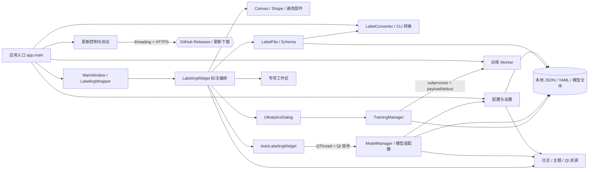
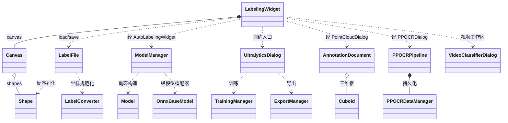
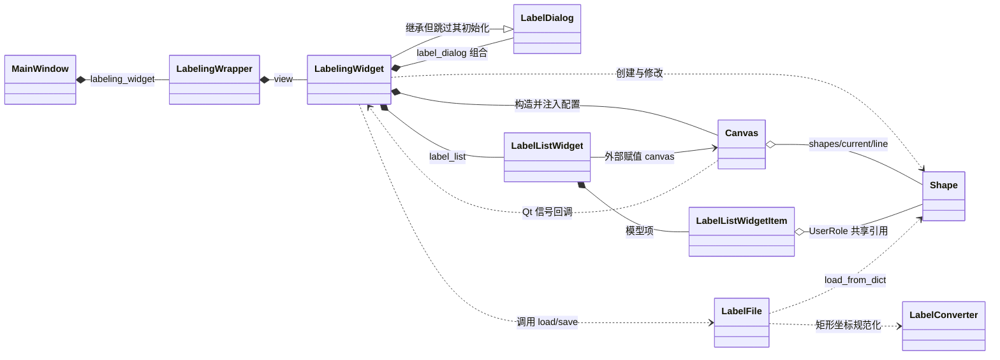
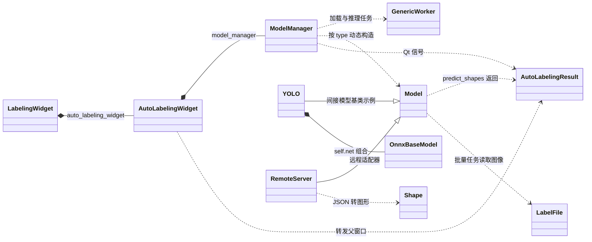
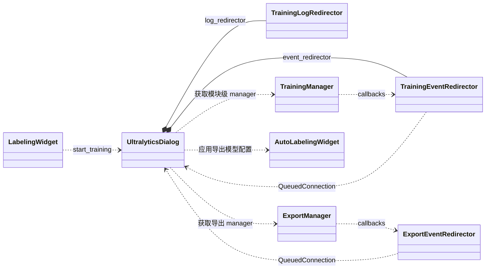
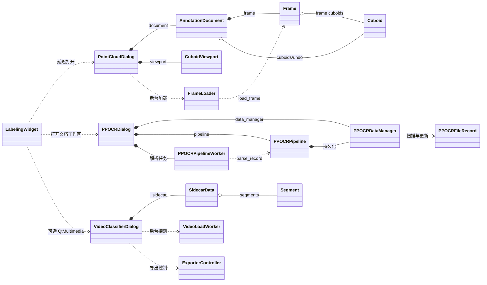

# X-AnyLabeling 代码结构说明（理解与维护）

> 分析日期：2026-11-09（Asia/Shanghai）  
> 项目版本：4.3.2  
> 分析方式：纯静态阅读、搜索与 AST 统计；未运行项目、测试、模型、训练、导出、更新或打包。  
> 本文以代码为准。运行时行为、动态注册、条件导入和实际导入顺序结论可能不完整。

## 1. 范围与基线

| 项目 | 结论 |
|---|---|
| 项目根目录 | `E:\dev-GitHub\X-AnyLabeling-main` |
| Git 基线 | 当前目录及父级无可用 Git 仓库，`.git` 元数据未找到；分支、commit、工作区状态及历史变更频率无法确认 |
| 版本 | 4.3.2，见 [app_info.py](anylabeling/app_info.py) |
| 语言 | Python，`requires-python >=3.11`，见 [pyproject.toml](pyproject.toml) |
| 主要框架 | PyQt6；ONNX/ONNX Runtime 为可选推理依赖 |
| 构建后端 | setuptools；PyInstaller 用于桌面可执行文件 |
| 主入口 | `xanylabeling = anylabeling.app:main`；亦支持 `python -m anylabeling.app` |
| 包构建 | `python -m build --no-isolation`，见 [build_and_publish_pypi.sh](scripts/build_and_publish_pypi.sh) |
| 分析日期 | 2026-11-09 |

### 1.1 规模与统计口径

初步枚举 `anylabeling` 下有 431 个 Python 文件，`tests` 下有 129 个 Python 文件。最终 AST 与依赖统计排除：

- [resources.py](anylabeling/resources/resources.py)：生成代码，只分析加载关系；
- `anylabeling/services/auto_labeling/visualgd/model/ops/build` 下 8 个生成 Python 文件；
- `__pycache__` 缓存。

因此最终统计集合为 **422 个 Python 文件、628 个唯一类名**。前五批过程数据已经按此口径复核，核心类排名未发生变化。

### 1.2 纳入范围

- 入口、配置、主窗口、标注、画布、标签持久化和格式转换；
- 自动标注、模型下载/加载/推理、自动训练及导出；
- 点云、PPOCR、VQA、聊天、图像分类、视频分类；
- 设置、更新、公共组件、资源加载、构建和发布脚本；
- 测试源码用于静态判断测试引用和维护风险，不据此声称测试通过。

### 1.3 排除或限制深度

- `assets`、`docs`、`examples` 不作为代码结构事实来源，只在需要时定点查阅；
- 第三方依赖源码不分析，只记录本项目对其接口的使用；
- 模型算法、OpenGL/相机投影、PPOCR 富文本编辑器只覆盖公共接口，不逐行展开；
- 测试数据、模型权重、构建产物和生成代码不展开；
- 未进行任何运行时验证，性能、模型精度、UI 实机表现和测试通过率不在范围内。

## 2. 分析计划与执行

| 批次 | 内容 | 执行结果 |
|---|---|---|
| 第 1 批 | 总览、入口、配置、模块级数据流与依赖图 | 已完成 |
| 第 2 批 | 标注主链路、持久化与相关核心类 | 已完成 |
| 第 3 批 | 自动标注、自动训练与相关核心类 | 已完成 |
| 第 4 批 | 专项子系统、支撑设施与外围脚本 | 已完成 |
| 第 5 批 | 解耦、维护指引、问题风险与覆盖声明 | 已完成 |

拟覆盖内容均已覆盖；本报告额外统一了生成文件排除口径，并增加 16 个核心类的总览图。未将计划中的静态分析扩大为运行或调试。

## 3. 入口与配置

### 3.1 应用入口

[app.py](anylabeling/app.py) 的 `main()` 是 GUI、格式转换和训练 worker 的共同入口。它先设置线程相关环境变量并解析参数，再通过 `set_work_directory()` 确定工作目录。`help/checks/version/config/convert/train-worker/training-worker` 在 `special` 表中分发并直接返回；GUI 相关模块随后才导入，见 [app.py:261-310](anylabeling/app.py#L261-L310)。

GUI 组合链为：

```text
main() → MainWindow → LabelingWrapper → LabelingWidget
```

对应 [app.py:427-449](anylabeling/app.py#L427-L449)、[mainwindow.py:22-55](anylabeling/views/mainwindow.py#L22-L55)、[label_wrapper.py:8-37](anylabeling/views/labeling/label_wrapper.py#L8-L37)。`MainWindow` 只负责窗口外壳、状态栏、关闭事件和窗口几何状态，主要业务集中在 `LabelingWidget`。

**维护重点：**把 GUI 或训练依赖移到入口顶层，可能破坏轻量 CLI 的懒加载；隐藏训练命令被子进程实际调用，不能当作死代码删除。

### 3.2 配置加载与保存

[get_config()](anylabeling/config.py#L198-L230) 的覆盖顺序为：

1. 从包内 [xanylabeling_config.yaml](anylabeling/configs/xanylabeling_config.yaml) 读取默认值；
2. 读取用户 YAML 文件或 YAML 字符串，规范化旧键后覆盖默认值；
3. 用 CLI 参数再次覆盖。

默认工作目录为用户主目录，可由 `--work-dir` 改写。用户配置保存到该目录下的 `.xanylabelingrc`，旧 `.anylabelingrc` 在新文件不存在时复制迁移，见 [config.py:131-159](anylabeling/config.py#L131-L159)。这些是代码定义的运行时路径，未检查用户机器上的实际文件。

`update_dict()` 对默认配置中不存在的键只记录警告并跳过，见 [config.py:43-53](anylabeling/config.py#L43-L53)。界面设置由 [SettingsController](anylabeling/views/labeling/settings/controller.py) 修改配置并延迟保存。`QSettings("anylabeling", "anylabeling")` 另用于窗口和界面状态，与 YAML 是两套持久化通道。

**维护重点：**新增配置键通常要同时核对默认 YAML、校验/旧键规范化、设置 schema 和运行时应用逻辑，否则可能出现设置无法持久化或文件值被跳过。

## 4. 模块划分表

划分依据为目录、职责分层及入口调用链。“可插拔”仅指功能边界独立，不表示存在通用插件框架。

| 模块名 | 职责 | 主要目录/文件 | 对外接口 | 依赖模块 | 类型 | 分析深度 | 维护提示 |
|---|---|---|---|---|---|---|---|
| 应用入口 | CLI 分发、GUI 初始化、更新启动 | [app.py](anylabeling/app.py)、[app_info.py](anylabeling/app_info.py) | `main()` | 配置、主窗口、转换、训练、更新 | 入口 | 深入 | 修改命令参数须同步训练 worker 的命令构造，不能只改帮助文本 |
| 配置与设置 | 默认/用户/CLI 配置合并及保存 | [config.py](anylabeling/config.py)、[controller.py](anylabeling/views/labeling/settings/controller.py) | `get_config()`、`save_config()`、`SettingsController` | 默认 YAML、日志 | 支撑 | 深入 | 新增键需同步默认 schema 与设置 schema；未知键不会自动加入配置 |
| 主窗口与标注编排 | 文件、图形、菜单、对话框及自动标注状态协调 | [mainwindow.py](anylabeling/views/mainwindow.py)、[label_widget.py](anylabeling/views/labeling/label_widget.py) | `MainWindow`、`LabelingWidget` | 多个 UI 与业务服务 | 核心 | 深入 | `LabelingWidget` 直接访问自动标注 manager，并持有训练/专项窗口；改构造参数或生命周期会多点联动 |
| 画布与通用部件 | 图形编辑、缩放、列表及交互组件 | [canvas.py](anylabeling/views/labeling/widgets/canvas.py)、[shape.py](anylabeling/views/labeling/shape.py) | `Canvas`、`Shape` | Qt、标注编排 | 核心 | 深入 | `Shape` 同时连接画布、标签列表和文件读写，坐标/字段变更须检查三处一致性 |
| 标签持久化与转换 | XLABEL JSON 读写及多格式转换 | [label_file.py](anylabeling/views/labeling/label_file.py)、[label_converter.py](anylabeling/views/labeling/label_converter.py)、[converter.py](anylabeling/views/common/converter.py) | `LabelFile.load/save()`、`LabelConverter`、`handle_convert_command()` | Shape、schema、本地文件 | 核心 | 深入 | 保存会规范化矩形并合并 `other_data`；改字段时需检查加载兼容和转换器 |
| 自动标注 | 模型配置、下载/加载、推理和结果回传 | [model_manager.py](anylabeling/services/auto_labeling/model_manager.py)、[auto_labeling.py](anylabeling/views/labeling/widgets/auto_labeling/auto_labeling.py) | `ModelManager`、`AutoLabelingWidget` | 配置、模型适配器、标注 UI | 核心 | 深入 | 模型 `type`、模型清单、动态类映射和适配器构造参数必须同步 |
| 自动训练 | 训练配置、进程启动、事件回传与导出 | [ultralytics_dialog.py](anylabeling/views/training/ultralytics_dialog.py)、[trainer.py](anylabeling/services/auto_training/ultralytics/trainer.py) | `UltralyticsDialog`、`TrainingManager` | 标注 UI、训练 worker、Ultralytics | 核心 | 深入 | payload、stdout 事件协议和隐藏 CLI 命令是跨进程契约，需成套修改 |
| 专项工作区 | 点云、PPOCR、VQA、图像/视频分类、聊天 | `views/labeling/{pointcloud,ppocr,vqa,classifier,video_classifier,chatbot}` | `LabelingWidget.open_*()` | 主标注窗口、各自服务与工具 | 可插拔 | 主链路深入、算法选读 | 视频分类依赖可选 QtMultimedia；点云采用延迟导入，不能移除异常和空值分支 |
| 更新服务 | 版本检查、下载和安装协调 | [update_controller.py](anylabeling/views/labeling/utils/update_controller.py)、[protocol.py](anylabeling/services/updates/protocol.py) | `UpdateController.check()` | 网络、主窗口、本地安装目录 | 支撑 | 主链路分析 | 控制器在窗口创建后附加；关闭流程依赖 `closing/prepare_for_close()` 防止迟到回调 |
| 公共资源与工具 | 日志、主题、Qt 工具、翻译资源 | [logger.py](anylabeling/views/labeling/logger.py)、[resources.py](anylabeling/resources/resources.py) | 工具函数、Qt 资源 | PyQt6 等第三方库 | 支撑 | 选读 | 资源 import 被入口用于翻译加载，不能仅因无直接调用而删除 |
| 构建、测试与脚本 | 打包、发布及回归测试 | [pyproject.toml](pyproject.toml)、`packaging`、`scripts`、`tests` | 构建命令、pytest 配置 | 全部运行时模块 | 外围 | 抽样 | 发布脚本会同时构建并上传，不是纯本地构建命令 |

## 5. 模块级数据流

### 5.1 启动与配置

CLI/默认 YAML/用户 YAML → `get_config()` → `MainWindow` → `LabelingWidget`；界面设置再经 `SettingsController` 写回用户 YAML。窗口尺寸等另写入 `QSettings`。翻译和模型 YAML 通过包资源读取，因此打包配置属于运行链路的一部分。

### 5.2 图像标注与持久化

图像或同名 JSON → [LabelingWidget.load_file()](anylabeling/views/labeling/label_widget.py#L6809-L6899) → `LabelFile` 读取 JSON/图像字节 → `Shape`、Canvas 和标签列表。

保存时，`save_labels()` 将列表中的 `Shape` 转为字典，见 [label_widget.py:6026-6064](anylabeling/views/labeling/label_widget.py#L6026-L6064)；[LabelFile.save()](anylabeling/views/labeling/label_file.py#L161-L225) 生成 XLABEL JSON，先写同目录临时文件，再用 `os.replace()` 替换目标文件。此链路使用本地文件，不涉及数据库。

独立 CLI 转换链为：`app convert` → `handle_convert_command()` → `LabelConverter` → 本地格式文件，不创建 GUI。

### 5.3 自动标注

`AutoLabelingWidget` 创建 `ModelManager`，并将推理结果信号转给父级 `new_shapes_from_auto_labeling()`，见 [auto_labeling.py:118-145](anylabeling/views/labeling/widgets/auto_labeling/auto_labeling.py#L118-L145)。

模型列表来自 [models.yaml](anylabeling/configs/models.yaml) 和用户自定义模型配置；`ModelManager` 按 `type` 延迟导入适配器。加载和推理均可放入 **QThread**，结果通过 Qt 信号返回标注状态，见 [model_manager.py:1122-1207](anylabeling/services/auto_labeling/model_manager.py#L1122-L1207)。

模型权重通过 HTTPS 下载，远程服务通过 HTTP 请求，均构成网络边界；已存在的 `.onnx/.pth/.pt` 缓存还可经 **multiprocessing.spawn 子进程**校验。

### 5.4 自动训练与导出

标注 UI → `UltralyticsDialog` → `TrainingManager` → 临时 JSON payload → **subprocess.Popen 子进程** → 训练 worker。

父进程用 Python 线程读取子进程 stdout，将带前缀的 JSON 事件转为 UI 回调。导出 ONNX 后可生成自定义模型 YAML并回到自动标注，形成：

```text
标注数据 → 数据集 → 训练权重 → ONNX → 自动标注自定义模型
```

### 5.5 专项工作区与更新

- 点云：BIN/PLY/PCD → `FrameLoader(QThread)` → `Frame/AnnotationDocument` → `.label`、`.cuboids.json` 或数据集压缩包；
- PPOCR：图像/PDF → `PPOCRPipelineWorker` → 官方异步 API或自建远程服务 → JSON、预览页和块裁剪图；
- VQA/图像分类：写回主窗口 `other_data` 或 flags，由主 `LabelFile` 链路保存；
- 视频分类：视频 → `SidecarData` → 同名 sidecar JSON；导出经 ffmpeg 子进程；
- 更新：检查和下载使用 Python 线程及 HTTPS，安装 helper 是独立进程。

## 6. 模块依赖图

箭头表示已确认的主要组合/调用方向，不是完整 import 清单。

[](code_structure_assets/module_dependencies.svg)

[打开 SVG 矢量图](code_structure_assets/module_dependencies.svg)

<details><summary>展开 Mermaid 源码</summary>



</details>

## 7. 核心业务流程详述

### 7.1 手动绘制与自动标注汇合

[Canvas.finalise()](anylabeling/views/labeling/widgets/canvas.py#L5396-L5444) 将 `current` 加入 `shapes`、保存撤销快照，再发出 `new_shape`。`LabelingWidget.new_shape()` 补全标签、组号和属性，通过 `add_label()` 建立列表项并标脏，见 [label_widget.py:6199-6285](anylabeling/views/labeling/label_widget.py#L6199-6285)。

自动标注结果由 [new_shapes_from_auto_labeling()](anylabeling/views/labeling/label_widget.py#L7877-L7998) 接收：先拒绝路径不匹配的迟到结果，再按 `replace` 保留锁定图形、合并新图形，并更新关系、描述、flags 和 tags。两条路径最终都进入 `Shape`、Canvas 和标签列表，不另设自动标注持久化通道。

`LabelListWidgetItem` 将 `Shape` 存入 Qt `UserRole`，Canvas 保存同一批对象，因此列表和画布是共享对象引用，不是两份独立数据。

### 7.2 标脏与自动保存

`auto_save=True` 时，[set_dirty()](anylabeling/views/labeling/label_widget.py#L3417-L3435) 直接计算目标路径并调用 `save_labels()`；关闭时的未保存提示依赖 `dirty/may_continue()`。“标脏”同时控制写盘频率、撤销按钮和关闭行为。

### 7.3 自动标注模型体系

[ModelManager.load_model_configs()](anylabeling/services/auto_labeling/model_manager.py#L465-L537) 合并内置和自定义模型。`load_model()` 创建 `QThread + GenericWorker`，`_load_model()` 先卸载旧模型，再按 `type` 动态构造适配器，见 [model_manager.py:898-964](anylabeling/services/auto_labeling/model_manager.py#L898-964)。

新增模型通常要同时维护：

```text
models.yaml/自定义 YAML → type → _get_model_class() 映射 → Model 子类
```

[Model](anylabeling/services/auto_labeling/model.py) 定义 `predict_shapes()` 和 `unload()` 抽象接口，静态统计有 46 个直接子类。[OnnxBaseModel](anylabeling/services/auto_labeling/engines/build_onnx_engine.py) 虽名为 BaseModel，实际由适配器组合实例化，共发现 40 处构造调用。

### 7.4 训练 worker 双协议

| 环境 | payload 与入口 | stdout 协议 |
|---|---|---|
| 内部环境 | 直接保存训练参数；经 `python -m anylabeling.app ... train-worker` 进入 `run_training_worker_command()` | `__XANYLABELING_TRAIN_EVENT__=`，无版本字段 |
| 外部环境 | 写入 `version/action/args/paths/options`；由选定 Python 执行 `worker.py payload` | `__XANYLABELING_WORKER_EVENT__=`，解析时校验版本 |

外部 payload 只接受 `probe/train/export`，并校验字段和训练参数白名单，见 [worker.py:426-474](anylabeling/services/auto_training/ultralytics/worker.py#L426-L474)。两种协议不能仅改前缀后互换。

内部导出由 `ExportManager` 在 Python 线程中执行；外部导出复用版本化 worker。训练对话框在打开时复制父窗口的 `image_list`，使用工作区快照而非持续共享列表。

### 7.5 专项子系统

- **点云：**`AnnotationDocument` 管理 uint32 标签，低 16 位为语义 ID、高 16 位为实例 ID，并维护锁、计数、dirty 和 undo/redo；`Cuboid` 提供三维几何，见 [model.py](anylabeling/views/labeling/pointcloud/model.py)、[cuboid.py](anylabeling/views/labeling/pointcloud/cuboid.py)。
- **PPOCR：**源文件位于 `xanylabeling_data/paddleocr/files`，结果位于 `jsons`；官方异步 API、自建文档整体解析和逐页解析是三条不同路径，见 [pipeline.py:355-441](anylabeling/views/labeling/ppocr/pipeline.py#L355-L441)。
- **VQA：**字段写入父窗口 `other_data["vqaData"]` 并调用 `set_dirty()`，最终仍由 `LabelFile` 保存；导出可生成 JSONL。
- **聊天与图像分类：**聊天使用 OpenAI 客户端和线程池；图像分类直接同步主窗口 `flag_widget`。两者与 VQA、视频模块共享聊天模型配置。
- **视频分类：**`SidecarData` 保存标签、颜色和时间段，视频同名 JSON 经校验后原子替换；导出经 ffmpeg，见 [sidecar.py](anylabeling/views/labeling/video_classifier/sidecar.py)、[exporter.py](anylabeling/views/labeling/video_classifier/exporter.py)。

## 8. 核心类表

### 8.1 筛选标准与统计口径

核心类至少满足两项：被引用次数居前、位于主流程、承担状态管理或核心算法、被测试源码直接引用。

AST 统计排除 import、类定义本身和字符串，统计构造、继承、类型标注和属性使用节点。排名按使用数降序，同名数按名称排序；测试列单独统计 `tests`。同名类可能合并，故该数值用于筛选，不等同精确运行时扇入。`Model` 因项目内存在同名类，不采用类名排名，改用 46 个直接子类作为依据。

- 主流程/状态管理并有测试引用：`LabelingWidget`、`Canvas`、`ModelManager`、`UltralyticsDialog`、`TrainingManager`、`ExportManager`、`AnnotationDocument`、`PPOCRPipeline`、`PPOCRDataManager`、`VideoClassifierDialog`；
- 高引用并承担核心数据/算法：`Shape`、`LabelFile`、`LabelConverter`、`Cuboid`、`OnnxBaseModel`；
- 核心抽象和大量直接子类：`Model`。

| 类名 | 文件 | 职责 | 关键属性与方法 | 被谁引用 | 引用了谁 | 维护提示 |
|---|---|---|---|---|---|---|
| `LabelingWidget` | [label_widget.py](anylabeling/views/labeling/label_widget.py) | 标注主流程和共享状态 | `filename/image_data/other_data/dirty`；`load_file()`、`new_shape()`、`load_shapes()`、`save_labels()` | 源码 2 处，第 186/628；`LabelingWrapper`；测试 98 处 | `LabelDialog`、`Canvas`、`Shape`、`LabelFile`、自动标注和训练 UI | `set_dirty()` 同时影响自动保存、撤销和关闭提示；修改前须检查写盘频率及未保存状态 |
| `Canvas` | [canvas.py](anylabeling/views/labeling/widgets/canvas.py) | 鼠标交互、绘制、几何编辑、撤销及渲染 | `shapes/current/selected_shapes/shapes_backups/scale/pixmap`；`finalise()`、`load_shapes()`、`paintEvent()` | 源码 1 处，第 254/628；`LabelingWidget`；测试 22 处 | `Shape`、`AutoLabelingMode`、OpenCV/NumPy、Qt | 列表与画布共享 `Shape`；改坐标或缓存时需同步撤销快照、选择状态和重绘 |
| `Shape` | [shape.py](anylabeling/views/labeling/shape.py) | 标注数据、序列化、几何与绘制 | `label/points/group_id/other_data/shape_type`；`to_dict()`、`load_from_dict()`、`make_path()`、`move_by()` | 197 处，第 2/628；Canvas、LabelFile、模型适配器等；测试 81 处 | Qt、图像/几何工具、logger | 新字段须同步 `KEYS/to_dict/load_from_dict`；`locked` 被序列化移除，不能当作已持久化字段 |
| `LabelFile` | [label_file.py](anylabeling/views/labeling/label_file.py) | XLABEL JSON 与图像数据读写 | `shapes/image_path/image_data/other_data`；`load()`、`save()` | 19 处，第 21/628；主标注和标签测试；测试 11 处 | `Shape`、`LabelConverter`、schema、文件系统 | 必须保留扩展字段、相对路径解析及临时文件替换语义，避免升级后丢字段或写坏原文件 |
| `LabelConverter` | [label_converter.py](anylabeling/views/labeling/label_converter.py) | XLABEL 与 YOLO/VOC/COCO 等格式互转及坐标计算 | `classes/pose_classes/custom_data`；`yolo_to_custom()`、`custom_to_yolo()`、`custom_to_coco()` 等 | 26 处，第 14/628；CLI、LabelFile、导出工具；测试 9 处 | schema、OpenCV、NumPy、XML/YAML/JSON | 新格式需同步任务表、扩展名、CLI 分支和成对转换方法；注意四点矩形、归一化及旋转坐标约定 |
| `ModelManager` | [model_manager.py](anylabeling/services/auto_labeling/model_manager.py) | 模型配置、加载、推理、下载和线程状态 | `loaded_model_config`、两类线程及锁；`load_model()`、`predict_shapes[_threading]()` | 源码 1 处，第 354/628；`AutoLabelingWidget`；测试 11 处 | `Model`、worker、配置、LabelFile、结果 DTO | 修改加载顺序须保留旧模型卸载、锁、完成信号和线程引用清理，避免迟到结果或重复加载 |
| `Model` | [model.py](anylabeling/services/auto_labeling/model.py) | 模型公共接口、权重定位、下载与校验 | `config/output_mode`；`get_model_abs_path()`、`predict_shapes()`、`unload()` | 46 个直接子类；由 manager 动态构造；测试 1 处 | LabelFile、配置、网络、本地权重 | 路径逻辑会删除无效缓存并重下；修改时需考虑路径约束、取消下载和校验子进程 |
| `OnnxBaseModel` | [build_onnx_engine.py](anylabeling/services/auto_labeling/engines/build_onnx_engine.py) | ONNX Runtime session 与输入输出封装 | `ort_session/providers/sess_opts`；`get_ort_inference()` | 40 处，第 11/628；各模型适配器组合使用；直接测试引用 0 | ONNX、ONNX Runtime | provider 和 session 选项被 40 处共享；改 CPU/GPU 选择需检查所有可选运行环境 |
| `UltralyticsDialog` | [ultralytics_dialog.py](anylabeling/views/training/ultralytics_dialog.py) | 数据快照、训练配置、进度和导出 UI | `image_list/training_status/current_project_path`；`get_training_args()`、`start_training_from_train_tab()` | 源码 1 处，第 478/628；`LabelingWidget`；测试 32 处 | TrainingManager、ExportManager、数据集工具、父标注窗口 | manager 的 `callbacks` 被整体替换；重开或多实例时需核查旧任务事件去向 |
| `TrainingManager` | [trainer.py](anylabeling/services/auto_training/ultralytics/trainer.py) | 训练子进程、停止状态和事件分发 | `training_process/is_training/stop_event`；`start_training()`、`_run_training()` | 源码 2 处，第 221/628；模块级 manager 和测试；测试 3 处 | 两种 worker、payload、进程树工具 | 改参数或事件必须同步两套协议、worker 白名单及解析器；payload 清理由 `finally` 负责 |
| `ExportManager` | [exporter.py](anylabeling/services/auto_training/ultralytics/exporter.py) | 内部/外部导出、依赖处理和导出状态 | `export_process/is_exporting/stop_event`；`start_export()`、两类 export worker | 源码 2 处，第 173/628；训练对话框；测试 5 处 | Ultralytics、外部 worker、自动标注配置 | 内部导出并非子进程，外部导出才是；修改停止或日志逻辑不能混用两条路径 |
| `AnnotationDocument` | [model.py](anylabeling/views/labeling/pointcloud/model.py) | 点云标签/三维框文档状态与撤销 | `_labels/_baseline/_dirty_count/_undo/_cuboids`；`assign_semantic()`、实例编辑、`undo/redo()` | 源码 1 处，第 233/628；PointCloudDialog；测试 7 处 | `Frame`、`Cuboid`、NumPy | 修改写入必须同步计数、baseline、revision 和锁；外部数组视图只读，不应绕过 |
| `Cuboid` | [cuboid.py](anylabeling/views/labeling/pointcloud/cuboid.py) | 三维框校验和几何算法 | `center/size/rotation/locked`；`corners()`、`contains()`、`resized()`、`rotated()` | 12 处，第 36/628；文档、视口和导入导出；测试 23 处 | NumPy、几何常量 | 导出直接使用 center/rotation/scale；修改旋转顺序或尺寸约束须检查所有格式 |
| `PPOCRPipeline` | [pipeline.py](anylabeling/views/labeling/ppocr/pipeline.py) | 服务探测、远程解析、结果规范化和取消 | 服务/API 设置；`parse_record()`、三类远程请求、结果规范化 | 源码 3 处，第 135/628；Dialog、PipelineWorker；测试 13 处 | DataManager、requests、PIL、渲染工具 | 官方 API、自建文档和逐页接口须分别修改；取消逻辑还涉及请求辅助线程 |
| `PPOCRDataManager` | [data_manager.py](anylabeling/views/labeling/ppocr/data_manager.py) | 文件记录、JSON 结果和 API 设置持久化 | 根目录及记录路径；`scan_records()`、`import_files()`、`save_record_data()` | 源码 2 处，第 193/628；Dialog、Pipeline；测试 3 处 | 本地文件、PIL/QtPdf、配置常量 | 删除记录会联动源文件、JSON 和图像目录；修改命名或 `_ppocr_meta` 需保留旧记录兼容性 |
| `VideoClassifierDialog` | [video_classifier_dialog.py](anylabeling/views/labeling/widgets/video_classifier_dialog.py) | 视频、时间段、撤销、AI 和导出状态 | `_sidecar/_dirty/_undo_stack` 及 worker 集合；`load_video()`、`_save_sidecar()`、`closeEvent()` | 源码 3 处，第 141/628；主标注窗口及测试；测试 4 处 | SidecarData、VideoLoadWorker、导出控制器、ffmpeg/HTTP | 必须保留迟到 worker 过滤和关闭时保存/释放顺序，避免旧结果写入新视频 |

### 8.2 DTO、异常和支撑类归并

- `AutoLabelingResult`、`AutoLabelingMode`、SAHI `ObjectPrediction`、`Frame`、`ClassDefinition`、`PPOCRFileRecord`、`SidecarData`、`Segment`、`ExportConfig` 按 DTO/值对象归并；
- `GenericWorker`、各 Qt 信号 redirector、模型/视频 worker 属于线程与事件适配器；
- `LabelFileError`、`PoseGroupError`、`PoseClassError` 等异常不逐个展开；
- XLABEL 常量和模板集中于 [schema.py](anylabeling/views/labeling/schema.py)。

## 9. 类级关系图

### 9.1 核心类总览

下图覆盖核心类表全部 16 个类；间接关系已标注。

[](code_structure_assets/core_classes_overview.svg)

[打开 SVG 矢量图](code_structure_assets/core_classes_overview.svg)

<details><summary>展开 Mermaid 源码</summary>



</details>

### 9.2 标注主链路局部图



### 9.3 自动标注局部图



### 9.4 自动训练局部图



训练 worker 是模块函数而非类，故未在类图中虚构节点；其进程协议见第 5、7 节。

### 9.5 专项子系统局部图



实线通常表示继承或持有，`o--` 表示共享对象聚合，点线表示调用、动态构造或事件依赖。`Canvas → LabelingWidget` 等回边是 Qt 协作关系，不据此直接认定 import 循环。

## 10. 解耦评估

除专门说明外，本节均有直接代码或静态统计证据【置信度：高】。运行影响未验证。

### 10.1 循环依赖

**A. 自动标注与 UI/工具包形成大循环分量。**静态检测得到 118 个文件处于同一强连通分量，但这不表示两两直接循环。一条最短实际路径为：

```text
model_manager.py:14
→ model.py:21
→ views/labeling/utils/__init__.py:6
→ utils/crop.py:29
→ widgets/__init__.py:4
→ widgets/auto_labeling/__init__.py:1
→ auto_labeling.py:20
→ ModelManager
```

对应文件：[model_manager.py](anylabeling/services/auto_labeling/model_manager.py)、[model.py](anylabeling/services/auto_labeling/model.py)、[utils/__init__.py](anylabeling/views/labeling/utils/__init__.py)、[crop.py](anylabeling/views/labeling/utils/crop.py)、[widgets/__init__.py](anylabeling/views/labeling/widgets/__init__.py)、[auto_labeling/__init__.py](anylabeling/views/labeling/widgets/auto_labeling/__init__.py)、[auto_labeling.py](anylabeling/views/labeling/widgets/auto_labeling/auto_labeling.py)。

可拆方向是减少两个聚合 `__init__.py` 的再导出，并把模型服务对 UI 的依赖移向独立数据/日志层。仅调整单条 import 不足以证明消除循环。

**B. 图形转换存在双文件循环。**[utils/shape.py:309-315](anylabeling/views/labeling/utils/shape.py#L309-L315) 在函数内导入 `ShapeConverterDialog`，而 [shape_converter_dialog.py:9-14](anylabeling/views/labeling/widgets/shape_converter_dialog.py#L9-L14) 顶层反向导入转换函数。延迟导入降低初始化风险，但静态循环仍成立。可将 UI 启动器移出几何工具模块。

### 10.2 扇入/扇出与最高耦合位置

统计为 422 个非生成 Python 文件的直接内部 import，含函数内延迟 import，不含字符串动态分发。分类仅按本项目比例：高约为 ≥10%，中为 2%—10%，低为 <2%。

| 耦合位置 | 文件扇入/扇出 | 判断与原因 |
|---|---:|---|
| [model_manager.py](anylabeling/services/auto_labeling/model_manager.py) | 1 / 101 | 扇出高：93 个模型类型字面量进入延迟解析；处于大循环，注册表修改影响面广 |
| [shape.py](anylabeling/views/labeling/shape.py) | 57 / 2 | 扇入高，约 13.5% 文件直接引用；另有 197 个类名使用节点，Canvas/列表共享实例 |
| [model.py](anylabeling/services/auto_labeling/model.py) | 47 / 5 | 扇入高；46 个直接子类，公共下载、读取和抽象接口变更会跨模型传播 |
| [label_widget.py](anylabeling/views/labeling/label_widget.py) | 1 / 25 | 扇出中、状态集中：8336 行，连接标注、自动标注、训练、设置及专项窗口 |
| [widgets/__init__.py](anylabeling/views/labeling/widgets/__init__.py) + [utils/__init__.py](anylabeling/views/labeling/utils/__init__.py) | 7/24、10/14 | 聚合包扩大导入面并参与循环，使用少量工具也可能触发额外模块加载 |

另需关注 [label_converter.py](anylabeling/views/labeling/label_converter.py) 与 [converter.py](anylabeling/views/common/converter.py)：前者有 26 个类名使用节点、排名第 14，后者集中任务分派，格式变更通常需要多点同步。

### 10.3 跨层引用、全局状态与隐式依赖

- **服务层反向依赖 UI 数据层：**[model.py:20-21](anylabeling/services/auto_labeling/model.py#L20-L21) 引用 `LabelFile` 和 labeling utils；[remote_server.py:14-16](anylabeling/services/auto_labeling/remote_server.py#L14-L16) 引用 `Shape`、UI logger 和图像转换。
- **UI 绕过统一持久化：**[vqa/utils.py:175-184](anylabeling/views/labeling/vqa/utils.py#L175-L184) 直接读取标签 JSON；[label_widget.py:7591-7608](anylabeling/views/labeling/label_widget.py#L7591-L7608) 直接移动图像、删除标签文件。
- **全局状态：**[config.py:11-12](anylabeling/config.py#L11-L12) 保存配置路径和工作目录；训练 manager、导出 manager、[DeviceManager](anylabeling/views/common/device_manager.py) 有进程级共享状态；`Shape` 的颜色和线宽含类级状态。
- **导入副作用：**[model.py:12](anylabeling/services/auto_labeling/model.py#L12) 修改默认 socket 超时，[label_file.py:10](anylabeling/views/labeling/label_file.py#L10) 修改 Pillow 全局开关。
- **隐式共享配置：**[chatbot/config.py](anylabeling/views/labeling/chatbot/config.py) 文件扇入为 8，聊天、VQA、图像分类和视频分类共享模型/供应商配置。

### 10.4 修改影响预估

- `Shape`、`Model`：结构性影响高，依据分别是 57 和 47 个直接引用文件；测试类名引用分别为 81 和 1，后者不能只依赖基类测试保障适配器回归。
- `ModelManager`、`LabelingWidget`：影响高，分别涉及 93 个模型类型和 25 个直接依赖模块；测试引用数为 11 和 98，但覆盖深度未执行验证。
- `OnnxBaseModel`：40 处构造调用而直接测试类名引用为 0，属于高影响、测试安全网不明确。
- 缺少 Git 历史，所有“近期变更频率”判断置信度为低，未纳入分级；缺少测试执行结果，回归有效性判断同样受限。

## 11. 新人上手路径

| 顺序 | 文件 | 读它是为了什么 |
|---:|---|---|
| 1 | [pyproject.toml](pyproject.toml) | 确认 Python、PyQt6、可选推理依赖和命令入口 |
| 2 | [app.py](anylabeling/app.py) | 理解 CLI 分发、配置加载及 GUI 创建顺序 |
| 3 | [mainwindow.py](anylabeling/views/mainwindow.py) | 确认主窗口只是外壳，避免误找业务逻辑 |
| 4 | [label_wrapper.py](anylabeling/views/labeling/label_wrapper.py) | 理解外壳到实际标注部件的组合关系 |
| 5 | [label_widget.py:206-375](anylabeling/views/labeling/label_widget.py#L206-L375)、[label_widget.py:473-594](anylabeling/views/labeling/label_widget.py#L473-L594) | 先看状态与信号，不建议从首行顺序读完 8336 行 |
| 6 | [canvas.py:5396-5444](anylabeling/views/labeling/widgets/canvas.py#L5396-L5444)、[shape.py:136-187](anylabeling/views/labeling/shape.py#L136-L187) | 分别理解图形完成事件和序列化结构 |
| 7 | [label_file.py](anylabeling/views/labeling/label_file.py) | 理解图像解析、扩展字段和原子保存 |
| 8 | [model_manager.py:431-537](anylabeling/services/auto_labeling/model_manager.py#L431-L537)、[model_manager.py:817-964](anylabeling/services/auto_labeling/model_manager.py#L817-L964) | 在主线之后理解模型注册与加载，不必先读全部适配器 |

## 12. 维护场景定位

| 场景 | 优先查看的 2—3 个文件 |
|---|---|
| 改绘制/编辑 UI | [canvas.py](anylabeling/views/labeling/widgets/canvas.py)、[shape.py](anylabeling/views/labeling/shape.py)、[test_shape_boundary.py](tests/test_canvas/test_shape_boundary.py) |
| 修标签读取或兼容问题 | [label_file.py](anylabeling/views/labeling/label_file.py)、[label_converter.py](anylabeling/views/labeling/label_converter.py)、[test_label_file_load.py](tests/test_labeling/test_label_file_load.py) |
| 新增自动标注模型 | [model_manager.py](anylabeling/services/auto_labeling/model_manager.py)、[model.py](anylabeling/services/auto_labeling/model.py)、[models.yaml](anylabeling/configs/models.yaml) |
| 改配置或快捷键 | [config.py](anylabeling/config.py)、[xanylabeling_config.yaml](anylabeling/configs/xanylabeling_config.yaml)、[runtime_applier.py](anylabeling/views/labeling/settings/runtime_applier.py) |
| 改训练 payload/事件 | [trainer.py](anylabeling/services/auto_training/ultralytics/trainer.py)、[worker.py](anylabeling/services/auto_training/ultralytics/worker.py)、[environment.py](anylabeling/services/auto_training/ultralytics/environment.py) |
| 改 PPOCR 服务或结果 | [pipeline.py](anylabeling/views/labeling/ppocr/pipeline.py)、[data_manager.py](anylabeling/views/labeling/ppocr/data_manager.py)、[config.py](anylabeling/views/labeling/ppocr/config.py) |
| 改依赖、打包或更新 | [pyproject.toml](pyproject.toml)、[build_executable.sh](scripts/build_executable.sh)、[package_updates.py](scripts/package_updates.py) |

## 13. 已知代码问题与风险

### 13.1 已确定的问题

| 位置 | 问题与建议 |
|---|---|
| [ultralytics_dialog.py:1713-1715](anylabeling/views/training/ultralytics_dialog.py#L1713-L1715) | `self.training_status == "idle"` 是无副作用比较，停止状态不会在此赋值；建议后续修正并补状态迁移测试 |
| [types.py:1-10](anylabeling/services/auto_labeling/types.py#L1-L10) | `DownloadCancelledError` 连续定义两次，前者被遮蔽；建议保留单一定义 |
| [editors.py:858-948](anylabeling/views/labeling/ppocr/editors.py#L858-L948)、[widgets.py:218-308](anylabeling/views/labeling/ppocr/widgets.py#L218-L308) | `_parse_span_int` 和 `_PPOCRHTMLTableParser` 基本重复；建议提取共同实现，防止表格解析行为分叉 |
| [app.py:40-48](anylabeling/app.py#L40-L48)、[mainwindow.py:12-19](anylabeling/views/mainwindow.py#L12-L19) | WSL 检测重复实现；建议统一，避免平台判断漂移 |
| [label_list_widget.py:358-367](anylabeling/views/labeling/widgets/label_list_widget.py#L358-L367) | 未找到 Shape 时返回 `None`，原异常被注释，可能把错误推迟到调用端；建议明确缺失项契约并补测试 |
| [label_widget.py:2578-2581](anylabeling/views/labeling/label_widget.py#L2578-L2581)、[canvas.py:2476](anylabeling/views/labeling/widgets/canvas.py#L2476) | 存在注释掉的信号和 UI 代码；建议确认保留原因后删除或转为有效任务。静态证据不足以把对应功能判为死代码 |

共检索到 42 处 TODO/FIXME/deprecated/临时处理标记，不等于 42 个缺陷。明确废弃兼容点包括 `output` 参数 [label_widget.py:222-227](anylabeling/views/labeling/label_widget.py#L222-L227) 和矩形两点旧格式 [label_file.py:81-94](anylabeling/views/labeling/label_file.py#L81-L94)；移除前需保留迁移测试。

### 13.2 风险：当前未必是缺陷，但修改时容易出问题

- 配置分散在 YAML、QSettings 和多类 JSON 中；API key 也会写入聊天/PPOCR 设置文件，调整存储或日志时需注意敏感信息。
- 自动保存直接在 `set_dirty()` 内写盘，高频编辑可能放大 IO 与状态联动。
- 模型动态导入、QtMultimedia/QtPdf 等条件依赖使静态覆盖可能不完整。
- 核心大文件与共享全局状态较多，局部修改可能产生跨窗口、跨线程副作用。
- 模型缓存校验失败后会删除并重新下载，修改该逻辑需考虑异常断网及已有本地文件保护。
- 更新与远程服务端点存在硬编码默认值，环境切换时需同步配置和打包元数据。

## 14. 支撑设施与外围补充

- **设置与设备：**`SettingsController` 负责校验/延迟保存，`SettingsRuntimeApplier` 将键映射到 QAction、Canvas 和 Shape。[DeviceManager](anylabeling/views/common/device_manager.py) 是单例，按“环境变量 → 用户 YAML → 自动检测”选择设备，并缓存 ONNX provider。
- **更新与资源：**[protocol.py](anylabeling/services/updates/protocol.py) 强制 HTTPS，验证 Ed25519 清单、版本、平台、SHA-256 和大小；自动安装只在符合要求的冻结安装环境启用。[installer.py](anylabeling/services/updates/installer.py) 是独立更新 helper。
- **外围脚本：**[build_executable.sh](scripts/build_executable.sh) 调用 PyInstaller 和各平台打包；[package_windows.ps1](scripts/package_windows.ps1) 调用 Inno Setup；[package_updates.py](scripts/package_updates.py) 准备并签名更新清单；[generate_update_key.py](scripts/generate_update_key.py) 生成 Ed25519 私钥；[generate_languages.py](scripts/generate_languages.py) 重新提取翻译；[compile_languages.py](scripts/compile_languages.py) 编译现有翻译和资源；[build_and_publish_pypi.sh](scripts/build_and_publish_pypi.sh) 构建并上传 PyPI；[generate_release_notes.py](scripts/generate_release_notes.py) 依赖 Git 标签；[format_code.sh](scripts/format_code.sh) 执行 `black .`。

## 15. 术语表

| 术语 | 含义 | 出现位置 |
|---|---|---|
| XLABEL | 项目原生 JSON 标注结构 | [schema.py](anylabeling/views/labeling/schema.py) |
| `other_data` | 未纳入基础字段的扩展数据 | [shape.py:182](anylabeling/views/labeling/shape.py#L182)、[label_file.py:135-139](anylabeling/views/labeling/label_file.py#L135-L139) |
| GID | `group_id` 对应的图形组号 | [label_widget.py](anylabeling/views/labeling/label_widget.py) |
| `AutoLabelingMode` | OBJECT/ADD/REMOVE 等交互标记，保存时过滤 | [types.py:48-81](anylabeling/services/auto_labeling/types.py#L48-L81) |
| `checked` | 标注审核状态，可为布尔值或 `"failed"` | [label_file.py:145-150](anylabeling/views/labeling/label_file.py#L145-L150) |
| Sidecar | 与视频同名的独立分类/时间段 JSON | [sidecar.py](anylabeling/views/labeling/video_classifier/sidecar.py) |
| AMG | 代码中无提示全图分割模式，使用 `auto_grid` 标记 | [auto_labeling.py:1007-1025](anylabeling/views/labeling/widgets/auto_labeling/auto_labeling.py#L1007-L1025) |
| SAHI | 项目内切片推理适配工具包名称；全称未在代码中定义 | `services/auto_labeling/utils/sahi` |
| VQA | 项目中的自定义问答标注工作区，数据键为 `vqaData` | [vqa_dialog.py:503-526](anylabeling/views/labeling/widgets/vqa_dialog.py#L503-L526) |
| PPOCR | 项目中的 PaddleOCR 文档解析工作区，含自建服务和官方 API 两类路径 | [pipeline.py](anylabeling/views/labeling/ppocr/pipeline.py) |

## 16. 覆盖声明

### 实际覆盖

- 入口与配置、标注及持久化、自动标注、训练/导出、点云、PPOCR、VQA、聊天、图像/视频分类、设置、更新、打包脚本；
- 模块和核心类关系、跨线程/进程/网络边界、引用统计、维护路径、已知问题和风险；
- 核心类表共 16 类，全部进入总览及相应局部图；
- 最终统计排除生成文件，依赖循环及扇入/扇出已按同一范围复核。

### 未覆盖及原因

- 未运行应用、测试、模型、训练、导出、更新或打包，不提供运行成功率、性能或测试通过率；
- 未逐行阅读全部模型算法、OpenGL/相机投影、PPOCR 富文本编辑器及第三方库，按计划只覆盖公共接口；
- Git 分支、commit 和历史频率无法确认；动态注册、条件导入和实际导入顺序可能不完整；
- 未发现已核实的文档/代码冲突，但未对 README 和全部注释逐项核对。

与计划的差异仅为最终补充生成文件口径复核、依赖统计复核和核心类总览，没有扩大为运行时分析。

---

**文档自检：**16 个核心类全部入图；各 Mermaid 图均不超过 25 个节点并作静态语法检查；所引项目文件均确认存在；未将低置信度推测写入事实段；未修改任何项目代码。
