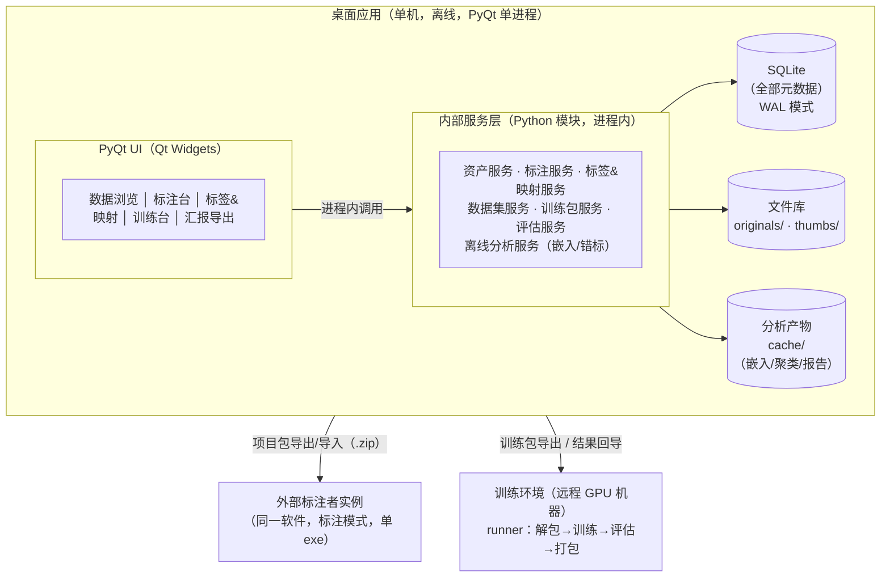

# 工业视觉数据平台 · 需求澄清、可行性评估与系统设计

| 项目 | 内容 |
|---|---|
| 文档版本 | v1.6 |
| 日期 | 2026-11-04 |
| 状态 | 设计阶段；PyQt 单进程、GPL-3.0、完整标注修订审计已定稿，待开工 |
| 文档性质 | 工作文档，随迭代修订；变更记入文末变更记录 |

---

## 1. 项目背景与目标

### 1.1 背景
开发一款自用的工业视觉数据平台。形态上对标的商业产品是 Handdle AI（东声智能）/ AIDI（阿丘科技）这类工业视觉平台——它们证明了"标注+训练+调优+评估"一体化平台在工业质检场景的价值，但为**闭源商业软件**，且数据管理以项目为单位，不满足本项目的灵活性要求。

立项前对主流开源方案做了调研（详见 §2 可行性评估），结论如下，构成本项目自研的必要性论据：

| 调研对象 | 类型 | 核心结论 |
|---|---|---|
| Labelme / X-AnyLabeling | 开源标注工具 | 文件中心模型：标注即写文件，无资产级元数据、无血缘、无数据集版本；X-AnyLabeling 的 AI 辅助标注与画布实现值得参考（其本身为 PyQt 应用，代码可直接研读），但其架构与本系统"元数据中心"冲突，**参考不集成** |
| CVAT / Label Studio | 开源标注平台 | 任务中心模型：强于多人协作分发，但数据管理以"标注任务"而非"数据资产"为中心，无训练闭环、无类别解耦；部署形态（Web 服务）也不符合单机桌面要求 |
| Intel Geti | 开源全流程平台 | 概念上最接近"标注→训练→部署"闭环，证明该形态可行；但面向 OpenVINO 生态、运维重（K8s）、无本地数据资产管理，**过重且不对口** |
| Anomalib 等算法库 | 开源算法库 | 仅提供算法不提供平台；其异常检测能力列入长期候选（非监督缺陷检测） |

因此本项目差异化重点是**更灵活的数据资产管理与标注-训练闭环**：以数据资产+统一元数据为中心，标注和训练都是元数据的生产者与消费者。现场生产持续产生图片：一部分用于训练/测试，一部分用于汇报、存档、复盘。当前"直接放桌面"的管理方式已出现混乱。

### 1.2 核心目标

| # | 目标 | 状态 | 说明 |
|---|---|---|---|
| 1 | 2D 图像多任务标注：分类 / 检测框 / 分割掩码 / OCR / 关键点 | 已采纳 | 由"支持多种数据格式的标注"经澄清收敛而来（见 §3） |
| 2 | 集标注、训练、调优于一体 | 已采纳 | 训练以"训练包导出+远程执行+结果回导"方式闭环（见 §6.6） |
| 3 | 数据资产管理能力 | 已采纳 | 本项目最大差异化点（见 §1.1、§2） |
| 4 | 标注与训练类别粒度解耦：标注细、训练粗，映射随项目演进 | 已采纳 | 映射表+版本快照方案（见 §6.1） |
| 5 | 自监督模型辅助标注，检查类别间数据交叉干涉 | 已降级 | 降为离线批处理分析，不进标注界面（见 §7） |
| 6 | 数据集、训练、评估三模块深度解耦 | 已采纳 | 解耦数据契约而非部署形态（见 §6.2） |
| 7 | 图片 ↔ 模型双向血缘；多个同任务数据集合并训练一个模型 | 已采纳 | 含数据集级采样权重（见 §6.4） |
| 8 | 数据用途管理：区分训练 / 存档 / 汇报 | 已重构 | 生命周期+汇报集合+派生资产+血缘派生（见 §6.3） |
| 9 | 标注内容修订、图级审核与生命周期归档可审计 | 已采纳 | 追加式 revision 与独立状态审计（见 §3.3、§5.3） |

### 1.3 范围控制清单（短期不做，长期视条件规划）

以下各项**短期（MVP/二期/中期）不做**，其中多数属于长期候选规划，触发条件满足时重新评估；**唯一例外是末项"嵌入可视化大屏"，长期也不做**（理由见 §7：对单人/清单式工作流无价值，此为已评估结论而非范围收敛）。

| 功能 | 性质 | 重新评估的触发条件 |
|---|---|---|
| 多租户 / 复杂权限体系 | 长期候选 | 协作角色 ≥10 人，或软件转为多组织共用 |
| 实时协同标注 | 长期候选 | 多名标注者必须同时在线作业（当前项目包离线分发模式失效时） |
| 产线对接 / 在线推理 | 长期候选 | 出现实时检测产线需求（当前定位仅为离线数据闭环） |
| 视频 / 点云 / 文本 / 音频 | 长期候选 | 实际业务出现对应数据类型（当前仅 2D 图像） |
| 标签规则引擎 | 长期候选 | 出现属性条件合并需求（如"长度>5mm 的划痕算 NG"），映射表被证明不够用 |
| K8s / 分布式训练调度 | 长期候选 | 训练机 ≥3 台且排队冲突成为日常瓶颈 |
| 独立后端服务进程（FastAPI） | 长期候选 | 需要向远程训练机或第三方工具暴露 API 时（当前单进程内调用，见 §4.2） |
| 嵌入可视化大屏 | **不做（含长期）** | —— |

---

## 2. 可行性评估总结

| 需求 | 结论 | 说明 |
|---|---|---|
| 2D 图像五任务标注 | 合理，但为第一大工程风险 | 五任务均分要求"统一画布+分层交互"，详见 §9 风险 |
| 标注+训练+调优一体 | 合理，技术成熟 | Intel Geti 已开源证明该形态可行；难点在工程量 |
| 数据管理（资产中心） | 合理，自研价值最大 | CVAT/Label Studio 为任务中心，X-AnyLabeling 为文件中心，均无资产级全局检索与血缘 |
| 类别解耦 | 合理，成本可控 | 映射表+版本快照即可，见 §6.1 |
| 自监督辅助标注 | 部分合理 → 离线分析 | 见 §7；先混淆矩阵（免费），嵌入分析排中期 |
| 双向血缘 / 多数据集合训 | 合理 | 血缘是免费查询；合训用派生快照+采样权重，见 §6.4 |
| 汇报/存档/训练用途管理 | 单字段方案有缺陷，已重构 | 见 §6.3 |
| 完整标注修订审计 | 合理，数据层 MVP 必须实现 | 追加式 revision；查看 UI 可后置，见 §3.3、§8 |
| 整体自研 | 成立 | 自用+开源、离线闭环、资产中心，三点共同支持自研 |

---

## 3. 需求澄清记录

| # | 问题 | 结论 |
|---|---|---|
| 1 | 数据类型 | 只做 2D 图像 |
| 2 | 标注任务类型 | 分类/检测框/分割掩码/OCR/关键点，各约 1:1:1:1:1 |
| 3 | 部署形态 | 单机桌面应用（技术栈见 §4） |
| 4 | 并发与协作 | 无多人同时在线；需分发给外部人员标注，提供项目包导出/导入/合并 |
| 5 | 数据规模 | 当前 2000 张，日增约 100 张，分辨率 1024×1024 |
| 6 | 训练资源 | 训练机 ≠ 标注机（"不同训练环境"），任务为 20h 级长跑 |
| 7 | 汇报形态 | 拼图、截屏、原始图、带缺陷渲染图都有；现场实施/售后统计，PM 使用，每日小量（<1000） |
| 8 | 许可 | **自用、开源，最终采用 GPL-3.0**；参考 X-AnyLabeling（GPLv3）画布 |
| 9 | 类别解耦 | 纯多对一合并，映射随项目演进变化 |
| 10 | 产线关系 | 不做产线对接，只做离线数据闭环 |
| 11 | 存档语义 | 日常视图收纳 + 合规留存；保持可逆+审计模型 |
| 12 | 合训采样权重 | 需要数据集级采样权重 |
| 13 | 汇报集合 | 嵌套、按"项目+日期"自动归集，含操作员与备注 |
| 14 | 技术栈 | **PyQt 单进程，Qt Widgets，绑定选择 PyQt**；具体发行版本随依赖锁定，不再单列待确认 |
| 15 | 标注审计 | **需要完整 annotation revision 审计**；数据层 MVP 必须实现，复杂查看 UI 可二期 |

外部标注者规模、训练机框架习惯以及是否执行固定周期的画布验证/B 计划，不作为当前待确认或阻塞事项。

### 3.1 数据与交换格式的版本管理

软件版本、数据库结构版本和交换包格式版本分别管理，**不在 `project` 表设置含义不明的 `version` 列**：

| 对象 | 机制 | 用途 |
|---|---|---|
| SQLite 数据库结构 | `PRAGMA user_version` 记录当前 schema 版本；启动时读取并执行有序、事务化、带备份的迁移；迁移记录可附于 `schema_migrations` 表 | 防止旧库被新程序静默改写，支持升级与排障；程序与库不兼容时明确阻止启动 |
| 项目包 / 训练包格式 | 包清单中的 `format_version` | 决定包内字段和结构能否被当前程序解析 |
| 交换包的生产软件 | 包清单中的 `producer_app_version` | 记录生成包的软件版本，仅用于诊断和兼容策略，不代替 `format_version` |
| 外部回导批次 | `import_session.app_version`（可选） | 追溯某次回导所使用的软件版本 |

`project` 会在不同软件版本中被反复打开和编辑，单一项目版本号无法表达这些事实。交换包格式版本与应用版本必须独立演进。

### 3.2 图像尺寸口径与状态归属

- `asset.width/height` 是导入时从原图提取并物化的**显示方向尺寸缓存**：读取并应用 EXIF orientation 后，与标注画布及坐标系一致。文件像素矩阵的原始宽高若需排障，可另存为 `raw_width/raw_height`，不得与显示尺寸混用。原图内容始终是尺寸权威，表中缓存用于免读文件的列表展示、筛选、坐标校验和训练导出；哈希或尺寸不一致视为数据异常，不静默信任缓存。
- 审核状态是**图级工作流事实**，统一存放于 `asset.state`；`annotation` 不保存另一份 `state`。图级状态机为 `unlabeled / labeling / review / finalized / rejected`。新增或修改标记、提交审核、驳回、定稿通过明确的服务层操作改变图级状态，禁止仅依赖人工同步。
- `annotation.created_at/updated_at` 由服务层统一维护，用于展示、增量同步和排查；`updated_at` 不用于外部项目包的冲突判定（外部实例时钟不可信），合并按 §6.5 的稳定标识与人工裁决。
- `asset.derived_from` 是派生资产指向原图的血缘关系，不可从图片内容重算，必须保留；训练采样排除派生资产、汇报回溯原图、文件 GC 均依赖该关系（见 §6.3）。

### 3.3 审计范围与不可变历史

系统区分三类变化，分别记录，不混用一张通用日志表：

| 对象 | 当前状态 | 历史记录 |
|---|---|---|
| 标注内容（类别、几何、删除） | `annotation.current_revision_id` | `annotation_revision`，只追加 |
| 图级审核状态 | `asset.state` | `asset_state_audit`，只追加 |
| 生命周期归档 | `asset.lifecycle` | `lifecycle_audit`，只追加 |

- revision 覆盖每次内容创建、修改和删除；删除以 `operation=delete` 的墓碑 revision 表达，不物理删除历史。
- revision 的 `revision_no` 在各自实例的同一 annotation 内递增；跨实例的唯一性由 UUID 等稳定标识保证，见 §6.5。
- `editor/reason/source_instance/created_at` 用于追溯；时间戳不用于外部冲突判定。
- 训练复现与内容审计是两种不同职责：训练快照保留冻结内容，revision 保留完整修订过程，二者都不可省略。
- 数据库约束、服务层事务和备份只能降低误改风险，**不声称提供防管理员篡改或密码学不可抵赖**；如未来出现该合规需求，另行评估哈希链、签名或外部存证。

---

## 4. 系统架构（定稿）

### 4.1 总体形态：PyQt 单进程桌面应用



### 4.2 关键技术决策

| 决策 | 方案 | 理由 |
|---|---|---|
| 桌面框架 | **PyQt 单进程**：UI（Qt Widgets）与后端逻辑同进程，无独立服务、无 IPC；GUI 绑定采用 PyQt，具体发行版本随依赖锁定 | 单机离线+外部标注者分发的最轻形态：单 exe 双击即用；避免浏览器壳的 Python+JS 双栈、服务进程与 IPC |
| 标注画布 | **QGraphicsView / QPainter + 交互分层**，参考 X-AnyLabeling（同为 PyQt）的画布实现；框/多边形/关键点共用几何内核；OCR 转写与分类走属性面板 | 五任务均分下只自研一个几何内核；参考成熟实现降低工程风险 |
| 数据库 | SQLite（WAL），不引入独立 DB 服务；标注内容采用追加式 revision | 规模下足够；零部署、单文件备份；保证历史可审计 |
| 文件存储 | 本地目录，内容寻址（sha256 前两位分桶），**原件只读永不修改**；**引用计数 + GC 保护** | 保证历史模型可复现 |
| 内部服务层 | 进程内 Python 模块，直接函数调用；模块边界即 §6.2 的产物契约；**不引入 FastAPI** | 单进程下 HTTP 服务与 IPC 是纯负担 |
| 训练解耦 | 训练包导出 + 远程 runner + 结果回导 | 训练机环境多变、20h 长跑，与桌面应用完全解耦 |
| 不引入 | MinIO、PostgreSQL、MLflow/ClearML、向量数据库、队列框架、独立后端服务进程 | 规模不支持，全部过度设计；实验元数据自建表 |
| 开源复用与许可 | **项目采用 GPL-3.0**；画布参考 X-AnyLabeling（GPLv3）；训练侧优先 Apache-2.0 系框架 | 与参考 GPLv3 代码及 PyQt 的 GPL 许可路径兼容；发布前仍须审计依赖与素材许可证 |

### 4.3 模块清单

| # | 模块 | 职责 | 阶段 |
|---|---|---|---|
| M1 | 数据接入 | 目录监听/手动导入、sha256 去重、尺寸/EXIF、缩略图、生命周期初始值、派生资产识别 | MVP |
| M2 | 数据管理 | 多维检索；训练血缘面板；批量操作；生命周期管理、图级审核审计 | MVP |
| M3 | 标签体系 | 细标签 CRUD、标签组、映射表及版本、映射对比视图、类别干涉报告消费入口 | MVP（映射 v1） |
| M4 | 标注 | 五任务统一画布、图级状态机、**每次内容写入生成 revision**、AI 预标注挂接点；分割画布支持 outer+holes | MVP 先框+分类+revision 记录；分割（含孔洞）/OCR/关键点二期 |
| M5 | 项目协作 | 项目包导出/导入/合并；保留跨实例稳定标识与 revision 来源；冲突清单、人工裁决 | MVP 简化版；二期完整版 |
| M6 | 数据集与训练 | 图片成员+冻结标注/类别/几何+revision 引用+映射版本+孔洞策略+清单哈希；合并派生快照；训练包导出与结果回导 | MVP 检测链路；其余任务二期 |
| M7 | 评估 | 独立评估：任意（模型 × 兼容数据集）组合、双口径指标、交叉评估矩阵 | MVP 基础版；二期独立评估 |
| M8 | 汇报导出 | 汇报集合（嵌套/自动归集）、拼图模板、渲染图副本、统计报表 | MVP 基础版 |
| M9 | 离线分析 | 嵌入批提取、k-NN 错标清单、类别对干涉报告、置信度分析 | 中期 |

---

## 5. 数据模型（核心表）

```
project          (id, name, created_at, ...)
asset            (id, sha256 UNIQUE, path, width, height, captured_at, source,
                  project_id, batch, lifecycle[active|archived],
                  state[unlabeled|labeling|review|finalized|rejected],
                  is_derived BOOL, derived_from(asset_id), operator,
                  import_session_id, created_at)
annotation       (id, uuid UNIQUE, asset_id, type[bbox|mask|kpts|ocr|cls],
                  current_revision_id, created_at, updated_at)
annotation_revision
                 (id, uuid UNIQUE, annotation_id, revision_no,
                  fine_label_id, geometry_json,
                  operation[create|update|delete], editor, reason,
                  source_instance, created_at)
                 -- 只追加；同一 annotation 内 revision_no 唯一；delete 为墓碑 revision
fine_label       (id, name, group, color, ...)
train_class      (id, task, class_index, name, ...)
label_mapping    (id, version, fine_label_id, train_class_id, created_at, note)
                 -- 版本只增不改；改映射 = 批量插入新 version 的行
dataset          (id, name, task, filter_json, mapping_version, hole_policy,
                  manifest_hash, parent_dataset_ids JSON,
                  sample_weights JSON, created_at)
dataset_item     (dataset_id, asset_id)  -- 冻结图片成员
dataset_annotation_item
                 (dataset_id, annotation_id, source_revision_id,
                  fine_label_id, train_class_id, geometry_json)
                 -- 主键(dataset_id, annotation_id)；冻结训练输入并回链审计 revision
model            (id, name, task, dataset_id, framework, artifact_path,
                  metrics_json, created_at)
evaluation       (id, model_id, dataset_id, metrics_json,
                  confusion_fine_json, confusion_coarse_json, created_at)
collection       (id, name, type[report|custom], parent_id, project_id,
                  date, operator, remark, auto_rule_json, created_at)
collection_item  (collection_id, asset_id, added_at)
asset_state_audit(id, asset_id, from_state, to_state, operator, reason, created_at)
lifecycle_audit  (id, asset_id, from_state, to_state, operator, reason, created_at)
import_session   (id, source_instance, app_version, imported_at, conflict_report_json)

-- SQLite schema 版本由 PRAGMA user_version 记录（见 §3.1）
```

设计要点：

1. **当前标注与历史内容不双写**：`annotation` 保存稳定身份、所属图片、类型和 `current_revision_id`；类别和几何只在 `annotation_revision` 中保存。删除标记用 `operation=delete`，不物理删除 annotation 或历史。
2. **标注修订与训练快照职责分离**：revision 回答"谁、何时、为何将什么改成什么"；`dataset_annotation_item` 冻结训练时的类别与几何，保证导出和历史复现不依赖后续 revision 查询；`source_revision_id` 提供审计回链。
3. **映射不可变**；标注 revision 仅存细标签，训练粗标签只在快照与训练包中物化。`dataset.mapping_version`、`hole_policy` 和快照内容共同进入 `manifest_hash`。
4. `dataset_item` 冻结图片成员；`dataset_annotation_item` 冻结标记引用、revision 引用、原细标签、映射后训练类别和完整几何。纯背景图仅出现在 `dataset_item`。
5. model→dataset 单值；合并数据集通过 `parent_dataset_ids` 派生快照表达。evaluation 独立于 model 训练记录，支撑交叉评估矩阵。
6. **annotation 粒度为一个标记一行**，经 `asset_id` 关联；审核状态统一在 `asset.state`，不在 annotation 双写。
7. 外键与检索字段显式建索引，包括 `annotation(asset_id)`、`annotation(uuid)`、`annotation_revision(annotation_id, revision_no)`、`annotation_revision(uuid)`、`asset(state)`、`dataset_item(asset_id)`、`dataset_annotation_item(annotation_id)` 等。
8. `fine_label` 表示标注事实；`train_class` 表示任务的模型输出类别及稳定 `class_index`，二者不可合并。
9. 创建/修改 annotation 时，在同一事务内插入 revision 并更新 `current_revision_id`；创建数据集时，在同一事务内写入成员、标注快照并计算 `manifest_hash`。
10. 合并派生数据集按 sha256 去重图片，按选定单一映射版本重新物化训练类别，保留原细标签和几何，不复制父快照中可能过时的粗标签。

### 5.1 几何格式规范（geometry_json）

**单一职责**：`geometry_json` 只存几何坐标；类别在 revision 的 `fine_label_id` 列，不入 JSON。所有几何对象带 `schema_version`，便于演进。

| type | 载荷结构 |
|---|---|
| bbox | `{"schema_version":1, "points":[[x1,y1],[x2,y2]]}` |
| kpts | `{"schema_version":1, "points":[[x,y],...], "visible":[2,2,1,...]}` |
| ocr | `{"schema_version":1, "points":[...], "text":"..."}` |
| cls | `{"schema_version":1}` |
| mask | `kind:multi_polygon`，见下 |

```json
{
  "schema_version": 1,
  "kind": "multi_polygon",
  "polygons": [
    {
      "outer": [[10,10],[100,10],[100,100],[10,100]],
      "holes": [
        [[40,40],[60,40],[60,60],[40,60]],
        [[70,70],[80,70],[80,80],[70,80]]
      ]
    }
  ]
}
```

规则：

1. `polygons` 数组表示同一物理实例的多个互不相连部件；不同物理实例必须是不同 annotation，不得并入同一数组。
2. 每个元素含 `outer` 与 `holes`；孔洞属于具体标注实例而非类别定义；无孔样本可为 `holes:[]` 或省略该键。
3. **不新增 holes 数据库列**；outer 与 holes 是同一几何对象。显式角色优先于顶点环绕方向。
4. 坐标为应用 EXIF 显示方向后的图像像素坐标。入库校验：每环 ≥3 个不同顶点；outer 不自交；hole 完全位于所属 outer 内；holes 不交叉；坐标在图像边界内。
5. 栅格化：先填 outer 为前景，再将 holes 填为背景。已有掩膜提取轮廓须保留层级（如 `RETR_CCOMP`），不得仅取外轮廓。
6. 修订几何会复制到新的 revision；快照亦冻结一份几何。该冗余是审计与训练复现的代价，不得通过改写历史消除。
7. 若未来需要按坐标范围做空间检索，再评估独立 `geometry_point` 表；本期不拆。

### 5.2 带孔对象与训练目标的关系

| 训练目标 | 导出策略 | 说明 |
|---|---|---|
| 定位、计数、OK/NG 判定 | `fill_holes` 或 bbox | 孔洞与任务无关 |
| 整体外形、外径、位置、姿态 | `fill_holes` | 孔洞不影响外轮廓 |
| 材料区域分割 | `preserve_holes` | 孔洞是背景，填实会制造错误正样本 |
| 环宽、材料面积、孔径、孔形测量 | `preserve_holes` | 填孔后无法正确计算 |

主库 revision 永远保存真实孔洞；`fill_holes` 仅作用于导出，不回写标注。训练与测试采用同一孔洞定义；策略记入 `train_config.yaml` 并纳入快照哈希。

### 5.3 审计链与快照链

```text
annotation（稳定身份）
  └─ annotation_revision v1 → v2 → ... → vN（完整内容修订）
                                      │
dataset ─ dataset_item ─ asset       │
   └─ dataset_annotation_item ─ source_revision_id ─┘
        （训练时冻结的细标签、训练类别、几何）
```

- 删除标记后，历史快照仍保留当时训练内容；当前标注列表按最新 delete revision 排除该标记。
- 同一 annotation 的后续 revision 不得改变已存在快照；若要基于新内容训练，必须创建新数据集版本。
- 图级审核和生命周期归档分别通过 `asset_state_audit` 与 `lifecycle_audit` 追踪，不能由 annotation revision 推断代替。

---

## 6. 关键机制设计

### 6.1 类别解耦：映射表 + 版本快照（方案 A）
- 细标签 →（映射表，多对一）→ 训练类别；标注存细，训练物化粗；
- 每次映射变更生成新版本并强制填写变更说明；提供映射版本对比视图；
- **评估双口径**：同时输出细标签混淆矩阵 + 粗标签指标；两细标签互混但同映射到一个粗类时，提示该混淆不影响粗指标；
- 层级树与规则引擎暂不采用：归类视角不唯一、无条件合并需求。

### 6.2 评估独立与三模块解耦原则
- 数据集、训练、评估只通过数据集快照、模型产物包、评估报告三类不可变产物通信，不互读写内部表，不共享可变状态；
- 评估支持任意（模型 × 同任务数据集）组合，构成交叉评估矩阵；
- 解耦限于数据契约层，不做进程拆分、插件热插拔、流水线引擎。

### 6.3 用途管理：生命周期 + 汇报集合 + 派生资产

| 概念 | 维度 | 载体 |
|---|---|---|
| 存档 | 生命周期状态 | `asset.lifecycle`：active / archived，单值、可逆、审计 |
| 汇报 | 输出用途的成员归属 | `collection`（M:N），加入不移出其他地方 |
| 训练 | 派生事实，不存储 | asset→dataset_item→dataset→model 血缘查询 |

存档默认从浏览视图隐藏且不参与新数据集采样，显式覆盖需留痕。所有视图是正交过滤器组合，不存在互斥桶。派生资产用 `is_derived=true` + `derived_from` 指向原图，系统自动排除于训练采样。tag 只做自由描述，不承担系统语义。归档导出/冷备恢复列中期候选。

### 6.4 多数据集合并训练（含采样权重）
- 合训从 N 个父数据集派生新快照：按 sha256 去重；强制选定单一映射版本重新物化；记录 `parent_dataset_ids` 与 `sample_weights`。
- model→dataset 保持单值，血缘链为 model → 合并快照 → 父数据集 → 图片。
- 当前规模下合并为秒级操作，无性能顾虑。

### 6.5 项目分发与合并（外部标注协作）
- **导出**：项目包含图片副本、元数据 JSON、细标签表、映射快照、任务清单，以及 annotation/revision 稳定标识。包清单含 `format_version` 与 `producer_app_version`。
- **外部实例**：同一软件"标注模式"，单 exe；只见标签表与标注台，外部只能提新标签建议，不能创建标签。
- **跨实例标识**：`annotation.uuid` 与 `annotation_revision.uuid` 全局唯一，本地整数 id 仅作库内主键；项目包回导时保留 UUID，并维护"来源实例 UUID ↔ 主库 id"映射。revision 另记 `source_instance` 与来源实例中的 `revision_no`。
- **回导合并**：asset.sha256 对图；annotation 优先按 UUID 匹配，revision 按 UUID 去重；不得仅用单机自增 id 或 updated_at 判定。冲突包括同图不同标注、同一 annotation 的不同 revision 链、标签表冲突及元数据冲突，进入清单人工裁决；元数据以主库为准。
- 主库裁决产生的新 revision 记录操作者、原因和来源；不得篡改外部已产生的历史 revision。重复回导同一 revision 必须幂等。
- 不做实时协同与自动三方合并算法；外部时钟不作为冲突判定依据。

### 6.6 训练闭环
```
[数据集快照] → 训练包(zip：图片 + 标准格式标注 + train_config.yaml + 映射快照 + 采样权重 + 孔洞导出策略)
  → 训练机 runner（环境自检→训练→评估→打包）
  → 结果回导 → 模型注册表（绑定 dataset_id，双口径指标落 evaluation 表）
```
train_config.yaml 是系统与训练框架间唯一接口；框架升级不冲击主系统。

- 训练包声明 `hole_policy: preserve | fill`，并随快照哈希固定。
- 主库始终保存 outer+holes；目标框架能力决定导出格式而非主标注格式。
- Ultralytics YOLO-seg 原生 TXT 不能严谨表达孔洞。整体外形任务可 `fill_holes`；严格中空分割使用像素掩膜/RLE 管线，或自定义 YOLO 数据加载器直接消费中空掩膜。
- 窄桥连接轮廓仅作特定版本下经验证的适配方案，产物不得回写主库。
- COCO 导出优先 RLE/像素掩膜；polygon 数组不天然提供孔洞归属语义，跨框架消费者需逐一验证。

### 6.7 汇报集合（M8 核心）
- 集合支持嵌套与按"项目+日期"自动归集；字段含操作员与备注，asset 亦记录 operator。
- 日常动线：导入当日图片 → 自动归集 → 补充备注 → 导出拼图/渲染图。
- MVP 只做 report 类型系统集合；custom 类型二期。

---

## 7. 自监督辅助标注评估（结论）

**做，但仅为离线批处理分析；不进标注界面、不做实时。**

- 收益真实项：发现错标、类别定义模糊；间接减少漏标。标注效率提升主要靠任务型预标注模型，不与自监督嵌入混淆。
- 成本：当前规模全库嵌入为分钟级；向量存 numpy/faiss 落盘，不上向量数据库。
- 交付物：疑似错标清单、类别对干涉报告。错标确认后的改标必须生成新 revision，并走图级审核流。
- 优先级：混淆矩阵与统计（MVP）→ 嵌入分析（中期）→ 主动学习采样（中期）。
- 验收：错标清单 Top-100 人工复核精确率 ≥60%；类别对报告被映射决策采纳率。不达标即砍。

---

## 8. MVP 与迭代路线

| 阶段 | 周期（估） | 内容 | 验证目标 |
|---|---|---|---|
| MVP | 6–8 周，revision 增加的成本尚未单独估算 | M1/M2/M3(v1)/M4(框+分类)/M5(简化)/M6(检测链路)/M7(回导评估)/M8(基础)；**数据层 revision 与状态审计必须实现** | 检测项目从导入到模型注册全程走通；连续修改、删除后可查询完整 revision 链；历史训练快照不受后续修改影响 |
| 二期 | +8–10 周 | 分割（含孔洞）+SAM 类预标注+训练链路；OCR/关键点；M5 完整合并与 UUID 映射；M7 独立评估；审计时间线 UI；custom 集合 | 五任务标注可用；外部回导保留完整审计链且重复导入幂等 |
| 中期 | +4–6 周 | M9 错标清单+类别对干涉报告；关键点/OCR 训练链路；汇报模板化；归档导出/冷备恢复（候选） | 按 §7 指标验收 M9 |
| 长期 | — | 见 §1.3 范围控制清单及触发条件 | — |

### 8.1 交换包清单最小字段

```json
{
  "format_version": 1,
  "producer_app_version": "0.1.0",
  "package_type": "annotation_project"
}
```

`format_version` 决定包结构兼容性；`producer_app_version` 用于诊断和兼容策略。数据库结构、包格式和应用版本互不绑定。包含 revision 的包还须携带 §6.5 规定的稳定标识及来源信息。

---

## 9. 主要风险与 B 计划

1. **最大工程风险：标注画布**。可在开发节奏合适时做技术验证：1024² 图缩放/平移/多边形编辑，以及外轮廓+孔洞渲染与拾取。若主线画布实现失败，B 计划为标注环节使用 X-AnyLabeling，本平台保留管理、映射、训练闭环；这不是当前待确认阻塞项。
2. **revision 与当前内容双权威**：annotation 不再保存独立类别/几何副本，当前内容只通过 current_revision_id 获取；所有内容修改必须在事务内同时写 revision 和更新指针。
3. **跨实例 id 冲突**：单机自增 id 不能作为外部合并身份，MVP 即预留 UUID 与来源映射；否则后补会破坏审计链。
4. **快照与 revision 混淆**：快照保留冻结几何/类别，不能只引用 revision；revision 也不能替代快照，因为合并数据集可能按新映射重新物化。
5. **项目包版本兼容**：包格式版本 MVP 即预留，二期实现兼容矩阵；重复回导必须幂等。
6. **审计性能与存储**：几何随 revision 和快照重复存储是预期成本；当前规模可控，不为节省空间改写历史。索引与事务是查询和一致性关键。
7. **开源协议**：项目已确定 GPL-3.0。发布前审计代码、模型权重、图标和其他素材的许可证，GPL-3.0 不自动解决所有第三方依赖问题。
8. **审计防篡改边界**：追加式表与服务层约束不等同密码学不可抵赖；如有更高合规要求另行评估。

---

## 10. 变更记录

| 版本 | 日期 | 内容 |
|---|---|---|
| v1.6 | 2026-11-04 | ① 最终许可证确定 GPL-3.0，GUI 绑定确定 PyQt，清除相关待确认项。② 采纳完整标注修订审计：annotation 仅保存稳定身份和 current_revision_id；新增只追加 annotation_revision，含 create/update/delete、操作者、原因、来源和时间。③ dataset_annotation_item 增加 source_revision_id，同时保留冻结训练类别与几何，区分审计与训练复现职责。④ 新增 asset_state_audit，区分标注内容、图级审核与生命周期归档。⑤ annotation/revision 增加 UUID 与跨实例映射，外部回导不得依赖本地自增 id 或时间戳；重复导入须幂等。⑥ revision 数据层纳入 MVP，复杂审计 UI 后置二期。⑦ 同步重建演示数据库与断言。 |
| v1.5 | 2026-11-04 | 图级状态、DB schema 版本、EXIF 尺寸口径、项目包版本字段；数据集成员与标注快照拆分；补充孔洞与索引说明。 |
| v1.4 | 2026-11-04 | 增加 outer+holes 孔洞几何、训练导出策略、YOLO-seg 格式限制与画布孔洞职责。 |
| v1.3 | 2026-10-31 | 技术栈改为 PyQt 单进程，画布参考 X-AnyLabeling；核心目标合并并去除对话痕迹。 |
| v1.2 | 2026-10-22 | 忠实还原 Mermaid 逻辑、同步版本号、补回开源调研；确定文档命名与保存目录。 |
| v1.1 | 2026-10-22 | 架构图改 Mermaid；范围清单增加长期触发条件。 |
| v1.0 | 2026-10-22 | 首版：资产中心、类别解耦、双向血缘、合并训练、汇报集合等基础设计。 |
