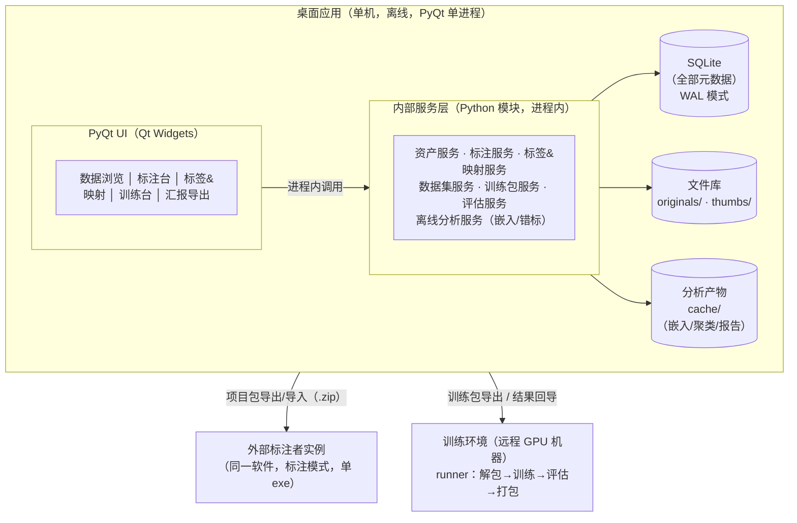

# 工业视觉数据平台 · 需求澄清、可行性评估与系统设计

| 项目 | 内容 |
|---|---|
| 文档版本 | v1.37 |
| 日期 | 2026-11-25 |
| 状态 | 方向性草案，未定稿；只作大方向指导和重大冲突提醒，不作为开发任务或验收依据 |
| 文档性质 | 工作草案，随讨论与迭代修订；具体任务、需求和改动以用户后续消息为准，变更记入文末变更记录 |

---

> **执行边界：**本文件只用于建立背景、讨论方向和识别重大冲突，不是任务清单、需求基线或验收标准。阅读后不得据此自行拆解或执行开发任务。若用户后续需求与本文存在重大方向冲突，应先指出冲突章节、影响、备选方案及成本，由用户决定是否继续；非重大差异不阻塞任务。

> **文件命名说明：**正文已升至 v1.37；文件名沿用 `-v1.6.md` 以保持历史链接不失效，版本以本页表格和 §10 变更记录为准。

## 1. 项目背景与目标

### 1.1 背景
开发一款自用的工业视觉数据平台。形态上对标的商业产品是 Handdle AI（东声智能）/ AIDI（阿丘科技）这类工业视觉平台——它们证明了"标注+训练+调优+评估"一体化平台在工业质检场景的价值，但为**闭源商业软件**，且数据管理以项目为单位，不满足本项目的灵活性要求。

立项前对主流开源方案做了调研（详见 §2 可行性评估），结论如下，构成本项目自研的必要性论据：

| 调研对象 | 类型 | 核心结论 |
|---|---|---|
| Labelme / X-AnyLabeling | 开源标注工具 | 文件中心模型：标注即写文件，无资产级元数据、无血缘、无数据集版本；X-AnyLabeling 的 AI 辅助标注与画布实现值得参考（其本身为 PyQt 应用，代码可直接研读），但其架构与本系统"元数据中心"冲突，**参考不集成** |
| CVAT / Label Studio | 开源标注平台 | 任务中心模型：强于多人协作分发，但数据管理以"标注任务"而非"数据资产"为中心，无训练闭环、无类别解耦；部署形态（Web 服务）也不符合单机桌面要求 |
| Intel Geti | 开源全流程平台 | 概念上最接近"标注→训练→部署"闭环，证明该形态可行；但面向 OpenVINO 生态、运维重（K8s）、无本地数据资产管理，**过重且不对口** |
| Anomalib 等算法库 | 开源算法库 | 仅提供算法不提供平台；其异常检测能力列入长期候选（非监督缺陷检测） |

因此本项目差异化重点是**更灵活的数据资产管理与标注-训练闭环**：以数据资产+统一元数据为中心，标注和训练都是元数据的生产者与消费者。现场生产持续产生图片：一部分用于训练/测试，一部分用于汇报、存档、复盘。当前"直接放桌面"的管理方式已出现混乱。

### 1.2 核心目标

| # | 目标 | 状态 | 说明 |
|---|---|---|---|
| 1 | 2D 图像多任务标注：分类 / 检测框 / 分割掩码 / OCR / 关键点 | 方向性参考 | 由"支持多种数据格式的标注"经澄清收敛而来（见 §3） |
| 2 | 集标注、训练、调优于一体 | 方向性参考 | 训练以"训练包导出+远程执行+结果回导"方式闭环（见 §6.6） |
| 3 | 数据资产管理能力 | 方向性参考 | 本项目最大差异化点（见 §1.1、§2） |
| 4 | 标注与训练类别粒度解耦：标注细、训练粗，映射随项目演进 | 方向性参考 | 映射表+版本快照方案（见 §6.1） |
| 5 | 自监督模型辅助标注，检查类别间数据交叉干涉 | 已降级 | 降为离线批处理分析，不进标注界面（见 §7） |
| 6 | 数据集、训练、评估三模块深度解耦 | 方向性参考 | 解耦数据契约而非部署形态（见 §6.2） |
| 7 | 图片 ↔ 模型双向血缘；多个同任务数据集合并训练一个模型 | 方向性参考 | 含数据集级采样权重（见 §6.4） |
| 8 | 数据用途管理：区分训练 / 存档 / 汇报 | 已重构 | 生命周期+汇报集合+派生资产+血缘派生（见 §6.3） |
| 9 | 标注内容修订、图级审核与生命周期归档可审计 | 方向性参考 | 追加式 revision 与独立状态审计（见 §3.3、§5.3） |

### 1.3 范围控制清单（短期不做，长期视条件规划）

以下各项**短期（MVP/二期/中期）不做**，其中多数属于长期候选规划，触发条件满足时重新评估；**唯一例外是末项"嵌入可视化大屏"，长期也不做**（理由见 §7：对单人/清单式工作流无价值，此为已评估结论而非范围收敛）。

| 功能 | 性质 | 重新评估的触发条件 |
|---|---|---|
| 多租户 / 复杂权限体系 | 长期候选 | 协作角色 ≥10 人，或软件转为多组织共用 |
| 实时协同标注 | 长期候选 | 多名标注者必须同时在线作业（当前项目包离线分发模式失效时） |
| 产线对接 / 在线推理 | 长期候选 | 出现实时检测产线需求（当前定位仅为离线数据闭环） |
| 视频 / 点云 / 文本 / 音频 | 长期候选 | 实际业务出现对应数据类型（当前仅 2D 图像） |
| 标签规则引擎 | 长期候选 | 出现属性条件合并需求（如"长度>5mm 的划痕算 NG"），映射表被证明不够用 |
| K8s / 分布式训练调度 | 长期候选 | 训练机 ≥3 台且排队冲突成为日常瓶颈 |
| 独立后端服务进程（FastAPI） | 长期候选 | 需要向远程训练机或第三方工具暴露 API 时（当前单进程内调用，见 §4.2） |
| 嵌入可视化大屏 | **不做（含长期）** | —— |

---

## 2. 可行性评估总结

| 需求 | 结论 | 说明 |
|---|---|---|
| 2D 图像五任务标注 | 合理，但为第一大工程风险 | 五任务均分要求"统一画布+分层交互"，详见 §9 风险 |
| 标注+训练+调优一体 | 合理，技术成熟 | Intel Geti 已开源证明该形态可行；难点在工程量 |
| 数据管理（资产中心） | 合理，自研价值最大 | CVAT/Label Studio 为任务中心，X-AnyLabeling 为文件中心，均无资产级全局检索与血缘 |
| 类别解耦 | 合理，成本可控 | 映射表+版本快照即可，见 §6.1 |
| 自监督辅助标注 | 部分合理 → 离线分析 | 见 §7；先混淆矩阵（免费），嵌入分析排中期 |
| 双向血缘 / 多数据集合训 | 合理 | 血缘是免费查询；合训用派生快照+采样权重，见 §6.4 |
| 汇报/存档/训练用途管理 | 单字段方案有缺陷，已重构 | 见 §6.3 |
| 完整标注修订审计 | 合理，数据层 MVP 必须实现 | 追加式 revision；查看 UI 可后置，见 §3.3、§8 |
| 整体自研 | 成立 | 自用+开源、离线闭环、资产中心，三点共同支持自研 |

---

## 3. 需求澄清记录

| # | 问题 | 结论 |
|---|---|---|
| 1 | 数据类型 | 只做 2D 图像 |
| 2 | 标注任务类型 | 分类/检测框/分割掩码/OCR/关键点，各约 1:1:1:1:1 |
| 3 | 部署形态 | 单机桌面应用（技术栈见 §4） |
| 4 | 并发与协作 | 无多人同时在线；需分发给外部人员标注，提供项目包导出/导入/合并 |
| 5 | 数据规模 | 当前 2000 张，日增约 100 张，分辨率 1024×1024 |
| 6 | 训练资源 | 训练机 ≠ 标注机（"不同训练环境"），任务为 20h 级长跑 |
| 7 | 汇报形态 | 拼图、截屏、原始图、带缺陷渲染图都有；现场实施/售后统计，PM 使用，每日小量（<1000） |
| 8 | 许可 | **自用、开源，最终采用 GPL-3.0**；参考 X-AnyLabeling（GPLv3）画布 |
| 9 | 类别解耦 | 纯多对一合并，映射随项目演进变化 |
| 10 | 产线关系 | 不做产线对接，只做离线数据闭环 |
| 11 | 存档语义 | 日常视图收纳 + 合规留存；保持可逆+审计模型 |
| 12 | 合训采样权重 | 需要数据集级采样权重 |
| 13 | 汇报集合 | 嵌套、按"项目+日期"自动归集，含操作员与备注 |
| 14 | 技术栈 | **PyQt 单进程，Qt Widgets，绑定选择 PyQt**；具体发行版本随依赖锁定，不再单列待确认 |
| 15 | 标注审计 | **需要完整 annotation revision 审计**；数据层 MVP 必须实现，复杂查看 UI 可二期 |

外部标注者规模、训练机框架习惯以及是否执行固定周期的画布验证/B 计划，不作为当前待确认或阻塞事项。

### 3.1 数据与交换格式的版本管理

软件版本、数据库结构版本和交换包格式版本分别管理，**不在 `project` 表设置含义不明的 `version` 列**：

| 对象 | 机制 | 用途 |
|---|---|---|
| SQLite 数据库结构 | `PRAGMA user_version` 记录当前 schema 版本；启动时读取并执行有序、事务化、带备份的迁移；迁移记录可附于 `schema_migrations` 表 | 防止旧库被新程序静默改写，支持升级与排障；程序与库不兼容时明确阻止启动 |
| 项目包 / 训练包格式 | 包清单中的 `format_version` | 决定包内字段和结构能否被当前程序解析 |
| 交换包的生产软件 | 包清单中的 `producer_app_version` | 记录生成包的软件版本，仅用于诊断和兼容策略，不代替 `format_version` |
| 外部回导批次 | `import_session.app_version`（可选） | 追溯某次回导所使用的软件版本 |

`project` 会在不同软件版本中被反复打开和编辑，单一项目版本号无法表达这些事实。交换包格式版本与应用版本必须独立演进。

### 3.2 图像尺寸口径与状态归属

- `asset.width/height` 是导入时从原图提取并物化的**显示方向尺寸缓存**：读取并应用 EXIF orientation 后，与标注画布及坐标系一致。文件像素矩阵的原始宽高若需排障，可另存为 `raw_width/raw_height`，不得与显示尺寸混用。原图内容始终是尺寸权威，表中缓存用于免读文件的列表展示、筛选、坐标校验和训练导出；哈希或尺寸不一致视为数据异常，不静默信任缓存。
- 审核状态是**图级工作流事实**，统一存放于 `asset.state`；`annotation` 不保存另一份 `state`。图级状态机为 `unlabeled / labeling / review / finalized / rejected`。新增或修改标记、提交审核、驳回、定稿通过明确的服务层操作改变图级状态，禁止仅依赖人工同步。
- **图片级 `checked` 已从数据库与搜索中移除**：数据库不建列、搜索语法不提供 `checked::`；旧 JSON 中的 `checked` 导入时忽略，不再作为审核事实。当前文件表勾选/审核动作仍保留为 JSON 兼容，属于 P4 清理项；图级审核按上一条的 `asset.state` 方向演进，对象级仍保留 `review_status`。
- `annotation.created_at/updated_at` 由服务层统一维护，用于展示、增量同步和排查；`updated_at` 不用于外部项目包的冲突判定（外部实例时钟不可信），合并按 §6.5 的稳定标识与人工裁决。
- `asset.derived_from` 是派生资产指向原图的血缘关系，不可从图片内容重算，必须保留；训练采样排除派生资产、汇报回溯原图、文件 GC 均依赖该关系（见 §6.3）。

### 3.3 审计范围与不可变历史

系统区分三类变化，分别记录，不混用一张通用日志表：

| 对象 | 当前状态 | 历史记录 |
|---|---|---|
| 标注内容（类别、几何、删除） | `annotation.current_revision_id` | `annotation_revision`，只追加 |
| 图级审核状态 | `asset.state` | `asset_state_audit`，只追加 |
| 生命周期归档 | `asset.lifecycle` | `lifecycle_audit`，只追加 |

- revision 覆盖每次内容创建、修改和删除；删除以 `operation=delete` 的墓碑 revision 表达，不物理删除历史。
- revision 的 `revision_no` 在各自实例的同一 annotation 内递增；跨实例的唯一性由 UUID 等稳定标识保证，见 §6.5。
- `editor/reason/source_instance/created_at` 用于追溯；时间戳不用于外部冲突判定。
- 训练复现与内容审计是两种不同职责：训练快照保留冻结内容，revision 保留完整修订过程，二者都不可省略。
- 数据库约束、服务层事务和备份只能降低误改风险，**不声称提供防管理员篡改或密码学不可抵赖**；如未来出现该合规需求，另行评估哈希链、签名或外部存证。

### 3.4 操作员归属与账号库边界（fork.4 已落地的最小实现）

数据库改造（T3）落地前，产品先用“本地账号 + 标注文件字段”承载“谁改的”，其边界如下：

- **账号库是应用级的**：位于系统应用数据目录（Windows `%APPDATA%\X-AnyLabeling\operators\operators.db`，Linux/macOS 使用 XDG/Application Support），与 `--work-dir` 无关，随软件/机器走，不随项目分发；账号只记录名称、口令哈希、管理员与禁用标记。
- **归属是数据级的**：XLABEL JSON 顶层 `author`（操作员名称，或 `"none"`）与 `modified_at`（本机 ISO 8601）。只有标注内容、flags、tags、description、relations 实质变化才更新；`split` 变化不更新；导入/外部数据为 `"none"`，不反推时间、不冒名。
- 两者只共享增删改查的实现形态，**不共享存储、不做外键关联**；项目数据库不得依赖账号库或登录状态才能打开、标注。

T3 落地时的对齐要求：

1. `annotation_revision.editor`（本文 §3.3、§5.3）沿用同一语义：以**名字字符串**记录操作者，不建到账号库的外键，保证跨实例与离线合并可解释；
2. 若一期需要“最后操作者”，可在图片/标注行冗余 `last_operator`、`last_modified_at`，与 JSON 字段同义且不得出现相反值；
3. 迁移导入把 `author` 原样带入（缺失即 `none`），不得用当前登录操作员覆盖；
4. 登录与门禁属于 UI/应用层，不是数据库访问前提；本设计仍不引入多租户或复杂权限体系（§2 长期候选条件未触发）。

---

## 4. 系统架构（方向性建议）

### 4.1 总体形态：PyQt 单进程桌面应用



### 4.2 关键技术决策

| 决策 | 方案 | 理由 |
|---|---|---|
| 桌面框架 | **PyQt 单进程**：UI（Qt Widgets）与后端逻辑同进程，无独立服务、无 IPC；GUI 绑定采用 PyQt，具体发行版本随依赖锁定 | 单机离线+外部标注者分发的最轻形态：单 exe 双击即用；避免浏览器壳的 Python+JS 双栈、服务进程与 IPC |
| 标注画布 | **QGraphicsView / QPainter + 交互分层**，参考 X-AnyLabeling（同为 PyQt）的画布实现；框/多边形/关键点共用几何内核；OCR 转写与分类走属性面板 | 五任务均分下只自研一个几何内核；参考成熟实现降低工程风险 |
| 数据库 | SQLite（WAL），不引入独立 DB 服务；标注内容采用追加式 revision | 规模下足够；零部署、单文件备份；保证历史可审计 |
| 文件存储 | 本地目录，内容寻址（sha256 前两位分桶），**原件只读永不修改**；**引用计数 + GC 保护** | 保证历史模型可复现 |
| 内部服务层 | 进程内 Python 模块，直接函数调用；模块边界即 §6.2 的产物契约；**不引入 FastAPI** | 单进程下 HTTP 服务与 IPC 是纯负担 |
| 训练解耦 | 训练包导出 + 远程 runner + 结果回导 | 训练机环境多变、20h 长跑，与桌面应用完全解耦 |
| 不引入 | MinIO、PostgreSQL、MLflow/ClearML、向量数据库、队列框架、独立后端服务进程 | 规模不支持，全部过度设计；实验元数据自建表 |
| 开源复用与许可 | **项目采用 GPL-3.0**；画布参考 X-AnyLabeling（GPLv3）；训练侧优先 Apache-2.0 系框架 | 与参考 GPLv3 代码及 PyQt 的 GPL 许可路径兼容；发布前仍须审计依赖与素材许可证 |

### 4.3 模块清单

| # | 模块 | 职责 | 阶段 |
|---|---|---|---|
| M1 | 数据接入 | 目录监听/手动导入、sha256 去重、尺寸/EXIF、缩略图、生命周期初始值、派生资产识别 | MVP |
| M2 | 数据管理 | 多维检索；训练血缘面板；批量操作；生命周期管理、图级审核审计 | MVP |
| M3 | 标签体系 | 细标签 CRUD、标签组、映射表及版本、映射对比视图、类别干涉报告消费入口 | MVP（映射 v1） |
| M4 | 标注 | 五任务统一画布、图级状态机、**每次内容写入生成 revision**、AI 预标注挂接点；分割画布支持 outer+holes | MVP 先框+分类+revision 记录；分割（含孔洞）/OCR/关键点二期 |
| M5 | 项目协作 | 项目包导出/导入/合并；保留跨实例稳定标识与 revision 来源；冲突清单、人工裁决 | MVP 简化版；二期完整版 |
| M6 | 数据集与训练 | 图片成员+冻结标注/类别/几何+revision 引用+映射版本+孔洞策略+清单哈希；合并派生快照；训练包导出与结果回导 | MVP 检测链路；其余任务二期 |
| M7 | 评估 | 独立评估：任意（模型 × 兼容数据集）组合、双口径指标、交叉评估矩阵 | MVP 基础版；二期独立评估 |
| M8 | 汇报导出 | 汇报集合（嵌套/自动归集）、拼图模板、渲染图副本、统计报表 | MVP 基础版 |
| M9 | 离线分析 | 嵌入批提取、k-NN 错标清单、类别对干涉报告、置信度分析 | 中期 |

### 4.4 文件表、搜索与统计的性能约束

本节记录已确认的界面数据路径与性能要求，避免把“数据库化”误做成“仍逐图读文件/逐行排缩略图”。

**数据来源**

- 文件表、单图读写、搜索、统计、类别页在 DB 模式下一律以 `xanylabeling.db` 为权威；不读来源 JSON。
- 图片本体仍在磁盘，DB 只存路径与元数据；缩略图必须从原图解码，不能假设 DB 能替代图片 I/O。
- 统计表从 DB 聚合（类别 × split、无对象），不扫描 JSON。

**文件表与缩略图**

- 文件表行由 `image_summaries()` 一次查询生成；禁止在行构建循环中逐行读 JSON。
- **缩略图必须懒加载**：只请求视口附近的行，滚动/排序/切换缩略图时再补；禁止在 `append_row`/`append_db_row` 中为全部行立即排队缩略图任务。当前实现见 `FileListController.request_visible_thumbnails()`。
- 7553 图的实测目标（离屏、不含真实图片解码）：文件表构建约 1s 量级；缩略图全量排队不得成为首屏瓶颈。
- **虚拟化要求**：当前 `QTableWidget` 在 7553 行约 0.8s 可接受；当目标规模达到数万行时，必须迁移到 model/view 虚拟化（或等效的行按需创建方案），不能继续为每行创建 6 个 item。该迁移是已确认的演进需求，不要求在当前批次实现，但不得用“QTableWidget 也能跑”否定。

**搜索**

- 搜索栏是**人可读的查询 DSL**，执行层应尽量编译为 SQL；禁止把“字段是给人看的”误解为“只能逐图 Python 求值”。
- 已下推 SQL 的字段：`label::`、`split::`、`shape::0`、普通文件名子串，以及它们的逗号 AND 组合；统计页点击反筛属于这一类。
- 复杂表达式（布尔分组、属性、描述、正则、`#N` 的进一步优化）可回退到统一语义的 Python 求值；回退必须保持与 SQL 快路径相同的标签/AND 语义。
- 搜索/统计反筛不得自动打开或解码第一张图；只刷新列表，用户点击行后再加载。
- 文件名搜索优先使用 SQL（`file_name`/`rel_path` 的 `instr`/LIKE 或等价数据库过滤）；复杂正则再回退。

**审核状态**

- 图片级 `checked` 已从 DB、软件状态和搜索语法中移除；不要重新引入 `checked::` 或把旧 JSON 的 `checked` 当审核事实。
- 对象级 `review_status` 仍保留；图级审核按 §3.2 的 `asset.state` 方向演进。

**验收口径**

- 文件表/统计/搜索的耗时以真实 1 万图量级数据集测量，不以 2–3 张图冒烟代替；
- 性能改动必须记录测量环境、数据量、是否包含图片解码；
- 不能以“数据库查询快”掩盖逐行 UI 构建或缩略图排队成本。

### 4.5 窗口 chrome、文件表操作与右侧栏交互约束

本书记录已经确认的界面交互约束，避免后续改版重新引入重复入口或隐藏状态。

**标题栏与全屏**

- 自绘标题栏只承载窗口级控制：侧栏开关、全屏切换、最小化、最大化/还原、关闭，以及操作员芯片；业务入口（编辑图片标签等）不再占用标题栏。
- 全屏是**一个按钮**：进入与退出共用同一按钮，图标与提示随状态变化；标题栏右键菜单不重复提供全屏项。`视图` 菜单与 `F11` 仍保留，三者共用同一动作，不得出现状态不同步的第二套状态。
- 原生窗口模式下没有自绘标题栏，全屏入口回退到工具条，行为不变。

**文件表列**

- 文件表固定为五列：`文件`、`对象`、`导入时间`、`推理`、`划分`。**不设 `标签` 列**；图片标签（`tags`）只在右侧“图像属性”页查看和编辑，避免同一事实两个展示出口。
- `对象` 列只显示对象数量，**不显示图片级审核状态圆点**；`checked` 仍按既有 JSON 契约保存和读写，状态入口为画布左下角面板、画布右键“检查状态”、快捷键与文件名 tooltip。后续若做 `asset.state` 图级审核 UI，再统一审核展示，不要恢复“对象列圆点”。
- 表头右键仍可显示/隐藏其余可选列；列宽与显隐偏好继续持久化。

**对象编辑对话框**

- 新建/编辑对象的对话框标题固定为 **对象编辑（Object Edit）**；同一对话框同时承担新建时的类别/属性录入与编辑时的修改。
- 类别列表单击即把类别名填入“对象类别”输入框，**只有一个类别时也必须生效**（不能依赖“当前项变化”事件）；双击类别名直接确认。

**文件表批量操作**

- 文件表右键菜单必须提供 **设置标签（Set Tags…）**：对当前选中行（Ctrl/Shift 多选）一次性执行标签操作，对话框标题为 **批量设置图片标签**；支持三种模式：
  - **添加到现有标签**：把输入的一组标签追加到每张图，已有不重复；
  - **替换指定标签**：把每张图中的旧标签（如 `xxx`）替换为新标签（如 `yyy`），其它标签保留；不含旧标签的图片保持不变，不能退化成“整组覆盖”或“批量添加”；
  - **删除所有图片标签**：清空这批图片的全部图片标签，必须在执行前二次确认。
- 对话框应从当前文件夹/数据集的标签库读取已有标签，提供“从标签库添加”选择，避免重新输入；替换模式的旧标签可从标签库选择或直接输入。
- 图片标签属于标注内容，批量写入需要已登录操作员；正常打开文件夹时自动建库，批量写入走数据库 `image_tag` 并盖章 `author`/`modified_at`；旧 JSON 目录只在首次迁移时读取 JSON，之后不再回到 JSON 读写路径。标签未变化的图片不重写、不重复盖章。
- 批量标签只改图片级 `tags`，不触碰 `split`、`shapes`、`flags`、描述或关系；当前打开的图片若在批量范围内，内存中的标签与“图像属性”页同步刷新。

**“类别”页**

- “类别”页必须**实时反映**当前数据集类别：导入图片、创建/删除对象、改名/删除类别、保存标注、导入标注后自动重建，不要求用户再点 `工具 → 标签管理器`。改动在页面可见时合并为一次重建；页面隐藏时只置脏，切页时重建。
- **启动时停留在其他标签页**（对象/统计等），随后导入图片或打开文件夹，再切到“类别”页时必须已是最新内容；切页判断不能依赖“面板控件就是 tab page”的同一性假设（面板位于容器内）。
- 自动重建保留用户已选的文件范围（`From`/`To`），不得悄悄扩成全部文件。
- 类别集合以实际存在的对象为准：某类别所有对象都被删除后不再列出；数据库中的类别字典行可以保留，但不在页面上展示（属于后续 `in_class_list`“隐藏类别”能力）。
- **类别顺序可调整**：数据集类别按 `category.sort_index` 展示，上移/下移即写库；该顺序是后续导出（YOLO/COCO 等类别编号）的权威顺序。升级/导入的新类别追加到末尾，不按导入源顺序重排既有类别（D7/D18）。**YOLO/COCO/DOTA/MOT 导出不得再询问 `classes.txt`**：直接读取“类别”页当前顺序（含 0 对象类别），避免界面类别与外部文件不一致。只有建库失败或没有图片的目录没有可排序的数据集。
- **批量导入类别**：“类别”页表头右上角提供批量导入，输入支持中文/英文逗号、空格、换行分隔；去重后追加到末尾。导入的空类别必须显示在表中，并支持改名/删除；否则词表无法维护、导出顺序也无法调整。
- 未启用数据库的目录没有类别顺序权威，顺序按钮禁用并说明原因，不制造只对当前窗口有效的假顺序。

**“统计”页**

- 统计表的所有数据单元格都可点击过滤，包括 `合计` 行、`合计` 列与 `(合计, 合计)`：
  - 类别行 × 合计列 → 只按类别过滤；`（无对象图）` 行 × 合计列 → 只按“无对象”过滤；
  - 合计行 × 划分列 → 只按该划分过滤；
  - 合计行的标签单元格与 `(合计, 合计)` → 清空搜索条件，显示全部图片（不写入空过滤条件）；
  - 表头点击行为不变（只按划分过滤），`Class`/`Total` 表头不触发过滤。

**“图像属性”与标签库**

- “图像属性”页保留 **图片标签**（`tags`，当前图片的自由文本 chips），其下方原“标志”复选框区改为 **标签库**；图片级 `flags` 数据仍保留在标注中，但不再提供独立复选框 UI。
- 标签库列出**当前文件夹/数据集内已经出现过、且当前图片尚未添加**的图片标签；按使用次数从多到少排序；支持搜索过滤与收起/展开。文件表被搜索过滤时，标签库仍保持整个文件夹/数据集的词表，不随筛选结果缩水。
- **双击**标签 = **立即写入并保存**：需要已登录操作员，保存路径按归属契约写 `author`/`modified_at`；未登录时点击必须弹出登录提示（标签库本身保持可点击，不因浏览模式禁用）。成功后该标签从库中消失，当前图片 chips 同步。单击只选中、不写入（避免手滑），选中后按 `Enter` 也可添加。标签库只负责添加，移除仍用 chips 上的 ×。
- **查找使用某标签的图片**：右键标签（或 `Ctrl+单击`）把 `tags::标签名` 写入文件搜索框并立即筛选；搜索语法必须支持 `tags::xxx`（精确、不区分大小写），走 `image_tag` 的 SQL 快路径。
- 数据源：标签库/`tags::` 按数据集全部活跃图片查询 `image_tag`；文件表搜索过滤不改变标签库词表。旧 JSON 目录只在首次建库迁移时读取 JSON。
- 不把图片级 `flags` 的布尔值混入标签库：两者是不同字段，混用会把布尔标志当自由文本标签。

### 4.6 上传契约与界面文案维护（fork.49）

**上传写到哪里，由数据源决定，不由格式决定**

- 数据库模式下数据集库是唯一数据源：任何“上传”必须写入数据集（`image_object`/`image_file`），**不得只写 JSON sidecar**。历史缺陷是“上传成功但界面无变化”，根因就是写 JSON 而界面读库。
- 一期已接入的是 YOLO 检测/分割/旋转框/姿态（外部 txt → DB）。未接入的格式（COCO/VOC/DOTA/MOT/MMGD/Mask/ODVG/PPOCR/VLM-R1）在数据库模式下必须**明确拒绝并说明原因**，不允许静默写 JSON。
- 类别来源优先级：数据集 `category.sort_index` → 最近的 `classes.txt`（`obj.names`/`names.txt` 兼容）→ `data.yaml` 的 `names` → 用户临时指定。同类顺序必须与导出共用同一权威（类别页顺序），避免“导出的 0 号”和“上传的 0 号”含义不一致。
- 标注目录默认推断 `images/<split>` → `labels/<split>`（保留 split），用户输入上级 `labels` 时允许自动下钻；解析失败必须按“文件:行:原因”逐条报告，不允许整批因一条坏行静默中断。
- 外部数据写入不冒充操作员：上传不写 `author`/`editor`，与“导入/转换数据一律 `none`”的归属契约一致。

**界面文案与翻译维护**

- 所有用户可见文案必须同时存在于 `.ts` 并编译进 `.qm`；仅有源码字符串不算完成。
- 翻译上下文必须与运行时一致：类方法用 `self.tr`；自由函数与类内非 `self` 接收者用模块级 `TR_CONTEXT` 或显式 `QCoreApplication.translate("Context", …)`；对话框基类自己的文案用显式上下文，不能依赖 `self.tr`（基类会登记到基类、运行时按子类查）。
- 该约束由测试固化（缺失条目、未解析上下文、`.qm` 与 `.ts` 不一致均视为失败），不依赖人工记忆。
- **译文不得调换 `%` 占位符的顺序或类型**：界面字符串用 Python `%` 按位置套参数，`%d`/`%s` 互换会在运行时抛 `TypeError`（fork.50 曾导致“上传 → YOLO Seg”崩溃）。需要调整语序时改写句子结构；确实要重排只能改成命名占位 `%(name)s` 并同步调用点。该规则由 `tests/test_i18n` 的占位符守卫覆盖。
- **动态翻译写法必须可被抽取工具识别**：`self._tr(...)`、`self.tr(常量)`、`for x in 常量元组`、`_translate("form", ...)`、`QT_TRANSLATE_NOOP(...)` 这些写法 `pylupdate6` 抽不到，重建 `.ts` 时会被当作废弃条目删除（fork.51 曾因此让右侧栏、回收站、自动标注面板整块回退英文）。新增此类写法时必须让 `scripts/translation_scan.py` 能解析，并在重建后**再跑一次生成、确认 `.ts` 无变化**（幂等）且 `tests/test_i18n` 通过；无法静态解析的动态字符串应改为字面量调用。
- **控件与对话框不得注入翻译函数**：构造函数接受 `translate`/`tr` 回调（如 `TagLibraryWidget(translate=host.tr)`）会让注册上下文（类名）与运行时上下文（`LabelingWidget`）永久不一致，`.ts` 有条目也不生效（fork.52 修复了图像属性页标签库因此长期英文的问题）。控件一律用自身 `self.tr`；确需跨上下文时由调用方用自己的 `tr` 处理**文本**后传入字符串。

### 4.7 数据集管理与合并契约（数据集中心，规划）

**定位与边界**

- “数据集中心”是**独立窗口**（菜单 `文件 → 数据集中心…`），不是右侧栏的 tab。右侧 tab 条承载单图上下文（对象/类别/图像属性/描述/统计）；数据集是项目级对象，混入 tab 会在“未打开数据集”时不可用，且侧栏宽度放不下合并向导。
- 中心管理“已知数据集”：查看概览、切换/新窗口打开、写注释、合并、移除记录、（P1）删除。数据集仍是一个数据库 = 一个数据集，合并结果是一个库，不是“多数据集库”。
- **项目（project）不在本期**（见“与项目的关系”）。

**身份与注册表**

- 数据集身份 = `dataset.uuid` + 数据库绝对路径（Windows 路径比较不区分大小写）；**名称、文件夹名都不参与身份判定**。两个不同路径但同名目录的数据集是两个独立数据集，不做任何“同名自动合并”。
- 已知数据集列表存在应用级注册表（`%APPDATA%/X-AnyLabeling/datasets.json`；Linux `$XDG_CONFIG_HOME`、macOS `Application Support`），只存路径、最近打开时间、显示名缓存；打开前校验文件存在、`PRAGMA application_id`、`PRAGMA user_version`，失效项标灰并可“移除记录”。
- “移除记录”只删注册表条目，不动文件与数据库；真正删除数据集属于 P1，需二次确认（输入数据集名）+ 先备份（`VACUUM INTO` 到 `.backup/`），P0 不提供。

**概览统计口径（全部查库、不扫 JSON、不打开图片）**

- 图片：总数、活跃/回收站数、`split` 四类计数（`train`/`val`/`test`/`none`），百分比。
- 类别：类别数（含 0 对象类别）、对象总数、每类对象数与图片数（复用 `category_counts()` 与 `v_category_split_stats`）。
- 标签：tag 种类数、每个 tag 的图片数（复用 `tag_counts()`；`None` 表示全库，`COUNT(*)` 已是图片数），支持搜索与“只看某个 tag 的图片”（沿用 `tags::` 查询）。
- 实现约束：用只读连接（`DatasetDatabase.open(path, read_only=True)`）计算，避免与编辑窗口争写锁；结果缓存并在切换数据集/写操作后失效；口径与右侧“统计”页一致（排除软删、无对象图计入“未标注”）。
- 大数据集（万级）概览必须在一次打开内完成（SQL 聚合），不得逐图解码。

**数据集注释**

- 复用 `dataset.description`（已有列，`TEXT NOT NULL DEFAULT ''`），**无需 schema 迁移**；中心内可编辑并保存，同时刷新 `dataset.updated_at`。
- 写入走 repository（新增 `update_dataset_metadata()`），不直接拼 SQL；列表展示注释摘要。
- 归属见“未决 U4”：dataset 表没有 `editor` 列；建议注释属于内容元数据、按“内容修改需登录”处理，但一期只记录 `updated_at`，不伪造归属（不写 `editor`，与导入数据归属契约一致）。

**合并契约（并集语义，源 → 目标）**

- 合并 = 把源数据集的**图片行、标注对象、标签、类别**并入目标数据集，得到并集；**不删除、不修改源库**（“合并后删除源”不在本期）。
- 冲突与身份（向导逐项确认，预检报告先行）：
  1. **图片文件**：`rel_path` 是相对数据集根的路径，跨库不可比（两个库都可能有 `images/train/001.jpg`）。已定（R4）**命名空间导入**：把源图片复制到 `<目标根>/imported/<源标识>-<session>/…` 并保留源相对结构，`rel_path` 天然唯一；不再提供“保留原 `rel_path`”选项。内容哈希去重未落地（`image_file.sha256` 延期），疑似重复只在预检报告提示、不自动跳过（R11）；P2 再做哈希去重。
  2. **类别**：`ux_category_name` 唯一索引 `(dataset_id, name) WHERE is_deleted = 0` 决定同名类别只能存在一行——**同名归并是数据模型约束，不是可选项**；可选的是“不同名类别的映射”（源名 → 目标名，默认不映射、各建一条）与“是否导入 0 对象的源类别”。映射只允许用户显式指定，绝不按目录名或文件路径推断。
  3. **对象**：`uuid4` 全局唯一，直接并集；`group_id` 是图片内分组（关键点组），合并不需要跨图重编号；`relation` 的 subject/object 均在同一图内，随对象重建。
  4. **split**：同一图在两库可能有不同划分；默认**保留源**（导入后可在文件表改），可选统一为某值或按比例重分。
  5. **标签/描述/归属**：tag 并集去重（`image_tag` 主键去重）；图片 `description` 冲突默认保留目标；`editor`/`modified_at` 不冒充操作员（按导入契约置空/`none`）。
  6. **类别顺序与颜色**：目标 `sort_index` 追加源类别顺序；新增类别用源颜色，冲突保留目标。
- 合并目标（R8）：支持“多源 → 已打开目标”与“合并到新数据集”（选若干源 → 新建空库并入，schema 与 `DatasetDatabase.create` 一致）；两种目标都写 `add`/`merge_target` 注册事件。
- 事务与可恢复性：合并前目标库 `VACUUM INTO` 备份；分批单事务写入（批次大小可配），后台线程 + 进度 + 可取消；失败回滚当前批次、已提交批次保留并记录，源库不受影响。
- 溯源：每次合并写一条 `import_session`（`source_format='dataset-merge'`、`source_path=源 DB 路径`、`category_map_json`、`stats_json`、`options_json` 记录冲突策略），图片行带 `import_session_id`。**不需要 schema 变更**。
- 预检（dry-run）：只读计算“将新增/冲突/跳过”的图片与对象数、类别合并结果与映射，先出报告，再执行。

**与项目的关系**

- 现状没有 `project` 实体，数据集是顶层；训练/评估也未挂到项目。
- 本期：中心按“数据集列表 + 详情”设计，信息架构**预留分组/面包屑位**（顶部筛选区），但**不引入 project 表、不做项目创建**。理由：项目要同时定义与数据集（1:N）、训练、评估、导出、权限的关系，属于独立设计，过早落地会把尚未定稿的归属固化进 schema。
- 二期：project 作为容器，新增 `dataset.project_id`（可空）或独立 `project` 表；届时中心窗口增加“项目”一级列表/筛选即可，不需要推翻现有窗口。
- 本期决定（R3，用户 2026-11-25 确认）：不实现“轻量项目 = 分组标签”，也不建 project 表；窗口只预留分组位。若将来做，必须同时定义“项目删除后数据集如何保留”。

**注册表与当前数据集（fork.54 实现约束）**

- 打开目录即视为使用该数据集：数据集中心每次刷新都会校验并自动登记当前打开的数据集（`xanylabeling.db`），因此“打开文件夹后中心为空”视为缺陷；
- 概览/校验/合并源读取使用 `DatasetDatabase.open_for_reading()`：先只读打开，WAL 被占用或只读 URI 失败时回退普通连接，不得把“暂时打不开”误报为“不是数据集”；
- 校验失败必须带路径与原因，便于定位被外部移动/删除的数据集。

**标签库显示约定（fork.58）**

- “标签库”始终显示当前文件列表的**完整标签词表**，已用于当前图片的标签不再消失，只做弱化标记；双击已存在的标签不再写入并提示“该标签已在此图片中”；
- 理由：标签库同时是搜索入口（右键/Ctrl+单击），移除已用标签会导致无法搜索该标签的图片；词表稳定后，同一控件可在“图像属性”页与“批量设置图片标签”窗口中无差异复用；
- 此约定由 `tests/test_widgets/test_tag_library_widget.py` 覆盖。

**入口与多窗口**

- 入口：`文件 → 数据集中心…`、工具栏按钮（fork.55；`layers` 图标，同时出现在工具栏设置列表）；标题栏**中央**“当前数据集”chip（fork.57 居中：作为标题栏子控件按窗口中心定位，并在窄窗口下限制在菜单栏与右侧控件之间；显示“数据集：<名称>”，菜单提供“数据集中心…/切换数据集（列注册表 active 项）/关闭数据集”；无数据集时显示“未打开数据集”，关闭动作置灰；原生边框模式下 chip 落到工具栏）。
- 概览使用表格呈现：**概览（指标/数值/占比）、类别（类别/图片/对象/图片占比/对象占比）、标签（标签/图片/图片占比）三个 tab**（fork.58，汇总表也放进 tab），便于逐行核对；合并目标下拉显示“显示名（数据库路径）”，同名数据集可区分（fork.55）。
- 打开方式：默认在当前窗口替换；可选“在新窗口打开”（每个窗口独立 DB 连接；SQLite WAL 支持多读、写串行，切换/写入后需刷新其他窗口的列表与统计——P0 若不做多窗口则明确只支持单窗口）。
- 切换/关闭前若有未保存修改，沿用现有 `may_continue()` 确认流程。

**非目标（本期）**

- 内容哈希去重、虚拟/链接式数据集（多 root）、云端/远程数据集、跨数据集联合视图、项目/训练归属、合并后删除源。

**决策记录（2026-11-25 用户确认，R4–R13）**

| 编号 | 问题 | 结论 |
|---|---|---|
| R1 | 合并是否复制图片 | **复制**：源图片复制进目标数据集根目录，源库/源文件不改动 |
| R2 | 合并是否提示类别映射 | **是**：向导展示同名归并结果与跨名映射，映射只由用户显式指定 |
| R3 | 本期是否做项目 | **否**：本期只做数据集中心；项目层将来并入同一窗口（分组/面包屑），不单开窗口 |
| R4 | 复制落盘路径（原 U1） | **命名空间子目录**：`<目标>/imported/<源标识>-<session>/…`，保留源相对结构；不提供“保留原 `rel_path`”选项（避免冲突策略复杂化） |
| R5 | 合并后 split（原 U2） | **保留源**；向导另给“统一为…”下拉（可选） |
| R6 | P0 是否含删除数据集（原 U3） | **含删除**，但必须：①删除前二次登录确认（重新输入当前账号密码）；②删除动作写入软件日志与审计表；③先备份再删；详见下方“删除与外部缺失处理” |
| R7 | 注释是否要求登录（原 U4） | **要求登录**；只更新 `updated_at`，不写 `editor`（`dataset` 无该列） |
| R8 | 合并目标形态（原 U5） | **C：支持“合并到新数据集”**（选若干源 → 新建空库并入）；同时保留 A（多源 → 已打开目标） |
| R9 | 合并登录要求（原 U6） | **要求登录**；浏览模式禁止合并 |
| R10 | 空类别/无标注/回收站图片（原 U7） | **A**：空类别导入、无标注图片导入、回收站图片跳过；向导提供“跳过空类别”开关（默认关） |
| R11 | 重复图片（原 U8） | **已实现（fork.62）**：`image_file.content_sha256`（文件字节 SHA-256，schema v2）作为精确身份；合并与新文件夹导入时按 SHA-256 分组，**由用户在预览对话框中选择**“两者保留 / 仅保留一条”（标注相同）或“各自保留 / 合并到一条”（标注不同），不自动删除；pHash 近似查重暂不做。 |
| R12 | 多窗口打开（原 U9） | **A：本期只支持当前窗口替换**；多窗口打开记录为后续升级项（U12），待独立设计 |
| R13 | 列表操作范围（原 U11） | **P0**：重命名、打开所在目录、复制路径、排序/搜索；**P1**：按注释过滤、扫描父目录发现、批量移除 |

**U10 注册表位置评估（已确认：B，fork.53 落地）**

| 维度 | A 应用配置目录 JSON | B 扩展 `operators.db`（`operator` 已存在；新增 `dataset_registry` + 审计表） |
|---|---|---|
| 作用域一致性 | 机器级、与账号目录同处 `%APPDATA%` | 与账号同库（`%APPDATA%/X-AnyLabeling/operators/operators.db`），同一作用域 |
| 事务/并发 | 原子替换可做，但多实例并发写有丢更新风险 | SQLite 事务 + `busy_timeout`，天然串行；多实例安全 |
| 审计能力 | 只能写日志文件（会轮转、不可查询） | 可建 `dataset_registry_event` 追加表，记录谁/何时/删了什么/备份路径 |
| 与账号的关系 | 需另存 `operator_id`，无外键 | 可直接外键到 `operator(id)`（注释人、删除人、最后打开人） |
| 迁移成本 | 新文件格式 + 读写/校验代码 + 测试 | 在 `_ensure_schema` 增加 `CREATE TABLE IF NOT EXISTS` 与 `meta.schema_version` 升到 2；幂等、无 ALTER |
| 故障影响面 | 注册表损坏不影响登录 | 注册表与账号同库：库损坏会同时影响登录（必须优雅降级：只读打开失败时列表为空 + 错误提示 + “从文件夹添加”） |
| 重置/备份 | 两份位置分别备份 | 单文件备份（账号 + 注册表 + 审计） |
| 未来扩展 | 项目/权限要再造一套 | 项目、归属、权限可复用同库 |

**建议：B（扩展 `operators.db`）**，但按以下约束实施：

- 不新建 `user` 表：账号表已是 `operator`（`id/name/name_key/password_hash/...`），注册表外键引用它即可；若将来要“用户档案”再加列或表。
- 新增 `dataset_registry(id, uuid, db_path UNIQUE, display_name, root_path, description_cache, state, created_at, last_opened_at, last_opened_by, deleted_at, deleted_by, delete_mode, backup_path)`，`state` 取 `active|missing|deleted`；`db_path` 大小写不敏感唯一（Windows）。
- 新增 `dataset_registry_event(id, registry_id, uuid, action, operator_id, detail_json, created_at)` 追加表：`add/rename/open/merge_source/merge_target/delete/mark_missing/relocate/remove_record`；这是 U3“删除留痕”的权威记录，应用日志只作辅助。
- `meta.schema_version` 从 `"1"` 升到 `"2"`；`_ensure_schema` 用 `CREATE TABLE IF NOT EXISTS`（对已有库幂等），不修改 `operator` 表。
- 注册表代码放 `services/dataset/registry.py`（独立 `RegistryStore`），与认证代码解耦；数据库路径复用 `identity.session.default_database_path()`。
- 降级：注册表不可读时，中心显示“注册表不可用”+ 错误详情，但仍允许“从文件夹添加数据集…”，添加成功后写回。

**删除与外部缺失处理（R6 细化）**

- 删除流程：二次登录（重新输入当前账号密码，校验 `operator`）→ 选择删除范围（仅数据集库 / 库 + 图片目录）→ `VACUUM INTO` 备份到 `<数据集根>/.backup/` → 删除 → 写 `dataset_registry_event(delete, operator_id, mode, backup_path)` + 应用日志 → 注册表置 `deleted`（保留记录以便追溯，列表默认隐藏，可“显示已删除”）。
- 二次登录失败/取消：不删除，记录一条 `delete_aborted` 事件（可选）。
- **外部手动删除**：中心打开时（及每次刷新）校验 `db_path`、`root_path`、`PRAGMA application_id`；校验失败置 `missing`，列表显示“缺失”，并禁用打开/合并源；提供“重新定位…”（选新路径，更新 `db_path`/`root_path`，写 `relocate` 事件）与“移除记录”（写 `remove_record` 事件）。
- 任何依赖数据集的操作（打开、合并源/目标、概览统计）遇到 `missing` 必须给出明确提示，不得抛异常/崩溃。
- “删除”不删源库（合并场景）：合并只写目标；“合并后删除源”仍是显式独立操作，不在本期。

**未决事项（剩余）**

| 编号 | 问题 | 选项 | 建议 |
|---|---|---|---|
| U10 | 注册表位置 | A JSON / B app 级数据库 | **B 已确认**：库更名为 `platform.db`，新增注册表与事件表（fork.53） |

**实现假设（如无反对按此执行）**

- 概览口径：排除软删图片与软删对象；回收站图片单列计数；`none` 划分计入“未划分”；百分比保留 1 位小数。
- 注释：纯文本（支持换行），最长 10 000 字符；仅保存 `dataset.description` 与 `updated_at`。
- 合并预检：必须先生成 dry-run 报告（新增/冲突/跳过/疑似重复/类别映射结果），用户确认后才执行；执行中按批次（默认 200 张/批）提交，可取消。
- 备份：合并或删除前 `VACUUM INTO <目标根>/.backup/xanylabeling-<时间戳>.db`；失败时保留备份并提示路径。
- 失败处理：单张图片复制失败/源文件缺失 → 记入报告并继续，不整批中断；数据库中已写入的批次保留并带 `import_session_id`。
- 类别映射方向：源类别名 → 目标类别名（可为新建）；映射只由用户在向导内显式指定，绝不按目录名/文件路径推断；未映射的源类别默认新建（同名则归并）。
- 溯源：`import_session.source_format='dataset-merge'`，`source_path` 存源 DB 绝对路径，`options_json` 存冲突策略，`category_map_json` 存映射，`stats_json` 存计数。
- 登录/归属：合并、注释、重命名、删除都按“内容/元数据修改”处理，要求登录；不写 `editor`（`dataset` 无该列），图片行 `editor` 保持导入契约（空/`none`）。
- 合并到新数据集（R8）：新建库使用与现有 `DatasetDatabase.create` 相同的 schema 与 `application_id`/`user_version`；新建后注册到注册表并写 `add` 事件；源仍只读。

**决策点清单（历史索引，已被 R1–R13 取代）**

| 编号 | 决策 | 建议 |
|---|---|---|
| D1 | 数据集注释是否要求登录/记录归属 | 见 R7：要求登录；只更新 `updated_at`，不写 `editor`（无该列） |
| D2 | 本期是否实现“轻量项目分组” | 见 R3：不实现，窗口预留分组位，项目独立立项 |
| D3 | 合并图片默认方式 | 见 R1 + R4：复制到命名空间子目录 |
| D4 | 合并 split 策略 | 见 R5：默认保留源 |

### 4.9 重复图片检测（fork.62）

- **身份**：`image_file.content_sha256` = 文件字节 SHA-256（流式 1 MiB 计算）；`size_bytes` 仅作快速预筛。字节相同才是“同一张图”，数据增强（旋转/镜像/裁剪/重编码）产生的派生图**按设计保持独立**，SHA-256 不会把它们判成重复。
- **不做 pHash**：感知哈希需要解码（1080p 约 15 ms/张，是 SHA-256 的 20+ 倍）、有阈值与误判，且会把增强样本判为相似；本阶段只做精确去重。
- **判定**：按 SHA-256 分组；用 `duplicates.annotation_hash()` 对“标注指纹”（shapes 的 label/type/points/attributes/flags/difficult/direction/group_id + tags，规范化排序，忽略 id/uuid/score/editor/时间戳/split/relations）比较，区分“标注相同”与“标注不同”。
- **决策权交给用户**：预览对话框每组给出选项——标注相同：两者保留 / 仅保留一条；标注不同：各自保留 / 合并到一条（对象与标签并集，relations 暂不合并）。不做默认自动删除；每组第一张始终保留。
- **两个触发点**：①数据集合并（跨目标库与源库、源库之间）；②打开没有 DB 的新文件夹（只查文件夹内部，避免跨库误判）。
- **schema v2 迁移**：`ALTER TABLE image_file ADD COLUMN content_sha256` + 索引；旧库在可写打开时自动迁移，只读源库允许仍是 v1（缺列时就地计算，不写源）。


### 4.8 文件/文件夹对话框契约（fork.60）

- **一律使用 Qt 静态 API**：`QFileDialog.getOpenFileName()`、`getOpenFileNames()`、`getSaveFileName()`、`getExistingDirectory()`；不构造`QFileDialog` 实例、不自定义子类、不设置 `DontUseNativeDialog`（默认 `False` = 系统原生对话框；`True` = Qt 自绘对话框，两者都不是“Qt 原生”的同义词）。
- **平台行为**：Windows/macOS 使用系统对话框；Linux 由平台主题/portal 决定，无原生集成时 Qt 自动回退自绘对话框（`QT_QPA_PLATFORM=offscreen` 即回退）。原生的代价是**不能嵌入自定义控件**，因此原 `FileDialogPreview`（图片/JSON 预览面板）已移除；如将来需要预览，只能作为显式的非原生例外单独设计。
- **集中策略（fork.61 已完成）**：全部 **87 处**文件/文件夹对话框调用（28 个文件）统一经过 `anylabeling/views/file_dialogs.py` 的四个助手（`choose_directory`/`choose_open_file`/`choose_open_files`/`choose_save_file`）：native 政策、目录默认选项与返回值归一化只在该模块维护；调用点保留原有标题、过滤器、起始目录与 options（`DIRECTORY_OPTIONS` 常量提供常用目录选项，助手默认不加选项以保持各调用点原行为）。新增对话框一律走 helper，不再直接调用 Qt 静态 API。
- **测试**：用 `monkeypatch` 替换四个静态 API，断言 options 不含 `DontUseNativeDialog`；原生对话框本身无法在离屏测试中驱动。


---

## 5. 数据模型（核心表）

```
project          (id, name, created_at, ...)
asset            (id, sha256 UNIQUE, path, width, height, captured_at, source,
                  project_id, batch, lifecycle[active|archived],
                  state[unlabeled|labeling|review|finalized|rejected],
                  is_derived BOOL, derived_from(asset_id), operator,
                  import_session_id, created_at)
annotation       (id, uuid UNIQUE, asset_id, type[bbox|mask|kpts|ocr|cls],
                  current_revision_id, created_at, updated_at)
annotation_revision
                 (id, uuid UNIQUE, annotation_id, revision_no,
                  fine_label_id, geometry_json,
                  operation[create|update|delete], editor, reason,
                  source_instance, created_at)
                 -- 只追加；同一 annotation 内 revision_no 唯一；delete 为墓碑 revision
fine_label       (id, name, group, color, ...)
train_class      (id, task, class_index, name, ...)
label_mapping    (id, version, fine_label_id, train_class_id, created_at, note)
                 -- 版本只增不改；改映射 = 批量插入新 version 的行
dataset          (id, name, task, filter_json, mapping_version, hole_policy,
                  manifest_hash, parent_dataset_ids JSON,
                  sample_weights JSON, created_at)
dataset_item     (dataset_id, asset_id)  -- 冻结图片成员
dataset_annotation_item
                 (dataset_id, annotation_id, source_revision_id,
                  fine_label_id, train_class_id, geometry_json)
                 -- 主键(dataset_id, annotation_id)；冻结训练输入并回链审计 revision
model            (id, name, task, dataset_id, framework, artifact_path,
                  metrics_json, created_at)
evaluation       (id, model_id, dataset_id, metrics_json,
                  confusion_fine_json, confusion_coarse_json, created_at)
collection       (id, name, type[report|custom], parent_id, project_id,
                  date, operator, remark, auto_rule_json, created_at)
collection_item  (collection_id, asset_id, added_at)
asset_state_audit(id, asset_id, from_state, to_state, operator, reason, created_at)
lifecycle_audit  (id, asset_id, from_state, to_state, operator, reason, created_at)
import_session   (id, source_instance, app_version, imported_at, conflict_report_json)

-- SQLite schema 版本由 PRAGMA user_version 记录（见 §3.1）
```

设计要点：

1. **当前标注与历史内容不双写**：`annotation` 保存稳定身份、所属图片、类型和 `current_revision_id`；类别和几何只在 `annotation_revision` 中保存。删除标记用 `operation=delete`，不物理删除 annotation 或历史。
2. **标注修订与训练快照职责分离**：revision 回答"谁、何时、为何将什么改成什么"；`dataset_annotation_item` 冻结训练时的类别与几何，保证导出和历史复现不依赖后续 revision 查询；`source_revision_id` 提供审计回链。
3. **映射不可变**；标注 revision 仅存细标签，训练粗标签只在快照与训练包中物化。`dataset.mapping_version`、`hole_policy` 和快照内容共同进入 `manifest_hash`。
4. `dataset_item` 冻结图片成员；`dataset_annotation_item` 冻结标记引用、revision 引用、原细标签、映射后训练类别和完整几何。纯背景图仅出现在 `dataset_item`。
5. model→dataset 单值；合并数据集通过 `parent_dataset_ids` 派生快照表达。evaluation 独立于 model 训练记录，支撑交叉评估矩阵。
6. **annotation 粒度为一个标记一行**，经 `asset_id` 关联；审核状态统一在 `asset.state`，不在 annotation 双写。
7. 外键与检索字段显式建索引，包括 `annotation(asset_id)`、`annotation(uuid)`、`annotation_revision(annotation_id, revision_no)`、`annotation_revision(uuid)`、`asset(state)`、`dataset_item(asset_id)`、`dataset_annotation_item(annotation_id)` 等。
8. `fine_label` 表示标注事实；`train_class` 表示任务的模型输出类别及稳定 `class_index`，二者不可合并。
9. 创建/修改 annotation 时，在同一事务内插入 revision 并更新 `current_revision_id`；创建数据集时，在同一事务内写入成员、标注快照并计算 `manifest_hash`。
10. 合并派生数据集按 sha256 去重图片，按选定单一映射版本重新物化训练类别，保留原细标签和几何，不复制父快照中可能过时的粗标签。

### 5.1 几何格式规范（geometry_json）

**单一职责**：`geometry_json` 只存几何坐标；类别在 revision 的 `fine_label_id` 列，不入 JSON。所有几何对象带 `schema_version`，便于演进。

| type | 载荷结构 |
|---|---|
| bbox | `{"schema_version":1, "points":[[x1,y1],[x2,y2]]}` |
| kpts | `{"schema_version":1, "points":[[x,y],...], "visible":[2,2,1,...]}` |
| ocr | `{"schema_version":1, "points":[...], "text":"..."}` |
| cls | `{"schema_version":1}` |
| mask | `kind:multi_polygon`，见下 |

```json
{
  "schema_version": 1,
  "kind": "multi_polygon",
  "polygons": [
    {
      "outer": [[10,10],[100,10],[100,100],[10,100]],
      "holes": [
        [[40,40],[60,40],[60,60],[40,60]],
        [[70,70],[80,70],[80,80],[70,80]]
      ]
    }
  ]
}
```

规则：

1. `polygons` 数组表示同一物理实例的多个互不相连部件；不同物理实例必须是不同 annotation，不得并入同一数组。
2. 每个元素含 `outer` 与 `holes`；孔洞属于具体标注实例而非类别定义；无孔样本可为 `holes:[]` 或省略该键。
3. **不新增 holes 数据库列**；outer 与 holes 是同一几何对象。显式角色优先于顶点环绕方向。
4. 坐标为应用 EXIF 显示方向后的图像像素坐标。入库校验：每环 ≥3 个不同顶点；outer 不自交；hole 完全位于所属 outer 内；holes 不交叉；坐标在图像边界内。
5. 栅格化：先填 outer 为前景，再将 holes 填为背景。已有掩膜提取轮廓须保留层级（如 `RETR_CCOMP`），不得仅取外轮廓。
6. 修订几何会复制到新的 revision；快照亦冻结一份几何。该冗余是审计与训练复现的代价，不得通过改写历史消除。
7. 若未来需要按坐标范围做空间检索，再评估独立 `geometry_point` 表；本期不拆。

### 5.2 带孔对象与训练目标的关系

| 训练目标 | 导出策略 | 说明 |
|---|---|---|
| 定位、计数、OK/NG 判定 | `fill_holes` 或 bbox | 孔洞与任务无关 |
| 整体外形、外径、位置、姿态 | `fill_holes` | 孔洞不影响外轮廓 |
| 材料区域分割 | `preserve_holes` | 孔洞是背景，填实会制造错误正样本 |
| 环宽、材料面积、孔径、孔形测量 | `preserve_holes` | 填孔后无法正确计算 |

主库 revision 永远保存真实孔洞；`fill_holes` 仅作用于导出，不回写标注。训练与测试采用同一孔洞定义；策略记入 `train_config.yaml` 并纳入快照哈希。

### 5.3 审计链与快照链

```text
annotation（稳定身份）
  └─ annotation_revision v1 → v2 → ... → vN（完整内容修订）
                                      │
dataset ─ dataset_item ─ asset       │
   └─ dataset_annotation_item ─ source_revision_id ─┘
        （训练时冻结的细标签、训练类别、几何）
```

- 删除标记后，历史快照仍保留当时训练内容；当前标注列表按最新 delete revision 排除该标记。
- 同一 annotation 的后续 revision 不得改变已存在快照；若要基于新内容训练，必须创建新数据集版本。
- 图级审核和生命周期归档分别通过 `asset_state_audit` 与 `lifecycle_audit` 追踪，不能由 annotation revision 推断代替。

---

## 6. 关键机制设计

### 6.1 类别解耦：映射表 + 版本快照（方案 A）
- 细标签 →（映射表，多对一）→ 训练类别；标注存细，训练物化粗；
- 每次映射变更生成新版本并强制填写变更说明；提供映射版本对比视图；
- **评估双口径**：同时输出细标签混淆矩阵 + 粗标签指标；两细标签互混但同映射到一个粗类时，提示该混淆不影响粗指标；
- 层级树与规则引擎暂不采用：归类视角不唯一、无条件合并需求。

### 6.2 评估独立与三模块解耦原则
- 数据集、训练、评估只通过数据集快照、模型产物包、评估报告三类不可变产物通信，不互读写内部表，不共享可变状态；
- 评估支持任意（模型 × 同任务数据集）组合，构成交叉评估矩阵；
- 解耦限于数据契约层，不做进程拆分、插件热插拔、流水线引擎。

### 6.3 用途管理：生命周期 + 汇报集合 + 派生资产

| 概念 | 维度 | 载体 |
|---|---|---|
| 存档 | 生命周期状态 | `asset.lifecycle`：active / archived，单值、可逆、审计 |
| 汇报 | 输出用途的成员归属 | `collection`（M:N），加入不移出其他地方 |
| 训练 | 派生事实，不存储 | asset→dataset_item→dataset→model 血缘查询 |

存档默认从浏览视图隐藏且不参与新数据集采样，显式覆盖需留痕。所有视图是正交过滤器组合，不存在互斥桶。派生资产用 `is_derived=true` + `derived_from` 指向原图，系统自动排除于训练采样。tag 只做自由描述，不承担系统语义。归档导出/冷备恢复列中期候选。

### 6.4 多数据集合并训练（含采样权重）
- 合训从 N 个父数据集派生新快照：按 sha256 去重；强制选定单一映射版本重新物化；记录 `parent_dataset_ids` 与 `sample_weights`。
- model→dataset 保持单值，血缘链为 model → 合并快照 → 父数据集 → 图片。
- 当前规模下合并为秒级操作，无性能顾虑。

### 6.5 项目分发与合并（外部标注协作）
- **导出**：项目包含图片副本、元数据 JSON、细标签表、映射快照、任务清单，以及 annotation/revision 稳定标识。包清单含 `format_version` 与 `producer_app_version`。
- **外部实例**：同一软件"标注模式"，单 exe；只见标签表与标注台，外部只能提新标签建议，不能创建标签。
- **跨实例标识**：`annotation.uuid` 与 `annotation_revision.uuid` 全局唯一，本地整数 id 仅作库内主键；项目包回导时保留 UUID，并维护"来源实例 UUID ↔ 主库 id"映射。revision 另记 `source_instance` 与来源实例中的 `revision_no`。
- **回导合并**：asset.sha256 对图；annotation 优先按 UUID 匹配，revision 按 UUID 去重；不得仅用单机自增 id 或 updated_at 判定。冲突包括同图不同标注、同一 annotation 的不同 revision 链、标签表冲突及元数据冲突，进入清单人工裁决；元数据以主库为准。
- 主库裁决产生的新 revision 记录操作者、原因和来源；不得篡改外部已产生的历史 revision。重复回导同一 revision 必须幂等。
- 不做实时协同与自动三方合并算法；外部时钟不作为冲突判定依据。

### 6.6 训练闭环
```
[数据集快照] → 训练包(zip：图片 + 标准格式标注 + train_config.yaml + 映射快照 + 采样权重 + 孔洞导出策略)
  → 训练机 runner（环境自检→训练→评估→打包）
  → 结果回导 → 模型注册表（绑定 dataset_id，双口径指标落 evaluation 表）
```
train_config.yaml 是系统与训练框架间唯一接口；框架升级不冲击主系统。

- 训练包声明 `hole_policy: preserve | fill`，并随快照哈希固定。
- 主库始终保存 outer+holes；目标框架能力决定导出格式而非主标注格式。
- Ultralytics YOLO-seg 原生 TXT 不能严谨表达孔洞。整体外形任务可 `fill_holes`；严格中空分割使用像素掩膜/RLE 管线，或自定义 YOLO 数据加载器直接消费中空掩膜。
- 窄桥连接轮廓仅作特定版本下经验证的适配方案，产物不得回写主库。
- COCO 导出优先 RLE/像素掩膜；polygon 数组不天然提供孔洞归属语义，跨框架消费者需逐一验证。

#### YOLO 导出契约（检测/分割/旋转框，fork.44）
- 数据集必须按 `train/val/test/none` 划分导出；DB 模式以 `image_file.split` 为准，JSON 模式读标注里的 `split`，缺失/非法值归 `none`。
- 目录固定为 `<export_root>/images/<split>/...` 与 `<export_root>/labels/<split>/...`，`<split>` ∈ `train/val/test/none`；即使某个划分没有图片，也创建对应空目录。
- 导出根目录生成 `data.yaml`：`path` 为导出根目录绝对路径、`train: images/train`、`val: images/val`、`test: images/test`、`nc`、`names`（按“类别”页顺序）；`none` 不写入训练键，只以注释标明供人工检查。
- 默认导出根目录为图片目录同级的 `yolo_dataset`，避免与旧的 `labels` 平铺目录混淆。
- YOLO Pose 仍使用关键点配置和旧目录结构，不套用本契约；后续如统一再单独设计 `kpt_shape`。
- 本次为破坏性目录变更：旧的平铺 `labels/*.txt` 不再生成；如需旧结构，需在后续批次提供兼容开关，而不是静默双写。

#### 6.6.1 训练结果分析（规划，菜单占位）
- 入口：与 Ultralytics 同一个训练菜单，菜单项“训练结果分析”；当前仅占位，点击提示“规划功能，暂未实现”。
- 目标：选择 Ultralytics 训练输出目录（`args.yaml`、`results.csv`、`weights/`、混淆矩阵/PR 曲线等），只读解析并展示：
  - 运行摘要、关键指标（mAP/precision/recall/损失）、逐类别指标；
  - 训练曲线、混淆矩阵、PR/F1 曲线；
  - 按指标/类别定位错误样本，回链到数据集图片与标注；
  - 多个 run 对比（同一数据集/映射版本）。
- 约束：只读，不回写训练产物；模型注册表绑定 `dataset_id`、映射版本和双口径指标；不做训练执行本身。

#### 6.6.2 SAM 工具（规划，菜单占位）
- 入口：训练菜单“SAM”；当前仅占位。
- 目标：统一 SAM/SAM2 的提示分割工作台，支持点/框/掩膜提示、候选掩膜选择、转换为对象轮廓；复用现有自动标注 SAM 适配器与模型管理。
- 约束：编码器峰值内存高，必须沿用 fork.20 的 CPU 串行锁与 fork.40 的 BFC arena 关闭策略；默认不并发加载多个 SAM 编码器。

#### 6.6.3 RF-DETR（规划，菜单占位）
- 入口：训练菜单“RF-DETR”；当前仅占位。
- 目标：接入 RF-DETR 检测模型族，支持自动标注/训练包导出/结果回导；模型注册表记录架构、输入尺寸、类别映射与数据集版本。
- 约束：首期只做推理与训练包对接，不在桌面端直接训练；导出遵循 §6.6 的 `train_config.yaml`。

#### 6.6.4 Efficient 模型族（规划，菜单占位）
- 入口：训练菜单“Efficient”；当前仅占位。
- 目标：接入 EfficientViT/EfficientDet 等轻量模型族，面向 CPU/低显存环境；支持自动标注、模型注册与导出。
- 约束：优先保证与现有 YOLO/SAM 适配器相同的输入输出契约；模型选择、设备与内存策略集中到 `ModelManager`，不在菜单回调里硬编码。

### 6.7 汇报集合（M8 核心）
- 集合支持嵌套与按"项目+日期"自动归集；字段含操作员与备注，asset 亦记录 operator。
- 日常动线：导入当日图片 → 自动归集 → 补充备注 → 导出拼图/渲染图。
- MVP 只做 report 类型系统集合；custom 类型二期。

---

## 7. 自监督辅助标注评估（结论）

**做，但仅为离线批处理分析；不进标注界面、不做实时。**

- 收益真实项：发现错标、类别定义模糊；间接减少漏标。标注效率提升主要靠任务型预标注模型，不与自监督嵌入混淆。
- 成本：当前规模全库嵌入为分钟级；向量存 numpy/faiss 落盘，不上向量数据库。
- 交付物：疑似错标清单、类别对干涉报告。错标确认后的改标必须生成新 revision，并走图级审核流。
- 优先级：混淆矩阵与统计（MVP）→ 嵌入分析（中期）→ 主动学习采样（中期）。
- 验收：错标清单 Top-100 人工复核精确率 ≥60%；类别对报告被映射决策采纳率。不达标即砍。

---

## 8. MVP 与迭代路线

| 阶段 | 周期（估） | 内容 | 验证目标 |
|---|---|---|---|
| MVP | 6–8 周，revision 增加的成本尚未单独估算 | M1/M2/M3(v1)/M4(框+分类)/M5(简化)/M6(检测链路)/M7(回导评估)/M8(基础)；**数据层 revision 与状态审计必须实现** | 检测项目从导入到模型注册全程走通；连续修改、删除后可查询完整 revision 链；历史训练快照不受后续修改影响 |
| 二期 | +8–10 周 | 分割（含孔洞）+SAM 类预标注+训练链路；OCR/关键点；M5 完整合并与 UUID 映射；M7 独立评估；审计时间线 UI；custom 集合 | 五任务标注可用；外部回导保留完整审计链且重复导入幂等 |
| 中期 | +4–6 周 | M9 错标清单+类别对干涉报告；关键点/OCR 训练链路；汇报模板化；归档导出/冷备恢复（候选） | 按 §7 指标验收 M9 |
| 长期 | — | 见 §1.3 范围控制清单及触发条件 | — |

> 二期导入格式候选（不计入 MVP，也不属于 T3 数据库设计）：Datumaro、CVAT XML。它们是格式适配能力，排期时随 M5/M6 一起评估，不阻塞数据库改造。

### 8.1 交换包清单最小字段

```json
{
  "format_version": 1,
  "producer_app_version": "0.1.0",
  "package_type": "annotation_project"
}
```

`format_version` 决定包结构兼容性；`producer_app_version` 用于诊断和兼容策略。数据库结构、包格式和应用版本互不绑定。包含 revision 的包还须携带 §6.5 规定的稳定标识及来源信息。

---

## 9. 主要风险与 B 计划

1. **最大工程风险：标注画布**。可在开发节奏合适时做技术验证：1024² 图缩放/平移/多边形编辑，以及外轮廓+孔洞渲染与拾取。若主线画布实现失败，B 计划为标注环节使用 X-AnyLabeling，本平台保留管理、映射、训练闭环；这不是当前待确认阻塞项。
2. **revision 与当前内容双权威**：annotation 不再保存独立类别/几何副本，当前内容只通过 current_revision_id 获取；所有内容修改必须在事务内同时写 revision 和更新指针。
3. **跨实例 id 冲突**：单机自增 id 不能作为外部合并身份，MVP 即预留 UUID 与来源映射；否则后补会破坏审计链。
4. **快照与 revision 混淆**：快照保留冻结几何/类别，不能只引用 revision；revision 也不能替代快照，因为合并数据集可能按新映射重新物化。
5. **项目包版本兼容**：包格式版本 MVP 即预留，二期实现兼容矩阵；重复回导必须幂等。
6. **审计性能与存储**：几何随 revision 和快照重复存储是预期成本；当前规模可控，不为节省空间改写历史。索引与事务是查询和一致性关键。
7. **开源协议**：项目已确定 GPL-3.0。发布前审计代码、模型权重、图标和其他素材的许可证，GPL-3.0 不自动解决所有第三方依赖问题。
8. **审计防篡改边界**：追加式表与服务层约束不等同密码学不可抵赖；如有更高合规要求另行评估。

---

## 10. 变更记录

| 版本 | 日期 | 内容 |
|---|---|---|
| v1.37 | 2026-11-26 | 新增 §4.9 重复图片检测（fork.62）：SHA-256 身份、标注指纹、用户四选一、合并/新文件夹两触发点、schema v2 迁移；R11 更新为已实现。 |
| v1.36 | 2026-11-26 | §4.8 迁移状态更新（fork.61：87 处调用全部经 helper）；补充默认选项与调用点保留项说明。 |
| v1.35 | 2026-11-26 | 新增 §4.8 文件/文件夹对话框契约（fork.60）：统一 Qt 静态 API 与原生语义、移除预览子类、集中 helper 与迁移状态、跨平台回退说明。 |
| v1.34 | 2026-11-25 | §4.7 概览改为三 tab（概览/类别/标签）并补占比列；标签库改为“完整词表 + 已用标签弱化标记”，双击已存在标签不再写入（fork.58）。 |
| v1.33 | 2026-11-25 | §4.7 chip 位置改为标题栏中央（fork.57）：`TitleBar.add_center_widget()` 按窗口中心定位并在窄窗口下夹在菜单栏与右侧控件之间；原生模式仍置于工具栏。 |
| v1.32 | 2026-11-25 | §4.7 落地标题栏“当前数据集”chip（fork.56）：显示当前数据集、菜单切换/打开中心/关闭；数据集打开/关闭信号驱动刷新。 |
| v1.31 | 2026-11-25 | §4.7 增补 fork.55：工具栏入口、概览表格、合并目标下拉显示路径（同名数据集可区分）、按钮更名“打开数据集”。 |
| v1.30 | 2026-11-25 | §4.7 增补 fork.54 实现约束：打开目录后数据集中心自动登记当前数据集；只读打开失败回退普通连接（避免 WAL 占用时误报“无法打开”）；校验错误必须带路径。 |
| v1.29 | 2026-11-25 | §4.7 落地（fork.53）：app 级数据库更名为 `platform.db`（遗留 `operators/operators.db` 自动迁移）；新增 `dataset_registry` + `dataset_registry_event`；实现数据集中心（概览/注释/重命名/删除含二次登录与审计/缺失检测与重新定位/移除记录）与合并服务+向导（命名空间复制、合并到已有或新建数据集、类别映射、dry-run、疑似重复提示、备份、`import_session` 溯源）；U10 定为 B。 |
| v1.28 | 2026-11-25 | §4.7 落定 R4–R13（命名空间复制、split 保留源、P0 含删除 + 二次登录 + 审计、注释需登录、合并到新数据集、合并需登录、空类别/无标注导入、疑似重复仅提示、单窗口打开、P0/P1 列表操作）；新增“删除与外部缺失处理”（`active|missing|deleted` 状态、重新定位、事件表）与 U10 注册表评估（建议扩展 `operators.db`：`dataset_registry` + `dataset_registry_event`）。 |
| v1.27 | 2026-11-25 | §4.7 决策记录：用户确认合并采用复制、合并需类别映射提醒、本期只做数据集中心（项目仅评估）；新增未决事项 U1–U11（落盘路径、split、P0 删除、注释登录、合并目标形态、合并登录、空类别/软删、去重提示、多窗口、注册表位置、P0 列表操作）与实现假设清单。 |
| v1.26 | 2026-11-25 | 新增 §4.7 数据集管理与合并契约：数据集中心定位（独立窗口）、身份与注册表（路径+UUID，名称/目录名不参与判定）、概览统计口径（split/tag/类别）、数据集注释（复用 `dataset.description`）、合并的并集语义与冲突策略（`rel_path` 命名空间、同名类别的 schema 约束、可选映射）、溯源 `import_session`、与项目的关系（本期不做、预留分组位）及 D1–D5 决策点。 |
| v1.25 | 2026-11-25 | §4.6 补充：控件/对话框不得注入翻译函数（`translate=host.tr` 会让注册上下文与运行时上下文永久不一致，`.ts` 有条目也不生效；fork.52 修复图像属性页标签库长期英文）。 |
| v1.24 | 2026-11-25 | §4.6 补充：动态翻译写法（`_tr`/`self.tr(常量)`/常量循环/`_translate`/`QT_TRANSLATE_NOOP`）必须能被抽取工具解析，重建 `.ts` 后要幂等复跑，否则整块界面会回退英文（fork.51 曾导致右侧栏/回收站/自动标注面板英文）。 |
| v1.23 | 2026-11-25 | §4.6 补充：译文不得调换 `%` 占位符顺序或类型（`%d`/`%s` 互换会抛 `TypeError`；fork.50 曾导致“上传 → YOLO Seg”崩溃）；需重排时改写句子结构或改用命名占位 `%(name)s`，并由 `tests/test_i18n` 守卫。 |
| v1.22 | 2026-11-25 | 新增 §4.6 上传契约与界面文案维护：DB 模式上传必须写库（不得只写 JSON sidecar）、未接入格式必须明确拒绝；类别来源优先级（数据集类别 → classes.txt → data.yaml → 临时指定）；`images/<split>`→`labels/<split>` 推断与逐条解析错误；外部数据不冒充操作员；所有用户可见文案必须进入 `.ts/.qm`，翻译上下文必须与运行时一致（自由函数 `TR_CONTEXT`、基类显式上下文），并由测试固化。 |
| v1.21 | 2026-11-23 | YOLO 检测/分割/旋转框导出改为按 `train/val/test/none` 分目录（`images/<split>`、`labels/<split>`），生成 Ultralytics `data.yaml`；DB `split` 权威、JSON 兜底；默认根目录改 `yolo_dataset`；Pose 暂不套用。 |
| v1.20 | 2026-11-23 | 训练菜单新增“训练结果分析 / SAM / RF-DETR / Efficient”四个占位入口（暂不实现，点击提示规划中）；§6.6.1–§6.6.4 补充四项后续功能的目标、约束与优先级。 |
| v1.19 | 2026-11-23 | ① 全部文件/文件夹选择改用 Windows 原生对话框（路径栏可直接输入），不再使用 `DontUseNativeDialog`；② “移动到文件夹”允许移出数据集：目标在根外时确认后从 DB 活跃列表/文件表移除，文件保留在新目录；③ 搜索新增 `editor::张三` / `author::张三`，文件表悬停显示编辑人，不新增列。 |
| v1.18 | 2026-11-23 | ① “类别”批量导入入口从表头覆盖按钮改为**右侧标签栏右上角**（仅 Classes 页显示，不再遮挡表头）；② 文件表新增“移动到文件夹…”：仅允许数据集根内，移动图片+同名 JSON 并更新 DB `rel_path`；③ 文档补充缺失文件“移除/跳过”与移动语义。 |
| v1.17 | 2026-11-23 | ① “类别”页表头批量导入类别（中文/英文逗号、空格、换行分隔；空类别也显示，可改名/删除）；② 标签库搜索框保持标题栏、高度 24px，计数紧跟标题；③ 批量标签对话框标签库随窗口纵向拉伸；④ SAM ONNX encoder/decoder 关闭 BFC arena/mem pattern，避免“有内存但 1GiB 连续块分配失败”。 |
| v1.16 | 2026-11-23 | ① 打开图片文件夹时若没有数据库必须自动建库并迁移旧 JSON，之后不再进入单独 JSON 读写路径；建库失败直接报错，不静默回退；② 文件被外部删除/移走时，打开该行弹“文件不存在”，仅提供“从列表移除/跳过”，不做全盘校验；③ 标签库搜索栏移入标题栏；④ 批量标签对话框直接复用标签库，不再用“从标签库添加”下拉。 |
| v1.15 | 2026-11-23 | ① §4.5 明确 DB 模式导出 YOLO/COCO/DOTA/MOT 直接使用 `category.sort_index`，不得再选 `classes.txt`；② “类别”页范围行改为紧凑控件（22px，与上下移按钮同高），不改变操作语义。 |
| v1.14 | 2026-11-23 | ① §4.5 文件表批量标签改为三种模式：添加、**替换指定标签**（仅替换旧标签、保留其它标签、不含旧标签的图片不变）、**删除所有图片标签**（二次确认）；② 对话框更名为“批量设置图片标签”，并从当前标签库提供“从标签库添加”选择。 |
| v1.13 | 2026-11-23 | ① §4.5 标签库：来源改为**当前文件夹/数据集**（搜索过滤不改变词表）；添加手势改为**双击**（单击只选中、Enter 添加），降低误触写盘；② 标签库标签项按文本宽度自适应，避免长标签被压缩成“暗…”。 |
| v1.12 | 2026-11-23 | ① §4.5 标签库补充：未登录点击必须弹登录提示（库保持可点击）；右键/`Ctrl+单击` 标签写入 `tags::标签名` 并筛选；② 文件搜索语法增加 `tags::`（精确、不区分大小写），DB 走 `image_tag` SQL 快路径、JSON 走求值器。 |
| v1.11 | 2026-11-23 | ① §4.5 新增“图像属性与标签库”：原“标志”复选框区改为标签库，列当前文件列表已用、当前图未添加的 tags，搜索/收起，单击立即保存并盖归属；图片级 `flags` 数据保留但无独立 UI；② 明确 DB 按当前文件表 `rel_path`、JSON 用 `TagCatalog` 缓存；不把 flags 布尔值混入标签库。 |
| v1.10 | 2026-11-23 | ① §4.5 文件表列：对象列只显示数量，不显示审核状态圆点（`checked` 数据契约不变）；② §4.5 新增“对象编辑对话框”：标题固定为对象编辑、类别列表单击即填入（含单类别）、双击确认。 |
| v1.9 | 2026-11-23 | ① §4.5 增加“文件表批量操作”：右键 `Set Tags…` 对选中图片批量追加/替换图片标签，需登录、未变化不重写、当前图片内存同步；② §4.5 明确启动停留在其他 tab 后导入图片、切到“类别”页必须已刷新（切页需识别容器内的面板）；③ §4.5 增加“统计页”：合计行/合计列/右下角单元格均可点击过滤，右下角清空搜索。 |
| v1.8 | 2026-11-22 | ① 新增 §4.5 窗口 chrome、文件表列与“类别”页交互约束：标题栏只放窗口级控制、全屏改为单按钮且退出右键菜单、文件表固定五列不含 `标签` 列、“类别”页实时刷新并保留范围、类别顺序按 `category.sort_index` 可上移/下移且为导出顺序权威、无数据库时禁用顺序按钮。 |
| v1.7 | 2026-11-21 | ① 新增 §4.4 文件表/搜索/统计性能约束：DB 为权威、缩略图必须视口懒加载、7553 图实测目标、数万行必须迁移 model/view 虚拟化、搜索 DSL 尽量下推 SQL、统计反筛不自动打开图片；② §3.2 明确图片级 `checked` 已移除（DB/软件/搜索均不处理，旧 JSON 忽略）；③ 归属更新条件去掉 `checked`。 |
| v1.6（2026-11-20 补充） | 2026-11-20 | §8 记录二期导入格式候选（Datumaro、CVAT XML）：属于格式适配能力，与 T3 数据库改造无关，不阻塞迁移。 |
| v1.6（fork.4 补充） | 2026-11-18 | 增加 §3.4：明确“操作员账号库（应用级，随软件）”与“标注项目数据库（数据级，随项目）”作用域不同、不共享存储不做外键；记录 fork.4 已落地的 XLABEL `author`/`modified_at` 契约，以及 T3 落地时 `editor` 以名字字符串记录、迁移不覆盖、登录不是数据库访问前提等对齐要求。文件中已有 §3.3 的 `editor` 语义不变。 |
| v1.6（执行边界修订） | 2026-11-11 | 明确本文是未定稿的方向性草案，只作大方向指导和重大冲突提醒，不是任务清单、需求基线或验收依据；具体任务以用户后续消息为准。首页状态、系统架构标题及核心目标状态同步改为方向性表述，避免按“定稿、待开工”误执行。 |
| v1.6 | 2026-11-04 | ① 最终许可证确定 GPL-3.0，GUI 绑定确定 PyQt，清除相关待确认项。② 采纳完整标注修订审计：annotation 仅保存稳定身份和 current_revision_id；新增只追加 annotation_revision，含 create/update/delete、操作者、原因、来源和时间。③ dataset_annotation_item 增加 source_revision_id，同时保留冻结训练类别与几何，区分审计与训练复现职责。④ 新增 asset_state_audit，区分标注内容、图级审核与生命周期归档。⑤ annotation/revision 增加 UUID 与跨实例映射，外部回导不得依赖本地自增 id 或时间戳；重复导入须幂等。⑥ revision 数据层纳入 MVP，复杂审计 UI 后置二期。⑦ 同步重建演示数据库与断言。 |
| v1.5 | 2026-11-04 | 图级状态、DB schema 版本、EXIF 尺寸口径、项目包版本字段；数据集成员与标注快照拆分；补充孔洞与索引说明。 |
| v1.4 | 2026-11-04 | 增加 outer+holes 孔洞几何、训练导出策略、YOLO-seg 格式限制与画布孔洞职责。 |
| v1.3 | 2026-10-31 | 技术栈改为 PyQt 单进程，画布参考 X-AnyLabeling；核心目标合并并去除对话痕迹。 |
| v1.2 | 2026-10-22 | 忠实还原 Mermaid 逻辑、同步版本号、补回开源调研；确定文档命名与保存目录。 |
| v1.1 | 2026-10-22 | 架构图改 Mermaid；范围清单增加长期触发条件。 |
| v1.0 | 2026-10-22 | 首版：资产中心、类别解耦、双向血缘、合并训练、汇报集合等基础设计。 |
