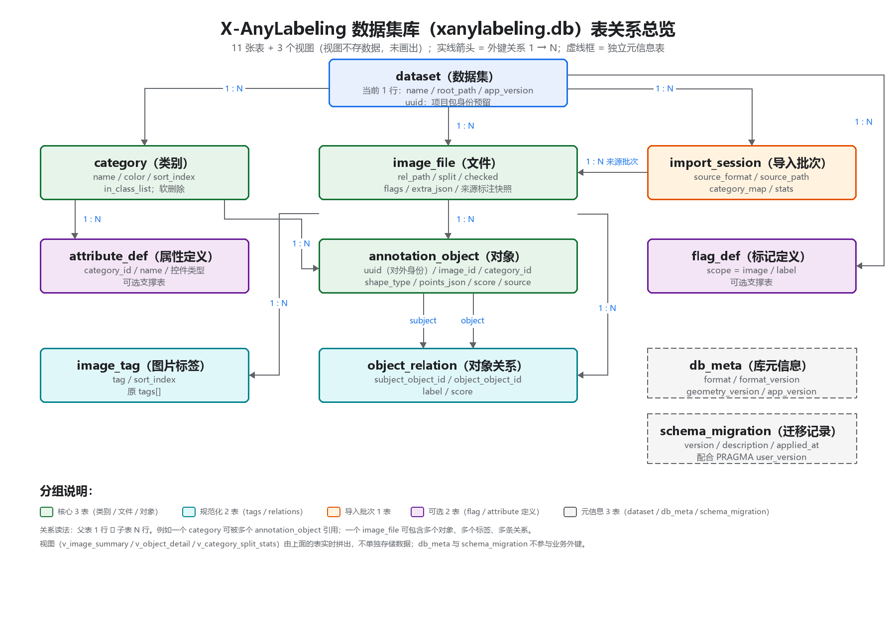
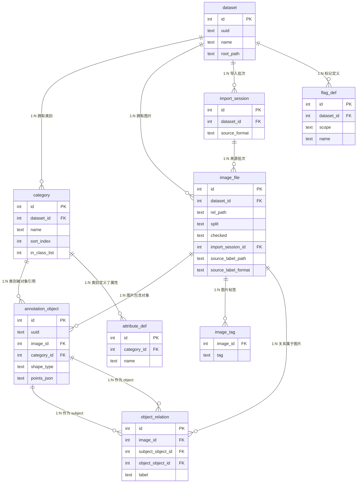

# X-AnyLabeling 数据集数据库设计（讨论稿 v0.4）

> **状态：讨论稿，未定稿。** 本文用于沟通表结构与功能落地细节，定稿后再并入
> [工业机器视觉数据平台-设计书-v1.6.md](工业机器视觉数据平台-设计书-v1.6.md) 与
> [CODE_STRUCTURE_REPORT.md](CODE_STRUCTURE_REPORT.md)；合并待办已记录在
> [开始.md](../开始.md) 的"待办事项"章节。
>
> - 文件名不带版本号（讨论期保持稳定，版本记录见 §16）；最近更新：2026-11-11（Asia/Shanghai）
> - 代码基线：`4.3.2+fork.3`，`main` / `c7c5518`（本稿未改任何软件代码）
> - 约束来源：[开始.md](../开始.md)
> - 方向参考：[设计书 v1.6](工业机器视觉数据平台-设计书-v1.6.md)（未定稿，只作方向）
> - **设计资产（随本讨论稿保留，不是一次性临时文件）**：`docs/dev/db_design_assets/`
>   - `schema.sql`：完整 DDL（与本文 §5 字段一致）
>   - `demo.db`：演示数据库（每次生成时自动校验列与设计清单一致）
>   - `queries.sql`：37 条示例查询
>   - `report.txt`：验证输出
>   - `db_er_overview.png`：表关系图
> - **原型脚本（一次性工具，位于 gitignore 的临时目录）**：`temporary/sqlite-design/`
>   - `make_demo.py`：生成 demo.db 的迁移/导入/导出/往返验证脚本
>   - `validate_queries.py`、`check_doc_vs_db.py`、`make_er_diagram.py`：校验与配图工具
>   - `demo_dataset/`：演示图片、旧 JSON、导入源、导出结果（一次性数据）

---

## 1. 背景、目标与范围

### 1.1 背景

当前 X-AnyLabeling 以"一张图片 + 一个同名 `.json`"保存标注：每个 JSON 内含该图的全部对象（`shapes[]`）、图片级状态（`flags/checked/split/tags/description`）以及`relations`、`vqaData`、`chat_history` 等扩展字段。由此带来：

- 文件列表、统计、搜索、总览、训练数据构建都要**逐图 `json.load`**，数万文件时卡顿（仓库自述见 `CHANGELOG-fork.md`）；
- 同一事实多处冗余（`version`、`imageHeight/Width`、空默认字段），且无跨文件实体（对象没有稳定主键，类别不是持久实体）；
- 类别管理、批量改标签/GID、批量删形状等操作要**逐文件非原子重写 JSON**；
- 导入其他格式后**无法追溯来源**，覆盖无备份，一个图片严格对应一个 JSON。

### 1.2 目标

用 **SQLite 单文件数据库**取代"每图一个 JSON"作为标注数据的权威存储，同时保持：

1. 图片本体仍在文件系统，数据库只存标注与元数据；
2. 一个数据集 = 一个 `xanylabeling.db`，随数据集目录整体搬移；
3. JSON 降级为**导入/导出格式**（用于兼容 LabelMe/X-AnyLabeling、以及与其他模块交换）；
4. 为后续"训练/评估/审计"演进留出增量空间，但一期不做过度设计。

### 1.3 范围

| 期次           | 内容                                                                                            |
| -------------- | ----------------------------------------------------------------------------------------------- |
| 一期（本稿）   | 图像标注的 DB 化：文件/类别/对象/tags/relations/导入批次；迁移旧标注；导入各格式；与训练/评估的数据契约（功能实现不属于本文） |
| 二期（待设计） | revision 审计、数据集快照、训练/评估注册表、外部分发合并（对应设计书 §5/§6）                  |
| 暂不在本期     | 视频分类 sidecar、点云 `.label/.cuboids.json`、PPOCR jsons 的入库（先用 `media_type` 预留） |

---

## 2. 已确认决策（2026-11-11）

| # | 决策                             | 说明                                                                                                                                     |
| - | -------------------------------- | ---------------------------------------------------------------------------------------------------------------------------------------- |
| 1 | **渐进路线 A**             | 一期只把 JSON 规范化成 DB，**不做** revision 审计；`uuid/时间戳/软删除` 预留，二期增量迁移                                       |
| 2 | **一数据集一库**           | `xanylabeling.db` 放在数据集根目录；`dataset` 表当前只有一行                                                                         |
| 3 | **表规模保留**             | 3 核心 + 2 规范化 + 1 批次 + 2 可选 + 3 元信息（共 11 表、3 视图）                                                                       |
| 4 | **旧标注文件不移动、不处理** | 导入后、导出前不读/写/移动/删除原标注文件（JSON/XML/TXT）；只有"导出为 X-AnyLabeling"时才写 JSON（写到**独立目标目录**，不覆盖原件）                  |
| 5 | **导入入口要改**           | 现状只能导入 YOLO/COCO 等标注，无法导入 LabelMe/LabelImg 的标注；交互已在第三轮确认（见 2.2）                                                      |
| 6 | **训练/评估按目标格式导出（数据契约）** | 训练/评估模块不读 JSON 中间文件、不直接读 DB；导出器从 DB 读取后写出目标格式数据集。功能与插件化实现归训练模块（`开始.md` T4） |
| 7 | **新增本文档**             | 定稿后并入设计书/结构报告，并在 `开始.md` 的"待办事项"章节记待办                                                                       |

### 2.1 第二轮确认（2026-11-11 追问后）

| #  | 决策                                            | 说明                                                                                                                                     |
| -- | ----------------------------------------------- | ---------------------------------------------------------------------------------------------------------------------------------------- |
| 8  | **图片不入库**                            | 图片文件始终保存在文件系统；SQLite 不存 BLOB。`store_data` 语义改为"导出 X-AnyLabeling 时可选把原图 base64 内嵌"，导出时从原图重新编码 |
| 9  | **删除 `raw_width/raw_height`**         | 只保留 EXIF 显示方向后的 `width/height`；原图文件是尺寸唯一权威，排障时现读文件                                                        |
| 11 | **来源标注文件列统一命名**                | `legacy_json_*` 改为 `source_label_path/format/sha256/mtime_ns`（JSON/XML/TXT 通用），并移到 `image_file` 表尾                     |
| 12 | **`attribute_def` 去掉 `dataset_id`** | 数据集归属由 `category` 隐含；语义澄清为"某类别对象的属性模板"，不是 `dataset` 自身的属性列                                          |
| 13 | **待办独立成章**                          | `开始.md` 增加"待办事项"章节，后续未完成需求统一登记；本讨论稿不再解释"为什么不止三张表"                                               |

> 编号按历史保留，便于正文引用；第 10 条（保留 `imported_at`）属于"不删除"的结论，已并入 §7 与变更记录，不再单列。

### 2.2 第三轮确认（2026-11-11 导入/训练交互）

| #  | 决策                             | 说明                                                                                                                                                    |
| -- | -------------------------------- | ------------------------------------------------------------------------------------------------------------------------------------------------------- |
| 14 | **导入采用两个入口**       | `File → 导入项目（X-AnyLabeling）` + `File → 导入数据集（COCO/YOLO/VOC/LabelMe/LabelImg…）`                                                      |
| 15 | **导入冲突默认"每次询问"** | 冲突清单逐项/批量选择"保留、覆盖、跳过"，不做全局默认覆盖                                                                                               |
| 16 | **打开目录行为** | 有 `xanylabeling.db` → 用库；无库则创建空库；目录内有 JSON/XML/TXT → 自动弹"导入为数据库项目"向导（预检后导入，来源文件不动）；无项目文件则创建项目文件（双击打开，详见 `开始.md` T5） |
| 18 | **设计资产随讨论稿保留**   | `schema.sql`、`demo.db`、`queries.sql`、`report.txt`、ER 图放在 `docs/dev/db_design_assets/`（不再只放临时目录）；生成脚本留在 `temporary/` |

> 原第 17 条（训练一期范围）不属于数据库设计，已迁至 `开始.md` 待办 T4，按插件/适配器方式在训练模块实现。

---

## 3. 数据库文件与运行参数

| 项             | 约定                                                                                            |
| -------------- | ----------------------------------------------------------------------------------------------- |
| 文件路径       | `<数据集根目录>/xanylabeling.db`                                                              |
| 同目录附带文件 | `xanylabeling.db-wal`、`xanylabeling.db-shm`（SQLite 运行时文件，关闭后自动清理/可忽略）    |
| 结构版本       | `PRAGMA user_version`（当前 `1`）；迁移记录写 `schema_migration`                          |
| 文件类型标识   | `PRAGMA application_id = 0x58414C42`（"XALB"），防止误把别的库当数据集打开                    |
| 日志模式       | `journal_mode=WAL`、`synchronous=NORMAL`；连接必须 `PRAGMA foreign_keys=ON`               |
| 编码           | UTF-8                                                                                           |
| 备份           | 在线备份用 `VACUUM INTO '<新文件>'`；打包/移动数据集前 `PRAGMA wal_checkpoint(TRUNCATE)`    |
| 兼容性         | 程序打开库时先比较 `user_version`：高于程序的版本 → 拒绝打开并提示升级；低于 → 执行有序迁移 |
| 路径           | 表内只存**相对数据集根目录**的路径，统一 `/` 分隔，避免搬移后失效                       |
| 项目文件       | 数据集根目录另有**项目文件**（格式待定，建议扩展名 `.xalp`；内容为 JSON 清单：`format_version`、`project_uuid`、`name`、数据库相对路径等），双击即可打开本软件并加载项目；打开文件夹时自动创建，详见 `开始.md` T5 |

---

## 4. 表总览与关系

### 4.1 分组

| 分组        | 表                    | 定位                                                                                                                             |
| ----------- | --------------------- | -------------------------------------------------------------------------------------------------------------------------------- |
| 核心 3 表   | `category`          | 类别字典：名字、颜色、顺序、是否在训练类别清单                                                                                   |
|             | `image_file`        | 一行一张图片：路径、尺寸、划分、复核、描述、图片级 flags、来源标注文件快照                                                       |
|             | `annotation_object` | 一行一个对象（原 `shapes[]` 元素）：几何、类别、分数、属性、复核、来源                                                         |
| 规范化 2 表 | `image_tag`         | 图片标签（原 `tags[]`），可筛选/统计                                                                                           |
|             | `object_relation`   | 对象间关系（原 `relations[]`），外键指向对象                                                                                   |
| 追溯 1 表   | `import_session`    | 一次导入的来源格式/路径/类别映射/统计                                                                                            |
| 可选 2 表   | `flag_def`          | 图片级/对象级 flag 的**名称定义**（现状只在内存），取值存 `flags_json`                                                   |
|             | `attribute_def`     | **某类别对象的属性模板**（如 crack 的 severity 只能 minor/major），不是 `dataset` 自身的属性；取值存 `attributes_json` |
| 元信息 3 表 | `dataset`           | 数据集身份（名称、根路径、软件版本）                                                                                             |
|             | `db_meta`           | 库格式版本、几何版本等键值                                                                                                       |
|             | `schema_migration`  | 每次 schema 迁移的记录                                                                                                           |

### 4.2 ER 图



<details><summary>展开 Mermaid 源码（可编辑版）</summary>



</details>

### 4.3 关系清单（外键列都在"子表"里，值必须等于父表主键）

| 父表（1 侧）          | 父表被引用的列 | 子表（N 侧）          | 子表里的外键列                        | 含义                     |
| --------------------- | -------------- | --------------------- | ------------------------------------- | ------------------------ |
| `dataset`           | `id`         | `category`          | `category.dataset_id`               | 一个数据集有一套类别     |
| `dataset`           | `id`         | `image_file`        | `image_file.dataset_id`             | 一个数据集有一批图片     |
| `dataset`           | `id`         | `import_session`    | `import_session.dataset_id`         | 一个数据集有多次导入     |
| `dataset`           | `id`         | `flag_def`          | `flag_def.dataset_id`               | 数据集级标记定义         |
| `import_session`    | `id`         | `image_file`        | `image_file.import_session_id`      | 图片来自哪次导入（可空） |
| `category`          | `id`         | `annotation_object` | `annotation_object.category_id`     | 对象属于哪个类别         |
| `category`          | `id`         | `attribute_def`     | `attribute_def.category_id`         | 某类别定义了哪些属性     |
| `image_file`        | `id`         | `annotation_object` | `annotation_object.image_id`        | 图片包含哪些对象         |
| `image_file`        | `id`         | `image_tag`         | `image_tag.image_id`                | 图片有哪些标签           |
| `image_file`        | `id`         | `object_relation`   | `object_relation.image_id`          | 关系属于哪张图片         |
| `annotation_object` | `id`         | `object_relation`   | `object_relation.subject_object_id` | 关系的起点对象           |
| `annotation_object` | `id`         | `object_relation`   | `object_relation.object_object_id`  | 关系的终点对象           |

说明：

- 外键列**只写在子表**里；父表不需要反向列（"有哪些子行"用 JOIN 查即可）。
- `attribute_def` 不再直接引用 `dataset`：它指向 `category`，而 `category` 已指向 `dataset`，数据集归属是隐含的，避免同一事实存两份。
- `db_meta`、`schema_migration` 是独立的"配置/记录"表，不参与业务外键。

---

## 5. 各表字段详解

> 约定：`时间戳` 均为 UTC ISO-8601 文本（`2026-11-11T10:00:00.000Z`）；`*_json` 为 JSON 文本；
> `is_deleted` 为软删除标志（1=已删，默认 0）；完整 DDL 见 `temporary/sqlite-design/schema.sql`。

### 5.1 `dataset` 数据集

**定位：** 一个数据库对应一个数据集，本表当前只有一行；记录身份与根目录，给未来"项目包/多数据集"留位。

| 字段                            | 类型    | 约束/默认    | 作用                                      |
| ------------------------------- | ------- | ------------ | ----------------------------------------- |
| `id`                          | INTEGER | 主键         | 库内编号，其他表用它做外键                |
| `uuid`                        | TEXT    | 唯一、必填   | 对外稳定身份（项目包/跨库合并用，见 附录 C） |
| `name`                        | TEXT    | 默认 `''`  | 数据集显示名                              |
| `root_path`                   | TEXT    | 默认 `''`  | 空串=库所在目录；否则为绝对路径           |
| `description`                 | TEXT    | 默认 `''`  | 说明                                      |
| `app_version`                 | TEXT    | 默认 `''`  | 最近写入本库的软件版本（诊断用）          |
| `created_at` / `updated_at` | TEXT    | 默认当前时间 | 创建/更新时间                             |

### 5.2 `category` 类别表

**定位：** 类别的持久化字典。替代 `.xanylabelingrc` 的 `labels`/`label_colors`、`classes.txt`、导入时的临时类别注入。改名/合并/删除类别只改这一张表，所有对象自动跟随。

| 字段                            | 类型    | 约束/默认                                            | 作用                                                            |
| ------------------------------- | ------- | ---------------------------------------------------- | --------------------------------------------------------------- |
| `id`                          | INTEGER | 主键                                                 | 库内编号                                                        |
| `dataset_id`                  | INTEGER | 外键→`dataset.id`，级联删除                       | 所属数据集                                                      |
| `name`                        | TEXT    | 必填；`UNIQUE(dataset_id,name) WHERE is_deleted=0` | 类别名（区分大小写）                                            |
| `group_name`                  | TEXT    | 可空                                                 | 类别分组（平台方向预留，暂空）                                  |
| `color`                       | TEXT    | 可空                                                 | `#RRGGBB`，替代配置里的 `label_colors`                      |
| `sort_index`                  | INTEGER | 默认 0                                               | 类别顺序 = **训练 `class_index`**（YOLO/COCO 导出顺序） |
| `in_class_list`               | INTEGER | 默认 1，取值 0/1                                     | 是否在"当前类别清单"中；删除清单条目只置 0，**不删行**    |
| `description`                 | TEXT    | 默认 `''`                                          | 类别说明                                                        |
| `is_deleted`                  | INTEGER | 默认 0                                               | 软删除                                                          |
| `created_at` / `updated_at` | TEXT    | 默认当前时间                                         | 时间戳                                                          |

### 5.3 `image_file` 文件表

**定位：** 一行一张图片。图片本体在磁盘，**本表不存图片字节**；它是"图片档案卡"：位置、尺寸、划分、复核状态、图片级 flags/描述、导入来源，以及"来源标注文件"的快照信息。

字段顺序刻意把"来源标注文件快照"（`source_label_*`）放在最后：它们可能不存在，也可能不是 JSON（LabelImg 是 XML、YOLO 是 TXT），所以既不叫 `json` 列，也不和图片自身字段混在一起。

| 字段                      | 类型    | 约束/默认                                                | 作用                                                                                                                                                         |
| ------------------------- | ------- | -------------------------------------------------------- | ------------------------------------------------------------------------------------------------------------------------------------------------------------ |
| `id`                    | INTEGER | 主键                                                     | 库内编号                                                                                                                                                     |
| `dataset_id`            | INTEGER | 外键→`dataset.id`                                     | 所属数据集                                                                                                                                                   |
| `rel_path`              | TEXT    | 必填；`UNIQUE(dataset_id,rel_path) WHERE is_deleted=0` | 相对数据集根目录的路径（`images/001.jpg`）                                                                                                                 |
| `file_name`             | TEXT    | 必填                                                     | 文件名（用于搜索/展示）                                                                                                                                      |
| `ext`                   | TEXT    | 默认 `''`                                              | 扩展名（小写）                                                                                                                                               |
| `width` / `height`    | INTEGER | 可空                                                     | **EXIF 显示方向后**的宽高（与画布坐标系一致）；原图文件是尺寸唯一权威                                                                                  |
| `size_bytes`            | INTEGER | 可空                                                     | 文件大小                                                                                                                                                     |
| `mtime_ns`              | INTEGER | 可空                                                     | 文件修改时间（纳秒），用于快照/重扫比对                                                                                                                      |
| `sha256`                | TEXT    | 可空                                                     | 图片内容哈希（去重/跨库/完整性）                                                                                                                             |
| `media_type`            | TEXT    | 默认 `'image'`；`image/video_frame/pointcloud`       | 媒体类型（为视频/点云预留）                                                                                                                                  |
| `split`                 | TEXT    | 默认 `'none'`；`none/train/val/test`                 | 数据划分                                                                                                                                                     |
| `checked`               | TEXT    | 默认 `'unchecked'`；`unchecked/passed/failed`        | 图片级复核三态（替代 JSON 的 `false/true/"failed"`）                                                                                                       |
| `description`           | TEXT    | 默认 `''`                                              | 图片级描述                                                                                                                                                   |
| `flags_json`            | TEXT    | 默认 `'{}'`，JSON 校验                                 | 图片级 flags（等价 JSON 顶层 `flags`）                                                                                                                     |
| `extra_json`            | TEXT    | 默认 `'{}'`，JSON 校验                                 | **未知顶层字段兜底**（`vqaData/chat_history/text` 等），保证无损往返                                                                                 |
| `import_session_id`     | INTEGER | 外键→`import_session.id`，可空                        | **最近一次**导入/批量写入该图标注或元数据的批次；单张手工编辑不改变它；旧库/人工修复可为空                                                             |
| `imported_at`           | TEXT    | 默认当前时间                                             | **该图首次导入数据集的时间**（文件列表"导入时间"列，替代原目录 sidecar）；与批次 `created_at` 不同：同一批次可能跨时段、拖拽追加也可能不属于任何批次 |
| `updated_at`            | TEXT    | 默认当前时间                                             | 更新时间                                                                                                                                                     |
| `is_deleted`            | INTEGER | 默认 0                                                   | 软删除                                                                                                                                                       |
| `source_label_path`     | TEXT    | 可空                                                     | 导入时来源标注文件的相对路径（`images/001.json` / `images/001.xml` / `labels/001.txt`）；**原文件保持原位，不移动不删除**                        |
| `source_label_format`   | TEXT    | 可空                                                     | 来源格式：`xlabel-json` / `labelme-json` / `voc-xml` / `labelimg-voc` / `yolo-txt` …                                                              |
| `source_label_sha256`   | TEXT    | 可空                                                     | 导入时文件内容哈希（检测"导入后被外部改动"）                                                                                                                 |
| `source_label_mtime_ns` | INTEGER | 可空                                                     | 导入时文件修改时间                                                                                                                                           |

> 关于 `imageData`：旧 JSON 里内嵌的图片 **不进入数据库**（见 §12.1）。导出 X-AnyLabeling 时若勾选"内嵌图片"，从磁盘原图重新 base64 编码；若原图不在，导出会提示而不是伪造图片。

### 5.4 `annotation_object` 对象表

**定位：** 一行一个对象，等价原 `shapes[]` 的一个元素（框/多边形/点/旋转框/3D 投影框…）。

| 字段                            | 类型    | 约束/默认                                                                                 | 作用                                                                                         |
| ------------------------------- | ------- | ----------------------------------------------------------------------------------------- | -------------------------------------------------------------------------------------------- |
| `id`                          | INTEGER | 主键                                                                                      | 库内编号                                                                                     |
| `uuid`                        | TEXT    | 唯一、必填                                                                                | **对外稳定身份**：关系引用、XLABEL `shape_id`、未来 revision、重复导入去重（见 附录 C） |
| `image_id`                    | INTEGER | 外键→`image_file.id`，级联删除                                                         | 所属图片                                                                                     |
| `category_id`                 | INTEGER | 外键→`category.id`                                                                     | 所属类别                                                                                     |
| `shape_type`                  | TEXT    | 九选一（`rectangle/rotation/quadrilateral/polygon/point/line/linestrip/circle/cuboid`） | 形状类型                                                                                     |
| `sort_index`                  | INTEGER | 默认 0                                                                                    | 在原 `shapes[]` 中的顺序（渲染层级）                                                       |
| `points_json`                 | TEXT    | 必填，JSON 校验                                                                           | 几何顶点 `[[x,y],…]`（规格见 §8）                                                       |
| `score`                       | REAL    | 可空                                                                                      | 模型置信度（人工为 NULL）                                                                    |
| `group_id`                    | INTEGER | 可空                                                                                      | 图内分组号（姿态/多段实例）                                                                  |
| `difficult`                   | INTEGER | 默认 0，0/1                                                                               | 难例标记                                                                                     |
| `direction`                   | REAL    | 可空                                                                                      | `rotation` 的旋转弧度                                                                      |
| `description`                 | TEXT    | 默认 `''`                                                                               | 对象描述（OCR 转写等）                                                                       |
| `review_status`               | TEXT    | 默认 `'pending'`；`pending/missed/false_positive`                                     | 对象级复核状态                                                                               |
| `source`                      | TEXT    | 默认 `'manual'`                                                                         | 来源：`manual/auto_labeling/imported:coco:det/migrated:xlabel-json…`                      |
| `source_model`                | TEXT    | 可空                                                                                      | 自动标注时的模型名                                                                           |
| `attributes_json`             | TEXT    | 默认 `'{}'`，JSON 校验                                                                  | 对象属性值                                                                                   |
| `flags_json`                  | TEXT    | 默认 `'{}'`，JSON 校验                                                                  | 对象级 flags                                                                                 |
| `kie_linking_json`            | TEXT    | 默认 `'[]'`，JSON 校验                                                                  | PPOCR KIE 关联对                                                                             |
| `extra_json`                  | TEXT    | 默认 `'{}'`，JSON 校验                                                                  | 未知 shape 字段兜底（`cuboid3d/visible/text/iscrowd…`）                                   |
| `created_at` / `updated_at` | TEXT    | 默认当前时间                                                                              | 时间戳                                                                                       |
| `is_deleted`                  | INTEGER | 默认 0                                                                                    | 软删除                                                                                       |

### 5.5 `image_tag` 图片标签

**定位：** 原 JSON 顶层 `tags[]` 的规范化。保留原顺序，便于按标签筛选和统计。

| 字段           | 类型    | 约束/默认                         | 作用               |
| -------------- | ------- | --------------------------------- | ------------------ |
| `image_id`   | INTEGER | 外键→`image_file.id`，级联删除 | 所属图片           |
| `tag`        | TEXT    | 必填                              | 标签文本           |
| `sort_index` | INTEGER | 默认 0                            | 原 `tags[]` 顺序 |

主键为 `(image_id, tag)`；`tag` 单列另建索引以支持"按标签找图"。

### 5.6 `object_relation` 对象关系

**定位：** 原 JSON 顶层 `relations[]`（`subject_id/object_id/label/score`）。用外键替代字符串 id，保证关系两端对象真实存在。

| 字段                  | 类型    | 约束/默认                      | 作用                       |
| --------------------- | ------- | ------------------------------ | -------------------------- |
| `id`                | INTEGER | 主键                           | 库内编号                   |
| `image_id`          | INTEGER | 外键→`image_file.id`        | 关系所属图片               |
| `subject_object_id` | INTEGER | 外键→`annotation_object.id` | 起点对象                   |
| `object_object_id`  | INTEGER | 外键→`annotation_object.id` | 终点对象                   |
| `label`             | TEXT    | 必填                           | 关系名（如 `center_of`） |
| `score`             | REAL    | 可空                           | 关系分数                   |
| `created_at`        | TEXT    | 默认当前时间                   | 创建时间                   |

唯一约束：`(image_id, subject_object_id, object_object_id, label)`。

### 5.7 `import_session` 导入批次

**定位：** 记录"这批标注从哪来、怎么映射的、成功多少"。现状完全没有，是修改导入入口的基础。

| 字段                  | 类型    | 约束/默认            | 作用                                                                                               |
| --------------------- | ------- | -------------------- | -------------------------------------------------------------------------------------------------- |
| `id`                | INTEGER | 主键                 | 批次编号                                                                                           |
| `dataset_id`        | INTEGER | 外键→`dataset.id` | 目标数据集                                                                                         |
| `source_format`     | TEXT    | 必填                 | `xlabel-json/coco:det/yolo:hbb/voc:det/labelme-json/labelimg-voc/dota/mask/mot/odvg/ppocr:rec…` |
| `source_path`       | TEXT    | 默认 `''`          | 源文件/目录                                                                                        |
| `class_source`      | TEXT    | 默认 `''`          | 类别来源（`classes.txt/COCO categories/JSON shape.label`）                                       |
| `options_json`      | TEXT    | 默认 `'{}'`        | 导入选项（覆盖/保留等）                                                                            |
| `category_map_json` | TEXT    | 默认 `'[]'`        | 源类别→`category_id` 的映射快照                                                                 |
| `stats_json`        | TEXT    | 默认 `'{}'`        | 成功/跳过/冲突统计                                                                                 |
| `app_version`       | TEXT    | 默认 `''`          | 导入时软件版本                                                                                     |
| `created_at`        | TEXT    | 默认当前时间         | 导入时间                                                                                           |

**批次与图片不是"必须一对多"的关系**：`import_session` 记录的是**一次摄入动作**（扫描目录、导入项目、导入某格式、拖拽追加……），不是"每张图片必须属于某个批次"。实现上会为所有摄入动作建批次（包括扫描与拖拽，`source_format` 用 `scan-existing` / `manual-add`），因此**新进入库的图片通常有批次**；但历史库迁移、人工修复或旧数据可能为空。批次回答"这批东西从哪来、怎么映射、成功多少"；图片的"第一次什么时候进来"由 `image_file.imported_at` 记录（见 §7）。重导/覆盖会记录新批次并更新 `image_file.import_session_id`（最近一次写入），但不会改变图片首次进入时间。

### 5.8 `flag_def` 标记定义（可选）

**定位：** 图片级/对象级 flag 的名称定义（原 `config.flags` / `label_flags` 文件只在内存）。值仍存 `flags_json`。

| 字段           | 类型    | 约束/默认              | 作用            |
| -------------- | ------- | ---------------------- | --------------- |
| `id`         | INTEGER | 主键                   | 编号            |
| `dataset_id` | INTEGER | 外键→`dataset.id`   | 所属数据集      |
| `scope`      | TEXT    | `image` 或 `label` | 图片级 / 对象级 |
| `name`       | TEXT    | 必填                   | flag 名         |
| `sort_index` | INTEGER | 默认 0                 | 显示顺序        |

唯一约束：`(dataset_id, scope, name)`。

### 5.9 `attribute_def` 属性定义（可选）

**定位：** **某类别对象的属性模板**，回答"这个类别的对象可以填哪些属性、每个属性是什么控件、候选值是什么"。例如 `crack` 可以定义 `severity`（select，minor/major）和 `length_mm`（text）。

三个容易混淆的点：

1. **它不是 `dataset` 自身的属性**。`dataset` 表描述"这个数据集叫什么、在哪"；`attribute_def` 描述"数据集里某类对象怎么填属性"，两者层级不同，不能合成 `dataset` 的一个列。
2. **模板与取值分离**：模板（本表）只有一份；具体每个对象填的值存在 `annotation_object.attributes_json`（例如 `{"severity":"minor"}`）。
3. **不重复存 `dataset_id`**：`category_id` 已经指向类别，类别已属于数据集，再加 `dataset_id` 是同一事实存两份。

| 字段             | 类型    | 约束/默认             | 作用                                   |
| ---------------- | ------- | --------------------- | -------------------------------------- |
| `id`           | INTEGER | 主键                  | 编号                                   |
| `category_id`  | INTEGER | 外键→`category.id` | 该属性模板属于哪个类别（隐含数据集）   |
| `name`         | TEXT    | 必填                  | 属性名                                 |
| `widget_type`  | TEXT    | 默认 `'select'`     | 控件类型（`select/text/checkbox`…） |
| `options_json` | TEXT    | 默认 `'[]'`         | 候选值                                 |
| `sort_index`   | INTEGER | 默认 0                | 显示顺序                               |

唯一约束：`(category_id, name)`。

### 5.10 `db_meta` 库元信息

**定位：** 键值对形式的库级配置，便于未来加键而不改表。

| 字段      | 类型      | 作用                                                                                     |
| --------- | --------- | ---------------------------------------------------------------------------------------- |
| `key`   | TEXT 主键 | 如 `format`、`format_version`、`geometry_version`、`app_version`、`created_at` |
| `value` | TEXT      | 值                                                                                       |

### 5.11 `schema_migration` 迁移记录

**定位：** 记录每次 schema 迁移，配合 `PRAGMA user_version` 排障。

| 字段            | 类型         | 作用             |
| --------------- | ------------ | ---------------- |
| `version`     | INTEGER 主键 | 迁移到的结构版本 |
| `description` | TEXT         | 本次迁移说明     |
| `applied_at`  | TEXT         | 执行时间         |

---

## 6. 视图（3 个）

### 6.1 `v_image_summary` 文件列表视图

作用：给文件列表一行所需的全部字段（对象数、类别名、划分、复核、导入时间），避免 UI 每次自己拼。定义等价于：

```sql
SELECT f.id, f.dataset_id, f.rel_path, f.file_name, f.split, f.checked,
       f.imported_at, f.updated_at,
       COUNT(o.id) AS object_count,
       GROUP_CONCAT(DISTINCT c.name) AS category_names
FROM image_file f
LEFT JOIN annotation_object o ON o.image_id = f.id AND o.is_deleted = 0
LEFT JOIN category c ON c.id = o.category_id
WHERE f.is_deleted = 0
GROUP BY f.id;
```

- 依赖表：`image_file`、`annotation_object`、`category`。
- 用途：文件表"对象"列、点击排序、统计页"无对象"判定。
- 注意：`object_count` 是每图对象数；没对象的图片 `LEFT JOIN` 后为 0。

### 6.2 `v_object_detail` 对象明细视图

作用：对象 + 类别名 + 图片路径拼成一行，供"加载图片/导出/搜索"直接查。

- 依赖表：`annotation_object`、`image_file`、`category`。
- 关键列：`object_id、object_uuid、image_id、rel_path、category_name、shape_type、points_json、score、group_id、difficult、direction、description、review_status、source`。
- 用途：打开一张图时一条查询取出全部对象；导出时按图片聚合。

### 6.3 `v_category_split_stats` 类别×划分统计视图

作用：统计页"类别 × Train/Val/Test/未划分"的单元格数值（口径=包含该类别的图片数）。

```sql
SELECT c.dataset_id, c.id AS category_id, c.name AS category_name,
       f.split,
       COUNT(DISTINCT f.id) AS image_count,  -- 图片数
       COUNT(o.id)          AS object_count  -- 对象数（可选展示）
FROM category c
JOIN annotation_object o ON o.category_id = c.id AND o.is_deleted = 0
JOIN image_file f ON f.id = o.image_id AND f.is_deleted = 0
WHERE c.is_deleted = 0
GROUP BY c.id, f.split;
```

- 依赖表：`category`、`annotation_object`、`image_file`。
- 用途：替代现在"逐图 json.load 再内存聚合"；点击单元格反筛只需 `WHERE` 条件。

## 7. 状态与语义约定

| 概念       | 存储                                | 取值                                | 说明                                    |
| ---------- | ----------------------------------- | ----------------------------------- | --------------------------------------- |
| 图片级复核 | `image_file.checked`              | `unchecked/passed/failed`         | 对应原 JSON `false / true / "failed"` |
| 对象级复核 | `annotation_object.review_status` | `pending/missed/false_positive`   | 原 shape `other_data.review_status`   |
| 数据划分   | `image_file.split`                | `none/train/val/test`             | 原 JSON 顶层 `split`                  |
| 类别可用性 | `category.in_class_list`          | 0/1                                 | 是否在训练类别清单；删除清单项只置 0    |
| 软删除     | 各表 `is_deleted`                 | 0/1                                 | 删除不物理移除；统计/导出默认排除       |
| 对象来源   | `annotation_object.source`        | `manual/auto_labeling/imported:*` | 现状没有来源字段，本次新增              |
| 图片来源   | `image_file.import_session_id`    | 指向批次                            | 追溯"这张图的标注最近一次从哪导入"      |

补充约定：

- **`imported_at` 与 `import_session.created_at` 不是重复**：
  - `imported_at` = "这张图**第一次**进入本数据集的时间"（文件列表"导入时间"列需要它；旧 `.xanylabeling_import_time.json` 可以给同一批图片记录不同时间）。
  - `import_session.created_at` = "这次摄入动作发生的时间"。
  - 两者粒度不同：批次是**动作/来源**，图片是**个体身份**。去掉 `imported_at` 后，无法再用批次时间精确还原每张图的首次进入时间（旧数据同批不同时间、重复导入、拖拽追加都可能不一致），文件列表的"导入时间"列也会退化。
- **批次表的意义不依赖"每张图都有批次"**：批次是"从哪来、怎么映射、成功多少"的追溯与统计单位；图片是数据集成员。实现上为每次摄入动作（含扫描、拖拽）建批次，所以新图通常有批次；但历史迁移、人工修复可为空，这不影响批次表的价值。重导/覆盖会建新批次、更新 `image_file.import_session_id`（最近一次写入）与对象统计，但保留图片首次 `imported_at`。
- **自动标注**：写入 `source='auto_labeling'`、`source_model`、`score`，并把图片 `checked`
  重置为 `unchecked`（保持现状"AI 结果待复核"语义）。
- **重命名/合并类别**：只 `UPDATE category.name`；对象通过 `category_id` 自动跟随。
- **删除对象**：`is_deleted=1`；关系行一并软删除/清理；统计默认排除。
- **删除图片**：`is_deleted=1`；不删磁盘图片（由用户显式删除，或走维护任务）。
- **尺寸口径**：`width/height` 是 EXIF 显示方向后的尺寸（与画布一致）；不另存 `raw_width/raw_height`，需要原始像素尺寸时从图片文件现读（避免同一事实三份来源）。

---

## 8. 几何与扩展字段格式

`points_json` 只放顶点，不重复放类别/分数等列已有信息：

| `shape_type`    | 顶点数 | 说明                                                                             |
| ----------------- | ------ | -------------------------------------------------------------------------------- |
| `rectangle`     | 4      | 保存前规范化为 `[xmin,ymin],[xmax,ymin],[xmax,ymax],[xmin,ymax]`（与现状一致） |
| `rotation`      | 4      | 另在 `direction` 存弧度（与现状一致）                                          |
| `quadrilateral` | 4      | OCR 透视框等                                                                     |
| `polygon`       | ≥3    | 闭合多边形（刷子/魔棒最终也是 polygon）                                          |
| `point`         | 1      | 关键点                                                                           |
| `line`          | 2      | 线段                                                                             |
| `linestrip`     | ≥2    | 折线                                                                             |
| `circle`        | 2      | 圆心 + 边上一点                                                                  |
| `cuboid`        | 8      | 前 4 + 后 4；附加信息在 `extra_json.cuboid3d`                                  |

`extra_json` 约定：保存所有"当前版本未显式建模"的字段（如 `visible/text/iscrowd/cuboid3d`），
导出 XLABEL 时原样写回；这保证升级后不丢字段。

版本策略：几何结构版本记录在 `db_meta.geometry_version`（当前 `1`）；未来若引入
outer+holes 等新结构，用新版本 + 迁移处理（设计书 §5.1 的方向）。

---

## 9. 功能实现映射（UI → SQL/事务）

| 现有功能                          | 数据库实现                                                            | 相对现状收益                        |
| --------------------------------- | --------------------------------------------------------------------- | ----------------------------------- |
| 打开文件夹                        | 扫描目录 → `upsert image_file`；无库时走"导入项目"向导             | 只登记，不写标注                    |
| 文件列表                          | 一条 `SELECT … FROM v_image_summary`                               | 从"每图一次 json.load"降为 1 条查询 |
| 打开图片                          | 查该图对象（`v_object_detail`）+ tags + relations → 构造 Shape     | 无 JSON 解析                        |
| 保存/自动保存                     | 单事务：更新 `image_file` + 重建对象/关系/标签                      | 原子、字段级、体积小                |
| 统计页                            | 一条 `GROUP BY`（`v_category_split_stats`）                       | 不再全量读文件                      |
| 搜索语法                          | 解析后生成 SQL（`label::`→EXISTS、`type/gid/score`→对象条件…） | 索引化，支持大数据集                |
| 类别管理器改名/删除/合并          | `UPDATE category` 一条语句                                          | 不再逐文件重写 JSON                 |
| 批量改标签/GID/删形状/形状转换    | `UPDATE/INSERT … WHERE image_id IN (…)` 事务                      | 原子、快                            |
| 自动标注落库                      | 插入对象（score/source/source_model），checked 置 unchecked           | 来源可追溯                          |
| 导入                              | 见 §10                                                               | 支持多来源、可追溯、可重导          |
| 返回 JSON（导出为 X-AnyLabeling） | 查询→构造 XLABEL 字典→写**独立目标目录**                      | 原 JSON 永不被改                    |
| 训练                              | 见 §11                                                               | 直接产出目标格式数据集              |

---

## 10. 导入设计（含 LabelMe / LabelImg）

### 10.1 现状事实

"上传"菜单 20 项中，3 项只改内存（Image/Label Flags、Label Classes；Attributes 未挂菜单），
17 项按格式导入并**逐图写/覆盖 JSON**。外部通用格式只有 COCO、YOLO(hbb/seg/obb/pose)、
VOC(det/seg)、DOTA、MOT；另有 ODVG/MASK/PPOCR/MM-GD/VLM-R1。**没有 LabelMe/LabelImg
专用入口**，且导入要求"先打开图片文件夹"，覆盖无备份、无来源记录。

### 10.2 导入交互（已确认，2026-11-11）

统一成两个入口，二者都写入 DB（不再要求先打开文件夹）：

1. **File → 导入项目（X-AnyLabeling）…**
   选数据集目录 → 扫描图片 + 同名 JSON → 预检（多少图/多少 JSON/多少冲突）→ 导入 DB。
   这是**打开已有 X-AnyLabeling 项目的标准路径**（JSON 只读，不移动）。
2. **File → 导入数据集…（其他来源）**
   向导式：选择格式 → 图片目录 → 标注目录/文件 → 类别文件 → 选项（保留/覆盖/跳过/每次询问）
   → 预览冲突 → 导入并生成报告。格式包括 COCO、YOLO(hbb/seg/obb/pose)、VOC(det/seg)、
   **LabelMe、LabelImg**、DOTA、MASK、MOT、ODVG、PPOCR、VLM-R1、MM-GD。

**打开目录行为（已确认）**：

- 目录里有 `xanylabeling.db` → 直接使用数据库；
- 无库、但目录里有 JSON/XML/TXT 标注文件 → 自动弹出"导入为数据库项目"向导（预检后导入，来源文件不动）；
- 都没有 → 按普通图片目录打开（可选后续"初始化数据库"，不强制）。

现有 Upload 菜单各项保留，但内部改为"解析 → 统一导入服务 → 写 DB"，不再各自写 JSON。

### 10.3 统一导入管道

```text
选择源 ─► 格式适配器（复用现有 LabelConverter 解析逻辑）
        ─► 中间对象 DTO（文件、类别名、shape_type、points、score、difficult、group_id、attrs…）
        ─► 类别映射（get_or_create_category；源顺序写入 sort_index；映射快照进 import_session）
        ─► 文件匹配（按 basename/stem 匹配 image_file；匹配不到进冲突清单）
        ─► 事务写入（每图：保留 / 覆盖 / 跳过；写 import_session_id）
        ─► 报告（成功/跳过/冲突/丢失项）
```

### 10.4 各格式映射

| 格式                  | 类别来源 → DB                                  | 几何 → DB                                                                                   | 保留字段                                           | 现状丢失/注意事项                                                                                                                  |
| --------------------- | ----------------------------------------------- | -------------------------------------------------------------------------------------------- | -------------------------------------------------- | ---------------------------------------------------------------------------------------------------------------------------------- |
| X-AnyLabeling JSON    | `shape.label`                                 | 全部 9 种 shape                                                                              | 全部字段（未知键→`extra_json`）                 | 本文原型已证明可无损往返                                                                                                           |
| LabelMe JSON          | `shape.label`（字段与 XLABEL 同源）           | 同 XLABEL（polygon/rectangle/circle/line/point/linestrip）                                   | 顶层 `flags/imagePath/imageData` 等              | 需兼容 LabelMe 5.x 缺省键；绝对 `imagePath` 按 basename 匹配；新增"LabelMe 目录"适配器                                           |
| LabelImg              | VOC XML `<name>`；或 YOLO `classes.txt`     | VOC bndbox→rectangle；YOLO txt→按模式                                                      | `difficult`                                      | LabelImg 输出 VOC XML 走 VOC 适配器、输出 YOLO txt 走 YOLO 适配器，无需新解析器；`pose/truncated/occluded` 建议存 `extra_json` |
| COCO det/seg/pose     | `categories`（源顺序→`sort_index`）        | bbox→rectangle；segmentation→polygon（多段共 `group_id`）；keypoints→point+`group_id` | `ignore→difficult`；`iscrowd`→`extra_json` | RLE 仅在可无损转 polygon 时支持（需 pycocotools）；`score/supercategory` 不导入                                                  |
| YOLO hbb/seg/obb/pose | `classes.txt` 行号→`sort_index`；pose YAML | hbb cxcywh→四点；seg 归一化→polygon；obb→rotation+`direction`；pose→rectangle+point    | visibility→difficult                              | 无 score/track/attributes；缺 classes 文件拒绝导入                                                                                 |
| VOC det/seg           | XML `<name>`                                  | bndbox→rectangle；`<polygon>`→polygon                                                    | `difficult`                                      | 缺 `<size>` 拒绝；pose/truncated/occluded 入 `extra_json`                                                                      |
| DOTA                  | txt 第 9 列                                     | 8 坐标→rotation                                                                             | `difficult`                                      | 建议不再只处理"当前文件列表"，改为目录全量                                                                                         |
| MASK                  | color_map 键                                    | 轮廓→polygon                                                                                | —                                                 | 轮廓近似误差；无 difficult/description                                                                                             |
| MOT                   | `classes.txt`                                 | 框→rectangle，`group_id`=track id                                                         | 帧号                                               | 无标注帧现状跳过；`vis` 暂丢                                                                                                     |
| ODVG                  | `category`                                    | bbox→rectangle                                                                              | —                                                 | 文件名含子目录的路径 bug 由导入服务统一处理                                                                                        |
| PPOCR rec/kie         | `label`（默认 text）                          | rectangle/quadrilateral/polygon                                                              | `description=transcription`、`kie_linking`     | 坐标截断                                                                                                                           |
| VLM-R1 OVD            | `label`                                       | bbox→rectangle                                                                              | —                                                 | 现状只写 4 个字段，DB 可补齐默认值                                                                                                 |
| MM-GD                 | `classes.txt` + 阈值                          | bbox+score                                                                                   | score                                              | 仅导入无导出                                                                                                                       |

### 10.5 冲突、幂等与校验

- **冲突默认"每次询问"（已确认）**：导入前给出冲突清单（哪张图已有标注、来源、对象数），逐项或批量选择 **保留 / 覆盖 / 跳过**；不设全局默认覆盖。选择可记住"本次导入"但不作为下次默认。
- **文件匹配失败**：进冲突清单，**不凭空创建图片行**（现状会写出无主 JSON）。
- **重复导入**：`import_session` + 源文件哈希/参数识别，支持"跳过/重导"。
- **校验**：类别名非空、坐标数值有限且在合理范围、`shape_type` 白名单、`kie_linking` 为整数对、
  来源标注文件可解析；不合法项进报告，不中断其余图。
- **类别清单**：导入后调用与"上传 Label Classes"等价的服务（更新 `sort_index`/`in_class_list`）。

---

## 11. 与训练 / 评估模块的数据契约

### 11.1 目标（用户决策 #6）

训练/评估模块不直接读数据库，也不依赖 JSON 中间文件；导出器从 DB 读取数据，
写成目标框架可直接消费的数据集产物（如 Ultralytics 的 `images/ + labels/ + data.yaml`）。
数据方向固定为：**DB → 导出产物 → 训练/评估框架**。

> 训练导出的功能范围、任务类型、插件化实现不属于数据库设计，统一记录在
> `开始.md` 待办 T4（一期 Ultralytics det/seg/obb/pose，其他框架后续适配器）。

### 11.2 契约

```text
训练/评估入口（如 UltralyticsDialog 点击"训练"）
  ─► DatasetExportService.export(format="ultralytics", task=…, image_ids=…, options=…)
       ├─ 只读查询 DB：图片（路径/尺寸/checked/split）+ 对象（类别/几何/难度）
       ├─ 类别顺序：category.sort_index（in_class_list=1）
       ├─ 几何转换：复用现有 custom_to_yolo 的换算规则
       └─ 写出数据集目录（临时目录/用户指定目录）
  ─► 训练/评估框架消费该目录（不接触 DB）
```

- 导出器是**消费方**，由训练/评估模块以插件/适配器方式实现；数据库层只承诺稳定的只读查询接口与数据语义，不负责导出实现。
- 标注库、训练、评估通过**数据集产物**解耦；外部数据也可以绕过标注模块，直接作为数据集进入训练。

---

## 12. 旧标注文件共存策略（用户决策 #4）

### 12.1 图片与标注文件的边界

- **图片本体不进入 SQLite**（用户决策：数据集平台图片量大，不把图片塞进数据库）。
- **旧标注文件（JSON/XML/TXT）保持原位**：导入时只读；导入后、导出前不读/写/移动/删除。
- 旧 JSON 里的 `imageData`（内嵌图片 base64）**不迁移、不入库**；需要内嵌图片时，只在"导出为 X-AnyLabeling"时从磁盘原图重新编码（可选）。若原图不存在，导出提示缺图，不会伪造。
- 来源标注文件的快照信息记在 `image_file.source_label_path/format/sha256/mtime_ns`（格式可能是 `xlabel-json`、`labelme-json`、`voc-xml`、`yolo-txt`…，所以列名不叫 `legacy_json_*`）。

### 12.2 日常规则

| 场景                                         | 规则                                                                                                                   |
| -------------------------------------------- | ---------------------------------------------------------------------------------------------------------------------- |
| 打开已有项目（目录里有 `xanylabeling.db`） | 直接读 DB，**不读 JSON/XML/TXT**                                                                                 |
| 导入已有项目（只有标注文件）                 | **只读** → 写 DB；文件保持原位，不移动/不删除；记录 `source_label_*` 快照                                     |
| 日常标注（导入后、导出前）                   | 只读写 DB；**不读/不写/不移动/删除任何来源标注文件**                                                             |
| 导出为 X-AnyLabeling                         | 查询 DB → 生成 XLABEL JSON，写到**用户指定的独立目录**；**不覆盖原文件**                                  |
| 检测外部改动                                 | 通过 `source_label_sha256/mtime_ns` 对比；若导入后来源文件被外部修改，提示"来源标注已变化，是否重新导入"，不静默覆盖 |
| 删除数据库/回退                              | 原标注文件仍在原位，可随时退回 JSON/XML 模式（本设计不删除任何用户数据）                                               |

> 本策略避免"两套权威"：DB 是标注唯一权威，来源标注文件是只读历史快照 + 导出格式。

---

## 12A. 操作员归属与账号库边界（fork.4 补充，2026-11-18）

本节记录与 T3 数据库改造相关、但**不属于本库 schema** 的最小实现边界，避免把两个不同作用域的数据库混为一谈。

### 12A.1 两个数据库的作用域不同

| | 标注项目数据库（本文 §3/§4） | 操作员账号库（fork.4 已落地） |
|---|---|---|
| 作用域 | 随项目/数据集目录走 | 随软件/机器走 |
| 生命周期 | 项目创建/删除、可随项目包分发 | 本机安装后长期存在 |
| 内容 | 图片、对象、类别、tags、来源快照 | 账号名、口令哈希、是否管理员/禁用 |
| 是否必需 | 是（T3 后的标注权威） | 否（不登录也能浏览/训练/评估） |
| 依赖方向 | 不依赖账号库 | 不依赖项目库 |

两者只共享“增删改查”的实现形态，**不共享存储、不做外键关联**。项目数据库必须能在没有账号库、没有登录的机器上打开和标注。

### 12A.2 当前已落地的归属契约（T3 之前的过渡载体）

- XLABEL JSON 顶层新增可选字段：`author`（操作员名称，或 `"none"` 表示未记录）与 `modified_at`（本机 ISO 8601 时间戳，含 UTC 偏移）。
- 仅当标注内容、flags、tags、description 或 relations 实质变化时更新；`checked`、`split` 变化不更新。
- 旧文件、导入/转换数据均视为 `none`，不反推文件时间，也不用导入者冒名。
- 账号库路径固定为 `<work_dir>/xanylabeling_data/operators/operators.db`；不随项目分发。

### 12A.3 T3 落地时需要的对齐（实现阶段执行）

1. `annotation_revision`（二期）的 `editor` 语义沿用本节：以**名字字符串**记录操作者，**不建到账号库的外键**，否则跨实例/离线合并时无法解释来源；
2. 若一期需要“最后操作者”查询，可在图片或标注行冗余 `last_operator` / `last_modified_at`，语义与本节的 JSON 字段一致；两者不得出现相反值；
3. 迁移导入（§10）把 `author` 原样带入（缺失即 `none`），不得用当前登录操作员覆盖；
4. 数据库层不得把“已登录”当作访问前提；门禁属于 UI/应用层，数据库只存归属事实。

---

## 13. 迁移、验证与原型

### 13.1 迁移步骤（实现阶段）

1. 预检：扫描目录图片与同名标注文件（JSON/XML/TXT），统计数量/异常/字段兼容性；统计带内嵌 `imageData` 的数量；
2. 备份：`VACUUM INTO` 已有库（若有）或提示用户复制目录；
3. 建库：执行 `schema.sql`，写 `db_meta`/`schema_migration`/`dataset`；
4. 导入：逐图写入（对象/类别/tags/relations/图片级状态/来源标注快照）；内嵌图片不迁移；
5. 校验：计数对账（图数、对象数、类别数）、抽样 JSON 往返比对、`integrity_check/foreign_key_check`、schema 列与设计清单一致性；
6. 报告：成功/跳过/冲突/丢失字段清单；失败可回退（来源文件未动）。

### 13.2 原型验证结果（2026-11-11）

设计资产（`schema.sql`、`demo.db`、`queries.sql`、`report.txt`、ER 图）位于
`docs/dev/db_design_assets/`，随本讨论稿保留；生成与校验脚本位于 `temporary/sqlite-design/`（非项目代码）。

- 9 张图（6 个旧 JSON）→ DB：迁移统计正确（含 `images_with_embedded_image_data=1`，内嵌图片未入库）；
- 旧 JSON → DB → 导出 XLABEL JSON：**6/6 逐字段一致**（`imagePath` 按导出目录重算后比较；内嵌图按原图重编码后一致）；原 JSON 前后哈希不变 6/6；
- COCO det 导入 2 个对象、YOLO hbb 导入 2 个对象，均带类别映射与批次记录；
- 37 条示例 SQL 全部通过；`integrity_check=ok`、`foreign_key_check` 无异常；
- **schema 一致性自动校验**：脚本比对 11 张表的实际列与设计清单（`EXPECTED_TABLE_COLUMNS`），本次通过（输出见 `report.txt` 第 10 节）；
- **文档-数据库一致性校验**：`check_doc_vs_db.py` 比对本文 §5 是否覆盖 `demo.db` 的 11 表 101 列，本次通过——避免再出现"文档没写、库里却有列"的漂移；
- 演示"上传类别清单"语义：`text` 类别保留但不进训练类别（`in_class_list=0`）。

### 13.3 验收标准（实现阶段）

- 迁移后：图数/对象数/类别数与 JSON 统计一致；抽样对象字段逐字段一致（含未知字段）；
- 功能回归：文件列表、读写单图、自动保存、统计、搜索、关系、复核、tags、类别改名、批量操作；
- 导入：各格式样例数据导入后对象/类别/字段符合映射表；冲突清单可解释；
- 导出：DB → 各目标格式后，用现有 `LabelConverter`/训练构建逻辑可正常消费；
- 性能：文件列表/统计在目标规模（先按 1 万图）下无明显卡顿（对比现状）。

---

## 14. 性能与容量

- **收益点**：文件列表/统计/搜索由"O(N) 次 JSON 解析"变为"索引查询"；单图保存只写变化行（事务）。
- **成本点**：首次导入/迁移要扫描全部图片并读取尺寸/哈希（一次性，可后台/进度条）；WAL 与索引占空间。
- **规模预期**：单库数万张图片、数十万对象在 SQLite 能力范围内（设计书结论"规模下足够"）。
- **注意事项**：批量导入分批事务（如每 500 图提交）；统计视图在大库可用汇总表/缓存（二期）；
  `VACUUM` 只在大批量删除后执行；备份用 `VACUUM INTO` 避免直接拷贝 WAL 中的库。

---

## 15. 风险与未决问题

| #  | 风险/未决              | 说明与处理                                                                                                                                   |
| -- | ---------------------- | -------------------------------------------------------------------------------------------------------------------------------------------- |
| 1  | revision 审计何时做    | 一期不做（已决策）；二期需新增追加式 `annotation_revision` 等表与迁移，本文的 uuid/软删除/时间戳已预留                                     |
| 2  | 导入向导字段细节       | 两个入口、冲突默认"每次询问"、打开目录自动提示已确认（§10.2/§10.5）；向导的具体字段布局在实现时细化                                        |
| 3  | 训练/评估导出的实现计划 | 不属于数据库设计；功能范围与插件化实现见 `开始.md` T4；本文只保证"DB → 导出产物"的数据契约及回归范围 |
| 4  | DB 与来源标注文件分叉  | 外部工具改 JSON/XML 不会自动同步；用 `source_label_*` 快照检测并提示，不静默覆盖                                                           |
| 5  | 批量写路径收口         | 现状 15+ 处绕过 `LabelFile` 直接写 JSON，改造必须统一到存储服务层，避免分裂                                                                |
| 6  | 类别删除后的统计口径   | 默认软删除后不计入，需在 UI/导出明确                                                                                                         |
| 7  | 视频/点云/OCR          | 本期不动；`media_type` 与独立表结构预留                                                                                                    |
| 8  | auto_save 写放大       | DB 事务更小；必要时合并写/延迟提交；WAL 增长需 checkpoint 策略                                                                               |
| 9  | 旧 JSON 内嵌图片的保真 | 不迁移 `imageData`；若旧项目只有 JSON 且原图缺失，DB 模式无法打开该样本，迁移报告需列出。后续可评估"从 imageData 提取原图到磁盘"的迁移选项 |
| 10 | 缩放/预览等派生图      | 本期不做；将来若做缩略图缓存，应放独立缓存文件或独立表，不塞进 `image_file` 主表                                                           |

---

## 16. 变更记录

| 版本 | 日期       | 说明                                                                                                                                                                                                                                                                                                                                                                                                                                        |
| ---- | ---------- | ------------------------------------------------------------------------------------------------------------------------------------------------------------------------------------------------------------------------------------------------------------------------------------------------------------------------------------------------------------------------------------------------------------------------------------------- |
| v0.1 | 2026-11-11 | 初稿：确认路线 A、一数据集一库、11 表 3 视图；补视图/uuid 说明、导入设计草案、训练导出契约、JSON 共存策略；uuid 精简为 `annotation_object.uuid` + `dataset.uuid`                                                                                                                                                                                                                                                                        |
| v0.2 | 2026-11-11 | 按第二轮追问修订：① 图片不入库，删除 `image_data`；② 删除 `raw_width/raw_height`；③ `legacy_json_*` 改为通用 `source_label_path/format/sha256/mtime_ns` 并置于表尾；④ `attribute_def` 去掉 `dataset_id`、澄清"类别对象属性模板"语义；⑤ `imported_at` 保留并说明与批次时间的区别；⑥ 关系清单补充"父表被引用列/子表外键列"；⑦ 删除"为什么不是三张表"说明；⑧ 待办集中到 `开始.md` 的独立章节；⑨ schema 一致性自动校验 |
| v0.3 | 2026-11-11 | ① 设计资产迁入 `docs/dev/db_design_assets/`（demo.db/schema.sql/queries.sql/report.txt/ER 图随讨论稿保留）；② 明确 `import_session` 是"摄入动作"而非"每图必须隶属"，并说明 `imported_at` 不可由批次时间替代；③ 记录已确认的导入交互（两入口、冲突每次询问、打开目录自动提示）与训练一期范围（Ultralytics det/seg/obb/pose）                                                                                                        |
| v0.4 | 2026-11-11 | ① 讲解/答疑（概念速览、视图原理、id/uuid）移到附录 A/B/C，正文只保留设计规格并按新顺序重编号；② 删除"保留 imported_at"这类非修改性决策条目（结论并入正文）；③ 训练/评估功能范围迁到 `开始.md` T4，本文只保留数据契约；④ 打开目录行为补充"无库建库、无项目文件建项目文件"；⑤ 记录项目文件需求（格式待定，建议 `.xalp`，见 `开始.md` T5） |

---

## 附录 A：数据库概念速览（面向非数据库读者）

理解后面的表结构只需要这几个概念：

| 概念                | 通俗解释                                                                             | 本设计中的例子                                     |
| ------------------- | ------------------------------------------------------------------------------------ | -------------------------------------------------- |
| 表（table）         | 一张有固定列名的"电子表格"，一行是一条记录                                           | `annotation_object` 一行 = 画布上的一个框/多边形 |
| 列/字段（column）   | 表格的列，规定这一列存什么                                                           | `score` 列存模型置信度                           |
| 主键（PRIMARY KEY） | 每行唯一的编号，用于精确定位一行                                                     | `image_file.id` 是整数递增编号                   |
| 外键（FOREIGN KEY） | 这一列的值必须指向另一张表的主键，保证"指向的东西真实存在"                           | `annotation_object.image_id` 必须指向已有的图片  |
| 索引（INDEX）       | 给某一列建"目录"，让按该列查找变快                                                   | 按 `category_id` 查某类对象                      |
| 视图（VIEW）        | **保存下来的查询语句**，看起来像表但**不存数据**，每次查询实时从表算出来 | `v_image_summary` 拼出文件列表                   |
| 事务（TRANSACTION） | 一组改动"要么全成功、要么全不做"，防止写一半                                         | 保存一张图 = 更新文件 + 重建对象                   |
| WAL                 | SQLite 的日志模式，读写并发更好、崩溃可恢复                                          | 数据库固定 `journal_mode=wal`                    |
| JSON 列（TEXT）     | 把一段 JSON 文本存进一个字段，SQLite 可用 `json_extract()` 查询                    | `points_json` 存对象顶点                         |

> 本设计里"id"与"uuid"的分工见附录 C；"视图"见附录 B。这两处是本次讨论的重点疑问。

---

## 附录 B：视图与查询答疑

### B.1 什么是视图

**视图 = 保存下来的一条 SELECT 语句，起了个名字。** 它不占存储、不复制数据；每次 `SELECT * FROM 视图` 时，SQLite 把视图定义展开成对真实表的查询，实时算出结果。

- 与表的关系：视图建立在表之上，**数据只存在表里**；表变了，视图结果立刻跟着变。
- 用途：把"文件列表要拼的 3 张表""统计要做的分组"这类固定查询封装一次，UI 代码和示例 SQL 都更短，且口径统一。
- 限制：视图默认只读；复杂视图不等于性能优化（真正的性能来自基础表索引）。

### B.2 视图与表的关系图

```text
        ┌────────────┐   ┌──────────────────┐   ┌──────────┐
        │ image_file │   │ annotation_object│   │ category │
        └─────┬──────┘   └────────┬─────────┘   └────┬─────┘
              │                   │                  │
              ├───────── 视图 v_image_summary ──────┤
              │                   │                  │
              ├───────── 视图 v_object_detail ───────┤
              │                   │                  │
              └──── 视图 v_category_split_stats ────┘
```

> 视图不是独立存储，删除表后视图会失效；改表结构时需同步检查视图定义。

---

## 附录 C：id 与 uuid 的分工（为什么不是"重复"）

| 标识                      | 性质                   | 用途                                                 | 出现在哪些表                          |
| ------------------------- | ---------------------- | ---------------------------------------------------- | ------------------------------------- |
| `id`（INTEGER 主键）    | **库内**行号     | 表之间关联（外键）、索引、排序；只在当前数据库内有效 | 所有业务表                            |
| `uuid`（32 位十六进制） | **对外稳定身份** | 跨文件/跨库仍能认出"同一个对象"                      | 仅 `annotation_object`、`dataset` |

三个原因决定对象需要 uuid：

1. **关系需要稳定引用**：X-AnyLabeling 的 `relations[]` 用 `shape_id`（uuid）引用对象；如果保存时"删旧插新"导致整数 id 变化，关系就断了。uuid 可以跨保存、跨导入保持不变。
2. **未来 revision 审计需要**：设计书 §5/§6.5 要求 annotation 有 `uuid`，跨实例合并时"不得仅用单机自增 id 判定"。
3. **重复导入/合并去重**：外部项目包回导时按 uuid 识别同一对象，而不是按时间或自增 id。

**为什么其他表不需要 uuid：**

- `image_file`：跨库识别图片用 **sha256**（设计书 §6.5：asset.sha256 对图），库内关联用 `id`；
- `category`：跨库按**类别名**匹配、按清单顺序排序，库内关联用 `id`；
- `import_session`：只是本库的导入记录，没有跨库身份需求。

> 结论：上一版 schema 给每张表都加 uuid 属于"过度预留"，本稿已精简为
> 只有 `annotation_object.uuid`（必须）和 `dataset.uuid`（项目包身份预留）。整数 `id`
> 仍是所有外键和索引的载体。

---
