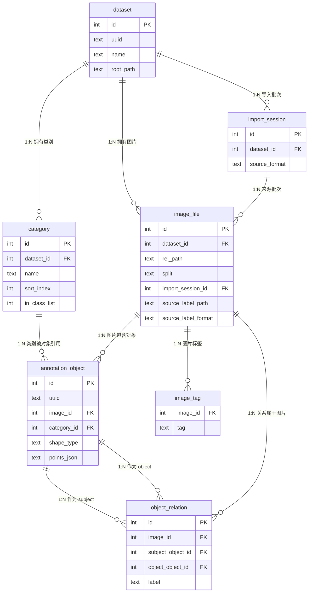

# X-AnyLabeling 数据集数据库设计（讨论稿 v0.13）

> **状态：讨论稿，未定稿。** 本文用于沟通表结构与功能落地细节，定稿后再并入
> [工业机器视觉数据平台-设计书-v1.6.md](工业机器视觉数据平台-设计书-v1.6.md) 与
> [CODE_STRUCTURE_REPORT.md](CODE_STRUCTURE_REPORT.md)；合并待办已记录在
> [开始.md](../开始.md) 的"待办事项"章节。
>
> - 文件名不带版本号（讨论期保持稳定，版本记录见 §16）；最近更新：2026-11-23（Asia/Shanghai）
> - 代码基线：`4.3.2+fork.34`（P0 存储层、P1 单图/文件表、P2 搜索/统计/类别页、P3a 导入/回收站、目录自动建库、退出关闭 DB、搜索快路径/缩略图懒加载、移除 checked 搜索、类别页实时刷新与 `sort_index` 排序 UI、文件表右键批量标签、图像属性标签库（DB `tag_counts`/JSON `TagCatalog`）已落地，提交见 CHANGELOG-fork.md；P3b 同步/导出/训练未做）
> - 规模：v0.6 精简后 **8 表 3 视图、83 列**（原 11 表 101 列，删除项见 §2.4）
> - 与代码的对齐点：fork.4 起 XLABEL JSON 已有 `author`/`modified_at` 归属字段与独立操作员账号库，本稿 §12A 记录其边界（T6 待落地）
> - 约束来源：[开始.md](../开始.md)
> - 方向参考：[设计书 v1.6](工业机器视觉数据平台-设计书-v1.6.md)（未定稿，只作方向）
> - **设计资产（随本讨论稿保留，不是一次性临时文件）**：`docs/dev/db_design_assets/`
>   - `schema.sql`：完整 DDL（与本文 §5 字段一致）
>   - `demo.db`：演示数据库（列清单与 `schema.sql` 一致，见 `report.txt` 第 0 节）
>   - `queries.sql`：38 条示例查询
>   - `report.txt`：验证输出（逐条执行 `queries.sql` 的结果 + 结构与文档覆盖核对）
>   - `db_er_overview.png`：表关系图（按当前 `schema.sql` 生成）
> - **生成脚本是一次性工具，不随仓库保留**：v0.6 精简时用的重建脚本只把旧 demo 数据
>   迁到精简后的 schema，跑完即删除。因此 `demo.db`、`report.txt`、ER 图是当时生成的
>   快照，不能只凭仓库内容重新生成；若需重做，应按 §13.1 重写脚本。

---

## 1. 背景、目标与范围

### 1.1 背景

当前 X-AnyLabeling 以"一张图片 + 一个同名 `.json`"保存标注：每个 JSON 内含该图的全部对象（`shapes[]`）、图片级状态（`flags/checked/split/tags/description`）以及`relations`、`vqaData`、`chat_history` 等扩展字段。由此带来：

- 文件列表、统计、搜索、总览、训练数据构建都要**逐图 `json.load`**，数万文件时卡顿（仓库自述见 `CHANGELOG-fork.md`）；
- 同一事实多处冗余（`version`、`imageHeight/Width`、空默认字段），且无跨文件实体（对象没有稳定主键，类别不是持久实体）；
- 类别管理、批量改标签/GID、批量删形状等操作要**逐文件非原子重写 JSON**；
- 导入其他格式后**无法追溯来源**，覆盖无备份，一个图片严格对应一个 JSON。

### 1.2 目标

用 **SQLite 单文件数据库**取代"每图一个 JSON"作为标注数据的权威存储，同时保持：

1. 图片本体仍在文件系统，数据库只存标注与元数据；
2. 一个数据集 = 一个 `xanylabeling.db`，随数据集目录整体搬移；
3. JSON 降级为**导入/导出格式**（用于兼容 LabelMe/X-AnyLabeling、以及与其他模块交换）；
4. 为后续"训练/评估/审计"演进留出增量空间，但一期不做过度设计。

### 1.3 范围

| 期次           | 内容                                                                                            |
| -------------- | ----------------------------------------------------------------------------------------------- |
| 一期（本稿）   | 图像标注的 DB 化：文件/类别/对象/tags/relations/导入批次；迁移旧标注；导入各格式；与训练/评估的数据契约（功能实现不属于本文） |
| 二期（待设计） | revision 审计、数据集快照、训练/评估注册表、外部分发合并（对应设计书 §5/§6）                  |
| 暂不在本期     | 视频分类 sidecar、点云 `.label/.cuboids.json`、PPOCR jsons 的入库 |

---

## 2. 已确认决策（2026-11-11）

| # | 决策                             | 说明                                                                                                                                     |
| - | -------------------------------- | ---------------------------------------------------------------------------------------------------------------------------------------- |
| 1 | **渐进路线 A**             | 一期只把 JSON 规范化成 DB，**不做** revision 审计；`uuid/时间戳/软删除` 预留，二期增量迁移                                       |
| 2 | **一数据集一库**           | `xanylabeling.db` 放在数据集根目录；`dataset` 表当前只有一行                                                                         |
| 3 | **表规模按需收敛**             | v0.6 精简后 **8 表 + 3 视图**（3 核心 + 2 规范化 + 1 批次 + 2 元信息/迁移）；删除项与理由见 §2.4。原 11 表的"2 可选 + 1 元信息"属于未落地的过度预留 |
| 4 | **旧标注文件不移动、不处理** | 导入后、导出前不读/写/移动/删除原标注文件（JSON/XML/TXT）；只有"导出为 X-AnyLabeling"时才写 JSON（写到**独立目标目录**，不覆盖原件）                  |
| 5 | **导入入口要改**           | 现状只能导入 YOLO/COCO 等标注，无法导入 LabelMe/LabelImg 的标注；交互已在第三轮确认（见 2.2）                                                      |
| 6 | **训练/评估按目标格式导出（数据契约）** | 训练/评估模块不读 JSON 中间文件、不直接读 DB；导出器从 DB 读取后写出目标格式数据集。功能与插件化实现归训练模块（`开始.md` T4） |
| 7 | **新增本文档**             | 定稿后并入设计书/结构报告，并在 `开始.md` 的"待办事项"章节记待办                                                                       |

### 2.1 第二轮确认（2026-11-11 追问后）

| #  | 决策                                            | 说明                                                                                                                                     |
| -- | ----------------------------------------------- | ---------------------------------------------------------------------------------------------------------------------------------------- |
| 8  | **图片不入库**                            | 图片文件始终保存在文件系统；SQLite 不存 BLOB。`store_data` 语义改为"导出 X-AnyLabeling 时可选把原图 base64 内嵌"，导出时从原图重新编码 |
| 9  | **删除 `raw_width/raw_height`**         | 只保留 EXIF 显示方向后的 `width/height`；原图文件是尺寸唯一权威，排障时现读文件                                                        |
| 11 | **来源标注文件列统一命名**                | `legacy_json_*` 改为 `source_label_path/format/sha256/mtime_ns`（JSON/XML/TXT 通用），并移到 `image_file` 表尾；v0.6 又删除 `sha256/mtime_ns`，只留 `path/format`（§2.4-22）                     |
| 12 | **`attribute_def` 去掉 `dataset_id`** | 数据集归属由 `category` 隐含；语义澄清为"某类别对象的属性模板"，不是 `dataset` 自身的属性列；v0.6 把该表整体推迟到二期（§2.4-24）                                          |
| 13 | **待办独立成章**                          | `开始.md` 增加"待办事项"章节，后续未完成需求统一登记；本讨论稿不再解释"为什么不止三张表"                                               |

> 编号按历史保留，便于正文引用；第 10 条（保留 `imported_at`）属于"不删除"的结论，已并入 §7 与变更记录，不再单列。

### 2.2 第三轮确认（2026-11-11 导入/训练交互）

| #  | 决策                             | 说明                                                                                                                                                    |
| -- | -------------------------------- | ------------------------------------------------------------------------------------------------------------------------------------------------------- |
| 14 | **导入采用两个入口**       | `File → 导入项目（X-AnyLabeling）` + `File → 导入数据集（COCO/YOLO/VOC/LabelMe/LabelImg…）`                                                      |
| 15 | **导入冲突默认"每次询问"** | 冲突清单逐项/批量选择"保留、覆盖、跳过"，不做全局默认覆盖                                                                                               |
| 16 | **打开目录行为** | 有 `xanylabeling.db` → 用库；无库则创建空库；目录内有 JSON/XML/TXT → 自动弹"导入为数据库项目"向导（预检后导入，来源文件不动）；无项目文件则创建项目文件（双击打开，详见 `开始.md` T5） |
| 18 | **设计资产随讨论稿保留**   | `schema.sql`、`demo.db`、`queries.sql`、`report.txt`、ER 图放在 `docs/dev/db_design_assets/`（不再只放临时目录）；生成脚本留在 `temporary/` |

> 原第 17 条（训练一期范围）不属于数据库设计，已迁至 `开始.md` 待办 T4，按插件/适配器方式在训练模块实现。

### 2.4 第四轮确认（2026-11-19，v0.6 精简）

本轮只做减法：把一期没有消费者、或与其他事实重复的预留去掉，表从 11 张降到 8 张。

| #  | 精简项                                             | 理由                                                                                                                       | 影响                                                                                 |
| -- | -------------------------------------------------- | -------------------------------------------------------------------------------------------------------------------------- | ------------------------------------------------------------------------------------ |
| 19 | 扫描目录、拖拽追加**不建** `import_session` | 打开/追加是读路径；为每次扫描写批次会让表膨胀，且与 §12.2"打开已有项目只读"矛盾                                       | `image_file.import_session_id` 允许为 `NULL`；只有真实导入动作建批次               |
| 20 | 删除 `db_meta` 表                                | `format`/`format_version`/`app_version`/`created_at` 与 `PRAGMA user_version`、`schema_migration`、`dataset.app_version` 重复；`geometry_version` 一期无消费者 | 库级版本只用 `user_version` + `schema_migration`；几何格式随 schema 版本演进       |
| 21 | 删除 `image_file.sha256`                         | 已决定不做硬唯一约束（U6，见 §2.5-D4），一期没有去重/合并的消费方；迁移时全量哈希要读完全部图片字节                                     | 图片内容哈希推迟到项目包/跨库合并（二期）按需引入                                    |
| 22 | 删除 `source_label_sha256` / `source_label_mtime_ns` | 来源标注文件严格只读、导入后不再读取，因此"外部改动检测"提示一并取消                                                   | `source_label_*` 只保留 `path` / `format`；需要时重新导入                        |
| 23 | 删除 `image_file.media_type`、`category.group_name` | 一期不把视频/点云入库，也没有类别分组 UI                                                                                 | 相应能力推迟到二期，届时用独立表，不用预留列                                         |
| 24 | `flag_def`、`attribute_def` 推迟到二期           | 两张"可选表"没有一期 UI 与消费方；`attribute_def` 的控件类型与现有 attributes 文件结构不一致（见 §15.3-B6）             | 一期只保留 `flags_json` / `attributes_json` 的**取值**存储；flag/attribute 的"定义"仍来自配置文件，重启丢失的现状不变 |

> 结果：表 **11 → 8**（`dataset`、`category`、`image_file`、`image_tag`、`annotation_object`、`object_relation`、`import_session`、`schema_migration`），列 **101 → 83**，视图仍是 3 个；`demo.db`、`report.txt`、ER 图已按新 schema 重建。

### 2.5 第五轮确认（2026-11-20，U1–U21 答复）

本轮把上一版 U 清单的答复固化为决定；仍未闭合的放 §15.2-Q（影响 T3），二期/非数据库问题移动到 §15.3、§14、§10.5。**U 编号此后只作历史追溯，不再新增**，新问题用 Q/B 编号。

| # | 决定 | 依据与边界 |
| - | ---- | ---------- |
| D1 | `dataset.task` 入库，**只作"主任务提示"** | 标注/训练解耦：任务类型**不限制**数据用途；det/seg/obb 之间允许导出转换（精度损失由用户承担）；导入不因任务不符拒绝。导出接口仍显式接收目标 task，提示值只作默认；旧项目迁移时留空，由用户后续指定。 |
| D2 | 图片标签（`tags`）**不与类别绑定** | tags 是图片级自由文本"指纹"，`category` 是粗略类别；`image_tag` 独立。对象级 flag 的"类别→可用 flag"是另一层问题，见 §15.3-B1（原 U2 问的是后者，不是 tags）。 |
| D3 | 分类与对象标注**可以共存** | 现有实现：分类结果写图片级 `flags`，对象 AI 结果写 shape 的 attributes/flags，互不妨碍；允许"分类数据集也带 label"。分类结果结构化见 §15.3-B2。 |
| D4 | 图片唯一性 = `(dataset_id, rel_path)`；**不引入内容哈希** | 同名不同路径允许；同路径重复导入走冲突清单。"同一来源再次导入"不再需要 `source_hash`（取消原 U5），靠 `import_session` 记录 + 冲突提示。Windows 路径大小写另见 §2.6-D16。 |
| D5 | 类别名**区分大小写** | 唯一索引保持 BINARY；`Crack`/`crack` 可并存。搜索 `label::` 目前是大小写不敏感，需随本决定统一，见 §2.6-D14。 |
| D6 | `editor` / `modified_at` **一期入库** | `image_file.editor`、`image_file.modified_at` 两个过渡列；JSON `author` 映射到 DB `editor`，JSON `modified_at` 同名映射。`updated_at` 只做行级最后写入，`modified_at` 仅在标注内容/flags/tags/description/relations 变化时更新。对象级/历史级归属留给二期审计表（§15.3-B8）。批量写路径（类别页改名/删除等）必须统一盖章，纳入 T6。 |
| D7 | 类别 `sort_index` 是**导出顺序权威**，导出不再依赖用户 `classes.txt` | 由库连续编号生成 classes 顺序；配套的排序 UI、种子顺序、`in_class_list` 去留见 §2.6-D18。 |
| D8 | 类别作用域 = **当前数据集/项目** | 重开软件或切换项目**不得**带出旧类别；启动不再用全局 `labels` 隐式灌入会话登记表。需要复用旧清单时走显式的"导入类别清单"（从文件/模板复制），不做全局默认。类别页范围见 §2.6-D15，种子与排序见 §2.6-D18。 |

其余答复的去向：原 U4→§2.6-D9，U5→已并入 D4，U8→§2.6-D17，U13→§6.4（已改写为规格，不再是问题），U14→§2.6-D14，U16→§15.3-B6，U17→§2.6-D10，U18→§2.6-D12（回收站见 §2.6-D19），U19→§2.6-D11（几何）+ §15.3-B7（预测），U20→§2.6-D13，U21→已并入 D8、范围见 §2.6-D15；原 U10/U11→§14，U12→§10.5。

### 2.6 第六轮确认（2026-11-20，A 组答复）

上一版把 A 组的已定结论也放在 §15.2"未决问题"里；本轮把已定项移到本节。Q1–Q4 已全部关闭，§15.2 现无未决项。

| # | 决定 | 依据与边界 |
| - | ---- | ---------- |
| D9（原 A2） | 导入前自动备份，撤销导入 = 恢复该备份 | 方案①，不新增列；只对"导入/覆盖"做，保留最近若干份并清理旧份（见 §14.1） |
| D10（原 A3） | 保存 = 按 uuid upsert；删除对象 = 软删（`is_deleted=1`），恢复 = 置 0；不整图重建 | 加载时把 uuid 注入内存 shape（§7）；旧 JSON 里没有 `shape_id` 的对象在首次导入时分配 uuid |
| D11（原 A4） | 几何用 `{"schema_version":1,"outer":[[x,y],…],"holes":[]}` 对象 | 规格见 §8；各 `shape_type` 的顶点数不变，`holes` 只对 polygon 有意义 |
| D12（原 A5） | 打开有库数据集**不扫描**；删除只留两个动作；取消"从列表移除"；新增"同步文件数据"入口 | 动作形态见下表；回收站见 §2.6-D19 |
| D13（原 A6） | 只有数据集根目录内的图片入库；追加外部图片复制进数据集；`output_dir` 停用；`Save As` = 导出单图 | 是用户可见的行为变化，需写进用户手册 |
| D14（原 A7） | 数据库模块提供查询 API；UI 只持查询条件，统计/搜索/文件列表共用同一组条件 | `#N` 废弃、文件名正则保留为应用层过滤（本轮已定） |
| D15（原 A9） | 类别页范围 = 整个数据集；"隐藏类别"与"删除该类对象"拆成两个动作 | — |
| D16（原 A10） | 一期只支持 Windows；`rel_path` 唯一索引用 `COLLATE NOCASE` | Linux 二期再议（会牺牲大小写敏感） |
| D17（原 Q1） | **移除图片级 `checked`**：不建列，也不在导出中保留语义 | 功能口径：改标签即视为已核对；无对象图片视为未核对（用对象数为 0 表达）。一并删除文件表复核图标与行勾选、三个勾选动作/快捷键、搜索 `checked::`、导出三个按复核状态跳过的选项（保留"跳过空标注"）；"下一张未核对"改为"下一张无对象的图"。旧 JSON 的 `checked` 导入时忽略，导出统一写 `false` 仅为格式兼容 |
| D18（原 Q4） | 导出顺序配套：保留 `in_class_list`；类别页加上移/下移；首次建库种子优先用现有 classes.txt；导出仍写 classes.txt 快照 | D7 的落地；新类别追加末尾，不按导入源顺序重排已有类别（§10.3）。**2026-11-22（fork.31）：上移/下移 UI 已落地**，顺序直接写 `category.sort_index`；`in_class_list` 与 classes.txt 种子仍属 P3b，无对象类别暂不在类别页展示 |
| D19（原 Q2） | 保留回收站：数据集根内 `.trash/`；删除文件 = 库行软删（`is_deleted=1`、`deleted_at`=删除时间）+ 图片移入 `.trash/<image_id>/`；恢复 = 移回原 `rel_path` 并置 `is_deleted=0`、`deleted_at=NULL`；旧来源 JSON 不随删 | 图片与标注同进退；`.trash/` 不参与同步扫描、统计、导出；过期清理默认手动"清空回收站"，自动清理天数作为配置项（默认关闭）；清空=物理删行 + 删 `.trash` 文件 |

**D12 的删除动作与打开流程**

| 动作 | 行为 | 待确认 |
| ---- | ---- | ------ |
| 删除文件 | 二次确认后：图片与标注同进退（都进回收站或都物理删除） | 回收站见 D19 |
| 删除标签 | 删除该图的一个对象；按 D10 软删（可恢复）；关系清理 | — |
| （取消）从列表移除 | 不再提供"仅当前会话移除"；列表内容就是查询结果 | — |
| 打开有库数据集 | 不扫描、不读文件；新增的"同步文件数据"入口处理新增/丢失/改名 | — |

**D14 的查询口径**

| 项 | 结论 |
| -- | ---- |
| 统计范围 | 与文件列表同一组查询条件，直接查库 |
| `label::` | 区分大小写（随 D5） |
| `score::[a,b]` | DB 中 NULL 不参与区间 |
| `description::` / `shape::` | 保留布尔语义 |
| 点击统计单元格 | 直接以该条件查询，不重建列表 |
| `#N` / 文件名正则 | `#N` 废弃；文件名正则保留为应用层过滤（已定） |


---

## 3. 数据库文件与运行参数

| 项             | 约定                                                                                            |
| -------------- | ----------------------------------------------------------------------------------------------- |
| 文件路径       | `<数据集根目录>/xanylabeling.db`                                                              |
| 同目录附带文件 | `xanylabeling.db-wal`、`xanylabeling.db-shm`（SQLite 运行时文件，关闭后自动清理/可忽略）    |
| 结构版本       | `PRAGMA user_version`（当前 `1`）；迁移记录写 `schema_migration`                          |
| 文件类型标识   | `PRAGMA application_id = 0x58414C42`（"XALB"），防止误把别的库当数据集打开                    |
| 日志模式       | `journal_mode=WAL`、`synchronous=NORMAL`；连接必须 `PRAGMA foreign_keys=ON`               |
| 编码           | UTF-8                                                                                           |
| 备份           | 在线备份用 `VACUUM INTO '<新文件>'`；打包/移动数据集前 `PRAGMA wal_checkpoint(TRUNCATE)`    |
| 兼容性         | 程序打开库时先比较 `user_version`：高于程序的版本 → 拒绝打开并提示升级；低于 → 执行有序迁移 |
| 路径           | 表内只存**相对数据集根目录**的路径，统一 `/` 分隔，避免搬移后失效；`rel_path` 唯一索引在 Windows 下按 `NOCASE` 比较（一期只支持 Windows，见 §2.6-D16） |
| 图片位置       | 只允许**数据集根目录内**的图片入库；追加外部图片时复制进数据集（§2.6-D13）；DB 模式下 `output_dir`/`--output` 停用，"另存为"改为导出单图 JSON |
| 项目文件       | 数据集根目录另有**项目文件** `*.xalp`（已定，2026-11-18）：JSON 清单，含 `format_version`、`project_uuid`、`name`、`database`（数据库相对路径）、`app_version`、时间戳；双击即可打开本软件并加载项目；打开文件夹时自动创建/自动修复，详见 `开始.md` T5 |

---

## 4. 表总览与关系

### 4.1 分组

| 分组        | 表                    | 定位                                                                                                                             |
| ----------- | --------------------- | -------------------------------------------------------------------------------------------------------------------------------- |
| 核心 3 表   | `category`          | 类别字典：名字、颜色、顺序、是否在训练类别清单                                                                                   |
|             | `image_file`        | 一行一张图片：路径、尺寸、划分、描述、图片级 flags、来源标注文件快照                                                       |
|             | `annotation_object` | 一行一个对象（原 `shapes[]` 元素）：几何、类别、分数、属性、复核、来源                                                         |
| 规范化 2 表 | `image_tag`         | 图片标签（原 `tags[]`），可筛选/统计                                                                                           |
|             | `object_relation`   | 对象间关系（原 `relations[]`），外键指向对象                                                                                   |
| 追溯 1 表   | `import_session`    | 一次导入的来源格式/路径/类别映射/统计（只记录真实导入，不含扫描/拖拽，见 §2.4-19）                                              |
| 元信息 2 表 | `dataset`           | 数据集身份（名称、根路径、软件版本）                                                                                             |
|             | `schema_migration`  | 每次 schema 迁移的记录                                                                                                           |

> v0.6 已删除 `db_meta`、`flag_def`、`attribute_def`：库级版本由 `PRAGMA user_version` + `schema_migration` 表达；flag/attribute 的**定义**推迟到二期，一期只存取值（§2.4-20/24）。

### 4.2 ER 图


<details><summary>展开 Mermaid 源码（可编辑版）</summary>



</details>

### 4.3 关系清单（外键列都在"子表"里，值必须等于父表主键）

| 父表（1 侧）          | 父表被引用的列 | 子表（N 侧）          | 子表里的外键列                        | 含义                     |
| --------------------- | -------------- | --------------------- | ------------------------------------- | ------------------------ |
| `dataset`           | `id`         | `category`          | `category.dataset_id`               | 一个数据集有一套类别     |
| `dataset`           | `id`         | `image_file`        | `image_file.dataset_id`             | 一个数据集有一批图片     |
| `dataset`           | `id`         | `import_session`    | `import_session.dataset_id`         | 一个数据集有多次导入     |
| `import_session`    | `id`         | `image_file`        | `image_file.import_session_id`      | 图片来自哪次导入（可空） |
| `category`          | `id`         | `annotation_object` | `annotation_object.category_id`     | 对象属于哪个类别         |
| `image_file`        | `id`         | `annotation_object` | `annotation_object.image_id`        | 图片包含哪些对象         |
| `image_file`        | `id`         | `image_tag`         | `image_tag.image_id`                | 图片有哪些标签           |
| `image_file`        | `id`         | `object_relation`   | `object_relation.image_id`          | 关系属于哪张图片         |
| `annotation_object` | `id`         | `object_relation`   | `object_relation.subject_object_id` | 关系的起点对象           |
| `annotation_object` | `id`         | `object_relation`   | `object_relation.object_object_id`  | 关系的终点对象           |

说明：

- 外键列**只写在子表**里；父表不需要反向列（"有哪些子行"用 JOIN 查即可）。
- `schema_migration` 是独立的"记录"表，不参与业务外键；`db_meta` 已在 v0.6 删除（§2.4-20）。

---

## 5. 各表字段详解

> 约定：`时间戳` 均为 UTC ISO-8601 文本（`2026-11-11T10:00:00.000Z`）；`*_json` 为 JSON 文本；
> `is_deleted` 是 `category`/`image_file`/`annotation_object` 三张表的软删除标志（1=已删，默认 0）；对象是否保留软删除见 §2.6-D10；
> `image_tag`、`object_relation` 随父行物理删除，不设独立软删除；完整 DDL 见 [db_design_assets/schema.sql](db_design_assets/schema.sql)。

### 5.1 `dataset` 数据集

**定位：** 一个数据库对应一个数据集，本表当前只有一行；记录身份与根目录，给未来"项目包/多数据集"留位。

| 字段                            | 类型    | 约束/默认    | 作用                                      |
| ------------------------------- | ------- | ------------ | ----------------------------------------- |
| `id`                          | INTEGER | 主键         | 库内编号，其他表用它做外键                |
| `uuid`                        | TEXT    | 唯一、必填   | 对外稳定身份（项目包/跨库合并用，见 附录 C） |
| `name`                        | TEXT    | 默认 `''`  | 数据集显示名                              |
| `root_path`                   | TEXT    | 默认 `''`  | 空串=库所在目录；否则为绝对路径           |
| `description`                 | TEXT    | 默认 `''`  | 说明                                      |
| `task`                        | TEXT    | 默认 `''`  | 主任务提示（`detect/segment/obb/pose/classify/ocr/kps/pointcloud`）；不限制数据用途（D1） |
| `app_version`                 | TEXT    | 默认 `''`  | 最近写入本库的软件版本（诊断用）          |
| `created_at` / `updated_at` | TEXT    | 默认当前时间 | 创建/更新时间                             |

### 5.2 `category` 类别表

**定位：** 类别的持久化字典。替代 `.xanylabelingrc` 的 `labels`/`label_colors`、`classes.txt`、导入时的临时类别注入。改名/合并只改这一张表，所有对象自动跟随；"删除类别"在 UI 上等于删除范围内该类别的对象（右侧"类别"页的标签管理器，见 §9、§2.5-D8 与 §2.6-D15）。

| 字段                            | 类型    | 约束/默认                                            | 作用                                                            |
| ------------------------------- | ------- | ---------------------------------------------------- | --------------------------------------------------------------- |
| `id`                          | INTEGER | 主键                                                 | 库内编号                                                        |
| `dataset_id`                  | INTEGER | 外键→`dataset.id`，级联删除                       | 所属数据集                                                      |
| `name`                        | TEXT    | 必填；`UNIQUE(dataset_id,name) WHERE is_deleted=0` | 类别名（区分大小写）                                            |
| `color`                       | TEXT    | 可空                                                 | `#RRGGBB`，替代配置里的 `label_colors`                      |
| `sort_index`                  | INTEGER | 默认 0                                               | 类别显示顺序，并作为导出顺序权威（§2.5-D7）；配套见 §2.6-D18 |
| `in_class_list`               | INTEGER | 默认 1，取值 0/1                                     | 是否在"当前类别清单"中；删除清单条目只置 0，**不删行**    |
| `description`                 | TEXT    | 默认 `''`                                          | 类别说明                                                        |
| `is_deleted`                  | INTEGER | 默认 0                                               | 软删除                                                          |
| `created_at` / `updated_at` | TEXT    | 默认当前时间                                         | 时间戳                                                          |

> `group_name`（类别分组）在 v0.6 删除：一期没有分组 UI，也没有消费方（§2.4-23）。
> 类别页的范围是**整个数据集**（不是当前文件列表，§2.6-D15）；"隐藏类别"（`in_class_list=0`）与"删除该类别的对象"是两个独立动作，见 §2.6-D15 与 §2.6-D18。

### 5.3 `image_file` 文件表

**定位：** 一行一张图片。图片本体在磁盘，**本表不存图片字节**；它是"图片档案卡"：位置、尺寸、划分、图片级 flags/描述、导入来源，以及"来源标注文件"的快照信息。

字段顺序刻意把"来源标注文件快照"（`source_label_*`）放在最后：它们可能不存在，也可能不是 JSON（LabelImg 是 XML、YOLO 是 TXT），所以既不叫 `json` 列，也不和图片自身字段混在一起。

| 字段                      | 类型    | 约束/默认                                                | 作用                                                                                                                                                         |
| ------------------------- | ------- | -------------------------------------------------------- | ------------------------------------------------------------------------------------------------------------------------------------------------------------ |
| `id`                    | INTEGER | 主键                                                     | 库内编号                                                                                                                                                     |
| `dataset_id`            | INTEGER | 外键→`dataset.id`                                     | 所属数据集                                                                                                                                                   |
| `rel_path`              | TEXT    | 必填；`UNIQUE(dataset_id,rel_path COLLATE NOCASE) WHERE is_deleted=0` | 相对数据集根目录的路径（`images/001.jpg`）；Windows 大小写不敏感（§2.6-D16） |
| `file_name`             | TEXT    | 必填                                                     | 文件名（用于搜索/展示）                                                                                                                                      |
| `ext`                   | TEXT    | 默认 `''`                                              | 扩展名（小写）                                                                                                                                               |
| `width` / `height`    | INTEGER | 可空                                                     | **EXIF 显示方向后**的宽高（与画布坐标系一致）；原图文件是尺寸唯一权威                                                                                  |
| `size_bytes`            | INTEGER | 可空                                                     | 文件大小                                                                                                                                                     |
| `mtime_ns`              | INTEGER | 可空                                                     | 文件修改时间（纳秒），用于快照/重扫比对                                                                                                                      |
| `split`                 | TEXT    | 默认 `'none'`；`none/train/val/test`                 | 数据划分                                                                                                                                                     |
| `description`           | TEXT    | 默认 `''`                                              | 图片级描述                                                                                                                                                   |
| `flags_json`            | TEXT    | 默认 `'{}'`，JSON 校验                                 | 图片级 flags（等价 JSON 顶层 `flags`）                                                                                                                     |
| `extra_json`            | TEXT    | 默认 `'{}'`，JSON 校验                                 | **未知顶层字段兜底**（`vqaData/chat_history/text` 等），保证无损往返                                                                                 |
| `editor`                | TEXT    | 默认 `''`                                              | 最后编辑者（对应 JSON `author`；D6）                                                                                                                        |
| `modified_at`           | TEXT    | 默认 `''`                                              | 标注内容最后修改时间（对应 JSON `modified_at`；与行级 `updated_at` 不同，D6）                                                                               |
| `import_session_id`     | INTEGER | 外键→`import_session.id`，可空                        | **最近一次**导入/批量写入该图标注或元数据的批次；单张手工编辑不改变它；旧库/人工修复可为空                                                             |
| `imported_at`           | TEXT    | 默认当前时间                                             | **该图首次导入数据集的时间**（文件列表"导入时间"列，替代原目录 sidecar）；与批次 `created_at` 不同：同一批次可能跨时段、拖拽追加也可能不属于任何批次 |
| `updated_at`            | TEXT    | 默认当前时间                                             | 更新时间                                                                                                                                                     |
| `is_deleted`            | INTEGER | 默认 0                                                   | 软删除（进回收站置 1）                                                                                                                                       |
| `deleted_at`            | TEXT    | 可空                                                     | 删除进回收站的时间；`is_deleted=0` 时必须为 `NULL`（D19）                                                                                                    |
| `source_label_path`     | TEXT    | 可空                                                     | 导入时来源标注文件的相对路径（`images/001.json` / `images/001.xml` / `labels/001.txt`）；**原文件保持原位，不移动不删除**                        |
| `source_label_format`   | TEXT    | 可空                                                     | 来源格式：`xlabel-json` / `labelme-json` / `voc-xml` / `labelimg-voc` / `yolo-txt` …                                                              |

> v0.6 删除：`sha256`（无去重消费方）、`media_type`（视频/点云本期不入库）、
> `source_label_sha256` / `source_label_mtime_ns`（来源文件导入后不再读取，不做外部改动检测）。见 §2.4-21/22/23。
> v0.11 删除 `checked`（§2.6-D17）：改标签即视为已核对，无对象图片视为未核对；不再存图级复核字段，导出仅为格式兼容写 `false`。
> D6 的 `editor` / `modified_at` 与 D19 的 `deleted_at` 已随 v0.12 资产落库；v0.13 按 D6 统一列名（JSON `author` 映射为 DB `editor`）；回收站目录约定见 D19 与 `queries.sql` 第 8.5 节。

> 关于 `imageData`：旧 JSON 里内嵌的图片 **不进入数据库**（见 §12.1）。导出 X-AnyLabeling 时若勾选"内嵌图片"，从磁盘原图重新 base64 编码；若原图不在，导出会提示而不是伪造图片。

### 5.4 `annotation_object` 对象表

**定位：** 一行一个对象，等价原 `shapes[]` 的一个元素（框/多边形/点/旋转框/3D 投影框…）。

| 字段                            | 类型    | 约束/默认                                                                                 | 作用                                                                                         |
| ------------------------------- | ------- | ----------------------------------------------------------------------------------------- | -------------------------------------------------------------------------------------------- |
| `id`                          | INTEGER | 主键                                                                                      | 库内编号                                                                                     |
| `uuid`                        | TEXT    | 唯一、必填                                                                                | **对外稳定身份**：关系引用、XLABEL `shape_id`、未来 revision、重复导入去重（见 附录 C） |
| `image_id`                    | INTEGER | 外键→`image_file.id`，级联删除                                                         | 所属图片                                                                                     |
| `category_id`                 | INTEGER | 外键→`category.id`                                                                     | 所属类别                                                                                     |
| `shape_type`                  | TEXT    | 九选一（`rectangle/rotation/quadrilateral/polygon/point/line/linestrip/circle/cuboid`） | 形状类型                                                                                     |
| `sort_index`                  | INTEGER | 默认 0                                                                                    | 在原 `shapes[]` 中的顺序（渲染层级）                                                       |
| `points_json`                 | TEXT    | 必填，JSON 校验                                                                           | 几何对象 `{"schema_version":1,"outer":[[x,y],…],"holes":[]}`（规格见 §8）              |
| `score`                       | REAL    | 可空                                                                                      | 模型置信度（人工为 NULL）                                                                    |
| `group_id`                    | INTEGER | 可空                                                                                      | 图内分组号（姿态/多段实例）                                                                  |
| `difficult`                   | INTEGER | 默认 0，0/1                                                                               | 难例标记                                                                                     |
| `direction`                   | REAL    | 可空                                                                                      | `rotation` 的旋转弧度                                                                      |
| `description`                 | TEXT    | 默认 `''`                                                                               | 对象描述（OCR 转写等）                                                                       |
| `review_status`               | TEXT    | 默认 `'pending'`；`pending/missed/false_positive`                                     | 对象级复核状态                                                                               |
| `source`                      | TEXT    | 默认 `'manual'`                                                                         | 来源：`manual/auto_labeling/imported:coco:det/migrated:xlabel-json…`                      |
| `source_model`                | TEXT    | 可空                                                                                      | 自动标注时的模型名                                                                           |
| `attributes_json`             | TEXT    | 默认 `'{}'`，JSON 校验                                                                  | 对象属性值                                                                                   |
| `flags_json`                  | TEXT    | 默认 `'{}'`，JSON 校验                                                                  | 对象级 flags                                                                                 |
| `kie_linking_json`            | TEXT    | 默认 `'[]'`，JSON 校验                                                                  | PPOCR KIE 关联对                                                                             |
| `extra_json`                  | TEXT    | 默认 `'{}'`，JSON 校验                                                                  | 未知 shape 字段兜底（`cuboid3d/visible/text/iscrowd…`）                                   |
| `created_at` / `updated_at` | TEXT    | 默认当前时间                                                                              | 时间戳                                                                                       |
| `is_deleted`                  | INTEGER | 默认 0                                                                                    | 软删除：删除置 1，恢复置 0（§2.6-D10）                                                       |

### 5.5 `image_tag` 图片标签

**定位：** 原 JSON 顶层 `tags[]` 的规范化。保留原顺序，便于按标签筛选和统计。

| 字段           | 类型    | 约束/默认                         | 作用               |
| -------------- | ------- | --------------------------------- | ------------------ |
| `image_id`   | INTEGER | 外键→`image_file.id`，级联删除 | 所属图片           |
| `tag`        | TEXT    | 必填                              | 标签文本           |
| `sort_index` | INTEGER | 默认 0                            | 原 `tags[]` 顺序 |

主键为 `(image_id, tag)`；`tag` 单列另建索引以支持"按标签找图"。

### 5.6 `object_relation` 对象关系

**定位：** 原 JSON 顶层 `relations[]`（`subject_id/object_id/label/score`）。用外键替代字符串 id，保证关系两端对象真实存在。

| 字段                  | 类型    | 约束/默认                      | 作用                       |
| --------------------- | ------- | ------------------------------ | -------------------------- |
| `id`                | INTEGER | 主键                           | 库内编号                   |
| `image_id`          | INTEGER | 外键→`image_file.id`        | 关系所属图片               |
| `subject_object_id` | INTEGER | 外键→`annotation_object.id` | 起点对象                   |
| `object_object_id`  | INTEGER | 外键→`annotation_object.id` | 终点对象                   |
| `label`             | TEXT    | 必填                           | 关系名（如 `center_of`） |
| `score`             | REAL    | 可空                           | 关系分数                   |
| `created_at`        | TEXT    | 默认当前时间                   | 创建时间                   |

唯一约束：`(image_id, subject_object_id, object_object_id, label)`。

### 5.7 `import_session` 导入批次

**定位：** 记录"这批标注从哪来、怎么映射的、成功多少"。现状完全没有，是修改导入入口的基础。

| 字段                  | 类型    | 约束/默认            | 作用                                                                                               |
| --------------------- | ------- | -------------------- | -------------------------------------------------------------------------------------------------- |
| `id`                | INTEGER | 主键                 | 批次编号                                                                                           |
| `dataset_id`        | INTEGER | 外键→`dataset.id` | 目标数据集                                                                                         |
| `source_format`     | TEXT    | 必填                 | `xlabel-json/coco:det/yolo:hbb/voc:det/labelme-json/labelimg-voc/dota/mask/mot/odvg/ppocr:rec…` |
| `source_path`       | TEXT    | 默认 `''`          | 源文件/目录                                                                                        |
| `class_source`      | TEXT    | 默认 `''`          | 类别来源（`classes.txt/COCO categories/JSON shape.label`）                                       |
| `options_json`      | TEXT    | 默认 `'{}'`        | 导入选项（覆盖/保留等）                                                                            |
| `category_map_json` | TEXT    | 默认 `'[]'`        | 源类别→`category_id` 的映射快照                                                                 |
| `stats_json`        | TEXT    | 默认 `'{}'`        | 成功/跳过/冲突统计                                                                                 |
| `app_version`       | TEXT    | 默认 `''`          | 导入时软件版本                                                                                     |
| `created_at`        | TEXT    | 默认当前时间         | 导入时间                                                                                           |

**批次与图片不是"必须一对多"的关系**：`import_session` 记录的是**一次真实导入动作**（导入项目、导入某格式、批量写入），不是"每张图片必须属于某个批次"。打开目录扫描、拖拽追加属于读路径，**不建批次**（§2.4-19），因此新进入库的图片可能没有批次；历史库迁移、人工修复也可能是空。批次回答"这批东西从哪来、怎么映射、成功多少"；图片的"第一次什么时候进来"由 `image_file.imported_at` 记录（见 §7）。重导/覆盖会记录新批次并更新 `image_file.import_session_id`（最近一次写入），但不会改变图片首次进入时间。

### 5.8 `schema_migration` 迁移记录

**定位：** 记录每次 schema 迁移，配合 `PRAGMA user_version` 排障；库级版本只由这两者表达（v0.6 删除了重复的 `db_meta`）。

| 字段            | 类型         | 作用             |
| --------------- | ------------ | ---------------- |
| `version`     | INTEGER 主键 | 迁移到的结构版本 |
| `description` | TEXT         | 本次迁移说明     |
| `applied_at`  | TEXT         | 执行时间         |

---

## 6. 视图（3 个）

**定位：口径封装，不是性能手段。** 视图只保存 SELECT 定义，SQLite 会内联展开，执行计划与直接写同样 SQL 相同（附录 B.1.1）。因此：UI 查询仍按过滤条件直查表并依赖索引（`ix_*`），视图只用来统一"文件列表一行""类别×划分单元格"这类口径，避免各处重复拼 SQL。

### 6.1 `v_image_summary` 文件列表视图

作用：给文件列表一行所需的**常用字段**（对象数、类别名、划分、导入时间）。注意当前文件表（fork.31 起五列：文件/对象/导入时间/推理/划分，`标签` 列已随 fork.31 删除）还有"推理"列，本视图不含（逐项对应见 §6.4）。定义等价于：

```sql
SELECT f.id, f.dataset_id, f.rel_path, f.file_name, f.split,
       f.imported_at, f.updated_at,
       COUNT(o.id) AS object_count,
       GROUP_CONCAT(DISTINCT c.name) AS category_names
FROM image_file f
LEFT JOIN annotation_object o ON o.image_id = f.id AND o.is_deleted = 0
LEFT JOIN category c ON c.id = o.category_id
WHERE f.is_deleted = 0
GROUP BY f.id;
```

- 依赖表：`image_file`、`annotation_object`、`category`。
- 用途：文件表"对象"列、点击排序、统计页"无对象"判定。
- 注意：`object_count` 是每图对象数；没对象的图片 `LEFT JOIN` 后为 0。

### 6.2 `v_object_detail` 对象明细视图

作用：对象 + 类别名 + 图片路径拼成一行，供"加载图片/导出/搜索"直接查。

- 依赖表：`annotation_object`、`image_file`、`category`。
- 关键列：`object_id、object_uuid、image_id、rel_path、category_name、shape_type、points_json、score、group_id、difficult、direction、description、review_status、source`。
- 用途：导出时按图片聚合、按类别/类型筛选。
- 注意：本视图**不足以重建一个 Shape**：`flags_json`、`kie_linking_json`、`extra_json` 和 relations 不在其中，加载一张图仍需按 `image_id` 再查对象行与关系行（逐项对应见 §6.4）。

### 6.3 `v_category_split_stats` 类别×划分统计视图

作用：统计页"类别 × Train/Val/Test/未划分"的单元格数值（口径=包含该类别的图片数）。

```sql
SELECT c.dataset_id, c.id AS category_id, c.name AS category_name,
       f.split,
       COUNT(DISTINCT f.id) AS image_count,  -- 图片数
       COUNT(o.id)          AS object_count  -- 对象数（可选展示）
FROM category c
JOIN annotation_object o ON o.category_id = c.id AND o.is_deleted = 0
JOIN image_file f ON f.id = o.image_id AND f.is_deleted = 0
WHERE c.is_deleted = 0
GROUP BY c.id, f.split;
```

- 依赖表：`category`、`annotation_object`、`image_file`。
- 用途：统计页单元格取值的口径来源。
- 注意：**统计范围**要明确是"全库"还是"当前文件列表"；现有 UI 还有一个"(No objects)"行与每列/每行的 Total（§2.6-D14）。本视图只给单元格，不含这两类行。

### 6.4 文件表与视图/字段的对应（原 U13 的答复）

当前文件表（fork.31，`file_list/constants.py`）有 5 列，`标签` 列已删除。DB 化后行勾选与"对象"列复核图标去掉（D12/D17），逐项对应如下：

| 文件表元素 | 现有数据源 | DB 对应 | 状态 |
| ---------- | ---------- | ------- | ---- |
| 文件列（rel_path） | 目录扫描 | `image_file.rel_path` | 对齐 |
| 对象列数字 | `len(shapes)` | `COUNT(annotation_object)` / `v_image_summary.object_count` | 对齐；注意"无 JSON"与"0 对象"在 DB 中同义 |
| 导入时间 | `.xanylabeling_import_time.json` 或文件 mtime | `image_file.imported_at` | 对齐；迁移时要从 sidecar 读（§13.1） |
| 推理 | 无，恒为 `—` | 无 | **未对齐**：需要 inference 表（§15.3-B7）后才有数据源 |
| 划分 | JSON `split` | `image_file.split` | 对齐 |
| ~~标签~~ | JSON `tags` | `image_tag` | **已移除**：fork.31 删除文件表 `标签` 列，图片标签只在右侧"图像属性"页展示 |
| 行勾选/复核图标 | 有无可读 JSON、`checked` | 无 | **已去掉**：D17 移除 `checked`，D12 取消"从列表移除"；行不再有勾选与复核图标 |
| 排序 | 内存排序 | SQL `ORDER BY` + 索引 | 需补 `rel_path`、`imported_at` 等索引 |
| 工具提示 | 路径 + 复核文本 | `rel_path` | 对齐（复核文本随 D17 去掉） |

**对象明细视图不足以重建一个 Shape**：`v_object_detail` 含 id/uuid/类别/形状/points/score/group/difficult/direction/description/review/source/attributes，但缺 `flags_json`、`kie_linking_json`、`extra_json`，也没有 relations 与 tags。因此"打开一张图"是**核心 2 次查询**（对象行、关系行）+ tags 1 次，不能只靠一个视图；若坚持一条 SQL，只能写 `json_group_array` 聚合视图，可读性差。

**读侧规模**（当前代码）：`json.load(` 约 67 处/37 文件、`json.dump(` 约 39 处/26 文件。其中右侧"类别"页的 `LabelManagerPanel` 在 DB 模式已查 `category_counts()`（fork.25 起），JSON 模式仍会扫描当前文件列表的全部 JSON 建表并在 `invalidate()` 后重建——后者是纯粹的兼容路径。

## 7. 状态与语义约定

| 概念       | 存储                                | 取值                                | 说明                                    |
| ---------- | ----------------------------------- | ----------------------------------- | --------------------------------------- |
| 图片级复核 | **不存字段** | 改标签即核对；无对象=未核对 | D17 移除 `checked`；用对象数是否为 0 表达，不再有图级复核状态 |
| 对象级复核 | `annotation_object.review_status` | `pending/missed/false_positive`   | 原 shape `other_data.review_status`   |
| 数据划分   | `image_file.split`                | `none/train/val/test`             | 原 JSON 顶层 `split`                  |
| 类别可用性 | `category.in_class_list`          | 0/1                                 | 是否在训练类别清单；删除清单项只置 0    |
| 软删除     | `category` / `image_file` / `annotation_object` 的 `is_deleted` | 0/1                                 | 删除置 1、恢复置 0；统计/导出默认排除。`image_tag`、`object_relation` 随父行物理删除，无独立软删除（§2.6-D10） |
| 对象来源   | `annotation_object.source`        | `manual/auto_labeling/imported:*` | 现状没有来源字段，本次新增              |
| 图片来源   | `image_file.import_session_id`    | 指向批次                            | 追溯"这张图的标注最近一次从哪导入"      |

补充约定：

- **`imported_at` 与 `import_session.created_at` 不是重复**：
  - `imported_at` = "这张图**第一次**进入本数据集的时间"（文件列表"导入时间"列需要它；旧 `.xanylabeling_import_time.json` 可以给同一批图片记录不同时间）。
  - `import_session.created_at` = "这次摄入动作发生的时间"。
  - 两者粒度不同：批次是**动作/来源**，图片是**个体身份**。去掉 `imported_at` 后，无法再用批次时间精确还原每张图的首次进入时间（旧数据同批不同时间、重复导入、拖拽追加都可能不一致），文件列表的"导入时间"列也会退化。
- **批次表的意义不依赖"每张图都有批次"**：批次是真实导入动作的追溯与统计单位；图片是数据集成员。"同步文件数据"入口登记新增图片、单张追加都不建批次（§2.4-19），所以新图也可能没有批次；历史迁移、人工修复同理，这不影响批次表的价值。重导/覆盖会建新批次、更新 `image_file.import_session_id`（最近一次写入）与对象统计，但保留图片首次 `imported_at`。
- **自动标注**：写入 `source='auto_labeling'`、`source_model`、`score`；不涉及图级复核状态（`checked` 已移除，§2.6-D17）。
- **图片级复核**：不存字段。改标签即视为已核对；无对象图片视为未核对，用对象数是否为 0 表达（§2.6-D17）。导入 XLABEL 时忽略 `checked`，导出统一写 `false` 仅为格式兼容。
- **重命名/合并类别**：只 `UPDATE category.name`；对象通过 `category_id` 自动跟随。
- **保存**：按 `uuid` 做 upsert（已存在则 UPDATE，不存在才 INSERT），不整图重建；当前集合里已不存在的对象置 `is_deleted=1`，恢复时置 0（§2.6-D10）。这样同一 uuid 永远不会被重复插入。
- **uuid 的传递**：加载图片时把 `annotation_object.uuid` 注入内存 Shape 的 `other_data["shape_id"]`（仅内存，不改变导出格式）；保存/自动保存据此 upsert。旧 JSON 里没有 `shape_id` 的对象在首次导入时分配 uuid。
- **删除对象**：置 `is_deleted=1`（软删除，可恢复）；关系行随对象清理或重建（关系没有独立软删除）。
- **删除图片**：按 D19 进回收站：库行 `is_deleted=1` 并写 `deleted_at`，图片文件移入数据集根内 `.trash/<image_id>/`；恢复 = 移回原 `rel_path` 并置 0；旧来源 JSON 不动。
- **尺寸口径**：`width/height` 是 EXIF 显示方向后的尺寸（与画布一致）；不另存 `raw_width/raw_height`，需要原始像素尺寸时从图片文件现读（避免同一事实三份来源）。

---

## 8. 几何与扩展字段格式

`points_json` 统一为**几何对象**（不再直接是顶点数组）：

```json
{"schema_version": 1, "outer": [[x, y], …], "holes": []}
```

- `outer` 是该形状的顶点序列，顶点数与下表一致；类别、分数、方向等仍在列里，不在 JSON 中重复。
- `holes` 只对 `polygon` 有意义（二期带孔分割），其他形状固定为 `[]`。当前代码画出的刷子/魔棒结果也是单个闭合环，写入时 `holes=[]`。
- `schema_version` 逐对象记录；二期引入多部件/孔洞时递增并迁移，不需要重建整表。

| `shape_type`    | 顶点数 | 说明                                                                             |
| ----------------- | ------ | -------------------------------------------------------------------------------- |
| `rectangle`     | 4      | 保存前规范化为 `[xmin,ymin],[xmax,ymin],[xmax,ymax],[xmin,ymax]`（与现状一致） |
| `rotation`      | 4      | 另在 `direction` 存弧度（与现状一致）                                          |
| `quadrilateral` | 4      | OCR 透视框等                                                                     |
| `polygon`       | ≥3    | 闭合多边形（刷子/魔棒最终也是 polygon）                                          |
| `point`         | 1      | 关键点                                                                           |
| `line`          | 2      | 线段                                                                             |
| `linestrip`     | ≥2    | 折线                                                                             |
| `circle`        | 2      | 圆心 + 边上一点                                                                  |
| `cuboid`        | 8      | 前 4 + 后 4；附加信息在 `extra_json.cuboid3d`                                  |

`extra_json` 约定：保存所有"当前版本未显式建模"的字段（如 `visible/text/iscrowd/cuboid3d`），
导出 XLABEL 时原样写回；这保证升级后不丢字段。

版本策略：几何格式随 schema 版本演进（`PRAGMA user_version` + `schema_migration`，v0.6 已删除 `db_meta.geometry_version`，§2.4-20）。一期即采用上面的对象结构（§2.6-D11），因此 `queries.sql` 中按旧数组写法的 `json_array_length(...)` 示例与 `demo.db` 的旧数据都要在资产重建时更新（§15.4）。

---

## 9. 功能实现映射（UI → SQL/事务）

**数据库模块是基础服务**：文件列表、统计、搜索、导出、训练构建都调用它提供的查询/事务接口，不各自读 JSON，也不各自维护"当前文件列表"的副本（§2.6-D14）。UI 持有的是**查询条件**，不是扫描结果。

| 现有功能                          | 数据库实现                                                            | 相对现状收益                        |
| --------------------------------- | --------------------------------------------------------------------- | ----------------------------------- |
| 打开文件夹（无库）                | 扫描目录并走"导入项目/导入数据集"向导（只在**没有数据库**时扫描）      | 建库一次，之后不再逐 JSON 解析      |
| 打开文件夹（有库）                | 直接读库，**不扫描、不读取文件**；新增"同步文件数据"入口时才检查新增/丢失/改名（§10.2、§2.6-D12） | 打开即用，O(1)                      |
| 文件列表                          | 按过滤/排序条件直查 `image_file` + 对象数聚合（索引 `ix_*`）；`v_image_summary` 只作口径参考 | 从"每图一次 json.load"降为一条查询 |
| 打开图片                          | 查该图对象（`v_object_detail` + 对象行）+ tags + relations → 构造 Shape | 无 JSON 解析                        |
| 保存/自动保存                     | 单事务：更新 `image_file` + 按 uuid upsert 对象/关系（§2.6-D10）      | 原子、字段级、体积小                |
| 统计页                            | 复用文件列表同一组查询条件做 `GROUP BY`；"(No objects)" 与 Total 另查 | 不再全量读文件                      |
| 搜索语法                          | 由数据库模块解析为查询条件（`label::`→EXISTS、`type/gid/score`→对象条件…）；`#N` 已废弃、文件名正则留应用层，`label::` 区分大小写（§2.6-D14） | 索引化，支持大数据集                |
| 类别页（标签管理器）              | 范围=整个数据集；改名/合并 = `UPDATE category`；"删除该类对象"与"隐藏类别"分开（§2.6-D15 与 §2.6-D18） | 不再逐文件重写 JSON                 |
| 批量改标签/GID/删形状/形状转换    | `UPDATE/INSERT … WHERE image_id IN (…)` 事务                      | 原子、快                            |
| 自动标注落库                      | 插入对象（score/source/source_model）；不涉及图级复核（D17）           | 来源可追溯                          |
| 导入                              | 见 §10                                                               | 支持多来源、可追溯、可重导          |
| 返回 JSON（导出为 X-AnyLabeling） | 查询→构造 XLABEL 字典→写**独立目标目录**                      | 原 JSON 永不被改                    |
| 训练                              | 见 §11；类别顺序由库生成（§2.5-D7）                                       | 直接产出目标格式数据集              |

---

## 10. 导入设计（含 LabelMe / LabelImg）

### 10.1 现状事实

"上传"菜单 20 项中，3 项只改内存（Image/Label Flags、Label Classes；Attributes 未挂菜单），
17 项按格式导入并**逐图写/覆盖 JSON**。外部通用格式只有 COCO、YOLO(hbb/seg/obb/pose)、
VOC(det/seg)、DOTA、MOT；另有 ODVG/MASK/PPOCR/MM-GD/VLM-R1。**没有 LabelMe/LabelImg
专用入口**——LabelMe 的 JSON 与 XLABEL 同源，目前可以直接打开编辑；LabelImg 的 VOC XML /
YOLO txt 也能通过现有 VOC、YOLO 入口导入——缺的是"导入到已有数据集、不覆盖、可追溯"，
且导入要求"先打开图片文件夹"、覆盖无备份、无来源记录。

### 10.2 导入交互（2026-11-11，2026-11-20 增补同步入口）

入口分两类：**两个导入入口**（从"没有数据库"的数据建库）与**一个同步入口**（已有数据库、文件数据需要更新）。三者都写入 DB。

1. **File → 导入项目（X-AnyLabeling）…**
   选数据集目录 → 扫描图片 + 同名 JSON → 预检（多少图/多少 JSON/多少冲突）→ 导入 DB。
   这是**打开已有 X-AnyLabeling 项目的标准路径**（JSON 只读，不移动）。
2. **File → 导入数据集…（其他来源）**
   向导式：选择格式 → 图片目录 → 标注目录/文件 → 类别文件 → 选项（保留/覆盖/跳过/每次询问）
   → 预览冲突 → 导入并生成报告。格式包括 COCO、YOLO(hbb/seg/obb/pose)、VOC(det/seg)、
   **LabelMe、LabelImg**、DOTA、MASK、MOT、ODVG、PPOCR、VLM-R1、MM-GD。
3. **File → 同步文件数据（已有数据库）…**
   仅在用户显式触发时扫描磁盘，与库对比：新增图片（登记）、丢失文件（报告，不自动删行）、
   改名（按尺寸/修改时间提示人工确认）；不读取标注内容。用于"库已存在但磁盘文件有变动"。

**打开目录行为（2026-11-20 修订）**：

- 目录里有 `xanylabeling.db` → 直接使用数据库，**不扫描、不读取文件**；文件变动走上面的"同步文件数据"入口（§2.6-D12）；
- 无库、但目录里有 JSON/XML/TXT 标注文件 → 自动弹出"导入为数据库项目"向导（预检后导入，来源文件不动）；
- 都没有 → 按普通图片目录打开（可选后续"初始化数据库"，不强制）。

现有 Upload 菜单各项保留，但内部改为"解析 → 统一导入服务 → 写 DB"，不再各自写 JSON。

### 10.3 统一导入管道

```text
选择源 ─► 格式适配器（复用现有 LabelConverter 解析逻辑）
        ─► 中间对象 DTO（文件、类别名、shape_type、points、score、difficult、group_id、attrs…）
        ─► 类别映射（get_or_create_category；新类别追加到现有 sort_index 末尾，不按源顺序重排已有类别；映射快照进 import_session）
        ─► 文件匹配（按 basename/stem 匹配 image_file；匹配不到进冲突清单）
        ─► 事务写入（每图：保留 / 覆盖 / 跳过；写 import_session_id）
        ─► 报告（成功/跳过/冲突/丢失项）
```

### 10.4 各格式映射

| 格式                  | 类别来源 → DB                                  | 几何 → DB                                                                                   | 保留字段                                           | 现状丢失/注意事项                                                                                                                  |
| --------------------- | ----------------------------------------------- | -------------------------------------------------------------------------------------------- | -------------------------------------------------- | ---------------------------------------------------------------------------------------------------------------------------------- |
| X-AnyLabeling JSON    | `shape.label`                                 | 全部 9 种 shape                                                                              | 全部字段（未知键→`extra_json`）                 | 旧 schema 原型曾验证 6/6 往返，但**不含** fork.4 的 `author`/`modified_at`（§13.2、§2.5-D6）                                           |
| LabelMe JSON          | `shape.label`（字段与 XLABEL 同源）           | 同 XLABEL（polygon/rectangle/circle/line/point/linestrip）                                   | 顶层 `flags/imagePath/imageData` 等              | 需兼容 LabelMe 5.x 缺省键；绝对 `imagePath` 按 basename 匹配；新增"LabelMe 目录"适配器                                           |
| LabelImg              | VOC XML `<name>`；或 YOLO `classes.txt`     | VOC bndbox→rectangle；YOLO txt→按模式                                                      | `difficult`                                      | LabelImg 输出 VOC XML 走 VOC 适配器、输出 YOLO txt 走 YOLO 适配器，无需新解析器；`pose/truncated/occluded` 建议存 `extra_json` |
| COCO det/seg/pose     | `categories`（源顺序→`sort_index`）        | bbox→rectangle；segmentation→polygon（多段共 `group_id`）；keypoints→point+`group_id` | `ignore→difficult`；`iscrowd`→`extra_json` | RLE 仅在可无损转 polygon 时支持（需 pycocotools）；`score/supercategory` 不导入                                                  |
| YOLO hbb/seg/obb/pose | `classes.txt` 行号→`sort_index`；pose YAML | hbb cxcywh→四点；seg 归一化→polygon；obb→rotation+`direction`；pose→rectangle+point    | visibility→difficult                              | 无 score/track/attributes；缺 classes 文件拒绝导入                                                                                 |
| VOC det/seg           | XML `<name>`                                  | bndbox→rectangle；`<polygon>`→polygon                                                    | `difficult`                                      | 缺 `<size>` 拒绝；pose/truncated/occluded 入 `extra_json`                                                                      |
| DOTA                  | txt 第 9 列                                     | 8 坐标→rotation                                                                             | `difficult`                                      | 建议不再只处理"当前文件列表"，改为目录全量                                                                                         |
| MASK                  | color_map 键                                    | 轮廓→polygon                                                                                | —                                                 | 轮廓近似误差；无 difficult/description                                                                                             |
| MOT                   | `classes.txt`                                 | 框→rectangle，`group_id`=track id                                                         | 帧号                                               | 无标注帧现状跳过；`vis` 暂丢                                                                                                     |
| ODVG                  | `category`                                    | bbox→rectangle                                                                              | —                                                 | 文件名含子目录的路径 bug 由导入服务统一处理                                                                                        |
| PPOCR rec/kie         | `label`（默认 text）                          | rectangle/quadrilateral/polygon                                                              | `description=transcription`、`kie_linking`     | 坐标截断                                                                                                                           |
| VLM-R1 OVD            | `label`                                       | bbox→rectangle                                                                              | —                                                 | 现状只写 4 个字段，DB 可补齐默认值                                                                                                 |
| MM-GD                 | `classes.txt` + 阈值                          | bbox+score                                                                                   | score                                              | 仅导入无导出                                                                                                                       |

> X-AnyLabeling 的 `checked`：导入时忽略，导出时统一写 `false`（D17 已移除图级复核字段；只为保持 XLABEL 格式兼容）。

### 10.5 冲突、幂等与校验

- **冲突默认"每次询问"（已确认）**：导入前给出冲突清单（哪张图已有标注、来源、对象数），逐项或批量选择 **保留 / 覆盖 / 跳过**；不设全局默认覆盖。选择可记住"本次导入"但不作为下次默认。
- **文件匹配失败**：进冲突清单，**不凭空创建图片行**（现状会写出无主 JSON）。
- **重复导入**：依据 `import_session` 的源路径/格式/类别映射参数识别"同一来源"，支持"跳过/重导"；不再需要来源哈希（§2.5-D4）。同 `source_path`+`source_format` 再次导入时提示"该来源曾导入过"。
- **撤销导入**：导入前自动 `VACUUM INTO` 备份；"撤销"=恢复该备份（会丢导入后的编辑），见 §14.1 与 §2.6-D9。
- **二期格式候选**：Datumaro、CVAT XML 属于产品格式能力，记在设计书 §8；不在 T3 范围，也不影响 schema。
- **校验**：类别名非空、坐标数值有限且在合理范围、`shape_type` 白名单、`kie_linking` 为整数对、
  来源标注文件可解析；不合法项进报告，不中断其余图。
- **类别清单**：导入后调用与"上传 Label Classes"等价的服务（更新 `sort_index`/`in_class_list`）。

---

## 11. 与训练 / 评估模块的数据契约

### 11.1 目标（用户决策 #6）

训练/评估模块不直接读数据库，也不依赖 JSON 中间文件；导出器从 DB 读取数据，
写成目标框架可直接消费的数据集产物（如 Ultralytics 的 `images/ + labels/ + data.yaml`）。
数据方向固定为：**DB → 导出产物 → 训练/评估框架**。

> 训练导出的功能范围、任务类型、插件化实现不属于数据库设计，统一记录在
> `开始.md` 待办 T4（一期 Ultralytics det/seg/obb/pose，其他框架后续适配器）。

### 11.2 契约

```text
训练/评估入口（如 UltralyticsDialog 点击"训练"）
  ─► DatasetExportService.export(format="ultralytics", task=…, image_ids=…, options=…)
       ├─ 只读查询 DB：图片（路径/尺寸/split/对象数）+ 对象（类别/几何/难度）
       ├─ 类别顺序：category.sort_index（in_class_list=1），由库生成，不再依赖用户 classes.txt（§2.5-D7）
       ├─ 几何转换：复用现有 custom_to_yolo 的换算规则
       └─ 写出数据集目录（临时目录/用户指定目录），并写出 classes.txt 快照
  ─► 训练/评估框架消费该目录（不接触 DB）
```

- 导出器是**消费方**，由训练/评估模块以插件/适配器方式实现；数据库层只承诺稳定的只读查询接口与数据语义，不负责导出实现。
- 标注库、训练、评估通过**数据集产物**解耦；外部数据也可以绕过标注模块，直接作为数据集进入训练。

---

## 12. 旧标注文件共存策略（用户决策 #4）

### 12.1 图片与标注文件的边界

- **图片本体不进入 SQLite**（用户决策：数据集平台图片量大，不把图片塞进数据库）。
- **旧标注文件（JSON/XML/TXT）保持原位**：导入时只读；导入后、导出前不读/写/移动/删除。
- 旧 JSON 里的 `imageData`（内嵌图片 base64）**不迁移、不入库**；需要内嵌图片时，只在"导出为 X-AnyLabeling"时从磁盘原图重新编码（可选）。若原图不存在，导出提示缺图，不会伪造。
- 来源标注文件的快照信息记在 `image_file.source_label_path/format`（格式可能是 `xlabel-json`、`labelme-json`、`voc-xml`、`yolo-txt`…，所以列名不叫 `legacy_json_*`）。v0.6 删除了 `sha256`/`mtime_ns` 两列：来源文件导入后不再读取，也不做外部改动检测（§2.4-22）。

### 12.2 日常规则

| 场景                                         | 规则                                                                                                                   |
| -------------------------------------------- | ---------------------------------------------------------------------------------------------------------------------- |
| 打开已有项目（目录里有 `xanylabeling.db`） | 直接读 DB，**不扫描磁盘、不读 JSON/XML/TXT**；文件变动走"同步文件数据"入口（§10.2、§2.6-D12） |
| 导入已有项目（只有标注文件）                 | **只读** → 写 DB；文件保持原位，不移动/不删除；记录 `source_label_*` 快照                                     |
| 日常标注（导入后、导出前）                   | 只读写 DB；**不读/不写/不移动/删除任何来源标注文件**                                                             |
| 导出为 X-AnyLabeling                         | 查询 DB → 生成 XLABEL JSON，写到**用户指定的独立目录**；**不覆盖原文件**                                  |
| 检测外部改动                                 | **不做**：来源文件导入后不再读取，因此不存在"外部改动"检测；需要时重新导入覆盖（§2.4-22）                        |
| 删除数据库/回退                              | 只有**迁移时已有**的旧标注还在原位，可退回 JSON/XML 模式；迁移后新产生的标注只存在于库中，删库即丢失（见 §2.6-D12） |

> 本策略避免"两套权威"：DB 是标注唯一权威，来源标注文件是只读历史快照 + 导出格式。

---

## 12A. 操作员归属与账号库边界（fork.4 补充，2026-11-18）

本节记录与 T3 数据库改造相关、但**不属于本库 schema** 的最小实现边界，避免把两个不同作用域的数据库混为一谈。

### 12A.1 两个数据库的作用域不同

| | 标注项目数据库（本文 §3/§4） | 操作员账号库（fork.4 已落地） |
|---|---|---|
| 作用域 | 随项目/数据集目录走 | 随软件/机器走 |
| 生命周期 | 项目创建/删除、可随项目包分发 | 本机安装后长期存在 |
| 内容 | 图片、对象、类别、tags、来源快照 | 账号名、口令哈希、是否管理员/禁用 |
| 是否必需 | 是（T3 后的标注权威） | 否（不登录也能浏览/训练/评估） |
| 依赖方向 | 不依赖账号库 | 不依赖项目库 |

两者只共享“增删改查”的实现形态，**不共享存储、不做外键关联**。项目数据库必须能在没有账号库、没有登录的机器上打开和标注。

### 12A.2 当前已落地的归属契约（T3 之前的过渡载体）

- XLABEL JSON 顶层新增可选字段：`author`（操作员名称，或 `"none"` 表示未记录）与 `modified_at`（本机 ISO 8601 时间戳，含 UTC 偏移）。
- 仅当标注内容、flags、tags、description 或 relations 实质变化时更新；`split` 变化不更新（`checked` 已移除，§2.6-D17）。
- 旧文件、导入/转换数据均视为 `none`，不反推文件时间，也不用导入者冒名。
- 账号库路径固定在**系统应用数据目录**（Windows `%APPDATA%\X-AnyLabeling\operators\operators.db`，Linux/macOS 对应 XDG/Application Support），与 `--work-dir` 无关；不随项目分发。fork.5 之前的旧路径 `<work_dir>/xanylabeling_data/operators/operators.db` 只作为首次复制迁移的来源。

### 12A.3 T3 落地时需要的对齐（实现阶段执行）

1. `annotation_revision`（二期）的 `editor` 语义沿用本节：以**名字字符串**记录操作者，**不建到账号库的外键**，否则跨实例/离线合并时无法解释来源；
2. 一期在 `image_file` 冗余 `editor` / `modified_at`（按 §2.5-D6；JSON `author` → DB `editor`；JSON `modified_at` 同名映射；不再另起 `last_operator` 命名）；`updated_at` 只做行级时间，两者不得出现相反值，批量写路径必须统一盖章；
3. 迁移导入把 JSON `author` 原样带入 DB `editor`（缺失即 `none`），不得用当前登录操作员覆盖；
4. 数据库层不得把“已登录”当作访问前提；门禁属于 UI/应用层，数据库只存归属事实。

---

## 13. 迁移、验证与原型

### 13.1 迁移步骤（实现阶段）

1. 预检：扫描目录图片与同名标注文件（JSON/XML/TXT），统计数量/异常/字段兼容性；统计带内嵌 `imageData` 的数量；
2. 备份：`VACUUM INTO` 已有库（若有）或提示用户复制目录；
3. 建库：执行 `schema.sql`，写 `schema_migration`/`dataset`；
4. 导入：逐图写入（对象/类别/tags/relations/图片级 flags/split/描述/来源标注快照）；`checked` 忽略（D17）；内嵌图片不迁移；类别顺序优先用现有 classes.txt 作种子（D18）；
5. 校验：计数对账（图数、对象数、类别数）、抽样 JSON 往返比对、`integrity_check/foreign_key_check`、schema 列与设计清单一致性；
6. 报告：成功/跳过/冲突/丢失字段清单；失败可回退（来源文件未动）。

### 13.2 原型验证结果

设计资产（`schema.sql`、`demo.db`、`queries.sql`、`report.txt`、ER 图）位于
`docs/dev/db_design_assets/`，随本讨论稿保留；生成脚本是一次性工具，跑完即删（见文首说明）。

**（1）v0.12 重建 / v0.13 改名后的核对（2026-11-20，可复现于 `report.txt`）**

- 表 8 张、视图 3 个、列 86 个；`demo.db` 的实际列清单与 `schema.sql` 逐表一致（`report.txt` 第 1 节，逐表 `[OK]`）；
- `queries.sql` 的 38 条语句在 `demo.db` 上全部执行通过；`integrity_check=ok`、`foreign_key_check` 无异常、`user_version=1`；
- 几何全部为 `schema_version=1` 的 `outer/holes` 对象；`image_file` 无 `checked` 列；`dataset.task`、`image_file.editor`/`modified_at`/`deleted_at` 均在；`rel_path` 唯一索引含 `COLLATE NOCASE`；
- 演示数据（9 图 / 14 对象 / 6 标签 / 1 关系 / 3 批次）与上一版行数一致；旧的 `checked` 值在重建时丢弃（D17）；v0.13 仅按 D6 统一归属列名，结构与行数不变。

**（2）旧 schema 的一次性原型结果（2026-11-11，已不可复现）**

下列结果属于精简前的 11 表原型。当时用的迁移/导入/往返脚本与演示数据放在
`temporary/sqlite-design/`（gitignore 目录，已随临时目录清理），**只能作为历史记录，不能重跑**：

- 9 张图（6 个旧 JSON）→ DB：迁移统计正确（含 `images_with_embedded_image_data=1`，内嵌图片未入库）；
- 旧 JSON → DB → 导出 XLABEL JSON：6/6 逐字段一致（`imagePath` 按导出目录重算后比较；内嵌图按原图重编码后一致）；原 JSON 前后哈希不变 6/6——注意这批 JSON 早于 fork.4，不含 `author`/`modified_at`（该字段本期入库，见 §2.5-D6）；
- COCO det 导入 2 个对象、YOLO hbb 导入 2 个对象，均带类别映射与批次记录；
- 37 条示例 SQL 全部通过（旧版 `queries.sql`）；
- "上传类别清单"语义演示：`text` 类别保留但不进训练类别（`in_class_list=0`）。

### 13.3 验收标准（实现阶段）

- 迁移后：图数/对象数/类别数与 JSON 统计一致；抽样对象字段逐字段一致（含未知字段）；
- 功能回归：文件列表、读写单图、自动保存、统计、搜索、关系、对象级复核（`review_status`）、tags、类别改名、批量操作；
- 导入：各格式样例数据导入后对象/类别/字段符合映射表；冲突清单可解释；
- 导出：DB → 各目标格式后，用现有 `LabelConverter`/训练构建逻辑可正常消费；
- 性能：文件列表/统计在目标规模（先按 1 万图）下无明显卡顿（对比现状）。

---

## 14. 性能与容量

- **收益点**：文件列表/统计/搜索由"O(N) 次 JSON 解析"变为"索引查询"；单图保存只写变化行（事务）。
- **成本点**：首次导入/迁移要扫描全部图片并读取尺寸（一次性，可后台/进度条；v0.6 不再计算图片哈希，见 §2.4-21）；WAL 与索引占空间。
- **规模预期**：单库数万张图片、数十万对象在 SQLite 能力范围内（设计书结论"规模下足够"）。
- **注意事项**：批量导入分批事务（如每 500 图提交）；统计视图在大库可用汇总表/缓存（二期）；
  `VACUUM` 只在大批量删除后执行；备份用 `VACUUM INTO` 避免直接拷贝 WAL 中的库。

### 14.1 备份与恢复（机制属本期，UI 入口二期）

- 在线备份：先 `PRAGMA wal_checkpoint(TRUNCATE)`，再 `VACUUM INTO '<新文件>'`；**不要直接复制**含 `-wal` 的库。
- 导入/批量操作前自动备份（§2.6-D9 已选方案①）；备份文件应放在数据集目录之外，避免被当成数据集内容再次扫描。
- "备份项目"的 UI 入口属于产品功能，不在本稿；但机制必须在 T3 里就绪，否则 WAL 模式下直接复制会得到不一致的库。

### 14.2 二期检索（FTS5，不属于 T3）

- 一期：`label::`/`type::` 等走 `EXISTS` + 索引，文件名/描述走 `LIKE`；中文子串在大库可能慢。
- 二期评估 SQLite FTS5（中文需分词方案），先做基准测试再决定；不计入 T3 范围，也不阻塞迁移。

---

## 15. 风险与未决问题

| #  | 风险/未决              | 说明与处理                                                                                                                                   |
| -- | ---------------------- | -------------------------------------------------------------------------------------------------------------------------------------------- |
| 1  | revision 审计何时做    | 一期不做（已决策）；二期需新增追加式 `annotation_revision` 等表与迁移，本文的 uuid/软删除/时间戳已预留                                     |
| 2  | 导入向导字段细节       | 两个入口、冲突默认"每次询问"、打开目录自动提示已确认（§10.2/§10.5）；向导的具体字段布局在实现时细化                                        |
| 3  | 训练/评估导出的实现计划 | 不属于数据库设计；功能范围与插件化实现见 `开始.md` T4；本文只保证"DB → 导出产物"的数据契约及回归范围 |
| 4  | DB 与来源标注文件分叉  | 来源文件导入后不再读取，因此**不检测**外部改动；需要时按新批次重新导入覆盖（§2.4-22）。若以后确实要发现分叉，需重新引入来源哈希列 |
| 5  | 批量写路径收口         | 现状约 39 处 `json.dump(` 直接写 JSON、约 67 处 `json.load(` 直接读 JSON（26 / 37 个文件），改造必须统一到存储服务层，避免分裂；读侧比写侧更重，见 §6.4 |
| 6  | 类别删除后的统计口径   | 默认软删除后不计入，需在 UI/导出明确                                                                                                         |
| 7  | 视频/点云/OCR          | 本期不动，也不再用 `media_type` 预留列（§2.4-23）；二期按独立表结构设计                                                                     |
| 8  | auto_save 写放大       | DB 事务更小；必要时合并写/延迟提交；WAL 增长需 checkpoint 策略                                                                               |
| 9  | 旧 JSON 内嵌图片的保真 | 不迁移 `imageData`；若旧项目只有 JSON 且原图缺失，DB 模式无法打开该样本，迁移报告需列出。后续可评估"从 imageData 提取原图到磁盘"的迁移选项 |
| 10 | 缩放/预览等派生图      | 本期不做；将来若做缩略图缓存，应放独立缓存文件或独立表，不塞进 `image_file` 主表                                                           |
| 11 | **WAL 与网络盘/云同步盘** | SQLite 的 WAL 在 SMB/NFS、OneDrive/坚果云等同步目录上不可靠，可能出现损坏或锁异常。**要求数据集放在本地磁盘**；启动时检测到网络路径/同步目录应警告，并提供切换 `journal_mode=DELETE` 的降级选项 |
| 12 | **Windows 长路径** | 工业数据集常见深层目录，超过 260 字符会失败；需启用长路径支持并在导入报告中记录失败项                                                   |
| 13 | **多实例并发** | 本方案按单进程单写者设计；同一数据集被两个进程打开时为 last-writer-wins。需提示或加实例锁（`xanylabeling.lock`）                          |

### 15.1 与对标产品的差距核对（2026-11-18）

> 说明：下表只列**可确认**的能力。CVAT、Label Studio、Intel Geti 的公开能力来自其公开文档/产品页的常见描述，未逐项在本项目验证；**HandleAI/AIDI 未核实，不作为设计依据**，需要时再单独调研。比对结论只用于识别缺口，不表示要照搬全部功能。

| 能力 | 对标产品（可确认部分） | 本方案现状 | 结论 |
|---|---|---|---|
| 图片级复核/审核流 | CVAT 有 review/consensus 与 issue 讨论；Label Studio 有 review 流程与标注者一致性 | 无图级复核（`checked` 已按 D17 移除）；保留对象级 `review_status`；无一致性、无评论、无审核人 | 一期够用；二期直接按设计书 §3.2 引入 `asset.state`，不再用图级字段近似 |
| 数据集划分 | CVAT 支持自定义子集（subset）；Label Studio 支持任意标签式划分 | 固定四值 `none/train/val/test` | 一期保留；若需自定义子集，二期改为 `split` 表 |
| 标签属性（attributes） | CVAT 支持每标签类型的属性；Label Studio 支持任意标注模板 | 只存对象 `attributes_json` 取值；属性的**模板**仍来自上传的 attributes JSON 文件，重启丢失（`attribute_def` 推迟到二期，§2.4-24） | 一期够用；二期把模板入库（结构见 §15.3-B6） |
| 标签级 flags | CVAT/Label Studio 均以属性表达，无独立"flag"概念 | 只存对象 `flags_json` 取值；flag 名与"标签→可用 flag"的绑定仍来自配置文件（`flag_def` 推迟到二期） | 与现状代码兼容；二期入库时一并解决绑定（§15.3-B1/B6） |
| 多格式导入导出 | CVAT 支持 CVAT XML/COCO/YOLO/VOC/MOT/LabelMe/Datumaro 等；Label Studio 支持 JSON/JSONL/COCO/VOC/YOLO | 支持 COCO/YOLO/VOC/DOTA/MASK/MOT/ODVG/PPOCR/VLM-R1 + LabelMe/LabelImg 兼容导入 | 覆盖常用；**Datumaro、CVAT XML** 未支持，列为后续候选 |
| 预标注/模型推理登记 | CVAT 有模型集成；Label Studio 有 ML backend；Geti 有主动学习 | 有 `source/source_model/score`，但**没有推理批次表**（模型版本、运行时间、参数） | 一期只记对象来源；二期加 `inference_run` |
| 多人协作/任务分配 | CVAT 有组织/角色/任务分配；Label Studio 有用户与任务 | fork.4 已有**本机**操作员账号库与 JSON `author`；项目库尚无归属列（T6 补），无任务分配 | 单机自用可接受；任务分配二期 |
| 数据版本/血缘 | Geti 有模型-数据关联；CVAT 有任务版本概念 | 无数据集快照、无血缘 | 与设计书 §6 对齐，二期 |
| 云/远程数据源 | CVAT/Label Studio 支持 S3、GCS 等 | 本地目录 | 不在范围（离线单机），列入长期候选 |
| 统计分析 | 三者都有基础统计/看板 | 类别×划分统计、无对象统计 | 已覆盖核心；导出报表二期 |
| 视频标注 | CVAT 支持视频/轨迹 | 视频分类有 sidecar；抽帧后按图片处理 | 一期不纳入 DB（不再用 `media_type` 占位，§2.4-23） |
| 3D/点云标注 | CVAT 支持 3D 任务 | 点云有独立 `.label/.cuboids.json` | 一期不纳入；二期独立表 |
| 项目文件/双击打开 | 对标产品多为 Web 或"任务"概念 | 已定 `*.xalp`（`开始.md` T5） | 本产品特有的桌面体验，已确认 |

### 15.2 未决问题（暂无）

Q1–Q4 已全部定案，见 §2.6（D14/D17/D18/D19）。本节保留为空位；后续新问题按 Q5… 追加，不再使用 A 编号。

### 15.3 二期与不影响 T3 的事项

#### 15.3.1 不进 T3 的清单（原 B 组）

| 编号 | 来源 | 去向与说明 |
| ---- | ---- | ---------- |
| B1 | U2 | 对象级 flag 的"类别→可用 flag"绑定 → §15.3.2。图片 tags 不与类别绑定已在 D2 关闭 |
| B2 | U3 | 分类结果结构化 `image_category` → §15.3.2；一期继续用图片级 flags |
| B3 | U10 | FTS5 → §14.2（二期评估，不阻塞 T3） |
| B4 | U11 | 备份/恢复：机制放 §14.1（T3 就绪），产品入口二期 |
| B5 | U12 | Datumaro / CVAT XML → 设计书 §8（本稿 §10.5 只留交叉引用） |
| B6 | U16 | `attribute_def`/`flag_def` 二期结构 → §15.3.2 |
| B7 | U19 | 预测/推理注册表与"推理"列 → §15.3.2 |
| B8 | U9 | 详细审计表（谁在何时改了什么）→ §15.3.2；一期只用 `image_file` 的两个过渡列 |

#### 15.3.2 二期表结构待定

- **B1 对象级 flag 定义**：二期建 `flag_def(scope, name, category_id?)`；值仍存 `flags_json`，"类别→可用 flag"在二期一并表达。
- **B2 分类结果**：二期建 `image_category(image_id, category_id, score)`；一期用图片级 `flags` 兼容层，二者不混写。
- **B6 属性/flag 模板**：控件类型取 `combobox/radiobutton/lineedit/group_id`（`lineedit` 取字符串、`group_id` 取空列表）；建议用 `definition_json` 原样存模板，而不是 `options_json` 的"候选值"。
- **B7 预测/推理**：预测结果需要独立于 `annotation_object` 的行（如 `prediction`/`inference_run`），否则人工一改就丢失原预测；同时补文件表"推理"列的数据源。
- **B8 审计**：`annotation_revision`（设计书 §5/§6）或等价追加表；`image_file.editor`/`modified_at` 只是过渡列。
- **二期图级状态**：一期不存图级复核（D17）；二期直接按设计书 §3.2 引入 `asset.state`（或等价图级状态列），不再从对象 `review_status` 反推，也不恢复 `checked`。

### 15.4 资产时点

- v0.12 已按 D1/D6/D11/D16/D17/D19 重建全部资产；v0.13 把 D6 的列名统一为 `editor`/`modified_at`（JSON `author` → DB `editor`），`schema.sql`、`demo.db`、`queries.sql`、`report.txt`、ER 图已同步。
- `report.txt` 全绿：结构、行数、JSON/几何、约束与 `queries.sql` 回归全部通过；`demo.db` 为 WAL、`user_version=1`、`application_id=0x58414C42`。
- 旧的 `checked` 值在重建时丢弃（D17）；`task`/`editor`/`modified_at`/`deleted_at` 已落库；几何已全部是 `schema_version=1` 的 `outer/holes` 对象。
- 后续任何 schema 变更都必须同步这些资产，并在 §16 记录。本稿当前**无未决项**。

---

## 16. 变更记录

| 版本 | 日期       | 说明                                                                                                                                                                                                                                                                                                                                                                                                                                        |
| ---- | ---------- | ------------------------------------------------------------------------------------------------------------------------------------------------------------------------------------------------------------------------------------------------------------------------------------------------------------------------------------------------------------------------------------------------------------------------------------------- |
| v0.1 | 2026-11-11 | 初稿：确认路线 A、一数据集一库、11 表 3 视图；补视图/uuid 说明、导入设计草案、训练导出契约、JSON 共存策略；uuid 精简为 `annotation_object.uuid` + `dataset.uuid`                                                                                                                                                                                                                                                                        |
| v0.2 | 2026-11-11 | 按第二轮追问修订：① 图片不入库，删除 `image_data`；② 删除 `raw_width/raw_height`；③ `legacy_json_*` 改为通用 `source_label_path/format/sha256/mtime_ns` 并置于表尾；④ `attribute_def` 去掉 `dataset_id`、澄清"类别对象属性模板"语义；⑤ `imported_at` 保留并说明与批次时间的区别；⑥ 关系清单补充"父表被引用列/子表外键列"；⑦ 删除"为什么不是三张表"说明；⑧ 待办集中到 `开始.md` 的独立章节；⑨ schema 一致性自动校验 |
| v0.3 | 2026-11-11 | ① 设计资产迁入 `docs/dev/db_design_assets/`（demo.db/schema.sql/queries.sql/report.txt/ER 图随讨论稿保留）；② 明确 `import_session` 是"摄入动作"而非"每图必须隶属"，并说明 `imported_at` 不可由批次时间替代；③ 记录已确认的导入交互（两入口、冲突每次询问、打开目录自动提示）与训练一期范围（Ultralytics det/seg/obb/pose）                                                                                                        |
| v0.4 | 2026-11-11 | ① 讲解/答疑（概念速览、视图原理、id/uuid）移到附录 A/B/C，正文只保留设计规格并按新顺序重编号；② 删除"保留 imported_at"这类非修改性决策条目（结论并入正文）；③ 训练/评估功能范围迁到 `开始.md` T4，本文只保留数据契约；④ 打开目录行为补充"无库建库、无项目文件建项目文件"；⑤ 记录项目文件需求（格式待定，建议 `.xalp`，见 `开始.md` T5） |
| v0.5 | 2026-11-18 | ① 代码基线更新到 fork.17（fork.4 起 JSON 已有 `author`/`modified_at` 与操作员账号库）；② 附录 B.1 增加"视图与性能"澄清（视图不加速、坏视图会变慢）；③ 新增 §15.1 对标差距核对、§15.2 未确定项 U1–U12；④ 项目文件扩展名确定为 `.xalp`；⑤ 新增 WAL/网络盘、Windows 长路径、多实例并发风险 |
| v0.6 | 2026-11-20 | ① 按"去掉过度设计"精简（§2.4）：扫描/拖拽不建 `import_session`、删除 `db_meta`/`flag_def`/`attribute_def`、删除 `image_file.sha256`/`media_type`、删除 `category.group_name`、删除 `source_label_sha256`/`mtime_ns`；表 11→8、列 101→83，视图仍 3 个；② 同步重写 `schema.sql`，按保留列重建 `demo.db`，重生成 `queries.sql`（38 条）、`report.txt`、ER 图，并逐表核对列清单与 §5 覆盖；③ 按代码现状修正：类别管理器"删除"= 删范围内该类别的对象、文件表/统计/搜索口径、`import_session` 与"打开只读"的矛盾、来源改动检测取消、"删库可回退"表述；④ 新增 §15.2 U13–U19（视图差距、统计/搜索口径、`sort_index` 与 class_index、二期 flag/attribute 结构、uuid+软删除+重建、文件生命周期对账、预测与带孔几何）；⑤ 代码基线更新到 `fork.23` / `ed61ecd`，并标明旧 schema 原型结果不可复现。纯文档改动，不升 fork 版本 |
| v0.7 | 2026-11-20 | ① 按 fork.22/fork.23 的代码与界面复核 §15.2 全部条目并改写为可核对的事实：U7（登记表与唯一索引区分大小写、搜索不区分）、U9（类别页 `_rewrite_files` 绕过归属盖章）、U13（文件表 6 列与推理占位、类别页逐 JSON 扫描并缓存、67/37 与 39/26 调用点核对）、U14（统计随搜索重建、`#N` 是扫描序号、点击统计反筛会重建列表）、U15（YOLO/COCO 导出强制 classes 文件、class id 即行号、`in_class_list` 无 UI）、U16（上传入口与登记表副作用）、U17（撤销从 `shapes_backups` 恢复同一 shape）、U18（四条文件生命周期路径与行勾选含义）；② 新增 U20（`output_dir`/追加外部目录/`Save As` 与 `rel_path` 的冲突）与 U21（类别作用域与三种"类别清单"来源）；③ 明确 U 编号稳定、只追加不重排，回答按编号即可；④ U8 映射表补"`review` 与 `labeling` 无法由现有字段唯一推导"的说明；⑤ §5.2/§9 的"类别管理器"统一改为右侧"类别"页的标签管理器。纯文档改动，不升 fork 版本 |
| v0.8 | 2026-11-20 | ① 新增 §2.5"第五轮确认"（D1–D8）：task 只作提示不限制用途、tags 不与类别绑定、分类与对象标注可共存、图片唯一性=`(dataset_id,rel_path)` 且不做内容哈希、类别名区分大小写、`author`/`author_modified_at` 一期入库、`sort_index` 为导出顺序权威、类别作用域限定当前数据集；② §15.2 重构为 A/B 两组：A（A1–A10）是影响 T3 的未决项（checked 去留、导入回滚、保存/删除与 uuid、几何格式、文件生命周期、文件位置、统计与搜索语义、导出顺序配套、类别页范围、rel_path 大小写），B（B1–B8）移至 §15.3/§14/§10.5；③ 原 U13 改写为规格 §6.4"文件表与视图/字段对应"（含未对齐项清单），原 U14 拆成 A7 的现状/需定项表；④ 新增 §15.3"二期表结构待定"（flag/attribute、image_category、预测/推理、审计、状态机映射）与 §15.4"资产时点"：schema/demo/report/ER 仍为 v0.7，尚未加入本轮确认的 3 列，待 A1/A3/A4/A10 闭合后一次性重建；⑤ U 编号只作追溯，不再新增。纯文档改动，不升 fork 版本 |
| v0.9 | 2026-11-20 | ① §15.2（当时的 A 组）增加"结论"列并记录本轮答复：A2=导入前备份、撤销=恢复；A3=按 uuid upsert（删除软删、恢复置 0，不再整图重建）；A4=几何对象化；A6=图片只允许数据集根内、追加外部图片复制入内、`output_dir` 停用；A9=类别页按整个数据集；A10=一期 Windows，`rel_path` 用 NOCASE；A5 部分收敛（取消"从列表移除"、删除只留两个动作、有库不扫描、新增"同步文件数据"入口）；A1/A5/A7/A8 仍待定；② §8 改为 `{"schema_version","outer","holes"}` 几何对象并说明各 shape 的顶点数与 holes 语义；③ §5.3/§5.4/§7 同步 upsert、软删除恢复、`rel_path` NOCASE、几何对象；④ §9 明确"数据库模块是基础服务、UI 只持有查询条件"，并重写打开/统计/搜索/类别页行；§10.2 增加第三个入口"同步文件数据"，§12.2/§14.1 同步；⑤ §15.4 区分"已确认未落库"与"仍待定"，资产仍停在 v0.7。纯文档改动，不升 fork 版本 |
| v0.10 | 2026-11-20 | ① 按“已定/未决”重新分层：A2/A3/A4/A5（模型）/A6/A7（方向）/A9/A10 移入 §2.6（D9–D16），§15.2 只保留 Q1–Q4（checked 去留、删除磁盘语义、`#N` 与正则、导出顺序配套）；② B 组与二期表结构移到 §15.3（15.3.1–15.3.2 及当时的状态机映射小节）；③ §2.5 的答复去向、§3/§5/§7/§8/§9/§10/§12/§14 的交叉引用全部改指 §2.6-Dx / §15.2-Qx；④ §15.4 区分“已确认未落库”与“仍待定”，资产仍 v0.7。纯文档改动，不升 fork 版本 |
| v0.11 | 2026-11-20 | ① 按 Q1–Q4 答复定案：D17 移除图片级 `checked`（改标签即核对、空图=未核对；一并删文件表复核图标/行勾选、三个勾选动作/快捷键、搜索 `checked::`、导出按复核状态跳过的选项；旧 JSON 导入忽略、导出写 `false`）；D18 导出顺序配套（保留 `in_class_list`、类别排序 UI、classes.txt 种子、写快照）；Q3 `#N` 废弃、文件名正则留应用层；② §5.3/§6.1/§6.4/§7/§8/§9/§10.4/§12A.2/§13.3/§15.1 移除 `checked` 的字段与口径，原状态机映射小节作废、改为“二期直接用 `asset.state`”；③ §15.2 只剩 Q2（回收站模型：是否保留、`.trash/` + 软删 + `deleted_at`）；④ §15.4 更新待落库清单（删除 checked 列）与仍待定项。纯文档改动，不升 fork 版本 |
| v0.12 | 2026-11-20 | ① Q2 定案为 D19（回收站）：数据集根内 `.trash/`、库行软删 + `deleted_at`、恢复移回原 `rel_path`；§15.2 当前无未决项；② §5.1 增 `dataset.task`，§5.3 增 `author`/`author_modified_at`/`deleted_at` 并移除“尚未落库”表述；③ 按 D1/D6/D11/D16/D17/D19 重建资产：`schema.sql` 8 表 86 列 3 视图、`demo.db`（WAL，9 图/14 对象/6 标签/1 关系/3 批次）、`queries.sql` 38 条（几何 `$.outer`、去 checked、加回收站示例）、`report.txt` 全绿、ER 图重绘；④ §13.2/§15.4 更新为 v0.12 资产时点，标注旧 `checked` 值丢弃。纯文档 + 演示资产，不升 fork 版本 |
| v0.13 | 2026-11-20 | ① D6 与 T6 命名统一为 `editor` / `modified_at`：`image_file.editor`（JSON `author` 映射）、`image_file.modified_at`（JSON 同名）；明确 `updated_at` 只做行级最后写入，`modified_at` 仅在标注内容/flags/tags/description/relations 变化时更新；② §5.3/§12A.3/§13.2/§15.3-B8/§15.4 同步；③ `schema.sql`/`demo.db`（ALTER RENAME）/`queries.sql`/`report.txt`/ER 图同步；④ `docs/开始.md` T6 与 §12A 行同步。纯文档 + 演示资产，不升 fork 版本 |

---

## 附录 A：数据库概念速览（面向非数据库读者）

理解后面的表结构只需要这几个概念：

| 概念                | 通俗解释                                                                             | 本设计中的例子                                     |
| ------------------- | ------------------------------------------------------------------------------------ | -------------------------------------------------- |
| 表（table）         | 一张有固定列名的"电子表格"，一行是一条记录                                           | `annotation_object` 一行 = 画布上的一个框/多边形 |
| 列/字段（column）   | 表格的列，规定这一列存什么                                                           | `score` 列存模型置信度                           |
| 主键（PRIMARY KEY） | 每行唯一的编号，用于精确定位一行                                                     | `image_file.id` 是整数递增编号                   |
| 外键（FOREIGN KEY） | 这一列的值必须指向另一张表的主键，保证"指向的东西真实存在"                           | `annotation_object.image_id` 必须指向已有的图片  |
| 索引（INDEX）       | 给某一列建"目录"，让按该列查找变快                                                   | 按 `category_id` 查某类对象                      |
| 视图（VIEW）        | **保存下来的查询语句**，看起来像表但**不存数据**，每次查询实时从表算出来 | `v_image_summary` 拼出文件列表                   |
| 事务（TRANSACTION） | 一组改动"要么全成功、要么全不做"，防止写一半                                         | 保存一张图 = 更新图片行 + upsert 对象/关系        |
| WAL                 | SQLite 的日志模式，读写并发更好、崩溃可恢复                                          | 数据库固定 `journal_mode=wal`                    |
| JSON 列（TEXT）     | 把一段 JSON 文本存进一个字段，SQLite 可用 `json_extract()` 查询                    | `points_json` 存对象顶点                         |

> 本设计里"id"与"uuid"的分工见附录 C；"视图"见附录 B。这两处是本次讨论的重点疑问。

---

## 附录 B：视图与查询答疑

### B.1 什么是视图

**视图 = 保存下来的一条 SELECT 语句，起了个名字。** 它不占存储、不复制数据；每次 `SELECT * FROM 视图` 时，SQLite 把视图定义展开成对真实表的查询，实时算出结果。

- 与表的关系：视图建立在表之上，**数据只存在表里**；表变了，视图结果立刻跟着变。
- 用途：把"文件列表要拼的 3 张表""统计要做的分组"这类固定查询封装一次，UI 代码和示例 SQL 都更短，且口径统一。
- 限制：视图默认只读；SQLite **没有物化视图**，视图不会缓存结果。

#### B.1.1 视图与性能（澄清一个常见误解）

先给出结论，再解释：

| 说法 | 是否正确 | 说明 |
|---|---|---|
| 视图是"虚拟表" | ✅ 正确 | 标准叫法；它只保存查询定义，不保存数据 |
| 有视图能让跨表查询更快 | ❌ 不正确 | SQLite 会把简单视图**内联展开**成等价的普通查询，执行计划与直接写同样 SQL 完全一致，**没有额外加速** |
| 没有视图会略慢 | ❌ 不正确 | 慢不慢取决于索引和数据量，与"是否封装成视图"无关 |
| 视图写得不好会比没有更慢 | ✅ 正确 | 如果视图里做了多余 JOIN、`GROUP BY`/`DISTINCT`/`LIMIT`、或在索引列上套函数，可能阻止条件下推和索引使用 |

因此：

1. **提速靠索引**（本方案的 `ix_*` 索引），不靠视图；我们建 3 个视图是为了"口径统一 + 少写重复 SQL"，不是为了性能。
2. **视图可能拖慢**的典型情形：
   - 视图内先聚合再过滤（`GROUP BY` 之后外层再 `WHERE`，无法用索引先缩小范围）；
   - 视图里 `SELECT *` 后又套多层子查询，优化器难以重排；
   - 对索引列使用函数（如 `lower(name)`、`date(created_at)`），索引失效；
   - 视图嵌套视图，执行计划难以阅读和调优。
3. 本方案的 3 个视图都只做**必要 JOIN + 条件过滤**；`v_image_summary` 含 `COUNT`/`GROUP BY`，在大库（数十万图）刷新统计时需实测；若成为瓶颈，改为"按需查询 + 汇总表"，而不是继续叠加视图。

> 一句话：**视图是"给 SQL 起名"，不是"给查询加速"；加速买的是索引，视图买的是可读性和一致性。**

### B.2 视图与表的关系图

```text
        ┌────────────┐   ┌──────────────────┐   ┌──────────┐
        │ image_file │   │ annotation_object│   │ category │
        └─────┬──────┘   └────────┬─────────┘   └────┬─────┘
              │                   │                  │
              ├───────── 视图 v_image_summary ──────┤
              │                   │                  │
              ├───────── 视图 v_object_detail ───────┤
              │                   │                  │
              └──── 视图 v_category_split_stats ────┘
```

> 视图不是独立存储，删除表后视图会失效；改表结构时需同步检查视图定义。

---

## 附录 C：id 与 uuid 的分工（为什么不是"重复"）

| 标识                      | 性质                   | 用途                                                 | 出现在哪些表                          |
| ------------------------- | ---------------------- | ---------------------------------------------------- | ------------------------------------- |
| `id`（INTEGER 主键）    | **库内**行号     | 表之间关联（外键）、索引、排序；只在当前数据库内有效 | 所有业务表                            |
| `uuid`（32 位十六进制） | **对外稳定身份** | 跨文件/跨库仍能认出"同一个对象"                      | 仅 `annotation_object`、`dataset` |

三个原因决定对象需要 uuid：

1. **关系需要稳定引用**：X-AnyLabeling 的 `relations[]` 用 `shape_id`（uuid）引用对象；如果保存时"删旧插新"导致整数 id 变化，关系就断了。uuid 可以跨保存、跨导入保持不变。
2. **未来 revision 审计需要**：设计书 §5/§6.5 要求 annotation 有 `uuid`，跨实例合并时"不得仅用单机自增 id 判定"。
3. **重复导入/合并去重**：外部项目包回导时按 uuid 识别同一对象，而不是按时间或自增 id。

**为什么其他表不需要 uuid：**

- `image_file`：跨库识别图片需要**图片内容哈希**（设计书 §6.5 用 asset.sha256 对图）；v0.6 一期不存该列（§2.4-21），二期做项目包/合并时再加回，库内关联一律用 `id`；
- `category`：跨库按**类别名**匹配、按清单顺序排序，库内关联用 `id`；
- `import_session`：只是本库的导入记录，没有跨库身份需求。

> 结论：上一版 schema 给每张表都加 uuid 属于"过度预留"，本稿已精简为
> 只有 `annotation_object.uuid`（必须）和 `dataset.uuid`（项目包身份预留）。整数 `id`
> 仍是所有外键和索引的载体。

---
